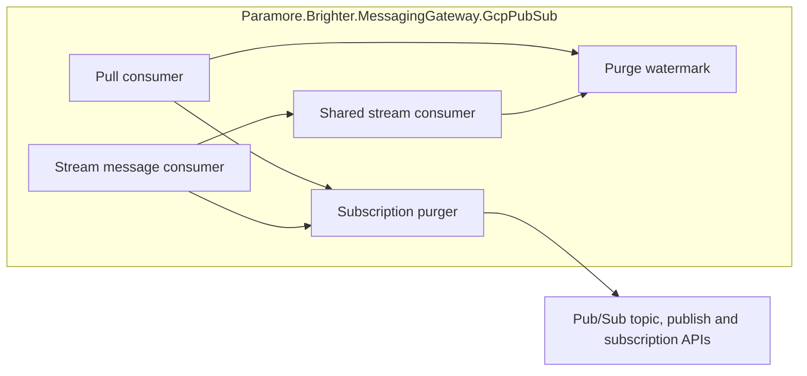

# 0085. Use a server boundary for GCP Pub/Sub purge

## Status

Proposed

## Context

Pub/Sub stamps publication times with its own clock. Seeking to the client's current time plus a margin can leave older messages available when clocks differ.
Streaming clients also hold messages outside Brighter's buffer. Draining that buffer cannot remove deliveries that arrive later.

### Terms

- **Cutoff:** a server timestamp before which messages belong to the purge.
- **Watermark:** the latest successful purge cutoff retained by a consumer.

### Scope

Parent requirement: [issue 4536](https://github.com/BrighterCommand/Brighter/issues/4536).

In scope:

- Use a server-derived cutoff for synchronous and asynchronous Pull and Stream purges.
- Acknowledge late deliveries before the cutoff without returning them to callers.
- Preserve delivery of messages published after a completed purge.

Out of scope:

- Coordinating independent processes or independently created Pull consumers.
- Recalling messages already returned to application handlers.
- Removing clock differences among Pub/Sub servers themselves.

### Late deliveries survive a buffer drain

| Location at purge | Existing Seek and drain | Required handling |
| --- | --- | --- |
| Subscription backlog | Depends on client clock | Seek to server cutoff |
| Brighter stream buffer | Drained and acknowledged | Keep existing drain |
| SDK queue or network | Can arrive after drain | Retain cutoff and filter |

### The forces

- Seek responses contain no server timestamp.
- Seek delivery is eventually consistent, so filtering must continue after the RPC succeeds.
- A sentinel on the application topic would reach unrelated subscribers and may violate the topic's schema.
- Obtaining a server boundary must not depend on freeing a saturated stream's flow-control slots.

## Decision

**Read a marker's server publication time from a temporary private topic, Seek to that cutoff, and retain a monotonic watermark for late deliveries.**

The marker uses its own temporary topic and subscription in the source subscription's project.
It never reaches application subscribers or encounters the application topic's schema, filters, or retention settings.
The marker's `PublishTime` is assigned by Pub/Sub and is directly comparable with the publication times of late deliveries.

### The mechanism, end to end

| Step | Operation | Invariant |
| --- | --- | --- |
| 1 | Create a unique private topic and subscription | Marker traffic is isolated from application topics |
| 2 | Publish a marker and retain the returned message ID | The server stamps its publication time after purge begins |
| 3 | Pull until the matching marker arrives, with a thirty-second overall deadline | The cutoff is the marker's `PublishTime`, preserving nanoseconds |
| 4 | Delete the temporary subscription and topic | Successful boundary acquisition leaves no temporary resources |
| 5 | Seek the source subscription to the cutoff | Backlog removal uses the service's clock |
| 6 | Advance the watermark and drain the stream buffer | Late arrivals remain subject to the cutoff |

Purges on one Pull consumer, or on wrappers sharing a stream consumer, run serially through cutoff acquisition, Seek and local cleanup.
Watermarks also reject backwards updates. Publication times strictly before the cutoff are discarded.
Messages published during a purge may be discarded. Callers must wait for purge completion before publishing messages that must survive it.

### Where the pieces live



### Key Components

#### The roles, and what each is responsible for

| Role | Type | Responsibilities | Responsibility classifier | Collaborators |
| --- | --- | --- | --- | --- |
| Subscription purge | GcpSubscriptionPurger | Obtain boundary, clean temporary resources, Seek | doing | SubscriberServiceApiClient, PublisherServiceApiClient |
| Purge cutoff | GcpPurgeWatermark | Advance monotonically and classify publication times | knowing, deciding | PubsubMessage |
| Stream delivery | GcpStreamConsumer | Share cutoff and drain buffered messages | doing | BrighterStreamHandler, watermark |
| Pull delivery | GcpPullMessageConsumer | Acknowledge and exclude old messages from batches | doing | SubscriberServiceApiClient, watermark |

#### Contracts

| Member | Input | Output | Error conditions |
| --- | --- | --- | --- |
| Purge / PurgeAsync | Clients, source subscription, optional cancellation | Server cutoff after successful Seek | Provisioning, marker publication/reception, cleanup or Seek failure |
| Advance | Successful cutoff | Updated watermark | None |
| Includes | Service message | Whether publication precedes cutoff | None |

#### Where each type is touched

| Assembly | Type | Change |
| --- | --- | --- |
| GCP gateway | GcpSubscriptionPurger, GcpPurgeWatermark | New internal collaborators |
| GCP gateway | Pull and Stream message consumers | Use shared purge mechanism and filter delivery |
| GCP gateway | GcpStreamConsumer, BrighterStreamHandler | Share watermark and acknowledge old callbacks |

Public constructors, message formats, rejection routing and application acknowledgement APIs remain unchanged.

### Technology Choices

#### Read the server timestamp directly

Pub/Sub supplies `PublishTime` on received messages. A marker on a private topic provides this timestamp without affecting other subscribers.
Matching the published message ID handles publication retries that leave an earlier marker copy in the temporary subscription.
Marker reception uses a monotonic elapsed-time budget and the caller's cancellation token; it does not depend on the caller's wall clock.

#### Filter at both stream entry and delivery

The callback check releases flow-control slots immediately. The read check covers a callback that passed its first check before the watermark advanced.
The local drain reads at most the initial buffer count, so continuous arrivals cannot prevent completion.
Pull filtering also handles older messages delivered while Seek propagates.

### Implementation Approach

1. Add the internal purge and watermark types in the GCP gateway assembly.
2. Route both synchronous and asynchronous purges through the boundary acquisition and Seek sequence.
3. Check the watermark in stream callbacks, stream reads and Pull responses.
4. Exercise clock skew, saturated streams, and concurrent publication with topic retention enabled through public gateway APIs.
5. Include the `GcpPubSubPurge` regression category in the existing emulator CI job, alongside Pull tests.
6. Run its non-emulator-only cases in the authenticated GCP CI job to verify the service contract.

## Consequences

### Positive

- Client clock offsets no longer determine purge correctness.
- Late arrivals are acknowledged without reaching application handlers.
- A full stream cannot prevent obtaining the boundary.

### Negative

- Each purge requires additional management and messaging RPCs and briefly consumes topic and subscription quota.
- Publishing and reading the private marker incurs normal Pub/Sub messaging charges.
- Consumers need additional IAM permissions even when their application subscription already exists.
- Purge no longer succeeds with only the permissions needed for timestamp Seek.

### Risks and Mitigations

- Grant topic/subscription creation, marker publishing/consumption, and resource deletion permissions as listed below.
- The temporary topic can briefly be unavailable to subscription creation. Bounded retries cover `NotFound` and `Unavailable`, with cancellation preserved.
- Marker reception is bounded by thirty seconds across all Pull attempts. An absent marker or missing publication time fails before Seek.
- Cleanup attempts deletion even when creation returned an error, because the server may have created the resource before its response was lost.
- Deletion treats `NotFound` as success. Each resource has a ten-second cleanup deadline independent of the caller's cancelled token.
- Cleanup errors name the resource in logs. An original failure remains primary, with cleanup errors attached as `PubSubPurgeCleanupException` in its `Data` dictionary.
- If only cleanup fails, purge throws `AggregateException` before Seek. Both deletions are attempted when subscription creation was attempted.
- A prolonged outage or a creation that finishes after a cleanup request can still leave resources requiring manual cleanup.
- Temporary subscriptions expire after one idle day. Topics do not expire automatically; a failed topic deletion requires operator cleanup using the logged resource name.
- The local emulator does not validate production IAM or all propagation behavior. The service regression cases also run in the authenticated GCP CI job.

#### Deployment requirements

This changes the permissions required by an existing `Purge` call. A principal with only subscription-consume permission can no longer perform purge.
Create permissions belong on the source subscription's project. Publish, consume, attach and delete permissions must cover the generated `brighter-purge-` resources.
No extra permission is required on the application topic, including when it belongs to another project.

Before deployment, grant the permissions below to the runtime identity and validate with that identity.
The service regressions cover private marker delivery, topic/subscription creation propagation, clock skew, saturated streams, and purge during publication on a retained application topic.
Cancellation and injected RPC failures are covered separately against the emulator.

The deployment identity needs these permissions for purge itself:

| Scope | Permissions |
| --- | --- |
| Source subscription | `pubsub.subscriptions.consume` |
| Subscription project | `pubsub.topics.create`, `pubsub.subscriptions.create` |
| Temporary subscription | `pubsub.subscriptions.consume`, `pubsub.subscriptions.delete` |
| Temporary topic | `pubsub.topics.attachSubscription`, `pubsub.topics.publish`, `pubsub.topics.delete` |

After configuring a disposable project and Application Default Credentials, the service checks can be run with:

```sh
env -u PUBSUB_EMULATOR_HOST GOOGLE_CLOUD_PROJECT=YOUR_TEST_PROJECT \
  dotnet test tests/Paramore.Brighter.Gcp.Tests/Paramore.Brighter.Gcp.Tests.csproj \
  --configuration Release --framework net10.0 \
  --filter 'Category=GcpPubSubPurge&Requires!=PubSubEmulator&Fragile!=CI'
```

These tests also create/delete their own topics and subscriptions and publish test messages; the test identity needs those fixture permissions in addition to purge permissions.
The injected-failure cases require the emulator and are excluded by the service filter.

#### Validation

On 2026-10-15, all eighteen service regression cases passed against real Pub/Sub in `brighter-pubsub-validation` using Release/net10.0.
The project contained no topics or subscriptions before the run and none after it, confirming cleanup of application fixtures and temporary purge resources.
This run used the configured validation credentials; it does not establish the permissions of a deployment's runtime identity.

All thirty-one purge regressions passed against the emulator on net9.0 and net10.0, including cancellation, lost create/publication responses, cleanup failures, and overlapping purges.
The gateway also built in Release for netstandard2.0, net8.0, net9.0, and net10.0 without warnings or errors.

## Alternatives Considered

### Increase the client-clock margin

A larger margin moves the failure threshold. It supplies no reliable cutoff for comparing late messages with the server's publication times.

### Publish a sentinel on the application topic

A sentinel on the application topic affects other subscriptions and schema constraints. The private topic avoids those effects at the cost of provisioning and publishing permissions.

### Derive a timestamp from snapshot expiry

Snapshot expiry depends on the oldest unacknowledged message. A newly created subscription on a retained topic recovered an old cutoff in local regressions.
An always-false filter passed those emulator tests, but Google's replay contract permits snapshots to contain older nonmatching messages.
That leaves the boundary dependent on snapshot/filter behavior. The marker uses the message publication timestamp directly.

### Restart the streaming client

Restarting releases SDK buffers but does not eliminate old deliveries during Seek propagation. It also changes the lifetime of a client shared by performers.

## References

- [Issue 4536](https://github.com/BrighterCommand/Brighter/issues/4536)
- [Pub/Sub snapshot lifetime and Seek consistency](https://docs.cloud.google.com/pubsub/docs/replay-overview)
- [Pub/Sub IAM requirements](https://docs.cloud.google.com/pubsub/docs/access-control)
- [Snapshot expiration contract](https://docs.cloud.google.com/pubsub/docs/reference/rest/v1/projects.snapshots)
- [Server-assigned message publication time](https://docs.cloud.google.com/pubsub/docs/reference/rest/v1/PubsubMessage)
