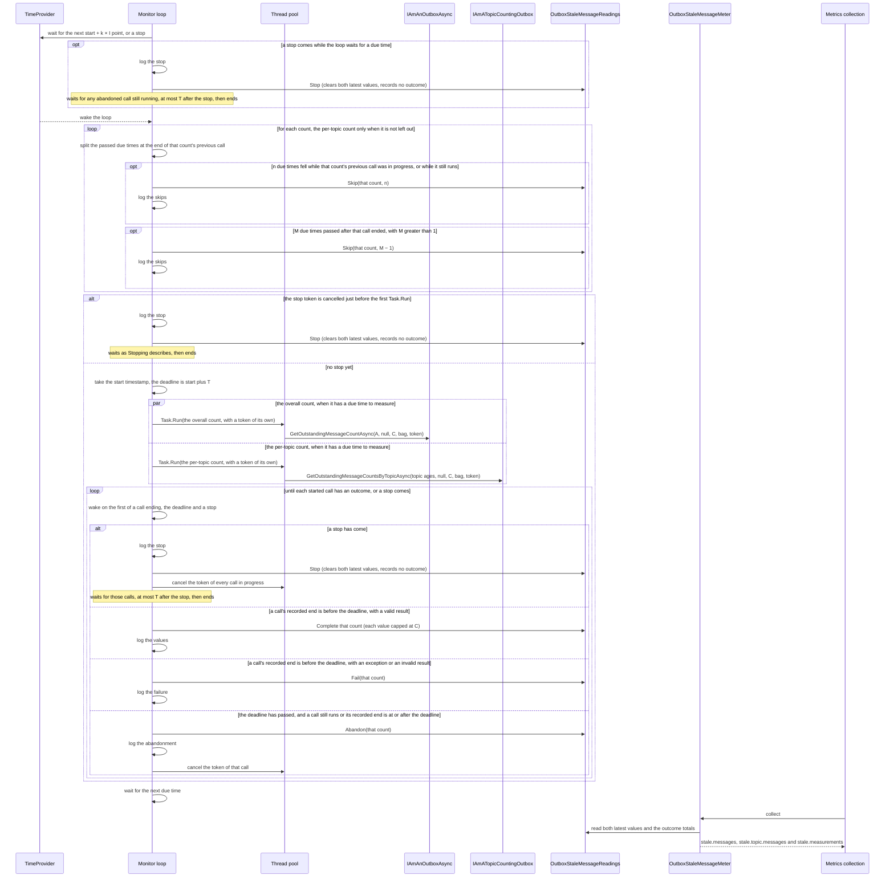
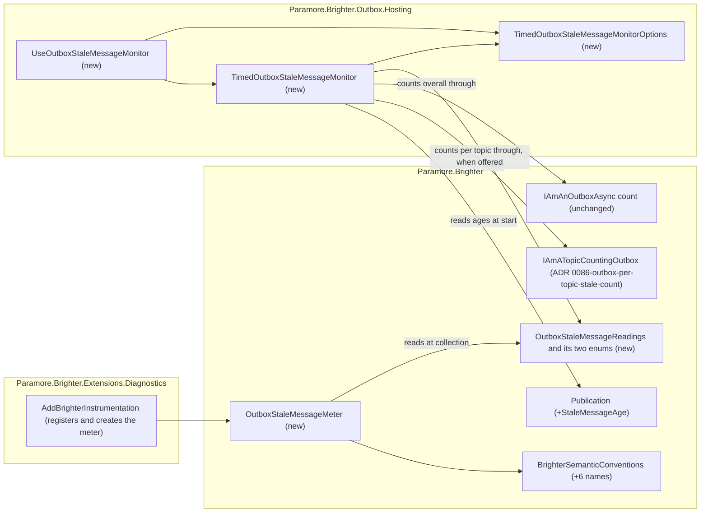

# 85. Outbox stale-message telemetry

Date: 2026-10-11

## Status

Accepted

## Context

If Brighter cannot send a message from the outbox, the message stays there undispatched, and the caller is not told. If no sweeper runs, nothing sends the message again. If a topic's circuit breaker is open, the sweeper skips that topic's messages until the breaker cools down. No metric shows that any of these messages is waiting, or on which topic. An operator therefore finds out about an unsent message from a consumer that never received it, not from a dashboard or an alert.

### Terms

The parent requirement's *Terms* table defines these words, and this ADR uses them with the same meaning:

- **stale age (A)**, **publication stale age (A_p)** and **topic age (A_t)**;
- **stale message**, **stale on topic t**, **stale count (S)** and **topic stale count (S_t)**;
- **ceiling (C)**, **reported value (V)** and **topic value (V_t)**;
- **overall count**, **per-topic count**, **measured topic** and **per-topic capability**;
- **measurement**, and its three endings: *completes*, *fails* and *is abandoned*;
- **due time**, **measurement interval (I)** and **measurement timeout (T)**.

Five more words matter below:

- **The monitor** is `TimedOutboxStaleMessageMonitor`, the hosted service that runs measurements. *Where the pieces live* places it.
- **The loop** is the monitor's one background task. It schedules every due time and decides every outcome of both counts. *The mechanism, end to end* describes it.
- **The capability** is `IAmATopicCountingOutbox`, the per-topic capability that ADR 0086-outbox-per-topic-stale-count decides. That ADR states its contract.
- **The readings** is `OutboxStaleMessageReadings`. The loop writes it and the meter reads it. Its contract is under *Key Components*.
- **Outcome** is how one count ended at one due time: `completed`, `failed`, `abandoned` or `skipped`. The decision ladder in *What one due time does* gives each count its outcome.

### Scope

**Parent requirement**: [specs/0038-outbox-stale-message-telemetry/requirements.md](../../specs/0038-outbox-stale-message-telemetry/requirements.md)

This ADR decides two things, and the second serves the first. A hosted service of its own counts the outbox's stale messages on a fixed schedule, and a meter in core publishes the results. Conformance tests check each outbox's overall count against FR-14 (a) to (c). The per-topic count goes through an optional outbox capability that ADR 0086-outbox-per-topic-stale-count decides.

This ADR and ADR 0086-outbox-per-topic-stale-count together record the answers to Q-1 to Q-16. ADR 0086-outbox-per-topic-stale-count records Q-15 and Q-16, and this ADR records the rest. This ADR also fixes the defaults and maximums that FR-2 leaves to design.

#### In scope

Each requirement below is met by the mechanism named on its bullet.

- **FR-1, off by default.** Only the new `UseOutboxStaleMessageMonitor` registers the monitor. `AddProducers`, `UseOutboxSweeper`, `UseOutboxArchiver` and `AddBrighterInstrumentation` do not register it. Only the monitor reads `Publication.StaleMessageAge`, so setting it enables nothing.
- **FR-2, validated settings.** The options type checks A, C, I and T when the registration extension runs. The monitor checks every publication's `StaleMessageAge` when it starts, and `StartAsync` throws for an invalid one. *Registration and validation timing* lists each check. *Technology Choices* sets the defaults and maximums.
- **FR-3 and FR-3.1, what each count counts.** The overall count goes through the outbox's own asynchronous count with A and C. The per-topic count goes through the capability, with each measured topic and its A_t. The monitor reads the publications once, at start, and gives each topic the smallest age of its publications. ADR 0086-outbox-per-topic-stale-count records how the capability applies the requirement's header-topic rule (Q-16).
- **FR-4, the ceiling.** The monitor passes C to both counts and caps every returned value at C. ADR 0086-outbox-per-topic-stale-count decides that the capability applies C to each topic on its own.
- **NFR-4(a) and (b), bounded calls.** Each measurement makes exactly one outbox call and never retries it. A due time makes at most two calls, one for each count. C's maximum of 1,000 bounds the overall count and each topic of the per-topic count.
- **FR-5, Q-6 and Q-7, the instruments.** `OutboxStaleMessageMeter` publishes two `ObservableGauge<long>` instruments on the `Paramore.Brighter` meter. `paramore.brighter.outbox.stale.messages` reports V. `paramore.brighter.outbox.stale.topic.messages` reports V_t, one series per measured topic.
- **FR-6 and FR-10, "no recent reading".** An observable outcome counter is the documented signal for each count. Its `paramore.brighter.outbox.stale.count` attribute names the count. Every series starts at zero when measurement starts. After a due time that does not complete, that count's gauge has no value until its next completed measurement. The loop logs each failure, abandonment and skip as soon as it records the outcome.
- **FR-7, the schedule.** The loop computes each next due time on the start + k × I grid from the `TimeProvider`, and waits for it. Both counts of a due time start when the loop handles it. When the loop wakes, it merges, for each count, the due times it missed while no call of that count was in progress.
- **FR-8, one call of each count at a time.** The loop starts no call of a count while that count's previous task is still running. That due time makes no call of that count and records `skipped` for it. The other count of the same due time is decided on its own.
- **FR-9, bounded wait, and neither count waits for the other.** The loop starts each count with its own `Task.Run`, and starts both before it waits. The deadline is T after the calls start. The loop abandons every call still running at the deadline, cancels each such call's token and ignores any later result.
- **FR-10 and FR-13, a cancellation is not a failure.** The loop records the outcome, or calls `Stop()`, before it cancels a call's token. The loop therefore never counts or logs a cancellation that it caused as a failure.
- **FR-11, independent of the sweeper.** The monitor takes no lock and never calls the sweeper or the mediator.
- **FR-12, the counts' arguments.** Both counts receive the same `args` that the outstanding-message check passes, a null `requestContext` and a cancellable token.
- **FR-12.1, without the capability or a measured topic.** At start the monitor checks whether the outbox implements the capability and whether any topic is measured. If either is missing, it logs one Information entry with the reason. The per-topic count then makes no call and has no series.
- **FR-13, stopping.** `StopAsync` cancels the loop's stop token. The loop handles the stop one asynchronous hop later, and only then cancels the token of every call in progress. Once the loop observes the stop, it starts no call and ends. *Stopping* states the one remaining window. `StopAsync` returns at the first of three events: the loop ends, T passes after the request, or the host's stop token is cancelled. The loop's hop and `StopAsync`'s own T timer each need a pool thread.
- **FR-14 columns (a) to (c), and FR-14.1 for them, outbox conformance.** The age, ceiling and cancellation tests of AC-16 and AC-17 are generic tests in `Paramore.Brighter.Base.Test`. The test generator renders them for every outbox it configures, and `InMemoryOutstandingCountOutboxTests` derives the AC-16 base by hand. Each gap is tracked in an issue of its own and listed as a known limitation of that outbox. Once step 13 has recorded a cell as a gap, that outbox's test configuration marks the cell with its issue. *Conformance tests for the overall count* describes the tests. ADR 0086-outbox-per-topic-stale-count covers column (d).
- **FR-15, attributes.** All three instruments carry a new attribute, `paramore.brighter.outbox.implementation`, set to the outbox's type name. The per-topic gauge also carries `messaging.destination.name`. The counter also carries the count and the outcome.
- **NFR-1 and NFR-2, the posting path and the check.** The monitor never calls the mediator. It shares no lock, semaphore or flag with the posting path. The posting path never reads `StaleMessageAge`.
- **NFR-3, additive API.** This ADR adds new types, one new extension method, new constants and one nullable property on `Publication`. No meter role and no outbox interface gains a member. ADR 0086-outbox-per-topic-stale-count adds the optional capability interface.
- **NFR-5, no pipeline dependency.** The monitor and the meter use `System.Diagnostics.Metrics` and `IMeterFactory` only. `AddBrighterInstrumentation` creates the meter. With no metrics configured, measurement runs and nothing throws.
- **NFR-6, testability.** All of the monitor's time comes from an injected `TimeProvider`. The listener-based tests observe the meter that `AddBrighterInstrumentation` creates, through a `MeterListener`.
- **NFR-7, documentation.** This is the last implementation step. It covers the documentation items of both ADRs.

#### Answers to the open questions

- **Q-1.** A hosted service of its own in `Paramore.Brighter.Outbox.Hosting`. *Why a hosted service of its own?* gives the reason.
- **Q-2.** No on-call trigger, and no Warning because V or a V_t is greater than 0 (alternative 13).
- **Q-3.** `StartAsync` rejects an outbox that implements only `IAmAnOutboxSync` (alternative 14).
- **Q-4.** A registration extension with options of its own, and `StaleMessageAge` on `Publication`. `IAmProducersConfiguration`, `IAmABrighterTracer` and `IAmAnOutboxProducerMediator` gain no member.
- **Q-5.** No age-aware count for the overall count (alternative 15).
- **Q-6.** Observable instruments on a sealed meter that `AddBrighterInstrumentation` creates.
- **Q-7.** Two gauges: the per-topic count has an instrument of its own (alternative 26).
- **Q-8.** No elected instance. The implementation attribute identifies the series, and the documentation says to combine instances with max (alternative 17).
- **Q-9.** The FR-14 gaps of columns (a) to (c) are tracked in separate issues.
- **Q-10.** No cancellation bound per outbox. *Why no cancellation bound per outbox?* gives the reason.
- **Q-11.** The monitor keeps querying with no listener (alternative 18).
- **Q-12.** The count's database span stays (alternative 19).
- **Q-13.** No startup warning about the sweeper's settings (alternative 20).
- **Q-14.** A topic uses the smallest age of its publications (alternative 25).
- **Q-15 and Q-16.** ADR 0086-outbox-per-topic-stale-count answers Q-15. It also records how the capability applies the requirement's header-topic rule (Q-16).

#### Out of scope

- **Closing FR-14's gaps in columns (a) to (c) (Q-9).** Separate issues will track Firestore's age, ceiling and token gaps, DynamoDB's ceiling split and read volume, and the relational and MongoDb row loading. Step 13 opens each issue as its conformance test confirms the gap. It also opens one for any "To verify" cell that proves to be a gap. No ADR covers them.
- **The per-topic capability (Q-15, Q-16, OOS-15).** ADR 0086-outbox-per-topic-stale-count decides its contract, which outboxes implement it, and the follow-up issues for the others.
- **An age-aware count for the overall count (Q-5).** NFR-4(c) stays a known limitation of the overall count for a follow-up.
- **`OutboxMeter`, from ADR 0084-outbox-metrics.** This ADR adds nothing to it (alternative 12).
- **The circuit breaker.** It does not change, and no metric reports which topics are tripped (OOS-14).
- **The requirement's OOS-1 to OOS-15.** Among them are the channel for failed `Clear` calls (OOS-1), a health check (OOS-6) and a topic age set outside `Publication` (OOS-13).
- **The sweeper.** ADR 0081-timed-outbox-sweeper-health-metrics owns its metrics. Nothing in the sweeper changes (C-4).

### Where this ADR sits

Two ADRs deliver spec 0038. Read this one first.

| ADR | Decides |
| --- | --- |
| **ADR 0085-outbox-stale-message-telemetry** *(this one)* | the monitor and its fixed schedule, the instruments that publish the counts, each publication's stale age, and the tests of the overall count |
| ADR 0086-outbox-per-topic-stale-count | the optional outbox capability that counts several topics in one call, and which outboxes offer it |

The monitor decides when each count runs, at which ages and what the meter reports, and the outbox decides only how its store counts.

### A message that is never sent stays invisible

| Where an operator might look | What it shows | Why an unsent message does not show |
| --- | --- | --- |
| The result of `PostAsync` | Nothing about the send | The mediator logs the send failure and returns false. The caller gets no error. |
| The outstanding-message check | Nothing | It counts only when `MaxOutStandingMessages` is set, and only to decide whether to throw `OutboxLimitReachedException` |
| Sweeper metrics (ADR 0081-timed-outbox-sweeper-health-metrics) | The sweeper's own health | They exist only when a sweeper runs, and they count sweeps, not messages |
| The outbox circuit breaker | Nothing outside the process | Its tripped topics live in memory. The sweeper skips their messages until the breaker cools down, and no metric names the topic that holds them |
| Outbox spans | Each outbox operation | Production sampling usually drops them |
| Outbox metrics (ADR 0084-outbox-metrics) | Messages added and cleared, and how long each cleared message waited | Added minus cleared is a count with no age, so a message about to be sent looks the same as one that never will be. Both counters restart with the process. A message added before a restart and cleared after it then pushes the difference below the real backlog (alternative 23) |

Without a sweeper, a message in a database outbox waits forever. A message in the default `InMemoryOutbox` is lost when the process stops. Neither event leaves a trace on any dashboard.

The outbox already knows most of the answer. `GetOutstandingMessageCountAsync(dispatchedSince, requestContext, maxCount, args, cancellationToken)` returns the number of undispatched messages older than an age, up to a ceiling. Every outbox in scope implements it. Today the only caller is the outstanding-message check. The check passes its own check interval as the age, and it runs only when a limit is set.

That count covers the whole outbox, at one age. Only MongoDb can narrow it, to the one topic its bag names. What is missing is a caller on a schedule, a count per topic, and an instrument for each result. ADR 0086-outbox-per-topic-stale-count decides the count per topic.

### The forces

- **The value is recorded directly (C-1).** Sampling drops spans, so a metric derived from spans (ADR 0022-generate-metrics-from-traces) would disappear exactly when it is needed. ADR 0081-timed-outbox-sweeper-health-metrics rejected span-derived health metrics for the same reason.
- **A topic can be circuit broken (FR-3.1, FR-5, Q-7).** A topic whose breaker is open holds its messages back. One count over the whole outbox cannot show which topic they belong to.
- **Measurement must not share the outstanding-message check (NFR-1).** The check's count has no timeout, and a count that never returns freezes the limit check (issue #4584). Measurement that shared the mediator's machinery would inherit that failure.
- **Some asynchronous counts block the calling thread (FR-9).** `InMemoryOutbox` computes its count synchronously and then returns a completed task. Sqlite's provider runs async methods synchronously (A-8). The code that schedules measurements therefore must never run on a thread that runs a count.
- **Neither count may wait for the other (FR-9).** A count that blocks its thread must not delay the start of the other count of the same due time, or its outcome.
- **Some outbox clients block when their token is cancelled.** `CancellationTokenSource.Cancel` runs the token's callbacks on the thread that calls it. A database client can do blocking work in such a callback, for example while it sends a cancel request to the server.
- **The schedule is a fixed grid (FR-7).** Due times are start + k × I. The loop merges missed due times into one for each count. The collection rate must not change the query rate.
- **Meter roles and outbox interfaces get no new members (NFR-3).** Issue #4573 states the rule for `IAmABrighterSweeperMeter`: it is a public role, and a new member would break every implementer. Brighter targets `netstandard2.0`, which has no default interface members. The count per topic therefore comes through an optional capability, which ADR 0086-outbox-per-topic-stale-count decides.
- **No dependency on a metrics pipeline (NFR-5).** Measurement and recording code uses only `System.Diagnostics.Metrics` and `IMeterFactory`. Measurement must work, and must not throw, when no metrics pipeline is configured.
- **Instances that share a store count the same rows (A-6).** Adding their values together overcounts, so the instruments must not be ones that backends add up by default. This holds for each topic too.
- **The sweeper stays as it is (FR-11, C-4).** Measurement must keep running while a sweep hangs, and it must not touch the sweeper's lock.
- **A count can be expensive (NFR-4).** The relational outboxes and MongoDb load up to C whole rows for the overall count. The per-topic count can read up to C entries for each measured topic. C's maximum must bound both.

## Decision

**A hosted service of its own counts stale outbox messages on a fixed schedule, and a meter in core publishes the counts and their outcomes.**

The hosted service, `TimedOutboxStaleMessageMonitor`, runs one background loop. At each due time the loop starts two counts. The overall count calls the outbox's existing asynchronous count with one age. The per-topic count calls an optional outbox capability with every measured topic and its own age. Each publication may set that age, and a topic uses the smallest age of its publications. The loop decides how each count ended, and writes the results into a small holder in core, the readings.

`AddBrighterInstrumentation` creates the meter, `OutboxStaleMessageMeter`. The meter reads the readings each time metrics are collected, and publishes on the `Paramore.Brighter` meter. An application turns the feature on with one registration step that names the stale age. The monitor never calls the mediator, never takes the sweeper's lock and never waits on the posting path. It holds no instruments, and the meter needs no knowledge of the schedule.

### The mechanism, end to end



Nine invariants follow from this sequence:

- **A collection never queries the outbox.** A collection reads memory only, so the collection rate cannot change how often the store is queried.
- **Only the loop decides.** The loop alone starts a count, decides an outcome, writes the readings and logs. It alone cancels and disposes a count's token source. One task cannot overlap with itself, so two decisions never race, and the monitor needs no atomic state. `StopAsync` and `Dispose` only signal the loop.
- **At most one call of each count is in progress.** The loop treats a call as in progress until its task ends, not until the loop stops waiting for it. Every due time at or before the end of a count's previous call is a skip for that count. An abandoned call that has not returned turns every due time into a skip for its count until it returns. At most two calls are in progress in total.
- **Neither count waits for the other.** The loop starts both counts of a due time before it waits for either. It decides each count when it next wakes after that count's task ends, whatever the other count is doing. One count's skips, failures and abandonments never change the other count's outcome.
- **Neither the loop nor the host runs outbox code.** Each count runs on a pool thread through `Task.Run`, and the loop cancels a count's token off its own thread. A count or a cancellation callback that blocks holds a pool thread. It never holds the loop, `StopAsync` or `FakeTimeProvider.Advance`.
- **The loop records the outcome, or calls `Stop()`, before it cancels.** An `OperationCanceledException` that follows belongs to a count that already has its outcome, or to a stop. The loop ignores it.
- **The outcome totals of a count equal that count's due times that have ended.** A count's due time ends when the loop records its outcome. That is at once for a skip, or when its call completes, fails or reaches the deadline. A due time that passes while a call of that count is in progress ends as a skip when the loop next wakes, within T. A due time interrupted by a stop never ends, and gets no outcome.
- **Each gauge shows only the result of its count's most recent due time that ended.** It never repeats an older value past a due time that did not complete. It never shows 0 in place of a missing reading. Neither gauge has a value after a stop.
- **The measured topics and their ages are fixed at start.** The loop passes the same topic ages at every due time, whatever the application later sets on a publication.

#### What one due time does

The loop keeps one instant for each count: the end of that count's previous call. The task records that instant as its own last step.

The deadline is FR-9's "T after a call starts". The loop takes one timestamp immediately before it starts a due time's calls. Both calls share that timestamp plus T as their deadline. After each `Advance`, the acceptance tests' synchronisation wait lets the calls due at that instant start before the fake clock moves again. In those tests the start therefore equals the due time, and the 12:01:00 calls reach their deadline at 12:01:10.

Each time it wakes, the loop splits, for each count, the due times that have passed at that instant. Row 4 takes those at or before that count's instant, and all of them while that count's previous call still runs. Row 3 merges the rest. The latest of the rest is that count's due time to measure, and it continues to rows 5 and 6.

| # | Situation | Outbox calls | Readings | Log |
| --- | --- | --- | --- | --- |
| 1 | The stop token is cancelled while the loop waits for a due time | None. The loop handles the stop as *Stopping* describes | `Stop()` | Information |
| 2 | No due time has passed since the last one handled, because the loop woke early | None. The loop waits again | None | None |
| 3 | For one count, M due times passed after the end of that count's previous call, with M greater than 1 | None for M − 1 of them | `Skip(count, M − 1)` | One Warning that names the outbox type and the count, and carries M − 1 |
| 4 | For one count, a due time passed while that count's previous call was in progress, or that call is still running | None for that count. Every such due time is skipped, never measured | `Skip(count, n)`, with n the number of such due times | One Warning that names the outbox type and the count, and carries n |
| 5 | The stop token is cancelled when the loop checks it, immediately before the first `Task.Run` | None. The loop handles the stop as *Stopping* describes | `Stop()` | Information |
| 6 | Otherwise | One call for each count that has a due time to measure, each started with `Task.Run`. The overall count starts first, and the loop starts both before it waits | The loop waits for the first of three events: a call's task ends, the deadline passes, or a stop comes. On each wake it checks row 6d first. It then decides each undecided call by rows 6a to 6c. It waits again until each call has an outcome | |
| 6a | A call's task has ended, its recorded end is before the deadline, and its result is valid | | `CompleteOverall(min(count, C))`, or `CompletePerTopic` with each requested topic's value capped at C. The loop drops topics that were not requested | Debug, with the count and its values |
| 6b | A call's task has ended, its recorded end is before the deadline, and it threw or its result is invalid | | `Fail(count)` | Warning, with the outbox type, the count and the exception |
| 6c | The deadline has passed, and a call's task still runs or its recorded end is at or after the deadline | The loop records the outcome of each such call, then cancels their tokens off its own thread | `Abandon(count)` for each such call. The loop ignores a later result or exception | Warning, with the outbox type, the count and T |
| 6d | A stop has come | The loop cancels the token of every call in progress, off its own thread, as *Stopping* describes | `Stop()`. The loop records no outcome for a call that has none | Information. Not logged as a failure |

Rows 3, 4 and 6a to 6c apply to each count separately. The per-topic count takes part only when FR-12.1 does not leave it out.

The loop writes each log entry as soon as it records the outcome that the entry reports.

The loop decides an ended call by the end timestamp its task recorded, not by when the loop reads it. A call that ended before the deadline completes or fails, even when the loop wakes after the deadline. A call still running at the deadline, or ended at or after it, is abandoned. The outcome therefore never depends on which task `Task.WhenAny` returned.

A result is invalid in these cases:

- the overall count returns a negative count;
- the per-topic call returns null;
- the per-topic result has no entry for a requested topic;
- the per-topic result has a negative value for a requested topic.

Row 6b covers every exception, `OperationCanceledException` included. In row 6b the loop has not cancelled the token, so the exception comes from the outbox itself. A timeout of the outbox's own is one example.

No row logs a Warning because V or a V_t is greater than 0. The metrics and the documented alert carry that warning (Q-2).

The loop catches any exception from its own code, such as one from a logging provider, a readings write or a bug. It logs the exception at Error and keeps running on the grid.

#### Stopping

`StopAsync` only signals and waits. The loop does the work.

`StopAsync` does three things:

1. It returns at once if the loop never started, for example because `StartAsync` threw.
2. It cancels the loop's stop token. The token's one registration completes the loop's stop task, whose continuations run asynchronously. This cancellation therefore runs no outbox code and no loop code. Each count's token comes from a separate source that is never linked to the stop token.
3. It waits for the first of three events: the loop ends, T passes after the stop request on the `TimeProvider`, or the host's stop token is cancelled.

The loop observes the stop one asynchronous hop after `StopAsync` cancels the token. It sees the stop at one of three points. The first is while it waits for a due time (row 1). The second is its check immediately before the first `Task.Run` (row 5). The third is while it waits for the calls of a due time (row 6d). After the loop observes the stop, no call starts.

One window remains. `StopAsync` can cancel the token after the check of row 5 and before the calls start. Those calls then start. The loop's next wait sees the stop at once and handles it as row 6d.

When the loop sees the stop token, it does four things:

1. It records no outcome for a call that has none, and logs the stop at Information.
2. It calls `Stop()` on the readings, which clears both latest values. The outcome totals do not change, so an export taken during shutdown carries the totals and no gauge value.
3. It cancels the token of every call in progress, of either count, off its own thread. At row 1, any call still in progress is an abandoned one, whose token is already cancelled.
4. It waits for those calls to end, at most until T after the stop request. It disposes the token source of each call whose task has ended. The loop then ends.

A count that honours its token therefore lets stopping return as soon as the call ends. A count that ignores its token holds stopping for at most T.

`Dispose` cancels the stop token in the same way, if `StopAsync` has not, and returns without waiting. It disposes nothing that the loop or a count still uses.

`HostOptions.ShutdownTimeout` controls the host's stop token. If T is longer than the time left before that timeout, the host's token ends the wait first. Stopping then still returns within T, as FR-13 requires. The default T is 10 seconds. That is well below the 30-second default `ShutdownTimeout` of current Microsoft.Extensions.Hosting versions. The documentation advises a T well below the shutdown timeout, because every hosted service shares that one budget.

### Where the pieces live



Every new dependency points into core. The monitor and the meter never refer to each other: they meet only at the readings. That holder is a plain core type with no metrics dependency. The monitor therefore works the same way with or without a metrics pipeline (NFR-5). The new `Publication` property is in core too.

The meter finds the readings only when the meter provider shares the application's container, as `services.AddOpenTelemetry().WithMetrics(...)` does. A provider built with `Sdk.CreateMeterProviderBuilder()` resolves the meter from a container of its own, which holds no readings. That setup is therefore not supported. This narrows step 3 of the requirement's Proposed Solution. These are the combinations of the two registration calls:

| `UseOutboxStaleMessageMonitor` | `AddBrighterInstrumentation` | Result |
| --- | --- | --- |
| Called | Called, on a provider that shares the application's container | Measurements run and the instruments report |
| Called | Called, on a provider from `Sdk.CreateMeterProviderBuilder()` | Not supported. That container holds no readings, and it registers no `IMeterFactory` unless the application adds one. ADR 0081-timed-outbox-sweeper-health-metrics's sweeper meter and `OutboxMeter` (ADR 0084-outbox-metrics) are resolved from the application's container too. They do not report there either |
| Called | Not called | Measurements run and the monitor writes the readings, but nothing reads them. Nothing throws (AC-24) |
| Not called | Called | No readings are registered, so the meter creates no instruments (AC-1) |
| Not called | Not called | Nothing new runs |

### Key Components

#### The roles, and what each is responsible for

| Role | Type | Responsibilities | Responsibility classifier | Collaborators |
| --- | --- | --- | --- | --- |
| Measures stale messages on a fixed schedule | `TimedOutboxStaleMessageMonitor` (Outbox.Hosting) | Knows the grid, the settings, and the measured topics and their ages. For each count, knows the call in progress and the end of its previous call. Resolves the outbox, the producers' configuration and the transaction type at start. Rejects a missing or sync-only outbox and an invalid publication age. Decides whether the per-topic count runs. Runs the loop, which decides each count's outcome, starts and cancels each call, writes the readings and logs. | knowing, doing, deciding | `IServiceScopeFactory`, `IAmAnOutbox`, `IAmProducersConfiguration`, `IAmABoxTransactionProvider`, `IAmAnOutboxAsync<Message, TTransaction>`, `IAmATopicCountingOutbox` (ADR 0086-outbox-per-topic-stale-count), `Publication`, `OutboxStaleMessageReadings`, `TimeProvider`, `TimedOutboxStaleMessageMonitorOptions` |
| Holds and checks the monitor's settings | `TimedOutboxStaleMessageMonitorOptions` (Outbox.Hosting) | Knows A, C, I and T, their defaults and their maximums. Rejects an invalid value. | knowing, deciding | `ConfigurationException` |
| Registers the monitor | `HostedServiceCollectionExtensions.UseOutboxStaleMessageMonitor` (Outbox.Hosting) | Builds and validates the options. Registers the options, the readings and the hosted service. | doing | `IBrighterBuilder` |
| Holds the latest readings and the outcome totals | `OutboxStaleMessageReadings` (Paramore.Brighter) | Knows whether measurement has started, the outbox type and whether topics are measured. Knows the latest V and the latest V_t of each topic, or that there are none. Knows four outcome totals for each count. Keeps them consistent while the loop writes and the meter reads. | knowing | written only by the loop, read by the meter |
| Publishes the stale-message instruments | `OutboxStaleMessageMeter` (Paramore.Brighter) | Owns the two gauges and the counter on the `Paramore.Brighter` meter. Maps each count and each outcome to its attribute value. | knowing, doing | `IMeterFactory`, `OutboxStaleMessageReadings`, `BrighterSemanticConventions` |
| Creates the meter with the metrics pipeline | `BrighterMetricsBuilderExtensions.AddBrighterInstrumentation` (Extensions.Diagnostics) | Registers the meter and creates it when the meter provider is built | doing | `OutboxStaleMessageMeter` |
| Carries a publication's own stale age | `Publication` (Paramore.Brighter) | Knows A_p, or that there is none | knowing | read by the monitor at start |
| Counts stale messages overall | Each outbox (unchanged) | Applies A, C and `args` to its store | doing | its store |
| Checks an outbox's overall count against FR-14 (a) and (b) | `OutstandingCountOutboxBaseTests<TTransaction>` (Paramore.Brighter.Base.Test) | Adds AC-16's nine messages, counts them and asserts the age and ceiling results. | doing | the outbox that a generated or derived class supplies |
| Checks that a count ends when its token is cancelled | `OutstandingCountCancellationOutboxBaseTests<TTransaction>` (Paramore.Brighter.Base.Test) | Runs AC-17 against the prepared store and bounds the wait. | doing | `OutstandingCountCancellationSetup<TTransaction>` |
| Holds the store for the cancellation test | `OutstandingCountCancellationSetup<TTransaction>` (Paramore.Brighter.Base.Test) | Knows the outbox, whether the store is held and the client's cancellation exception. Releases the hold and removes the store when disposed. | knowing, doing | the provider that prepares it |
| Supplies each store's parts to the generated tests | `IAmAnOutstandingCountOutboxProvider` (rendered into each outbox test project) | Creates and removes a store of its own for each case. Prepares the store for AC-17. | doing | the outbox under test and its store |

The loop decides what happened, the readings remember it, and the meter publishes it. The meter holds no schedule state, and the monitor holds no instruments. The monitor calls the per-topic capability of ADR 0086-outbox-per-topic-stale-count, which states that capability's contract and error conditions.

#### `UseOutboxStaleMessageMonitor` and `TimedOutboxStaleMessageMonitorOptions`

```csharp
namespace Paramore.Brighter.Outbox.Hosting;

public static IBrighterBuilder UseOutboxStaleMessageMonitor(
    this IBrighterBuilder brighterBuilder,
    TimeSpan staleMessageAge,
    Action<TimedOutboxStaleMessageMonitorOptions>? configure = null);

public sealed class TimedOutboxStaleMessageMonitorOptions
{
    public static readonly TimeSpan MaxStaleMessageAge;      // 365 days
    public const int MaxCountCeiling = 1000;
    public static readonly TimeSpan MaxMeasurementInterval;  // 4,294,967,294 ms

    public TimedOutboxStaleMessageMonitorOptions(TimeSpan staleMessageAge);

    public TimeSpan StaleMessageAge { get; }                                    // A, required
    public int CountCeiling { get; set; } = 100;                                // C
    public TimeSpan MeasurementInterval { get; set; } = TimeSpan.FromMinutes(1); // I
    public TimeSpan MeasurementTimeout { get; set; } = TimeSpan.FromSeconds(10); // T
}
```

The trailing comments in the sketch are annotations for this ADR. In the code, each member carries its meaning and default in its `///` documentation.

| Member | Input | Output | Error conditions |
| --- | --- | --- | --- |
| `UseOutboxStaleMessageMonitor` | The builder, A, and an optional action that sets C, I and T | The same builder | `ConfigurationException` when a value is invalid. The message names the setting and the value. Nothing is registered in that case. `ArgumentNullException` for a null builder |
| Options constructor | A | Options with the default C, I and T | None. The extension checks the value when it runs, and the monitor's constructor checks it again, after `configure` has run |
| Validation | A, C, I and T | None | A must be greater than zero and at most `MaxStaleMessageAge`. C must be from 1 to `MaxCountCeiling`. I must be greater than zero and at most `MaxMeasurementInterval`. T must be greater than zero and less than I |

A is a constructor argument, so an application cannot turn the feature on without naming it. The monitor copies the four values when it is constructed, so they do not change while measurement runs.

The first call to the extension wins. It registers the options and the readings with `TryAddSingleton`, and `AddHostedService` adds the monitor through `TryAddEnumerable`. A later call still validates its settings, but the container ignores them. This is accepted because a process measures one outbox (C-8). A second set of settings therefore has nothing else to measure. `UseOutboxSweeper` keeps its first options the same way.

#### `Publication.StaleMessageAge`

```csharp
namespace Paramore.Brighter;

public class Publication
{
    public TimeSpan? StaleMessageAge { get; set; }
}
```

| Member | Input | Output | Error conditions |
| --- | --- | --- | --- |
| `StaleMessageAge` | Null, or an age greater than zero and at most 365 days | A_p for this publication's topic. Null means the monitor's A | The setter never throws. The monitor checks the value when it starts, as *Registration and validation timing* states |

The property is the only member `Publication` gains. `Publication` is a concrete class, so code that constructs it or derives from it compiles and behaves as before (NFR-3). A value may be smaller or greater than A.

Its `///` documentation states three things. Only the stale-message monitor reads the property, once, when measurement starts. A topic uses the smallest age of its publications. The age is at most 365 days. The documentation states that bound in prose, because core cannot refer to `MaxStaleMessageAge` in `Outbox.Hosting`.

#### `TimedOutboxStaleMessageMonitor`

```csharp
namespace Paramore.Brighter.Outbox.Hosting;

public partial class TimedOutboxStaleMessageMonitor : IHostedService, IDisposable
{
    public TimedOutboxStaleMessageMonitor(
        IServiceScopeFactory serviceScopeFactory,
        OutboxStaleMessageReadings readings,
        TimedOutboxStaleMessageMonitorOptions options,
        TimeProvider? timeProvider = null);
}
```

| Member | Input | Output | Error conditions |
| --- | --- | --- | --- |
| Constructor | A scope factory, the readings, the options, and an optional clock that defaults to `TimeProvider.System` | A monitor that is not yet running | `ConfigurationException` if the options are invalid |
| `StartAsync` | Not used | A completed task. The loop is running, and the first due time is start + I | `ConfigurationException` in the cases *Registration and validation timing* lists. In each case the host does not start, and the monitor makes no call of either count |
| `StopAsync` | The host's stop token | A task that ends as *Stopping* describes | Never throws, even when the loop's task has faulted |
| `Dispose` | None | Signals a stop and returns without waiting | Never throws |

The monitor resolves its collaborators at start, not in its constructor. At start it opens a scope, because the transaction provider is often scoped. It resolves `IAmAnOutbox`, `IAmProducersConfiguration` and `IAmABoxTransactionProvider` from that scope with `GetService`. It disposes the scope before `StartAsync` returns, as `AddEventBus` does with its own. The outbox and the producers' configuration that it keeps are the container's singletons. A missing outbox or producers' configuration then becomes a `ConfigurationException` that names `AddProducers`. A required constructor parameter would instead fail with the container's `InvalidOperationException`, which does not name `AddProducers`.

`CommandProcessor.GetTransactionTypeFromTransactionProvider` gives the transaction type, or `CommittableTransaction` when no provider is registered. The monitor checks the outbox against `IAmAnOutboxAsync<Message, TTransaction>`, the same check `AddProducers` makes before it registers that interface. The monitor closes a generic helper over the transaction type once, at start. The application therefore passes no generic argument.

At start the monitor also reads the publications once, through `IAmProducersConfiguration.ProducerRegistry` and each producer's `Publication`. It builds the topic ages from them:

- it checks every publication's `StaleMessageAge`, including one with an empty topic;
- it skips a publication whose topic is null or empty;
- it gives each distinct topic the smallest age of its publications, where a publication with no `StaleMessageAge` contributes A;
- it keeps the result as a read-only map that it passes, unchanged, at every due time.

A null registry, an empty registry, or one with no non-empty topic gives zero measured topics. The monitor then checks whether the outbox instance implements `IAmATopicCountingOutbox`, as ADR 0086-outbox-per-topic-stale-count decides. If it does not, or if no topic is measured, the monitor leaves the per-topic count out (FR-12.1). It logs one Information entry that names the outbox type and the reason. When both reasons apply, the reason is the missing capability.

`StartAsync` starts the loop under `ExecutionContext.SuppressFlow`, as `TimedOutboxSweeper` starts its thread. The loop, and every count it starts, therefore carry none of the host's ambient state, such as `Activity.Current`.

#### Registration and validation timing

| Check | Made by | When | When it fails |
| --- | --- | --- | --- |
| A, C, I and T are valid | The options' validation | When `UseOutboxStaleMessageMonitor` runs, and again in the monitor's constructor | `ConfigurationException` naming the setting and the value. Nothing is registered |
| `IAmAnOutbox` and `IAmProducersConfiguration` are registered | The monitor | `StartAsync` | `ConfigurationException` naming the missing service and saying that `AddProducers` registers it |
| The outbox implements `IAmAnOutboxAsync<Message, TTransaction>` | The monitor | `StartAsync` | `ConfigurationException` saying whether the outbox is sync-only (Q-3) or implements neither interface |
| Every publication's `StaleMessageAge` is null, or greater than zero and at most `MaxStaleMessageAge` | The monitor | `StartAsync`, when it reads the publications | `ConfigurationException` naming the value and, when the topic is not empty, the topic. It surfaces from `StartAsync` and is not swallowed |
| The outbox implements `IAmATopicCountingOutbox`, and at least one topic is measured | The monitor | `StartAsync`, after the checks above | Not an error. One Information entry names the outbox type and the reason, and only the overall count runs |

No check runs during a measurement. Without `UseOutboxStaleMessageMonitor`, nothing reads `StaleMessageAge`, so an invalid value throws nothing (AC-35).

#### `OutboxStaleMessageReadings`

```csharp
namespace Paramore.Brighter.Observability;

public enum StaleMessageCount { Overall, PerTopic }

public enum StaleMeasurementOutcome { Completed, Failed, Abandoned, Skipped }

public sealed class OutboxStaleMessageReadings
{
    public void Start(string outboxType, bool measuresTopics);
    public void CompleteOverall(int staleCount);
    public void CompletePerTopic(IReadOnlyDictionary<RoutingKey, int> staleCounts);
    public void Fail(StaleMessageCount count);
    public void Abandon(StaleMessageCount count);
    public void Skip(StaleMessageCount count, int dueTimes);
    public void Stop();

    public bool IsStarted { get; }
    public string? OutboxType { get; }
    public bool MeasuresTopics { get; }
    public bool TryGetLatestOverall(out int staleCount);
    public bool TryGetLatestPerTopic(out IReadOnlyDictionary<RoutingKey, int> staleCounts);
    public long GetTotal(StaleMessageCount count, StaleMeasurementOutcome outcome);
}
```

| Member | Input | Output | Error conditions |
| --- | --- | --- | --- |
| `Start` | The outbox's type name, and whether the per-topic count runs | Marks measurement as started. Every total starts at zero, and neither count has a latest value | Never throws |
| `CompleteOverall` | V, from 0 to C | Sets the latest overall value. Adds one to the overall `Completed` total | `ArgumentOutOfRangeException` for a negative value. The monitor never passes one |
| `CompletePerTopic` | V_t for each measured topic, from 0 to C | Replaces the latest per-topic values with a copy of the map. Adds one to the per-topic `Completed` total | `ArgumentOutOfRangeException` for a negative value. `InvalidOperationException` when topics are not measured. The monitor never does either |
| `Fail`, `Abandon` | The count | Clears that count's latest value or values. Adds one to that count's matching total | Never throws |
| `Skip` | The count, and the number of due times skipped, 1 or more | Clears that count's latest value or values. Adds the number to that count's `Skipped` total | `ArgumentOutOfRangeException` for a number less than 1 |
| `Stop` | None | Clears both latest values. The totals do not change | Never throws |
| Read members | None, or the count and the outcome for `GetTotal` | A consistent view of the state | Never throw. They do no I/O and wait only on the readings' own short lock |

The loop calls the methods, and the meter reads the properties. The loop is the only writer. Each public member carries `///` documentation, and the class's `<remarks>` names the writer and the reader.

The type is public because `Outbox.Hosting` is a separate assembly that writes it, and Brighter uses no `InternalsVisibleTo`. Its XML `<remarks>` say that it is public for Brighter's own use, not as an extension point. The same holds for the two enums. It is a DI singleton, not static state, so parallel tests that build their own containers do not see each other's values.

#### `OutboxStaleMessageMeter` and its instruments

```csharp
namespace Paramore.Brighter.Observability;

public sealed class OutboxStaleMessageMeter
{
    public OutboxStaleMessageMeter(IMeterFactory meterFactory, OutboxStaleMessageReadings? readings = null);
}
```

| Instrument | Type | Unit | Attributes | What it reports |
| --- | --- | --- | --- | --- |
| `paramore.brighter.outbox.stale.messages` | `ObservableGauge<long>` | `{message}` | `paramore.brighter.outbox.implementation` | The latest V |
| `paramore.brighter.outbox.stale.topic.messages` | `ObservableGauge<long>` | `{message}` | `paramore.brighter.outbox.implementation`, `messaging.destination.name` | The latest V_t, one series per measured topic |
| `paramore.brighter.outbox.stale.measurements` | `ObservableCounter<long>` | `{measurement}` | `paramore.brighter.outbox.implementation`, `paramore.brighter.outbox.stale.count`, `paramore.brighter.outbox.stale.outcome` | Due times by count and outcome since measurement started. Each of `completed`, `failed`, `abandoned` and `skipped` is reported from start, at zero, for each count that runs |

The count attribute is `overall` or `per_topic`. It carries no topic, so a per-topic outcome covers all measured topics together (FR-6, FR-15).

Each count behaves the same way in its own instruments:

| Situation, for one count | Gauge of that count | Counter series of that count |
| --- | --- | --- |
| Feature not enabled, or the readings not started | No series | No series |
| The per-topic count is left out (FR-12.1) | No per-topic series | No `per_topic` series |
| Started, and no measurement of that count has completed yet | No series | Four series, and `completed` is 0 |
| That count's last due time completed | V, or one V_t for each measured topic | `completed` has increased |
| That count's last due time failed, was abandoned or was skipped | No series | The matching outcome has increased |
| Stopped | No series | The totals as they were at the stop |

These states can be told apart from metrics alone, for each count (FR-6):

- "No recent reading" means `completed` for that count has not increased for more than about I + T. This is the documented signal, because it does not depend on how a backend shows a gauge that stops reporting.
- "No success since start" means `completed` for that count is 0 while its counter series exists.
- "Per-topic count left out" means the `overall` counter series exist and no `per_topic` series does.
- "Feature disabled" means no instrument has a series.

If no readings are registered, the constructor creates no instruments. `AddBrighterInstrumentation` registers the meter with `TryAddSingleton<OutboxStaleMessageMeter>()`. That registration relies on the container passing the default value for an optional parameter whose service is not registered. The optional `meter` parameter of `TimedOutboxSweeper` already relies on the same behaviour. The meter's own unit tests construct it directly, as the `PublishConfirmationMeter` test does. The listener-based ACs build it through `AddBrighterInstrumentation` instead, as *Implementation Approach* describes.

#### Conformance tests for the overall count

The outbox tests that every store shares are rendered from Liquid templates by the test generator (ADR 0035-generated-test). A generated file is never edited by hand (`.agent_instructions/generated_tests.md`). The AC-16 test is proven first on `InMemoryOutbox`, which needs no external store. `InMemoryOutbox` already has the overall count, so the first step is two generic tests in `Paramore.Brighter.Base.Test` and the in-memory class for AC-16. A new suite of templates then renders both tests for every outbox the generator configures. The generic tests hold the messages, the counts and the assertions. What differs per store goes in the provider class that each outbox's test project already writes by hand.

```csharp
namespace Paramore.Brighter.Base.Test.Outbox;

public abstract class OutstandingCountOutboxBaseTests<TTransaction> : IDisposable
{
    protected abstract IAmAnOutboxAsync<Message, TTransaction> Outbox { get; }
    protected virtual TimeSpan ReadConsistencyTimeout => TimeSpan.Zero;
    protected virtual void CreateStore() { }
    protected virtual void DeleteStore() { }
    protected abstract Task AddMessageWithAgeAsync(Message message, TimeSpan age);
    protected virtual void BeforeCount() { }

    protected Task AssertAgeAsync();
    protected Task AssertCeilingOfThreeAsync();
    protected Task AssertCeilingOfFiveAsync();
    protected Task<string> ObserveCountAsync(int maxCount);
}

public abstract class OutstandingCountCancellationOutboxBaseTests<TTransaction>
{
    protected abstract Task<OutstandingCountCancellationSetup<TTransaction>> PrepareStoreAsync(TimeSpan holdFor);

    protected Task AssertCancellationEndsTheCountAsync();
}

public sealed class OutstandingCountCancellationSetup<TTransaction> : IAsyncDisposable
{
    public OutstandingCountCancellationSetup(
        IAmAnOutboxAsync<Message, TTransaction> outbox,
        bool storeHeld,
        Type? clientCancellationException,
        Func<ValueTask> release);

    public IAmAnOutboxAsync<Message, TTransaction> Outbox { get; }
    public bool StoreHeld { get; }
    public Type? ClientCancellationException { get; }
    public ValueTask DisposeAsync();
}
```

| Member | Input | Output | Error conditions |
| --- | --- | --- | --- |
| `Outbox` | None | The asynchronous outbox under test, over a store that no other test writes to. The cases call the asynchronous count, as the monitor does | None |
| `ReadConsistencyTimeout` | None | How long a case may retry a count against an eventually consistent index. Zero by default, which means one call | None |
| `CreateStore`, `DeleteStore` | None | Create and remove the store around each case, as in `CausationTrackingOutboxBaseTests` | None |
| `AddMessageWithAgeAsync` | A message and an age | The message is in the outbox, undispatched. It is at least that age old on the outbox's own clock when the case counts. It is older only by the time the case takes to reach the count | An exception fails the case |
| `BeforeCount` | None | The outbox's clock is ready for the count. A case calls it once, after the adds and before the first count. It does nothing by default | None |
| `AssertAgeAsync`, `AssertCeilingOfThreeAsync`, `AssertCeilingOfFiveAsync` | None | Each case adds AC-16's nine messages, oldest first, and then counts with A of 5 minutes. It asserts 5 for C of 100, 3 for C of 3, or 5 for C of 5 | Fails when the count still differs after `ReadConsistencyTimeout` |
| `ObserveCountAsync` | C | Adds the nine messages, counts once with A of 5 minutes, and returns the result, or the exception, as text | Asserts nothing. An exception while adding fails the case |
| `PrepareStoreAsync` | How long to hold the store, at least 30 seconds | A setup over an outbox, which says whether the store is held | An exception fails the case |
| `AssertCancellationEndsTheCountAsync` | None | Runs AC-17 against the setup, as the flow below describes | Fails as the flow below describes |
| `OutstandingCountCancellationSetup` | The outbox, whether the store is held, the client's cancellation exception or null, and the release | Disposing it releases the hold and then removes the store. The hold also ends on its own after the time asked for | `DisposeAsync` never throws |

The AC-16 base class follows `CausationTrackingOutboxBaseTests` in its store hooks and `ReadConsistencyTimeout`. Unlike that class, neither base class declares a `[Fact]`. The suite's templates declare the facts, one for each case, because a gap mark acts on one column of one outbox. AC-17 leaves `InMemoryOutbox` out, so AC-17 has a base class of its own and the in-memory class derives only the AC-16 base.

Each case adds AC-16's two dispatched messages and then marks them with `MarkDispatchedAsync`. AC-16 sets `Header.TimeStamp` relative to the outbox's own clock. No provider sets a clock on its outbox. The outboxes and configurations that take a `TimeProvider` default to `TimeProvider.System`. The template therefore sets the time stamps relative to the system clock. `InMemoryOutstandingCountOutboxTests`, in `Paramore.Brighter.InMemory.Tests`, derives from the AC-16 base by hand and declares its own facts. It uses a `FakeTimeProvider` as ADR 0086-outbox-per-topic-stale-count describes for its in-memory class, and advances the clock in `BeforeCount`.

`OutboxConfiguration` gains two settings for the suite:

- `OutstandingCountReadConsistencyTimeoutInMilliseconds`, 0 by default. DynamoDB and DynamoDB V4 set it to 10000, AC-16's 10 seconds. It is not the existing `ReadConsistencyTimeoutInMilliseconds`, which they set to 30000 for the causation suite.
- `OutstandingCountBelowScanConcurrency`, false by default. When it is true, the template renders two more facts, for C of 1 and C of 2. Each writes the text from `ObserveCountAsync` to the test output, for step 13 to record. DynamoDB and DynamoDB V4 set it to true, because their providers build the outbox with the default `ScanConcurrency` of 3.

`AssertCancellationEndsTheCountAsync` runs AC-17 in this order:

1. It calls `PrepareStoreAsync` with 30 seconds.
2. It starts the count with `Task.Run`, so a count that runs synchronously, as Sqlite's does (A-8), cannot block the test's thread. If the store is not held, it cancels the token before this call.
3. If the store is held, it cancels the token 1 second after the count starts.
4. It waits for the count with `Task.WhenAny`, against a delay of the 1 second before the cancellation, AC-17's 5 seconds, and a margin. This bounds the wait, as ADR 0066-conformance-test-provider-and-ungating bounds its read members, so an outbox that ignores the token fails the case instead of hanging it.
5. It asserts that the count ended with `OperationCanceledException`, or with the setup's client exception, within 5 seconds of the cancellation.
6. In a `finally` block, it disposes the setup, which releases the store, and then waits for the count with the same bound.

A token cancelled before the call proves only that the outbox checks the token before it calls the store. AC-17 therefore adds a review that the token reaches the client. Step 13 records that review in the outbox's FR-14 (c) cell, with the file and the line that pass the token.

| Outbox | How the setup holds the store |
| --- | --- |
| MsSql, PostgreSql, MySql | A second connection takes an exclusive lock on the outbox's table, in a mode that blocks a plain read. No mode is named here, because the mode that blocks a read differs by database |
| Sqlite | Sqlite has no table lock, so AC-17's exclusive lock becomes a lock on the database. The setup creates a database file of its own in the `DELETE` journal mode, and a second connection holds it with `BEGIN EXCLUSIVE`. In WAL mode a writer does not block readers |
| DynamoDB, DynamoDB V4 | Not held, because DynamoDB Local cannot be held. As AC-17 requires, the setup constructs its configuration with `timeout: 0` and builds an outbox of its own from that configuration |
| MongoDb, Spanner | Not held |
| Firestore | Not held. FR-14 records its column (c) as a Gap, so its fact carries a gap mark once step 13 has recorded the result |

AC-16 counts every undispatched message in the store, so the store must hold only the case's nine messages. The MsSql, PostgreSql, MySql, Sqlite, MongoDb and Spanner providers already create a table or a collection for each test. The DynamoDB providers share one table, and the Firestore provider shares one collection. The suite therefore asks each provider for a store of its own. The DynamoDB providers create a table for each case and delete it afterwards, as their tests for tripped topics already do. The Firestore provider creates a collection with a unique name for each case, and deletes its documents afterwards.

The suite is the fourth that `OutboxGenerator.SuitesFor` yields, beside the Sync, Async and Causation suites, with its templates in `Templates/Outbox/OutstandingCount/`. It renders `IAmAnOutstandingCountOutboxProvider` into the suite's folder of each outbox test project, as the Sync and Async suites render their provider interfaces:

| Member | Input | Output | Error conditions |
| --- | --- | --- | --- |
| `CreateOutstandingCountStore` | None | Creates a store that no other test writes to, and returns an asynchronous outbox over it | An exception fails the case |
| `DeleteOutstandingCountStore` | None | Removes that store | Never throws |
| `PrepareCancellationAsync` | How long to hold the store | The setup, over a store of its own that no other test writes to, as the table above describes for each outbox | An exception fails the case |

Each outbox's provider class implements `IAmAnOutstandingCountOutboxProvider`, beside `IAmAnOutboxProviderSync` and `IAmAnOutboxProviderAsync`. The generated test classes derive from the base classes, as the causation template does. They override `Outbox`, the store hooks and `PrepareStoreAsync` with calls to the provider. `SuitesFor` gives the suite no `SkipTest` filter, so the generator renders each of the suite's templates for every outbox, whatever the template's name. ADR 0066-conformance-test-provider-and-ungating does not rely on names either, because a `SkipTest` matches parts of file names.

`OutboxConfiguration` also gains three gap marks, empty by default: `OutstandingCountAgeGap`, `OutstandingCountCeilingGap` and `OutstandingCountCancellationGap`. Each holds the issue number of one FR-14 cell: (a) for the age fact, (b) for both ceiling facts and (c) for the cancellation fact. When a mark is set, the template renders that column's facts with `Skip = "Deferred: #<n> ..."` and a fixed reason for the column. The FR-14 table stays the source of truth, and each project's `test-configuration.json` mirrors it. Step 13 sets a mark only after it has run the column's facts with no mark, recorded the result and opened the issue.

`Deferred: #<n>` is the form that `GatewaySkipConventionAudit` requires of a messaging-gateway Skip (ADR 0067-conformance-rollout-and-deferral-governance). Both that audit and `LedgerSkipCrossCheckAudit` scan every `Generated` folder under `tests/`, through `GatewaySkipConventionAudit.EnumerateGatewayArtifacts`. An outbox Skip would therefore fail `LedgerSkipCrossCheckAudit`, which matches each Skip to a deferred row of the gateway ledger. Before the first mark, step 13 restricts that scan to the messaging-gateway folders, test first. The rule in the summary of `GatewaySkipConventionAudit` names only messaging-gateway artifacts, so the restricted scan matches that rule. After that, no audit checks the outbox marks. The FR-14 table and step 13 keep each mark in step with its issue.

The `gcp-ci` job leaves out the Spanner tests, and it does not run for a pull request from a fork. Step 13 therefore runs the Spanner and Firestore facts by hand, each against its emulator. `FirestoreClientBuilder` has no public `EmulatorDetection` setting like the one the Spanner providers put in their connection strings. When `FIRESTORE_EMULATOR_HOST` is set, the Firestore provider therefore sets a `Configure` action on the `FirestoreConfiguration` it builds for each case. The action clears the builder's `Credential`, because the builder takes only one source of credentials. The action then sets `Endpoint` to the value of `FIRESTORE_EMULATOR_HOST` and `ChannelCredentials` to `ChannelCredentials.Insecure`. With the variable unset, as in `gcp-ci`, the Firestore facts still connect to a Google Cloud project.

The Firestore gaps in columns (a) to (c) of FR-14 come from the outbox's code, not from the store. A run against the Firestore emulator therefore shows those gaps. The `gcp-ci` job runs the Firestore tests on every push to master, so step 13 sets the Firestore gap marks before the merge.

#### Where each type is touched

| Assembly | Type | Change |
| --- | --- | --- |
| Paramore.Brighter | `BrighterSemanticConventions` | Six new constants beside the outbox names of ADR 0084-outbox-metrics: `OutboxStaleMessages`, `OutboxStaleTopicMessages`, `OutboxStaleMeasurements`, `OutboxStaleCount`, `OutboxStaleOutcome` and `OutboxImplementation` (`paramore.brighter.outbox.implementation`) |
| Paramore.Brighter | `Publication` | One new nullable property, `StaleMessageAge` |
| Paramore.Brighter | `OutboxStaleMessageReadings`, `StaleMessageCount`, `StaleMeasurementOutcome` | New, in `Observability/` |
| Paramore.Brighter | `OutboxStaleMessageMeter` | New, sealed, modelled on `PublishConfirmationMeter` |
| Paramore.Brighter.Outbox.Hosting | `TimedOutboxStaleMessageMonitor`, `TimedOutboxStaleMessageMonitorOptions` | New |
| Paramore.Brighter.Outbox.Hosting | `HostedServiceCollectionExtensions` | New `UseOutboxStaleMessageMonitor`, beside `UseOutboxArchiver` |
| Paramore.Brighter.Extensions.Diagnostics | `BrighterMetricsBuilderExtensions` | Registers the meter beside `PublishConfirmationMeter`, and creates it in the same deferred `Configure` |
| Paramore.Brighter.Base.Test | `OutstandingCountOutboxBaseTests<TTransaction>`, `OutstandingCountCancellationOutboxBaseTests<TTransaction>`, `OutstandingCountCancellationSetup<TTransaction>` | New, beside `CausationTrackingOutboxBaseTests` |
| Paramore.Brighter.InMemory.Tests | `InMemoryOutstandingCountOutboxTests` | New, derived from the AC-16 base by hand, as `InMemoryCausationTrackingOutboxTests` is |
| Paramore.Brighter.Test.Generator | `OutboxConfiguration`, `OutboxGenerator` | Two new settings and three gap marks. A fourth suite in `SuitesFor`, with no `SkipTest` filter and its templates in `Templates/Outbox/OutstandingCount/`. The comments that name the Sync, Async and Causation suites name the fourth too. `.agent_instructions/generated_tests.md` and the generator's `README.md` describe it |
| Paramore.Brighter.Test.Generator.Tests | The generator's tests, `GatewaySkipConventionAudit` | Tests for the new suite and its gap marks. The collection test gains the new suite, and its filter also leaves out `IAmAnOutstandingCountOutboxProvider`, as it leaves out the Sync and Async provider interfaces. The scan that both audits share covers only the messaging-gateway folders |
| Each outbox's test project | Its outbox provider class, and `test-configuration.json` | The provider implements `IAmAnOutstandingCountOutboxProvider`. The configuration sets the suite's settings and, after step 13, its gap marks. The generated files are regenerated |

ADR 0086-outbox-per-topic-stale-count adds `IAmATopicCountingOutbox` and implements it on `InMemoryOutbox`.

The following stay unchanged:

- `OutboxProducerMediator` and its outstanding-message check. The monitor never calls the mediator, so NFR-2 holds by construction.
- Every outbox's overall count. FR-14's gaps in columns (a) to (c) are closed through separate issues (Q-9).
- `IAmAnOutbox`, `IAmAnOutboxSync` and `IAmAnOutboxAsync` (NFR-3).
- `IAmAProducerRegistry`, `ProducerRegistry`, `IAmAMessageProducer` and every `Publication` member other than the new one.
- `IAmAnOutboxCircuitBreaker` and its implementations. The monitor passes no tripped topics to either count.
- `IAmProducersConfiguration`, `ProducersConfiguration`, `IAmABrighterTracer` and `IAmAnOutboxProducerMediator` (Q-4).
- `IAmABrighterMessagingMeter`, `IAmABrighterDbMeter`, `IAmABrighterSweeperMeter`, `SweeperMeter`, `PublishConfirmationMeter`, `IAmABrighterOutboxMeter` and `OutboxMeter` (NFR-3).
- `TimedOutboxSweeper`, `TimedOutboxSweeperOptions` and the sweeper's lock resource, together with `TimedOutboxArchiver` (C-4).
- `BrighterMetricsFromTracesProcessor` and `InstrumentationOptions`. The instruments do not go through spans.
- `BrighterSemanticConventions.OutboxType` and its `sync` and `async` values on outbox spans, and `BoxDbOperation`.
- `CommandProcessor.GetTransactionTypeFromTransactionProvider`, which the monitor calls as it is.
- Both `AddProducers` overloads. The monitor resolves only what they already register.

### Technology Choices

#### Why a hosted service of its own?

The monitor is a timed background job with its own reason to change, like `TimedOutboxArchiver`. ADR 0021-move-archive-from-esb moved archiving out of the mediator for that reason. In the mediator, a timer would sit beside the outstanding-message check and the posting path, which is exactly what NFR-1 rules out. In `TimedOutboxSweeper`, measurement would stop whenever a sweep hangs. ADR 0081-timed-outbox-sweeper-health-metrics records that a hung sweep is the case its metrics cannot show. A hosted service of its own keeps measurement running while the sweeper or the posting path is stuck. In that state the stale counts are the signals that still report.

#### Why one loop that computes the grid?

The loop keeps the start as a `TimeProvider` timestamp, as the sweeper does, and measures elapsed time rather than wall-clock time. Each time it wakes, it computes which grid points have passed since the last one it handled. For each count it records as skipped every grid point at or before the end of that count's previous call. Of the rest, it runs at most one measurement of that count and records the others as skipped. It then waits for the next start + k × I point. The merging therefore follows from arithmetic the code states. AC-8 requires a review against that rule, because a fake clock cannot produce a missed due time.

One loop also keeps the concurrency simple. The loop is the only code that decides an outcome, and one task cannot overlap with itself. Timer callbacks can overlap. An outcome decided from several callbacks needs an atomic state machine to stay correct (alternative 5).

The second count adds per-count state, not a second loop. The loop keeps one grid, one stop path and one writer of the readings. Both counts of a due time therefore start at the same grid point, and one stop handles both (alternative 29).

The loop waits through one helper over `TimeProvider.CreateTimer`, the same on every target. The helper completes a task whose continuations run asynchronously. The stop task is a `TaskCompletionSource` with `RunContinuationsAsynchronously`, completed from the stop token's registration. After each `Task.WhenAny` returns, the loop yields. It uses `Task.Yield` on netstandard2.0 and `ConfigureAwaitOptions.ForceYielding` on net8.0 and later. With these three conditions, the loop never runs inside a timer callback or `FakeTimeProvider.Advance`. It also never runs on a count's completing thread, inside `StopAsync` or inside `Dispose`.

The monitor implements `IHostedService` itself, as the sweeper does, rather than deriving from `BackgroundService`. It needs the loop started under `ExecutionContext.SuppressFlow`, and a stop wait bounded by T as well as by the host's token. With its own `StartAsync` and `StopAsync`, the monitor states both in its own code.

#### Why start each count with its own `Task.Run`?

A count can block its thread before it returns a task (FR-9). If the loop called the outbox directly, such a count would hold the loop. It would also hold the start of the other count of the same due time. With a fake clock it would hold `Advance` too, which AC-11 forbids.

`Task.Run` queues each call to a pool thread and returns at once. The loop starts the overall count, then the per-topic count, and only then waits. A count that blocks its pool thread therefore delays neither the other count's start nor its outcome (AC-36, AC-37). FR-8 means at most two pool threads are ever held by counts that block, one for each count.

`TimedOutboxSweeper` uses a dedicated thread because a late sweep leaves messages unsent (issue #4560). A late measurement only delays a reading, and the delay is itself visible: `completed` stops increasing. That is the alert. The counts are also asynchronous I/O. A dedicated thread would have to block on them, or run an async context of its own.

#### Why cancel a count's token off the loop's thread?

`Cancel` runs the token's callbacks on the calling thread, and an outbox's client can block in such a callback. If the loop called `Cancel`, the callback could hold the loop past the T bound, and with it the other count. If `StopAsync` called it, the callback could hold the host's stop.

The loop therefore cancels each count's token without running its callbacks itself:

- on net8.0, net9.0 and net10.0 it calls `CancelAsync`, which marks the token cancelled at once and runs the callbacks on a pool thread;
- on netstandard2.0, which has no `CancelAsync`, it queues `Cancel` to the thread pool.

The loop does not wait for either to finish. It observes the exception of the work it started, so a callback that throws raises no unobserved task exception. Only the loop cancels a count's token source. The loop disposes the source when it next sees that the count's task has ended, at a wake or at the stop. The count's continuation only observes the count's exception.

#### Why the smallest age when publications share a topic?

Several publications can share a topic, because the producer registry is keyed by topic and CloudEvents type. The circuit breaker trips a topic, not a publication. The per-topic count therefore cannot tell the publications of one topic apart, and the topic needs one age.

The smallest age makes the topic show at the earliest alert any of its publications asks for. A publication that set a short age did so to hear early about held messages. The largest age would silence that request whenever another publication on the topic set a longer one (alternative 25). The cost is an earlier alert for the publications that set a longer age. The documentation says a topic uses the smallest age of its publications.

#### Why an age on `Publication`?

The age belongs to what the application publishes, and `Publication` is where Brighter keeps producer settings for one topic. A topic can be circuit broken, and its messages then wait while other topics flow. An age on each publication lets the per-topic count report that topic at the age its publications ask for (FR-3.1, FR-5, Q-7). OOS-13 excludes an age per topic set anywhere else, such as the monitor's options (alternative 28).

`Publication` is a concrete class, so a new nullable property breaks no one (NFR-3). The monitor reads it once, at start, through the producer registry. The posting path never reads it (NFR-1). The monitor copies the ages at start, so a later change to a publication does not change measurement (AC-39).

#### Why a second gauge, not a topic attribute on the overall gauge?

The overall value is not the sum of the topic values. A topic can have a smaller age than A, and some topics in the store have no publication in this process. A topic attribute on one gauge would make a sum over that gauge mix the two counts. Two instruments keep each aggregation correct (alternative 26).

The per-topic gauge carries `messaging.destination.name`, as `OutboxMeter` tags its instruments. An operator can then join it with the outbox metrics of ADR 0084-outbox-metrics. It has one series per measured topic, fixed at start, so its series do not grow while measurement runs.

#### Why does the monitor write a holder instead of recording on instruments?

A synchronous instrument needs a reference from the monitor to the object that owns it. If the meter owns it, that reference is either a meter role interface or the concrete meter class. This ADR adds no meter role (NFR-3). The concrete class is registered only by `AddBrighterInstrumentation`. The monitor would therefore hold a nullable reference, or a null object for a class that has no interface. The monitor could own the instruments itself instead, which alternative 8 rejects. With a holder, the monitor needs neither, and it works the same way with or without metrics.

The cost is that the outcome counter is observable, not synchronous like ADR 0081-timed-outbox-sweeper-health-metrics's `sweeps` counter. An observable counter reports a cumulative total. An OpenTelemetry exporter produces the same data point from a synchronous counter with cumulative temporality. For delta exporters, the SDK computes the deltas in both cases. The totals start at zero when measurement starts, so a backend's increase function works from the first collection.

#### Why observable gauges, when `PublishConfirmationMeter` uses an up-down counter?

OpenTelemetry treats an up-down counter as additive, so backends add its series together by default. That is correct for `PublishConfirmationMeter`, because each producer's queue is separate and the depths add up. Here, instances that share a store count the same rows (A-6), and a sum overcounts. A gauge is non-additive by kind, so a backend does not add it up by default. The documentation tells operators to combine instances with max, per topic for the per-topic gauge. The counter, by contrast, is correctly added across instances, because each instance counts only its own due times.

#### Why does a gauge stop reporting after a due time that did not complete?

FR-6 forbids reporting a value that no completed measurement produced, and it forbids reporting 0 in place of a missing reading. Repeating an older value while the store fails would satisfy the first rule. It would still show a dashboard reader a number that is several intervals old as if it were current. The outcome counter alone satisfies FR-6, and it is the documented "no recent reading" signal. Clearing the gauge is a second, weaker signal. A pull backend that marks a missing series as stale shows a gap. A push pipeline without staleness markers keeps showing the last value. Stopping clears both gauges for the same reason, because no later measurement will follow the last values.

A per-topic measurement that does not complete clears every topic's series together. The per-topic call answers all topics at once, so no topic has a fresher value than the others.

#### Why these defaults and maximums?

| Setting | Default | Maximum | Reason |
| --- | --- | --- | --- |
| A | None. It is required | 365 days | Longer than any useful staleness threshold, and far from where any outbox's `now - A` could overflow (FR-2). The same bound applies to `Publication.StaleMessageAge` and to the capability's ages (ADR 0086-outbox-per-topic-stale-count) |
| A_p | None. Null means A | 365 days, as A | The same overflow bound applies to each topic's age |
| C | 100 | 1,000 | The default equals the mediator's default count ceiling and the count interface's default `maxCount`. The maximum bounds the rows a relational or MongoDb count loads each interval (NFR-4). It also bounds the entries the per-topic call reads for each topic. Above 1,000 stale messages the alert has long since fired, and a value equal to C already means "C or more" |
| I | 1 minute | 4,294,967,294 ms | Two bounded queries per minute per instance is a small query load. The row loading of NFR-4(c) is the exception, under Negative. Alerting at minute granularity matches an A measured in minutes (A-2). The maximum is the largest period a .NET timer accepts (FR-2) |
| T | 10 seconds | Less than I | A count that starts on time reaches its outcome before the next due time. Ten seconds is long enough for a count of at most C rows, or C entries per topic, on a healthy store. It is well below Spanner's 60-second command timeout, and well below the 30-second default host shutdown timeout, which every hosted service shares. An I of 10 seconds or less therefore needs an explicit T |

An application that only needs "is any message stale" can set C to 1. That is the cheapest count for the relational outboxes and MongoDb, and the cheapest per-topic call.

#### Why a new `paramore.brighter.outbox.implementation` attribute?

FR-15 needs a fixed attribute set, with one overall series per process. Each process measures one outbox (C-8), so the outbox's CLR type name, such as `MsSqlOutbox`, identifies the series. A table or collection name would add a value that differs per deployment but adds no information within one process. The documentation tells operators to combine instances with max. No instance is elected, because an election would need a lock, which FR-11 keeps measurement away from (Q-8).

The existing `paramore.brighter.outbox.type` key cannot carry the type name. On outbox spans it carries the write mode, `sync` or `async`. The new key follows ADR 0010-brighter-semantic-conventions's `paramore.brighter.` naming, and C-5 adds it to `BrighterSemanticConventions`.

#### Why keep querying with no listener, and keep the counts' spans?

The monitor does not check whether a listener is subscribed (Q-11). A check on `Instrument.Enabled` changes with the pipeline's state. The query load would then depend on telemetry configuration, against the intent of FR-7. The Warning logs also stay useful without metrics.

The monitor leaves each count's own database span as it is (Q-12). The monitor passes a null request context, and the loop carries no ambient `Activity`. Where a tracer is configured, each measurement may therefore start a new trace. Suppressing that span would need a new member on `IAmABrighterTracer`, or an ambient flag that every outbox honours. Q-4 and NFR-3 rule out both. The spans are sampled like any other span. The documentation describes them.

#### Why no cancellation bound per outbox?

The monitor never depends on an outbox honouring its token (FR-9). The loop stops waiting at the deadline whatever the outbox does. Honouring the token is best effort (Q-10). AC-17's 5 seconds is a test tolerance, not a contract.

#### Why these instrument names?

ADR 0084-outbox-metrics names its outbox instruments with the noun as its own dotted segment, as in `paramore.brighter.outbox.added.messages`. The instruments here follow it, so an operator sees one naming shape under `paramore.brighter.outbox.`:

- `paramore.brighter.outbox.stale.messages` for the overall count;
- `paramore.brighter.outbox.stale.topic.messages` for the per-topic count, which keeps the same noun and adds the `topic` segment;
- `paramore.brighter.outbox.stale.measurements` for the outcome counter.

The outcome key, `paramore.brighter.outbox.stale.outcome`, ends in `outcome` as the sweeper's `paramore.brighter.outbox_sweeper.outcome` does. The count key, `paramore.brighter.outbox.stale.count`, takes the values `overall` and `per_topic`, the requirement's names for the two counts. All five names share the `paramore.brighter.outbox.stale.` prefix. FR-5's `stale_messages` was a working name.

#### Why generated tests with a provider hook?

Brighter renders the outbox tests that every store shares, and a generated test changes only through its template (`.agent_instructions/generated_tests.md`). The overall count's tests are shared by every store, so they are rendered too. A test copied into each outbox's project would drift, the hazard that ADR 0073-gateway-channel-factory-type-regression-guard names for near-identical tests across test projects. Holding a store, though, cannot be written once in Liquid, because each database is held in its own way. Each outbox's test project already writes its provider class by hand, so the suite reaches the per-store parts through one interface on that class. The facts stay in the suite's templates, and the messages and the assertions in the base classes. Alternatives 30 to 34 record the shapes this ADR does not take.

### Implementation Approach

Line numbers refer to commit 1ce331eb2.

The steps are in commit order, structural changes before the behavioural ones that use them. Each behavioural step is test first, with `FakeTimeProvider` driving time (NFR-6, AC-25). The monitor and meter tests go in a new folder, `tests/Paramore.Brighter.Core.Tests/Observability/StaleMessages/`.

The steps of ADR 0086-outbox-per-topic-stale-count land after step 2 and before step 3. Step 6 needs its capability interface. The end-to-end per-topic tests of step 8 need `InMemoryOutbox` to implement it.

The meter is created by `AddBrighterInstrumentation`, so the listener-based ACs use the setup the requirement names for that case:

- a `ServiceCollection` that calls `AddMetrics()` and `AddOpenTelemetry().WithMetrics(metrics => metrics.AddBrighterInstrumentation())`, as `InMemoryMetricsFromTraces` does;
- the `MeterProvider` resolved from that container, so that the deferred `Configure` creates the meter;
- a `MeterListener` over the `Paramore.Brighter` instruments that the container's `IMeterFactory` created.

Only the meter's own unit tests, in step 3, construct the meter directly.

The counting outbox of the requirement's setup is two test doubles in that folder. The first implements both outbox interfaces and not the capability. The second derives from it and implements the capability. The monitor detects the capability by type, so "leave the capability out" means using the first double.

The loop resumes on a pool thread, so a fake clock alone does not make a monitor test deterministic. Two rules hold in every monitor test:

- after each `FakeTimeProvider.Advance`, the test waits for every call and outcome due at that instant. Wall-clock time bounds the wait, as the `Sweeping/` tests poll with `SpinWait.SpinUntil` (`RecordedSweeperMeasurements.cs:46-47`);
- an assertion that a token was cancelled reads `IsCancellationRequested`, not the timestamp of a callback, because `CancelAsync` runs callbacks on a pool thread.

1. **Structural: the names.** Add the six constants to `BrighterSemanticConventions` beside the outbox constants of ADR 0084-outbox-metrics (`BrighterSemanticConventions.cs:104-108`). Nothing reads them yet, so no behaviour changes.
2. **Structural: `Publication.StaleMessageAge`.** Add the nullable property to `Publication`, beside `Topic` (`Publication.cs:96`). Its `///` documentation states the 365-day bound in prose. Nothing reads the property yet.
3. **Behavioural: the readings and the meter.** Add `OutboxStaleMessageReadings`, its two enums and `OutboxStaleMessageMeter`, modelled on `PublishConfirmationMeter.cs:37-52`. Tag the per-topic gauge with `messaging.destination.name`, as `OutboxMeter` does (`OutboxMeter.cs:135`). Construct the meter directly, as `When_confirmations_are_waiting_should_report_the_queue_depth.cs:21` constructs `PublishConfirmationMeter`. Cases:
   - no readings: no instruments;
   - not started: no series;
   - started with topics: eight zero counter series and no gauge;
   - started without topics: four `overall` counter series only;
   - `CompleteOverall` and `CompletePerTopic`: each gauge reports its values, with one series per topic;
   - `Fail(PerTopic)` after both completes: the per-topic gauge has no series, the overall gauge keeps V, and the `per_topic` `failed` total is 1;
   - `Skip(Overall, 3)`: the `overall` `skipped` total is 3;
   - `Stop` after both completes: neither gauge has a series, and the totals do not change.
4. **Behavioural: the meter in `AddBrighterInstrumentation`.** Add `services.TryAddSingleton<OutboxStaleMessageMeter>()` beside `BrighterMetricsBuilderExtensions.cs:42`. Resolve the meter in the existing deferred `Configure` at `:49-50`. That block then creates two meters. Extract it into a named private method rather than extend its in-body comment (CONTRIBUTING.md, "Comments in Code"). Test on the shared-container setup above. With started readings registered, the instruments report. Without readings, none exists. This setup becomes the fixture of the listener-based ACs.
5. **Behavioural: options and registration (AC-2, AC-3).** Add `TimedOutboxStaleMessageMonitorOptions` with its validation, and `UseOutboxStaleMessageMonitor`. Register the options and the readings with `TryAddSingleton`, as `UseOutboxArchiver` registers its options (`HostedServiceCollectionExtensions.cs:59`). The default C equals `DefaultOutstandingCountCeiling` (`OutboxProducerMediator.cs:80`), but as a value of its own. The mediator's constant is private, and the two may diverge. AC-3's last clause needs a measurement, so step 8 adds it.
6. **Behavioural: the monitor and resolution at start (AC-28, AC-29, AC-32, AC-39).** Add `TimedOutboxStaleMessageMonitor` with a `StartAsync` that resolves only what the counts need.
   - Register the monitor in `UseOutboxStaleMessageMonitor` with `AddHostedService`, as `UseOutboxArchiver` does (`HostedServiceCollectionExtensions.cs:68`). Test: after two calls to the extension, the container holds one `IHostedService` registration for the monitor.
   - Open a scope and resolve `IAmAnOutbox`, `IAmProducersConfiguration` and `IAmABoxTransactionProvider` with `GetService`. Dispose the scope before `StartAsync` returns. `AddEventBus` resolves the transaction provider and disposes its scope the same way (`src/Paramore.Brighter.Extensions.DependencyInjection/ServiceCollectionExtensions.cs:716-723`).
   - Throw `ConfigurationException` when the outbox or the producers' configuration is missing. Test: `UseOutboxStaleMessageMonitor` without `AddProducers` fails `StartAsync` with a message that names `AddProducers`.
   - Find the transaction type with `CommandProcessor.GetTransactionTypeFromTransactionProvider`.
   - Read the bag the way the mediator's registration reads it (`ServiceCollectionExtensions.cs:568`, `:850`). The two then pass the same dictionary, even when `IAmProducersConfiguration` is not a `ProducersConfiguration`. Use an empty dictionary when there is no bag, as `OutboxProducerMediator.cs:200` does.
   - Read the publications once from `IAmProducersConfiguration.ProducerRegistry` (`ProducersConfiguration.cs:109`), its `Producers` (`IAmAProducerRegistry.cs:43`) and each `Publication` (`IAmAMessageProducer.cs:36`). Check every `StaleMessageAge`, then build the read-only topic ages. Tests: AC-32's invalid ages fail `StartAsync`. AC-28's three publications on one topic give "orders" at 2 minutes. AC-39's later changes do not reach the map.
   - Check `outbox is IAmATopicCountingOutbox` and the number of measured topics, and log the FR-12.1 Information entry. Test: AC-29's entry and its reasons.
   - Call `readings.Start(outbox.GetType().Name, measuresTopics)`.
7. **Behavioural: the sync-only check and rejection (Q-3).** Check the outbox against `IAmAnOutboxAsync<Message, TTransaction>`, as `AddProducers` does (`ServiceCollectionExtensions.cs:368-375`, `:513-518`). The deferred `AddProducers` overload registers only `IAmAnOutbox` (`:501`), so check the instance rather than resolve the closed interface. Throw `ConfigurationException` from `StartAsync`, naming whether the outbox is sync-only or implements neither interface. Test: a sync-only outbox fails `StartAsync`, and no call of either count is made.
8. **Behavioural: the loop and the schedule (AC-3 last clause, AC-4 to AC-6, AC-8, AC-14, AC-19, AC-23, AC-27, AC-30, AC-31, AC-38, AC-40).**
   - Start the loop with `Task.Run` under `ExecutionContext.SuppressFlow`, as `TimedOutboxSweeper.cs:103-105` starts its thread.
   - Measure elapsed time from a `TimeProvider` timestamp, as `TimedOutboxSweeper.cs:161-163` does. Compute grid points in whole ticks, so rounding cannot move a due time.
   - Wait through one helper over `TimeProvider.CreateTimer`, whose completion source uses `RunContinuationsAsynchronously`. Check the clock again after the timer exists, as `TimedOutboxSweeper.cs:192-195` does.
   - Build the stop task as a `TaskCompletionSource` with `RunContinuationsAsynchronously`, completed from the stop token's registration. After each `Task.WhenAny`, yield with `Task.Yield` on netstandard2.0, or with `ConfigureAwaitOptions.ForceYielding` on net8.0 and later.
   - Start each count with its own `Task.Run`, the overall count first, and start both before the first wait. Cap the overall value at C. For the per-topic result, drop unrequested topics and cap each value at C. Review checks AC-8's merging clause against *Why one loop that computes the grid?*.
   - Add the AC-14 tests that pin both calls' arguments, and the AC-23 test that counts the calls.
   - Add the end-to-end per-topic tests AC-27, AC-30, AC-31, AC-38 and AC-40. They use the `InMemoryOutbox` capability of ADR 0086-outbox-per-topic-stale-count.
   - Add AC-3's last clause: with A and C at their maximums, the app starts and a measurement against `InMemoryOutbox` completes.
9. **Behavioural: timeout, single flight and failure, for each count (AC-7, AC-9, AC-10, AC-11 first half, AC-12, AC-33, AC-36, AC-37).**
   - Take one start timestamp immediately before the loop starts a due time's calls. The deadline is that timestamp plus T.
   - Await `Task.WhenAny` of each undecided call, a delay to the deadline from the same helper, and the stop task. On each wake, check row 6d first. Then decide each ended call by its recorded end timestamp (rows 6a to 6c). Once the deadline has passed, abandon each call still running (row 6c). Wait again while a call is undecided.
   - Test: a count released just after fake time reaches the deadline is recorded as `abandoned`, never as `completed`.
   - Test: a count that returns before the deadline is recorded as `completed`, even when a blocking logger holds the loop past the deadline.
   - Treat a per-topic result as invalid when it is null, lacks a requested topic or holds a negative value for one (row 6b).
   - Record the outcome, then cancel the token: `CancelAsync` on net8.0 and later, `Cancel` queued to the thread pool on netstandard2.0. Observe the exception of that work.
   - Keep each count's task as that count's call in progress until it ends. The task records its end timestamp as its last step. A continuation on the task only observes its exception.
   - At each wake, for each count, skip every due time at or before the end of that count's previous call (row 4). While an abandoned call still runs, skip every due time of its count. AC-9 and AC-33 test the still-running case. The other case needs a late loop, which a fake clock cannot make. Review checks that split against row 4 and FR-8.
   - Let only the loop cancel a count's token source. The loop disposes the source when it next sees that the count's task has ended, at a wake or at the stop.
   - Add the log entries of the decision ladder as `[LoggerMessage]` methods, with the logger from `ApplicationLogging`, as the sweeper does. Each entry names the count. The loop writes each entry as soon as it records the outcome.
   - Catch every exception from the loop's own code, log it at Error and keep the grid. Test: a logger that throws once does not stop the next due time.
   - Add a test whose count registers a cancellation callback that blocks until the test releases it. The test asserts that `abandoned` is recorded and that the next due time is handled while the callback is still blocked.
10. **Behavioural: stopping (AC-11 second half, AC-15).** Add `StopAsync`, `Dispose` and the loop's stop handling as *Stopping* describes, with the stop bound driven by the `TimeProvider` and the host's token.
    - Check the stop token immediately before the first `Task.Run` (row 5).
    - Test that a stop while both counts are in progress cancels both tokens, records no outcome, logs no failure and clears both gauges.
    - Test that a stop while the loop waits for a due time, with an abandoned call still running, returns within T.
    - Test that a stop requested while a cancellation callback blocks still returns within T.
    - Test that no call of either count starts after the loop observes the stop, even 10 minutes of fake time later.
11. **Behavioural: isolation (AC-13, AC-20, AC-21).** Add tests that run measurement beside a hung sweep and beside a blocked outstanding-message check. Add tests that compare posting-path calls with the feature on and off, with both counts blocked. No production code is expected to change in this step.
12. **Behavioural: registration end to end (AC-1, AC-24, AC-35).** AC-1 uses `AddProducers` with the counting outbox and `AddBrighterInstrumentation` on the shared-container setup, with and without the stale step. AC-24 runs without `AddBrighterInstrumentation`. AC-35 sets an invalid `StaleMessageAge` without the stale step. No production code is expected to change in this step.
13. **Outbox conformance for the overall count (AC-16, AC-17, and AC-18 for columns (a) to (c)).** As *Conformance tests for the overall count* describes, add the generic tests, the setup and `InMemoryOutstandingCountOutboxTests` first. Then add the suite to the generator, implement its interface on every outbox's provider, set each outbox's settings, and regenerate. Run the facts with no gap mark set, against each real store or emulator. Run the Spanner and Firestore facts by hand, for the reason that subsection gives. Record the observed results in the FR-14 table, with the review that the token reaches the client for each outbox whose store is not held. Open one issue per gap, and list each gap under that outbox's known limitations (Q-9). Restrict the scan that the Skip audits share to the messaging-gateway folders, test first. Then set the gap marks. Column (d) is steps 2 and 3 of ADR 0086-outbox-per-topic-stale-count.
14. **Documentation (AC-26).** Write the XML documentation for every new public type and member, and add an entry to `release_notes.md`. Add the telemetry page section, covering each item of NFR-7 and these points:
    - the example alert, for each gauge;
    - that the overall value is not the sum of the topic values;
    - that a topic uses the smallest age of its publications;
    - that a message counts toward its header topic (Q-16);
    - the per-topic cost, linear in the number of measured topics, and how to choose C;
    - which outboxes offer the count per topic (ADR 0086-outbox-per-topic-stale-count);
    - combining instances with max, per topic for the per-topic gauge;
    - MongoDb's topic narrowing of the overall count;
    - choosing A and each `StaleMessageAge` when a sweeper runs (Q-13);
    - the trace each measurement may start (Q-12);
    - a T well below `HostOptions.ShutdownTimeout`;
    - an explicit T when I is 10 seconds or less;
    - a meter provider that shares the application's container, since `Sdk.CreateMeterProviderBuilder()` is not supported.

## Consequences

### Positive

- An operator can alert on messages that were never sent, for every outbox Brighter ships, with or without a sweeper. An application that already calls `AddBrighterInstrumentation`, on a meter provider that shares its container, gets the instruments with no further setup.
- Where the outbox offers the capability, a topic whose circuit breaker is open shows as its own series. That series reports at the age the topic's publications ask for.
- "No recent reading", "no success yet", "per-topic count left out" and "disabled" look different in metrics alone, for each count. The counter has a series for each count from the start, at zero.
- The stale counts complement ADR 0081-timed-outbox-sweeper-health-metrics. When a sweep hangs, the sweeper's instruments go silent, but the stale counts keep rising.
- The posting path and the outstanding-message check do not change. NFR-1 and NFR-2 hold because the monitor never calls the mediator, not because a protocol keeps them apart.
- The load on the store is bounded and known. Each instance makes at most two bounded calls per due time, with at most one call of each count in progress.
- One loop makes every decision, so the monitor has no atomic state, no claim protocol and no overlapping callbacks to reason about.
- The monitor and the meter each have one job and can each be tested alone. The monitor's tests need no metrics, and the meter's unit tests need no clock.

### Negative

- A topic with no publication in this process has no per-topic series. Its stale messages appear in the overall count only.
- The overall value is not the sum of the topic values. An operator who adds the topic series gets a different number from the overall gauge, and the documentation explains why.
- The smallest age alerts sooner on a topic than a publication with a longer age expects.
- The measured topics and their ages are fixed at start. A change to a publication takes effect only after a restart.
- `Publication`, a core type, gains a setting that only the hosting monitor reads.
- The relational outboxes and MongoDb load up to C whole rows for each overall count (NFR-4(c), Q-5). With large bodies, the default C and I can allocate tens of megabytes per minute. A comment on issue #4489 reports about 60 MB for 100 rows of 200 KB. An application can lower C, and C of 1 is enough for "any stale message".
- Where a tracer is configured, each measurement may start a trace of its own (Q-12).
- Brighter gains a second outbox attribute key, `paramore.brighter.outbox.implementation`, beside `paramore.brighter.outbox.type`. The names are close but carry different values. One is the outbox's type name, and the other is the write mode on spans.
- Until the FR-14 gaps are closed, the overall values are less accurate for some outboxes. Firestore ignores A, C and the token. DynamoDB can undercount when C is split across scan segments, and it reads more than C items.
- No CI job runs the Spanner tests, so the Spanner facts run only by hand. The `gcp-ci` job does not run for a pull request from a fork, so step 13 also runs the Firestore facts by hand. Step 13 runs both sets of facts against an emulator, so FR-14 records no result from Google Cloud for Spanner or Firestore.
- No audit checks the outbox gap marks. The FR-14 table and step 13 keep each mark in step with its issue.
- The DynamoDB and Firestore providers create and remove a store for each AC-16 case.
- The test generator gains a fourth outbox suite, two settings and three gap marks. Every outbox's provider implements one more interface.
- A count that ignores cancellation holds one pool thread until it returns. Every due time of that count until then is skipped (FR-8). The skips are visible, but no reading of that count arrives.
- An outbox's cancellation callback that blocks holds one more pool thread until it returns. It does not hold the loop, `StopAsync` or `FakeTimeProvider.Advance`.
- A count that ignores cancellation can still use up to T of the host's shutdown budget, which every hosted service shares. The services that stop after the monitor lose that time. With the defaults, the monitor uses at most 10 of the 30 seconds. The documentation advises a T well below `ShutdownTimeout`.
- Stopping clears both gauges, so an export taken during shutdown has no stale-count value.
- The instruments report only when the meter provider shares the application's container. A provider from `Sdk.CreateMeterProviderBuilder()` is not supported. ADR 0081-timed-outbox-sweeper-health-metrics's sweeper meter has the same limitation. The sweeper is resolved from the application's container, which then holds no `IAmABrighterSweeperMeter`. `OutboxMeter` has it too, because the mediator resolves it from the application's container. The documentation names this setup (step 14).
- A second call to `UseOutboxStaleMessageMonitor` is ignored once its settings pass validation.
- The loop needs a pool thread each time it resumes, and so does `StopAsync`'s own T timer. When the thread pool is starved, measurement is late. The deadline, the cancellation of a token and the stop bound are late too. A call's task records its end after the outbox returns, often on a pool thread. Under starvation that record can be late, so a call that returned just before the deadline can be abandoned. A late due time shows only as a missing increase in `completed`.
- The loop logs on its own thread. A logging provider that blocks therefore delays the schedule, and due times pass as skips or merge. Stopping stays bounded by `StopAsync`'s T.
- A fake clock alone does not drive the monitor's tests. After each `Advance`, a test waits for the calls and outcomes due, bounded by wall-clock time. The tests are slower and harder to write than tests that only advance a fake clock.
- The outcome counter is observable, while ADR 0081-timed-outbox-sweeper-health-metrics's `sweeps` counter is synchronous. The two Brighter counters are built differently.
- Because a gauge has no value after a missed due time, an alert on a value above 0 alone resets during intermittent store failures. The documented alert takes the maximum of the gauge over a window.
- Core gains public types that Brighter must support: the readings, its two enums and the meter. The readings and its enums are public only so that `Outbox.Hosting` can reach them.
- An application that calls `UseOutboxStaleMessageMonitor` without the generic host gets no measurements, as with the sweeper.

### Risks and Mitigations

| Risk | Mitigation |
| --- | --- |
| The per-topic call blocks its calling thread | It runs on a pool thread of its own. The overall count still starts at the due time and reaches its outcome within T (AC-37) |
| The overall count blocks its calling thread | The per-topic count still starts at the due time and reaches its outcome within T (AC-36) |
| The application changes a publication's topic or age after start | The monitor copied the topic ages at start, so measurement does not change (AC-39). The documentation says a change needs a restart |
| Hosted services stop one after another by default. A count that ignores cancellation can then delay the stop of the services after the monitor by up to T | The wait also ends on the host's stop token. The default T is 10 seconds, and the documentation advises a T well below `HostOptions.ShutdownTimeout` |
| A stop arrives just as a due time is reached | The loop checks the stop token immediately before the first `Task.Run` (row 5). A stop that lands after that check lets the calls start, as *Stopping* states. The loop's next wait sees the stop at once and cancels their tokens |
| The loop's own code throws, for example in a logging provider, a readings write or a bug | The loop catches the exception, logs it at Error and keeps running on the grid. `StopAsync` never throws, even when the loop's task has faulted |
| A count's token source is disposed while a cancellation of it is still queued | Only the loop cancels or disposes the source, and it disposes the source only after the count's task has ended. A queued `Cancel` that runs later throws `ObjectDisposedException`. The loop observes it like any other exception of that work |
| An outbox's cancellation callback blocks | The loop cancels with `CancelAsync`, or with `Cancel` queued to the pool. The callback then holds a pool thread, never the loop or the host's stop |
| An outbox throws `OperationCanceledException` after the loop has cancelled its token | The loop has already recorded `abandoned` or the stop, and it ignores the late exception. The exception is never counted or logged as a failure |
| An operator sums a gauge across instances and overcounts (A-6) | The gauge kind is not added up by default. The documentation says to use max, per topic for the per-topic gauge. Every instance reports the same attribute set |
| Clock skew between instances shifts every age (A-2) | A and every A_p are expected to be minutes and skew to be seconds. The documentation states the assumption |
| A very small I sends many queries to the store | At most one call of each count is ever in progress. The documentation explains the cost of a short I |
| A T longer than DynamoDB's own 500 ms operation timeout means the outbox fails first (A-7) | The failure is recorded as `failed` and logged with the exception. The documentation names the interaction |
| An outbox returns more than C, as Firestore can | The monitor caps each value at C, so a value equal to C still means "C or more" |
| A result arrives at almost the same moment as the deadline | The loop decides an ended call by the end timestamp its task recorded, not by when the loop reads it. The outcome therefore does not depend on which task `Task.WhenAny` returned |
| An abandoned call faults later and raises an unobserved task exception | A continuation on each count's task observes its exception |
| A later ADR wants these instruments on `OutboxMeter`, so the outbox has one meter | They live in a sealed class with no role interface, so a later ADR can move them without breaking any implementer |
| A gap mark outlives its issue, or hides a regression | The FR-14 table is the source of truth. Step 13 sets a mark only after it records the result, and the fix for each issue removes its mark |

## Alternatives Considered

1. **A timer in the outbox producer mediator, with the age on `ProducersConfiguration`.** This is the proposal on issue #4489, and it needs no hosted service. Rejected because it puts measurement beside the posting path and the outstanding-message check, which NFR-1 keeps it away from. It also adds a member to `IAmProducersConfiguration`, which breaks implementers on `netstandard2.0` (Q-4, NFR-3). ADR 0021-move-archive-from-esb moved the archiver out of the mediator for the same reason: a different reason to change.
2. **An observable gauge whose callback runs the count.** This needs no scheduler. Rejected because it runs store I/O on the collection thread and makes the query rate follow the collection rate (FR-7). It also leaves no place to enforce FR-8 or FR-9 (Q-1).
3. **Measure inside `TimedOutboxSweeper`.** This reuses an existing timer. Rejected because a hung sweep would stop measurement (FR-11), and C-4 keeps the sweeper unchanged.
4. **A dedicated thread, as the sweeper has.** This would measure on time while the thread pool is starved. Rejected because a late measurement is already visible as a missing increase in `completed`. The counts are also asynchronous I/O that a dedicated thread would have to block on.
5. **A one-shot timer whose callback decides each due time.** Each callback would start the counts, set the timer for the next grid point and decide the outcomes. Rejected because callbacks can overlap: a re-armed timer can fire before the previous callback has finished. The outcomes would also be decided in several places, by the timeout's callback, the counts' continuations and `StopAsync`. Keeping that correct needs an atomic state machine. One loop avoids both problems.
6. **A loop over `PeriodicTimer`.** This is the standard .NET loop timer. Rejected because `PeriodicTimer` does not exist on netstandard2.0, which core and `Outbox.Hosting` target. It also merges missed ticks without saying how many. FR-7 needs that number to record the skips.
7. **Synchronous `Gauge<long>` and `Counter<long>` on the meter, recorded by the monitor.** This matches ADR 0081-timed-outbox-sweeper-health-metrics's counter. Rejected because the monitor would need a new meter role, which this ADR does not add. The other choice is a nullable reference to a concrete class that only `AddBrighterInstrumentation` registers. A synchronous gauge also reports its last value forever, so it cannot stop reporting after a missed due time.
8. **The monitor takes an optional `IMeterFactory` and creates its own instruments.** This needs no holder and no meter type, and the monitor could record synchronously. Rejected because `AddBrighterInstrumentation` registers every other Brighter meter type. Issue #4573 directs the sweeper's new gauge to follow `PublishConfirmationMeter` there. The instruments would also exist whenever the container holds an `IMeterFactory`, which the generic host registers by default. They would then depend on hosting setup, not on `AddBrighterInstrumentation`.
9. **An `ObservableUpDownCounter`, as `PublishConfirmationMeter` uses.** This follows the nearest precedent. Rejected because backends add up-down counters together, and A-6 says a sum overcounts for a shared store.
10. **Keep reporting the last value after a missed due time.** This keeps an alert on a value above 0 steady during intermittent failures. Rejected because it shows an old reading as if it were current. The outcome counter alone would carry "no recent reading", and the gauge would hide it.
11. **Derive the values from spans (ADR 0022-generate-metrics-from-traces).** This needs no new instrument code. Rejected because sampling drops the spans (C-1).
12. **Put the instruments on `OutboxMeter` (ADR 0084-outbox-metrics).** This would give the outbox one meter. Rejected because `OutboxMeter` depends on `OpenTelemetry.Metrics`, which NFR-5 keeps out of measurement and recording code. The mediator resolves it from the container. The counter's series from the start (FR-6) would then depend on when the mediator is built. Its `Meter` is process-wide, so the per-container listener tests of NFR-6 would see the instruments of every container in the test run. The gauges would also need new members on `IAmABrighterOutboxMeter`. A new member on a public role breaks its implementers once released (issue #4573). A later ADR can still move these instruments, because no implementer depends on them.
13. **Add an on-call trigger on `Post` and `Clear`, or log a Warning whenever a value is above 0 (Q-2).** Either would read "on the call" and "warns" literally. Rejected because a trigger puts work on the posting path, and a quiet system with no posts would never report a message that failed once. A Warning on every measurement repeats the metrics in the logs, once per interval, for as long as the backlog lasts.
14. **Run a sync-only outbox's count on a dedicated thread, or skip it and log once (Q-3).** Either would support an outbox that implements only `IAmAnOutboxSync`. Rejected because no shipped outbox is sync-only. A dedicated blocking thread is a cost for a case nobody has. Skipping quietly would look like a working feature that never reports.
15. **Add an age-aware count capability for the overall count now (Q-5).** This would make NFR-4(c) binding for the overall count and stop row loading. Rejected for this ADR because it changes every relational outbox and MongoDb, and the overall count does not depend on it. The per-topic capability is age-aware and transfers no body, but it counts only measured topics. It therefore cannot replace the overall count (alternative 27). A follow-up can add an overall capability, and the monitor can then call it with a fallback to `GetOutstandingMessageCountAsync`.
16. **One stale age for the whole outbox, and only the overall count (Q-7).** This needs no capability and no change to `Publication`. Rejected because a topic whose circuit breaker is open holds its messages back. One count over the outbox cannot show which topic they belong to (FR-3.1, FR-5).
17. **Elect one measuring instance through a lock (Q-8).** This would give exactly one series across instances. Rejected because it needs a lock, which FR-11 keeps measurement away from. A process that is not elected would report nothing. Max across instances gives the same answer with no coordination.
18. **Skip a due time when no listener is subscribed (Q-11).** This saves queries in an application without metrics. Rejected because the query load would then depend on telemetry configuration, and the logs would lose their failure reports.
19. **Suppress the counts' database spans (Q-12).** This would avoid a trace per measurement. Rejected because it needs a new tracer member or an ambient flag in every outbox, and Q-4 and NFR-3 exclude both.
20. **Warn at startup when A, or a publication's age, is not greater than the sweeper's `MinimumMessageAge` plus `TimerInterval` (Q-13).** This would catch a misconfiguration. Rejected because the monitor would have to read the sweeper's options, which couples two independent hosted services. A smaller age is also legitimate when an operator wants an early warning. The documentation explains how to choose A and each publication's age.
21. **Reuse `paramore.brighter.outbox.type` for the outbox's type name.** This would add no new attribute key. Rejected because that key already carries the write mode, `sync` or `async`, on outbox spans. One key with two meanings would mislead anyone who joins metrics and spans on it.
22. **Do nothing and rely on logs.** Rejected because the mediator logs a send failure once, at the moment it happens, and nothing reports the message afterwards. Logs give no level to alert on, and many log pipelines sample or drop entries under load.
23. **Alert on added minus cleared from ADR 0084-outbox-metrics.** ADR 0084-outbox-metrics offers this as the backlog signal, and it needs no new code. Rejected because the difference has no age, so it cannot tell a message about to be sent from one that never will be. Both counters restart with the process. A message added before a restart and cleared after it then pushes the difference below the real backlog. ADR 0084-outbox-metrics's own alternative 9 leaves an outstanding-message gauge to a spec of its own.
24. **Keep the readings in a static holder and create the `Meter` outside the container.** The meter would then not depend on sharing the application's container. Rejected because every container in the process would share one set of readings. The per-container listener tests of NFR-6 would then see each other's readings. The documentation names the setup this leaves out (step 14).
25. **The largest age when publications share a topic (Q-14).** This raises fewer early alerts. Rejected because it silences a publication that asked to hear about held messages sooner. The breaker trips the topic, so every publication on it is held back together.
26. **A topic attribute on the overall gauge.** This needs one instrument instead of two. Rejected because the overall value is not the sum of the topic values, so a sum over that gauge would mix the two counts. FR-5 and FR-15 keep the topic off the overall gauge.
27. **Derive the overall count from the per-topic counts.** This would make one call per due time. Rejected because topics can have different ages and each stops at C, so the sum is not the overall count. Topics with no publication in this process would also be missed.
28. **An age per topic in the monitor's options.** This would keep `Publication` unchanged. Rejected because OOS-13 excludes it, and the age belongs to what the application publishes. A second place to set an age would also need a rule for which one wins.
29. **Two loops, one for each count.** Each loop would be the single-count loop. Rejected because two loops need two stop paths, two grids and two writers of the readings. The two counts of a due time could then start at different instants, against AC-8. One loop with state for each count keeps one of each.
30. **Write AC-16 and AC-17 by hand in each outbox's test project.** Each project would derive from the generic tests, as `InMemoryCausationTrackingOutboxTests` does for `InMemoryOutbox`, and would need no generator change. Rejected because Brighter generates the outbox tests that every store shares, and copies in each project drift apart.
31. **Generate AC-16 and write AC-17 by hand for each store.** Holding a store differs for each database, so a hand-written test would sit beside the code that holds it. Rejected because the timing, the bounded wait and the assertions would then be repeated in every project. The cancellation base class keeps them in one place, and the generated test reaches the hold through the provider.
32. **Mark a gap by leaving its fact out of the rendered file, or by not rendering the file.** Leaving a fact out, with a comment that names the issue, needs no change to the audits. Not rendering the file needs one flag, as `SupportsTransactions` does. Rejected because a skipped fact still shows in every test run, with its issue. A fact that is left out or not rendered shows nowhere. ADR 0066-conformance-test-provider-and-ungating also keeps its canonical templates ungated, and ADR 0067-conformance-rollout-and-deferral-governance allows no silent skip.
33. **Reach the per-store parts through another hook.** ADR 0066-conformance-test-provider-and-ungating adds members to the generated messaging-gateway provider interfaces for its tests. The same move here would add members to `IAmAnOutboxProviderAsync` that the async suite never calls. Methods only on each concrete provider class, which the template calls by name, would leave the contract with no type that states it. One generic interface in `Paramore.Brighter.Base.Test` would also work, but no provider interface lives there. Rejected because an interface that the suite renders in its own folder states the contract. It adds no member to a suite that does not call it, and the Sync and Async suites render theirs the same way.
34. **Check the outbox gap marks against a ledger, as ADR 0067-conformance-rollout-and-deferral-governance does for the messaging gateways.** The generator would read each mark from a ledger table, and an audit would match each Skip to its row. Rejected because columns (a) to (c) of FR-14 have few Gap cells. A ledger, a parser and an audit for so few cells cost more than they protect. ADR 0067-conformance-rollout-and-deferral-governance rejects Skips with no ledger in its alternative 4, partly because they give no coverage view and nothing to check them against. Here the FR-14 table is that view. No audit checks the marks against the table, so step 13 sets each mark only after recording the result in the table. The template builds each Skip from the issue number in its mark, so the Skip's form holds by construction. The generator's tests check that form.

## References

- Parent requirement: [specs/0038-outbox-stale-message-telemetry/requirements.md](../../specs/0038-outbox-stale-message-telemetry/requirements.md), spec 0038, issue [#4489](https://github.com/BrighterCommand/Brighter/issues/4489)
- Review on PR [#4598](https://github.com/BrighterCommand/Brighter/pull/4598):
  - [comment on the age per publication](https://github.com/BrighterCommand/Brighter/pull/4598#issuecomment-6141309069), 2026-10-13, which asks for an age per publication because a topic can be circuit broken;
  - [review comment on the requirements](https://github.com/BrighterCommand/Brighter/pull/4598#discussion_r4256375898), 2026-10-13, which suggests a per-topic outstanding count beside the overall count;
  - [comment on the generated tests](https://github.com/BrighterCommand/Brighter/pull/4598#issuecomment-6196267020), 2026-10-15, which points out that the box tests are generated from Liquid templates. The comment gives the usual order: the in-memory outbox, then a generic test, then every outbox.
- Related ADRs (none is superseded by this ADR):
  - ADR [0086-outbox-per-topic-stale-count](0086-outbox-per-topic-stale-count.md) decides the optional capability that the per-topic count calls, its contract and which outboxes offer it.
  - ADR [0081-timed-outbox-sweeper-health-metrics](0081-timed-outbox-sweeper-health-metrics.md) is the closest precedent: directly recorded health metrics, and the `PublishConfirmationMeter` registration pattern this ADR copies.
  - ADR [0084-outbox-metrics](0084-outbox-metrics.md) adds `OutboxMeter`, which records messages added to and cleared from the outbox, tagged with `messaging.destination.name`. Its alternative 9 leaves an outstanding-message gauge to a spec of its own, which spec 0038 is. This ADR measures what is still waiting and leaves `OutboxMeter` as it is (alternatives 12 and 23).
  - ADR [0010-brighter-semantic-conventions](0010-brighter-semantic-conventions.md) supplies the `paramore.brighter.` naming that the six new names follow.
  - ADR [0022-generate-metrics-from-traces](0022-generate-metrics-from-traces.md) is the span-derived pattern that this ADR does not use (C-1).
  - ADR [0039-opentelemetry-builder-extension](0039-opentelemetry-builder-extension.md) is the `AddBrighterInstrumentation` entry point that creates the meter.
  - ADR [0021-move-archive-from-esb](0021-move-archive-from-esb.md) moved `Archive` and `ArchiveAsync` out of the mediator into `OutboxArchiver`, because they had a different reason to change.
  - ADR [0012-provide-in-memory-and-simple-implementations](0012-provide-in-memory-and-simple-implementations.md) explains why the core tests use `InMemoryOutbox`, with a test double only for failure, blocking and cancellation behaviour.
  - ADR [0035-generated-test](0035-generated-test.md) is the test generator that renders the outbox suites, and [`.agent_instructions/generated_tests.md`](../../.agent_instructions/generated_tests.md) is its working guide.
  - ADR [0066-conformance-test-provider-and-ungating](0066-conformance-test-provider-and-ungating.md) extends the generated messaging-gateway provider interfaces for its conformance tests, and bounds the waits of its read members.
  - ADR [0067-conformance-rollout-and-deferral-governance](0067-conformance-rollout-and-deferral-governance.md) sets the `Deferred: #<n>` form of a Skip that the gap marks reuse.
  - ADR [0073-gateway-channel-factory-type-regression-guard](0073-gateway-channel-factory-type-regression-guard.md) names the drift of near-identical tests copied across test projects.
- Related issues and work:
  - Issue [#4573](https://github.com/BrighterCommand/Brighter/issues/4573): hung sweeper detection, the direction that the sweeper's new gauge follow `PublishConfirmationMeter` into `AddBrighterInstrumentation`, and the rule against new members on meter roles.
  - Issue [#4584](https://github.com/BrighterCommand/Brighter/issues/4584): the outstanding-message check's unbounded relational count. PR [#4597](https://github.com/BrighterCommand/Brighter/pull/4597) removed its static semaphore.
  - Issue [#4554](https://github.com/BrighterCommand/Brighter/issues/4554): the cost of the outstanding-message count.
  - Issue [#4560](https://github.com/BrighterCommand/Brighter/issues/4560): thread-pool starvation of the timed sweeper, the reason it runs on a dedicated thread.
  - PR [#4484](https://github.com/BrighterCommand/Brighter/pull/4484): the outbox metrics, `IAmABrighterOutboxMeter` and `OutboxMeter`.
- External:
  - [OpenTelemetry metrics API: instrument selection (Gauge, UpDownCounter, Counter)](https://opentelemetry.io/docs/specs/otel/metrics/supplementary-guidelines/#instrument-selection)
  - [.NET `System.Diagnostics.Metrics` instrument types](https://learn.microsoft.com/dotnet/core/diagnostics/metrics-instrumentation)
  - [`CancellationTokenSource.CancelAsync`](https://learn.microsoft.com/dotnet/api/system.threading.cancellationtokensource.cancelasync)
