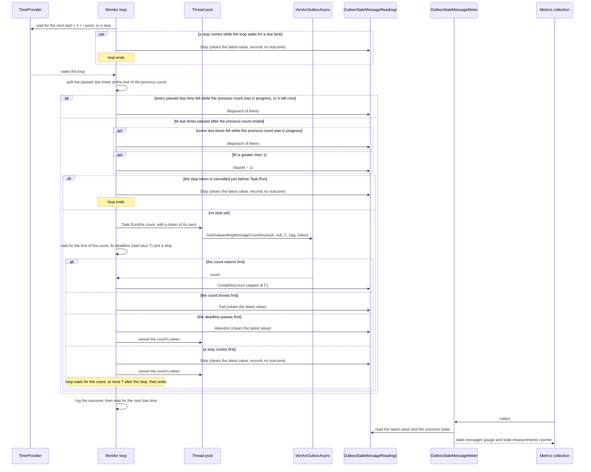
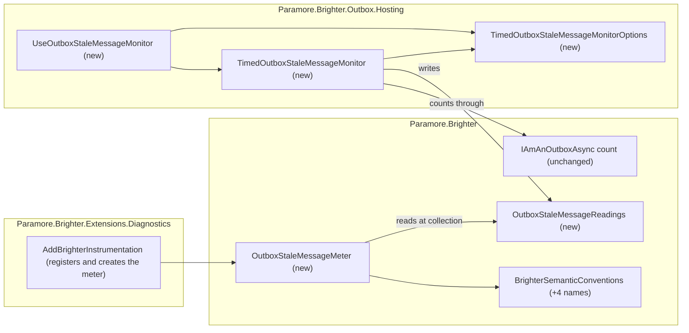

# 85. Outbox stale-message telemetry

Date: 2026-10-11

## Status

Proposed

## Context

If Brighter cannot send a message from the outbox, the message stays there undispatched, and the caller is not told. If no sweeper runs, nothing sends the message again. No metric shows that it is waiting. An operator therefore finds out about an unsent message from a consumer that never received it, not from a dashboard or an alert.

### Terms

The parent requirement's *Terms* table defines these words, and this ADR uses them with the same meaning:

- **stale age (A)**, **stale message**, **stale count (S)**, **ceiling (C)** and **reported value (V)**;
- **measurement**, and its three endings: *completes*, *fails* and *is abandoned*;
- **due time**, **measurement interval (I)** and **measurement timeout (T)**.

Four more words matter below:

- **The monitor** is `TimedOutboxStaleMessageMonitor`, the hosted service that runs measurements. *Where the pieces live* places it.
- **The loop** is the monitor's one background task. It schedules every due time and decides every outcome. *The mechanism, end to end* describes it.
- **The readings** is `OutboxStaleMessageReadings`. The loop writes it and the meter reads it. Its contract is under *Key Components*.
- **Outcome** is how one due time ended: `completed`, `failed`, `abandoned` or `skipped`. The decision ladder in *What one due time does* gives each due time its outcome.

### Scope

**Parent requirement**: [specs/0038-outbox-stale-message-telemetry/requirements.md](../../specs/0038-outbox-stale-message-telemetry/requirements.md)

This ADR decides one thing: **a hosted service of its own counts the outbox's stale messages on a schedule, and a meter in core publishes the last count and each due time's outcome.** It records the answers to Q-1 to Q-13. It also fixes the defaults and maximums that FR-2 leaves to design.

**In scope.** Each requirement below is met by the mechanism named on its bullet.

- **FR-1, off by default.** Only the new `UseOutboxStaleMessageMonitor` registers the monitor. `AddProducers`, `UseOutboxSweeper`, `UseOutboxArchiver` and `AddBrighterInstrumentation` do not register it.
- **FR-2, validated settings.** The options type checks A, C, I and T when the registration extension runs. The monitor checks the outbox and the producers' registration when it starts. The defaults and maximums are set in *Technology Choices*.
- **FR-3 and FR-4, the count and the ceiling.** The monitor passes A and C to the outbox's own asynchronous count. It caps the result at C. Accuracy below C belongs to each outbox (FR-14).
- **NFR-4(a) and (b), one bounded call.** Each measurement makes exactly one outbox call and never retries it. The monitor passes C as `maxCount` and caps the result at C. C's maximum of 1,000 bounds what one call can ask for.
- **FR-14 and FR-14.1, outbox conformance.** Each outbox's test project gets the age, ceiling and cancellation tests of AC-16 and AC-17. Each gap those tests find is tracked in an issue of its own and listed as a known limitation of that outbox.
- **FR-5 and Q-6, the instrument.** `OutboxStaleMessageMeter` publishes an `ObservableGauge<long>` named `paramore.brighter.outbox.stale.messages` on the `Paramore.Brighter` meter.
- **FR-6 and FR-10, "no recent reading".** An observable outcome counter is the documented signal. It reports every due time by outcome, starting at zero for each outcome when measurement starts. After a due time that does not complete, the gauge has no value until the next completed measurement. The loop logs each failure, abandonment and skip after it records the outcome.
- **FR-7, the schedule.** The loop computes each next due time on the start + k × I grid from the `TimeProvider` and waits for it. When it wakes, it merges the due times it missed while no count was in progress.
- **FR-8, one call at a time.** The loop starts no count while the previous count's task is still running. A due time that arrives while a count is in progress makes no outbox call and records no value. The loop records that due time as skipped.
- **FR-9, bounded wait.** The loop starts each count with `Task.Run` and waits for the first of the count, its deadline and a stop. The deadline is the call's start timestamp plus T. When the deadline comes first, the loop records `abandoned`, cancels the count's token and ignores any later result.
- **FR-10 and FR-13, a cancellation is not a failure.** The loop records the outcome, or calls `Stop()`, before it cancels the count's token. A cancellation that the loop caused is therefore never counted or logged as a failure.
- **FR-11, independent of the sweeper.** The monitor takes no lock and never calls the sweeper or the mediator.
- **FR-12, the count's arguments.** The monitor passes the same `args` the outstanding-message check passes, a null `requestContext`, and a cancellable token.
- **FR-13, stopping.** `StopAsync` cancels the loop's stop token. The loop handles the stop one asynchronous hop later, and only then cancels the count's token. Once the loop observes the stop, it starts no count and ends. *Stopping* states the one remaining window. `StopAsync` returns when the loop ends, T after the request, or when the host's stop token is cancelled, whichever comes first. The loop's hop and `StopAsync`'s own T timer each need a pool thread.
- **FR-15, attributes.** Both instruments carry a new attribute, `paramore.brighter.outbox.implementation`, set to the outbox's type name. The counter also carries the outcome.
- **NFR-1 and NFR-2, the posting path and the check.** The monitor never calls the mediator. It shares no lock, semaphore or flag with the posting path.
- **NFR-3, additive API.** Only new types, one new extension method and new constants are added. No meter role and no existing interface changes.
- **NFR-5, no pipeline dependency.** The monitor and the meter use `System.Diagnostics.Metrics` and `IMeterFactory` only. `AddBrighterInstrumentation` creates the meter. With no metrics configured, measurement runs and nothing throws.
- **NFR-6, testability.** All of the monitor's time comes from an injected `TimeProvider`. The listener-based tests observe the meter that `AddBrighterInstrumentation` creates, through a `MeterListener`.
- **NFR-7, documentation.** This is the last implementation step.

**Out of scope.**

- **Closing FR-14's gaps (Q-9).** Separate issues will track Firestore's age, ceiling and token gaps, DynamoDB's ceiling split and read volume, and the relational and MongoDb row loading, opened as the conformance tests of step 12 confirm each gap. They will also track any "To verify" cell that proves to be a gap. No ADR covers them. The conformance tests that find them are in scope.
- **An age-aware count capability (Q-5).** NFR-4(c) stays a known limitation for a follow-up.
- **`OutboxMeter`, from ADR 0084-outbox-metrics.** This ADR adds nothing to it (alternative 12).
- **The requirement's OOS-1 to OOS-12**, in particular the channel for failed `Clear` calls (OOS-1) and a health check (OOS-6).
- **The sweeper.** ADR `0081-timed-outbox-sweeper-health-metrics` owns its metrics. Nothing in the sweeper changes (C-4).

### A message that is never sent stays invisible

| Where an operator might look | What it shows | Why an unsent message does not show |
| --- | --- | --- |
| The result of `PostAsync` | Nothing about the send | The mediator logs the send failure and returns false. The caller gets no error. |
| The outstanding-message check | Nothing | It counts only when `MaxOutStandingMessages` is set, and only to decide whether to throw `OutboxLimitReachedException` |
| Sweeper metrics (ADR 0081-timed-outbox-sweeper-health-metrics) | The sweeper's own health | They exist only when a sweeper runs, and they count sweeps, not messages |
| Outbox spans | Each outbox operation | Production sampling usually drops them |
| Outbox metrics (ADR 0084-outbox-metrics) | Messages added and cleared, and how long each cleared message waited | Added minus cleared is a count with no age, so a message about to be sent looks the same as one that never will be. Both counters restart with the process, so a message added before a restart and cleared after it pushes the difference below the real backlog (alternative 23) |

Without a sweeper, a message in a database outbox waits forever. A message in the default `InMemoryOutbox` is lost when the process stops. Neither event leaves a trace on any dashboard.

The outbox already knows the answer. `GetOutstandingMessageCountAsync(dispatchedSince, requestContext, maxCount, args, cancellationToken)` returns the number of undispatched messages older than an age, up to a ceiling. Every outbox in scope implements it. Today the only caller is the outstanding-message check. The check passes its own check interval as the age, and it runs only when a limit is set. What is missing is a caller on a schedule, and an instrument for the result.

### The forces

- **The value is recorded directly (C-1).** Sampling drops spans, so a metric derived from spans (ADR 0022-generate-metrics-from-traces) would disappear exactly when it is needed. ADR 0081-timed-outbox-sweeper-health-metrics rejected span-derived health metrics for the same reason.
- **Measurement must not share the outstanding-message check (NFR-1).** The check's count has no timeout, and a count that never returns freezes the limit check (issue #4584). Measurement that shared the mediator's machinery would inherit that failure.
- **Some asynchronous counts block the calling thread (FR-9).** `InMemoryOutbox` computes its count synchronously and then returns a completed task. Sqlite's provider runs async methods synchronously (A-8). The code that schedules measurements therefore must never run on the thread that runs the count.
- **Some outbox clients block when their token is cancelled.** `CancellationTokenSource.Cancel` runs the token's callbacks on the thread that calls it. A database client can do blocking work in such a callback, for example while it sends a cancel request to the server.
- **The schedule is a fixed grid (FR-7).** Due times are start + k × I. Missed due times are merged into one, and the collection rate must not change the query rate.
- **Meter roles get no new members (NFR-3).** Issue #4573 states the rule for `IAmABrighterSweeperMeter`: it is a public role, and a new member would break every implementer. Brighter targets `netstandard2.0`, which has no default interface members. A new role interface would carry the same problem from its first release, so this ADR adds none.
- **No dependency on a metrics pipeline (NFR-5).** Measurement and recording code uses only `System.Diagnostics.Metrics` and `IMeterFactory`. Measurement must work, and must not throw, when no metrics pipeline is configured.
- **Instances that share a store count the same rows (A-6).** Adding their values together overcounts, so the instrument must not be one that backends add up by default.
- **The sweeper stays as it is (FR-11, C-4).** Measurement must keep running while a sweep hangs, and it must not touch the sweeper's lock.
- **A count can be expensive (NFR-4).** The relational outboxes and MongoDb load up to C whole rows to count them. C's maximum must bound that cost.

## Decision

**A new hosted service counts the outbox's stale messages on a fixed schedule, and a new meter in core publishes the last completed count and every due time's outcome.**

The hosted service, `TimedOutboxStaleMessageMonitor`, runs one background loop. The loop calls the outbox's existing asynchronous count and decides how each due time ended. It writes the result into a small holder in core, the readings. The meter, `OutboxStaleMessageMeter`, is created by `AddBrighterInstrumentation` and reads the readings each time metrics are collected. It publishes on the `Paramore.Brighter` meter. An application turns the feature on with one registration step that names the stale age. The monitor never calls the mediator, never takes the sweeper's lock and never waits on the posting path. It holds no instruments, and the meter needs no knowledge of the schedule.

### The mechanism, end to end



Seven invariants follow from this sequence:

- **A collection never queries the outbox.** A collection reads memory only, so the collection rate cannot change how often the store is queried.
- **Only the loop decides.** The loop alone starts a count, decides an outcome, writes the readings and logs. It alone cancels and disposes a count's token source. One task cannot overlap with itself, so two decisions never race, and the monitor needs no atomic state. `StopAsync` and `Dispose` only signal the loop.
- **At most one count is in progress.** The loop treats a count as in progress until the count's task ends, not until the loop stops waiting for it. Every due time at or before the end of the previous count is a skip. An abandoned count that has not returned turns every due time into a skip until it returns.
- **Neither the loop nor the host runs outbox code.** The count runs on a pool thread through `Task.Run`, and the loop cancels the count's token off its own thread. A count or a cancellation callback that blocks holds a pool thread, never the loop, `StopAsync` or `FakeTimeProvider.Advance`.
- **The loop records the outcome, or calls `Stop()`, before it cancels.** An `OperationCanceledException` that follows belongs to a due time that already has its outcome, or to a stop. The loop ignores it.
- **The outcome totals equal the due times that have ended.** A due time ends when the loop records its outcome: at once for a skip, or when its count completes, fails or reaches its deadline. A due time whose count is still before its deadline has not ended. A due time that passes while a count is in progress ends as a skip when the loop next wakes, within T. A due time interrupted by a stop never ends, and gets no outcome.
- **The gauge shows only the result of the most recent due time that ended.** It never repeats an older value past a due time that did not complete, and it never shows 0 in place of a missing reading. It has no value after a stop.

#### What one due time does

The loop keeps one instant, the end of the previous count. Once the count's task has ended, the instant is when the task ended. The task records that instant as its own last step. While an abandoned task still runs, the instant is when the loop stopped waiting for it. The count's deadline is the timestamp at which the loop starts the call, plus T.

Each time it wakes, the loop splits the due times that have passed at that instant. Row 4 takes those at or before it, and all of them while the previous count still runs. Row 3 merges the rest. The latest of the rest continues to rows 5 and 6.

| # | Situation | Outbox call | Readings | Log |
| --- | --- | --- | --- | --- |
| 1 | The stop token is cancelled while the loop waits for a due time | None. The loop handles the stop as *Stopping* describes | `Stop()` | Information |
| 2 | No due time has passed since the last one handled, because the loop woke early | None. The loop waits again | None | None |
| 3 | M due times passed after the end of the previous count, with M greater than 1 | None for M − 1 of them | `Skip(M − 1)` | One Warning that names the outbox type and carries M − 1 |
| 4 | A due time passed while the previous count was in progress, or the previous count is still running | None. Every due time at or before the end of the previous count is skipped, never measured | `Skip` with the number of such due times | One Warning that names the outbox type and carries that number |
| 5 | The stop token is cancelled when the loop checks it, immediately before `Task.Run` | None. The loop handles the stop as *Stopping* describes | `Stop()` | Information |
| 6 | Otherwise | One call, started with `Task.Run` | The loop waits for the first of the count, its deadline and a stop, then follows 6a to 6d | |
| 6a | The count returns 0 or more first | | `Complete(min(count, C))` | Debug, with V |
| 6b | The count throws first, or returns a negative count | | `Fail()` | Warning, with the outbox type and the exception |
| 6c | The deadline passes first | The loop records the outcome, then cancels the token off its own thread | `Abandon()`. A later result or exception is ignored | Warning, with the outbox type and T |
| 6d | A stop comes first | The loop cancels the token off its own thread, as *Stopping* describes | `Stop()`. No outcome is recorded | Information. Not logged as a failure |

Row 6b covers every exception, `OperationCanceledException` included. In row 6b the loop has not cancelled the token, so the exception comes from the outbox itself. A timeout of the outbox's own is one example.

`Task.WhenAny` returns one task, and the loop decides on that task alone. The count and the deadline can end at almost the same moment. The outcome then follows the task that `WhenAny` returned, and the loop ignores the other.

No row logs a Warning because V is greater than 0. The metric and the documented alert carry that warning (Q-2).

The loop catches any exception from its own code, such as one from a logging provider, a readings write or a bug. It logs the exception at Error and keeps running on the grid.

#### Stopping

`StopAsync` only signals and waits. The loop does the work.

`StopAsync` does three things:

1. It returns at once if the loop never started, for example because `StartAsync` threw.
2. It cancels the loop's stop token. The token's one registration completes the loop's stop task, whose continuations run asynchronously. This cancellation therefore runs no outbox code and no loop code. The count's token comes from a separate source that is never linked to the stop token.
3. It waits for the first of these: the loop ends, T passes after the stop request on the `TimeProvider`, or the host's stop token is cancelled.

The loop observes the stop one asynchronous hop after `StopAsync` cancels the token. It sees the stop at one of three points. The first is while it waits for a due time (row 1). The second is its check immediately before `Task.Run` (row 5). The third is while it waits for a count (row 6d). After the loop observes the stop, no count starts. One window remains. `StopAsync` can cancel the token after the check of row 5 and before `Task.Run`. That one count then starts. The loop's next wait sees the stop at once and handles it as row 6d.

When the loop sees the stop token, it does four things:

1. It records no outcome for a due time in progress, and logs the stop at Information.
2. It calls `Stop()` on the readings, which clears the latest value. The outcome totals do not change, so an export taken during shutdown carries the totals and no gauge value.
3. It cancels the token of any count in progress, off its own thread.
4. It waits for that count to end, at most until T after the stop request. If the count's task has ended, the loop disposes the count's token source. The loop then ends.

A count that honours its token therefore lets stopping return as soon as the call ends. A count that ignores its token holds stopping for at most T.

`Dispose` cancels the stop token in the same way, if `StopAsync` has not, and returns without waiting. It disposes nothing that the loop or a count still uses.

`HostOptions.ShutdownTimeout` controls the host's stop token. If T is longer than the time left before that timeout, the host's token ends the wait first. Stopping then still returns within T, as FR-13 requires. The default T is 10 seconds, well below the 30-second default `ShutdownTimeout` of current Microsoft.Extensions.Hosting versions. The documentation advises a T well below the shutdown timeout, because every hosted service shares that one budget.

### Where the pieces live



Every new dependency points into core. The monitor and the meter never refer to each other: they meet only at the readings. That holder is a plain core type with no metrics dependency, so the monitor works the same way with or without a metrics pipeline (NFR-5).

The meter finds the readings only when the meter provider shares the application's container, as `services.AddOpenTelemetry().WithMetrics(...)` does. A provider built with `Sdk.CreateMeterProviderBuilder()` resolves the meter from a container of its own, which holds no readings, so that setup is not supported. This narrows step 3 of the requirement's Proposed Solution. These are the combinations of the two registration calls:

| `UseOutboxStaleMessageMonitor` | `AddBrighterInstrumentation` | Result |
| --- | --- | --- |
| Called | Called, on a provider that shares the application's container | Measurements run and both instruments report |
| Called | Called, on a provider from `Sdk.CreateMeterProviderBuilder()` | Not supported. That container holds no readings, and it registers no `IMeterFactory` unless the application adds one. ADR 0081-timed-outbox-sweeper-health-metrics's sweeper meter and `OutboxMeter` (ADR 0084-outbox-metrics) are resolved from the application's container too, so they do not report there either |
| Called | Not called | Measurements run and the monitor writes the readings, but nothing reads them. Nothing throws (AC-24) |
| Not called | Called | No readings are registered, so the meter creates no instruments (AC-1) |
| Not called | Not called | Nothing new runs |

### Key Components

#### The roles, and what each is responsible for

| Role | Type | Responsibilities | Responsibility classifier | Collaborators |
| --- | --- | --- | --- | --- |
| Measures stale messages on a fixed schedule | `TimedOutboxStaleMessageMonitor` (Outbox.Hosting) | Knows the grid, the settings, the count in progress and the end of the previous count. Resolves the outbox, the producers' configuration and the transaction type at start, and rejects a missing or sync-only outbox. Runs the loop, which decides each due time's outcome, starts and cancels each count, writes the readings and logs. | knowing, doing, deciding | `IServiceScopeFactory`, `IAmAnOutbox`, `IAmProducersConfiguration`, `IAmABoxTransactionProvider`, `IAmAnOutboxAsync<Message, TTransaction>`, `OutboxStaleMessageReadings`, `TimeProvider`, `TimedOutboxStaleMessageMonitorOptions` |
| Holds and checks the monitor's settings | `TimedOutboxStaleMessageMonitorOptions` (Outbox.Hosting) | Knows A, C, I and T and their defaults. Rejects an invalid value. | knowing, deciding | `ConfigurationException` |
| Registers the monitor | `HostedServiceCollectionExtensions.UseOutboxStaleMessageMonitor` (Outbox.Hosting) | Builds and validates the options. Registers the options, the readings and the hosted service. | doing | `IBrighterBuilder` |
| Holds the latest reading and the outcome totals | `OutboxStaleMessageReadings` (Paramore.Brighter) | Knows whether measurement has started, the outbox type, the latest V or that there is none, and four outcome totals. Keeps them consistent under concurrent writes and reads. | knowing | written by the monitor, read by the meter |
| Publishes the stale-message instruments | `OutboxStaleMessageMeter` (Paramore.Brighter) | Owns the gauge and the counter on the `Paramore.Brighter` meter. Maps each outcome to its attribute value. | knowing, doing | `IMeterFactory`, `OutboxStaleMessageReadings`, `BrighterSemanticConventions` |
| Creates the meter with the metrics pipeline | `BrighterMetricsBuilderExtensions.AddBrighterInstrumentation` (Extensions.Diagnostics) | Registers the meter and creates it when the meter provider is built | doing | `OutboxStaleMessageMeter` |
| Counts stale messages | Each outbox (unchanged) | Applies A, C and `args` to its store | doing | its store |

The loop decides what happened, the readings remember it, and the meter publishes it. The meter holds no schedule state, and the monitor holds no instruments.

#### `UseOutboxStaleMessageMonitor` and `TimedOutboxStaleMessageMonitorOptions`

```csharp
namespace Paramore.Brighter.Outbox.Hosting;

public static IBrighterBuilder UseOutboxStaleMessageMonitor(
    this IBrighterBuilder brighterBuilder,
    TimeSpan staleMessageAge,
    Action<TimedOutboxStaleMessageMonitorOptions>? configure = null);

public sealed class TimedOutboxStaleMessageMonitorOptions
{
    public static readonly TimeSpan MaxStaleMessageAge;      // 365 days
    public const int MaxCountCeiling = 1000;
    public static readonly TimeSpan MaxMeasurementInterval;  // 4,294,967,294 ms

    public TimedOutboxStaleMessageMonitorOptions(TimeSpan staleMessageAge);

    public TimeSpan StaleMessageAge { get; }                                    // A, required
    public int CountCeiling { get; set; } = 100;                                // C
    public TimeSpan MeasurementInterval { get; set; } = TimeSpan.FromMinutes(1); // I
    public TimeSpan MeasurementTimeout { get; set; } = TimeSpan.FromSeconds(10); // T
}
```

The trailing comments in the sketch are annotations for this ADR. In the code, each member carries its meaning and default in its `///` documentation.

| Member | Input | Output | Error conditions |
| --- | --- | --- | --- |
| `UseOutboxStaleMessageMonitor` | The builder, A, and an optional action that sets C, I and T | The same builder | `ConfigurationException` when a value is invalid. The message names the setting and the value. Nothing is registered in that case. `ArgumentNullException` for a null builder |
| Options constructor | A | Options with the default C, I and T | None. The value is checked when the extension runs, and again in the monitor's constructor, after `configure` has run |
| Validation | A, C, I and T | None | A must be greater than zero and at most `MaxStaleMessageAge`. C must be from 1 to `MaxCountCeiling`. I must be greater than zero and at most `MaxMeasurementInterval`. T must be greater than zero and less than I |

A is a constructor argument, so an application cannot turn the feature on without naming it. The monitor copies the four values when it is constructed, so they do not change while measurement runs.

The first call to the extension wins. It registers the options and the readings with `TryAddSingleton`, and `AddHostedService` adds the monitor through `TryAddEnumerable`. A later call still validates its settings, but the container ignores them. This is accepted because a process measures one outbox (Q-8), so a second set of settings has nothing else to measure. `UseOutboxSweeper` keeps its first options the same way.

#### `TimedOutboxStaleMessageMonitor`

```csharp
namespace Paramore.Brighter.Outbox.Hosting;

public partial class TimedOutboxStaleMessageMonitor : IHostedService, IDisposable
{
    public TimedOutboxStaleMessageMonitor(
        IServiceScopeFactory serviceScopeFactory,
        OutboxStaleMessageReadings readings,
        TimedOutboxStaleMessageMonitorOptions options,
        TimeProvider? timeProvider = null);
}
```

| Member | Input | Output | Error conditions |
| --- | --- | --- | --- |
| Constructor | A scope factory, the readings, the options, and an optional clock that defaults to `TimeProvider.System` | A monitor that is not yet running | `ConfigurationException` if the options are invalid |
| `StartAsync` | Not used | A completed task. The loop is running, and the first due time is start + I | `ConfigurationException` when `IAmAnOutbox` or `IAmProducersConfiguration` is not registered. The message names the missing service and says that `AddProducers` registers it. `ConfigurationException` when the outbox does not implement `IAmAnOutboxAsync<Message, TTransaction>` for the registered transaction type. The message says whether the outbox is sync-only (Q-3) or implements neither interface. In each case the host does not start, and no count is made |
| `StopAsync` | The host's stop token | A task that ends as *Stopping* describes | Never throws, even when the loop's task has faulted |
| `Dispose` | None | Signals a stop and returns without waiting | Never throws |

The monitor resolves its collaborators at start, not in its constructor. At start it opens a scope, because the transaction provider is often scoped. It resolves `IAmAnOutbox`, `IAmProducersConfiguration` and `IAmABoxTransactionProvider` from that scope with `GetService`. It disposes the scope before `StartAsync` returns, as `AddEventBus` does with its own (`ServiceCollectionExtensions.cs:719`). The outbox and the producers' configuration that it keeps are the container's singletons. A missing outbox or producers' configuration then becomes the `ConfigurationException` above. A required constructor parameter would instead fail with the container's `InvalidOperationException`, which does not name `AddProducers`.

`CommandProcessor.GetTransactionTypeFromTransactionProvider` gives the transaction type, or `CommittableTransaction` when no provider is registered. The monitor checks the outbox against `IAmAnOutboxAsync<Message, TTransaction>`, the same check `AddProducers` makes before it registers that interface. The monitor closes a generic helper over the transaction type once, at start. The application therefore passes no generic argument.

`StartAsync` starts the loop under `ExecutionContext.SuppressFlow`, as `TimedOutboxSweeper` starts its thread. The loop, and every count it starts, therefore carry none of the host's ambient state, such as `Activity.Current`.

#### `OutboxStaleMessageReadings`

```csharp
namespace Paramore.Brighter.Observability;

public sealed class OutboxStaleMessageReadings
{
    public void Start(string outboxType);
    public void Complete(int staleCount);
    public void Fail();
    public void Abandon();
    public void Skip(int dueTimes);
    public void Stop();

    public bool IsStarted { get; }
    public string? OutboxType { get; }
    public bool TryGetLatest(out int staleCount);
    public long Completed { get; }
    public long Failed { get; }
    public long Abandoned { get; }
    public long Skipped { get; }
}
```

| Member | Input | Output | Error conditions |
| --- | --- | --- | --- |
| `Start` | The outbox's type name | Marks measurement as started. The four totals start at zero, and there is no latest value | Never throws |
| `Complete` | V, from 0 to C | Sets the latest value. Adds one to `Completed` | `ArgumentOutOfRangeException` for a negative value. The monitor never passes one |
| `Fail`, `Abandon` | None | Clears the latest value. Adds one to the matching total | Never throws |
| `Skip` | The number of due times skipped, 1 or more | Clears the latest value. Adds the number to `Skipped` | `ArgumentOutOfRangeException` for a value less than 1 |
| `Stop` | None | Clears the latest value. The totals do not change | Never throws |
| Read members | None | A consistent view of the state | Never throw. They do no I/O and wait only on the readings' own short lock |

The monitor calls the methods and the meter reads the properties. Each public member carries `///` documentation, and the class's `<remarks>` names the writer and the reader.

The type is public because `Outbox.Hosting` is a separate assembly that writes it, and Brighter uses no `InternalsVisibleTo`. Its XML `<remarks>` say that it is public for Brighter's own use, not as an extension point. It is a DI singleton, not static state, so parallel tests that build their own containers do not see each other's values.

#### `OutboxStaleMessageMeter` and its instruments

```csharp
namespace Paramore.Brighter.Observability;

public sealed class OutboxStaleMessageMeter
{
    public OutboxStaleMessageMeter(IMeterFactory meterFactory, OutboxStaleMessageReadings? readings = null);
}
```

| Instrument | Type | Unit | Attributes | What it reports |
| --- | --- | --- | --- | --- |
| `paramore.brighter.outbox.stale.messages` | `ObservableGauge<long>` | `{message}` | `paramore.brighter.outbox.implementation` | The latest V. No value before the first completed measurement, after a due time that did not complete until the next completed measurement, or after a stop |
| `paramore.brighter.outbox.stale.measurements` | `ObservableCounter<long>` | `{measurement}` | `paramore.brighter.outbox.implementation`, `paramore.brighter.outbox.stale.outcome` | Due times by outcome since measurement started. Each of `completed`, `failed`, `abandoned` and `skipped` is reported from start, at zero |

| Situation | Gauge | Counter |
| --- | --- | --- |
| Feature not enabled, or the readings not started | No series | No series |
| Started, no completed measurement yet | No series | Four series, and `completed` is 0 |
| Last due time completed | V | `completed` has increased |
| Last due time failed, abandoned or skipped | No series | The matching outcome has increased |
| Stopped | No series | The totals as they were at the stop |

These states can be told apart from metrics alone (FR-6):

- "No recent reading" means `completed` has not increased for more than about I + T. This is the documented signal, because it does not depend on how a backend shows a gauge that stops reporting.
- "No success since start" means `completed` is 0 while the counter series exists.
- "Feature disabled" means neither instrument has a series.

If no readings are registered, the constructor creates no instruments. `AddBrighterInstrumentation` registers the meter with `TryAddSingleton<OutboxStaleMessageMeter>()`. That registration relies on the container passing the default value for an optional parameter whose service is not registered. The optional `meter` parameter of `TimedOutboxSweeper` already relies on the same behaviour. The meter's own unit tests construct it directly, as the `PublishConfirmationMeter` test does. The listener-based ACs build it through `AddBrighterInstrumentation` instead, as *Implementation Approach* describes.

#### Where each type is touched

| Assembly | Type | Change |
| --- | --- | --- |
| Paramore.Brighter | `BrighterSemanticConventions` | Four new constants beside the outbox names of ADR 0084-outbox-metrics: `OutboxStaleMessages`, `OutboxStaleMeasurements`, `OutboxStaleOutcome` and `OutboxImplementation` (`paramore.brighter.outbox.implementation`) |
| Paramore.Brighter | `OutboxStaleMessageReadings` | New, in `Observability/` |
| Paramore.Brighter | `OutboxStaleMessageMeter` | New, sealed, modelled on `PublishConfirmationMeter` |
| Paramore.Brighter.Outbox.Hosting | `TimedOutboxStaleMessageMonitor`, `TimedOutboxStaleMessageMonitorOptions` | New |
| Paramore.Brighter.Outbox.Hosting | `HostedServiceCollectionExtensions` | New `UseOutboxStaleMessageMonitor`, beside `UseOutboxArchiver` |
| Paramore.Brighter.Extensions.Diagnostics | `BrighterMetricsBuilderExtensions` | Registers the meter beside `PublishConfirmationMeter`, and creates it in the same deferred `Configure` |

The following stay **unchanged**:

- `OutboxProducerMediator` and its outstanding-message check. The monitor never calls the mediator, so NFR-2 holds by construction.
- Every outbox, and `IAmAnOutboxSync` and `IAmAnOutboxAsync`. FR-14's gaps are closed through separate issues.
- `IAmProducersConfiguration`, `ProducersConfiguration`, `IAmABrighterTracer` and `IAmAnOutboxProducerMediator` (Q-4).
- `IAmABrighterMessagingMeter`, `IAmABrighterDbMeter`, `IAmABrighterSweeperMeter`, `SweeperMeter`, `PublishConfirmationMeter`, `IAmABrighterOutboxMeter` and `OutboxMeter` (NFR-3).
- `TimedOutboxSweeper`, `TimedOutboxSweeperOptions` and the sweeper's lock resource, together with `TimedOutboxArchiver` (C-4).
- `BrighterMetricsFromTracesProcessor` and `InstrumentationOptions`. The instrument does not go through spans.
- `BrighterSemanticConventions.OutboxType` and its `sync` and `async` values on outbox spans.
- `CommandProcessor.GetTransactionTypeFromTransactionProvider`, which the monitor calls as it is.
- Both `AddProducers` overloads.

### Technology Choices

#### Why a hosted service of its own?

The monitor is a timed background job with its own reason to change, like `TimedOutboxArchiver`. ADR 0021-move-archive-from-esb moved archiving out of the mediator for that reason. In the mediator, a timer would sit beside the outstanding-message check and the posting path, which is exactly what NFR-1 rules out. In `TimedOutboxSweeper`, measurement would stop whenever a sweep hangs, and ADR 0081-timed-outbox-sweeper-health-metrics records that a hung sweep is the case its metrics cannot show. A hosted service of its own keeps measurement running while the sweeper or the posting path is stuck. In that state the stale count is the signal that still reports.

#### Why one loop that computes the grid?

The loop keeps the start as a `TimeProvider` timestamp, as the sweeper does, and measures elapsed time rather than wall-clock time. Each time it wakes, it computes which grid points have passed since the last one it handled. It records as skipped every grid point at or before the end of the previous count. Of the rest, it runs at most one measurement and records the others as skipped. It then waits for the next start + k × I point. The merging therefore follows from arithmetic the code states. AC-8 requires a review against that rule, because a fake clock cannot produce a missed due time.

One loop also keeps the concurrency simple. The loop is the only code that decides an outcome, and one task cannot overlap with itself. Timer callbacks can overlap. An outcome decided from several callbacks needs an atomic state machine to stay correct (alternative 5).

The loop waits through one helper over `TimeProvider.CreateTimer`, the same on every target. The helper completes a task whose continuations run asynchronously. The stop task is a `TaskCompletionSource` with `RunContinuationsAsynchronously`, completed from the stop token's registration. After each `Task.WhenAny` returns, the loop yields. It uses `Task.Yield` on netstandard2.0 and `ConfigureAwaitOptions.ForceYielding` on net8.0 and later. With these three conditions, the loop never runs inside a timer callback or `FakeTimeProvider.Advance`. It also never runs on a count's completing thread, inside `StopAsync` or inside `Dispose`.

The monitor implements `IHostedService` itself, as the sweeper does, rather than deriving from `BackgroundService`. It needs the loop started under `ExecutionContext.SuppressFlow`, and a stop wait bounded by T as well as by the host's token. With its own `StartAsync` and `StopAsync`, the monitor states both in its own code.

#### Why start the count with `Task.Run`?

A count can block its thread before it returns a task (FR-9). If the loop called the outbox directly, such a count would hold the loop. With a fake clock it would hold `Advance` too, which AC-11 forbids. `Task.Run` puts the call on a pool thread, so the loop always reaches its wait. FR-8 means at most one pool thread is ever held by a count that blocks.

`TimedOutboxSweeper` uses a dedicated thread because a late sweep leaves messages unsent (issue #4560). A late measurement only delays a reading, and the delay is itself visible: `completed` stops increasing. That is the alert. The count is also asynchronous I/O. A dedicated thread would have to block on it, or run an async context of its own.

#### Why cancel the count's token off the loop's thread?

`Cancel` runs the token's callbacks on the calling thread, and an outbox's client can block in such a callback. If the loop called `Cancel`, the callback could hold the loop past the T bound. If `StopAsync` called it, the callback could hold the host's stop.

The loop therefore cancels the count's token without running its callbacks itself:

- on net8.0, net9.0 and net10.0 it calls `CancelAsync`, which marks the token cancelled at once and runs the callbacks on a pool thread;
- on netstandard2.0, which has no `CancelAsync`, it queues `Cancel` to the thread pool.

The loop does not wait for either to finish. It observes the exception of the work it started, so a callback that throws raises no unobserved task exception. Only the loop cancels the count's token source. The loop disposes the source when it next sees that the count's task has ended, at a wake or at the stop. The count's continuation only observes the count's exception.

#### Why does the monitor write a holder instead of recording on instruments?

A synchronous instrument needs a reference from the monitor to the object that owns it. If the meter owns it, that reference is either a meter role interface or the concrete meter class. This ADR adds no meter role (NFR-3). The concrete class is registered only by `AddBrighterInstrumentation`. The monitor would therefore hold a nullable reference, or a null object for a class that has no interface. The monitor could own the instruments itself instead, which alternative 8 rejects. With a holder, the monitor needs neither, and it works the same way with or without metrics.

The cost is that the outcome counter is observable, not synchronous like ADR 0081-timed-outbox-sweeper-health-metrics's `sweeps` counter. An observable counter reports a cumulative total. An OpenTelemetry exporter produces the same data point from a synchronous counter with cumulative temporality. For delta exporters, the SDK computes the deltas in both cases. The totals start at zero when measurement starts, so a backend's increase function works from the first collection.

#### Why an observable gauge, when `PublishConfirmationMeter` uses an up-down counter?

OpenTelemetry treats an up-down counter as additive, so backends add its series together by default. That is correct for `PublishConfirmationMeter`, because each producer's queue is separate and the depths add up. Here, instances that share a store count the same rows (A-6), and a sum overcounts. A gauge is non-additive by kind, so a backend does not add it up by default. The documentation tells operators to combine instances with max. The counter, by contrast, is correctly added across instances, because each instance counts only its own due times.

#### Why does the gauge stop reporting after a due time that did not complete?

FR-6 forbids reporting a value that no completed measurement produced, and it forbids reporting 0 in place of a missing reading. Repeating an older V while the store fails would satisfy the first rule. It would still show a dashboard reader a number that is several intervals old as if it were current. The outcome counter alone satisfies FR-6, and it is the documented "no recent reading" signal. Clearing the gauge is a second, weaker signal. A pull backend that marks a missing series as stale shows a gap. A push pipeline without staleness markers keeps showing the last value. Stopping clears the gauge for the same reason, because no later measurement will follow the last V.

#### Why these defaults and maximums?

| Setting | Default | Maximum | Reason |
| --- | --- | --- | --- |
| A | None. It is required | 365 days | Longer than any useful staleness threshold, and far from where any outbox's `now - A` could overflow (FR-2) |
| C | 100 | 1,000 | The default equals the mediator's default count ceiling and the count interface's default `maxCount`. The maximum bounds the rows a relational or MongoDb count loads each interval (NFR-4). Above 1,000 stale messages the alert has long since fired, and V equal to C already means "C or more" |
| I | 1 minute | 4,294,967,294 ms | One bounded query per minute per instance is a small query load. The row loading of NFR-4(c) is the exception, under Negative. Alerting at minute granularity matches an A measured in minutes (A-2). The maximum is the largest period a .NET timer accepts (FR-2) |
| T | 10 seconds | Less than I | A count that starts on time reaches its outcome before the next due time. Ten seconds is long enough for a count of at most C rows on a healthy store, and well below Spanner's 60-second command timeout. It is also well below the 30-second default host shutdown timeout, which every hosted service shares. An I of 10 seconds or less therefore needs an explicit T |

An application that only needs "is any message stale" can set C to 1. That is the cheapest count for the relational outboxes and MongoDb.

#### Why a new `paramore.brighter.outbox.implementation` attribute?

FR-15 needs a fixed attribute set with one series per process. Each process measures one outbox (Q-8), so the outbox's CLR type name, such as `MsSqlOutbox`, identifies the series. A table or collection name would add a value that differs per deployment but adds no information within one process. The documentation tells operators to combine instances with max. No instance is elected, because an election would need a lock, which FR-11 keeps measurement away from.

The existing `paramore.brighter.outbox.type` key cannot carry the type name. On outbox spans it carries the write mode, `sync` or `async`. The new key follows ADR 0010-brighter-semantic-conventions's `paramore.brighter.` naming, and C-5 adds it to `BrighterSemanticConventions`.

#### Why keep querying with no listener, and keep the count's span?

The monitor does not check whether a listener is subscribed (Q-11). A check on `Instrument.Enabled` changes with the pipeline's state, so the query load would depend on telemetry configuration, against the intent of FR-7. The Warning logs also stay useful without metrics.

The count's own database span is left as it is (Q-12). The monitor passes a null request context, and the loop carries no ambient `Activity`. Where a tracer is configured, each measurement may therefore start a new trace. Suppressing that span would need a new member on `IAmABrighterTracer` or an ambient flag that every outbox honours, and Q-4 and NFR-3 rule out both. The spans are sampled like any other span. The documentation describes them.

#### Why no cancellation bound per outbox?

The monitor never depends on an outbox honouring its token (FR-9). The loop stops waiting at the count's deadline whatever the outbox does. Honouring the token is best effort (Q-10). AC-17's 5 seconds is a test tolerance, not a contract.

#### Why these instrument names?

ADR 0084-outbox-metrics names its outbox instruments with the noun as its own dotted segment, as in `paramore.brighter.outbox.added.messages`. The two instruments here follow it, as `paramore.brighter.outbox.stale.messages` and `paramore.brighter.outbox.stale.measurements`, so an operator sees one naming shape under `paramore.brighter.outbox.`. The outcome key, `paramore.brighter.outbox.stale.outcome`, ends in `outcome` as the sweeper's `paramore.brighter.outbox_sweeper.outcome` does, so the three names share the `paramore.brighter.outbox.stale.` prefix. FR-5's `stale_messages` was a working name.

### Implementation Approach

Line numbers refer to master at 53a238e49.

The steps are in commit order. Each behavioural step is test first, with `FakeTimeProvider` driving time (NFR-6, AC-25). The tests go in a new folder, `tests/Paramore.Brighter.Core.Tests/Observability/StaleMessages/`.

The meter is created by `AddBrighterInstrumentation`, so the listener-based ACs use the setup the requirement names for that case:

- a `ServiceCollection` that calls `AddMetrics()` and `AddOpenTelemetry().WithMetrics(metrics => metrics.AddBrighterInstrumentation())`, as `InMemoryMetricsFromTraces` does;
- the `MeterProvider` resolved from that container, so that the deferred `Configure` creates the meter;
- a `MeterListener` over the `Paramore.Brighter` instruments that the container's `IMeterFactory` created.

Only the meter's own unit tests, in step 2, construct the meter directly.

The loop resumes on a pool thread, so a fake clock alone does not make a monitor test deterministic. Two rules hold in every monitor test:

- before each `FakeTimeProvider.Advance`, the test waits for the recorded call or outcome, bounded by wall-clock time, as the `Sweeping/` tests poll with `SpinWait.SpinUntil` (`RecordedSweeperMeasurements.cs:46-47`);
- an assertion that a token was cancelled reads `IsCancellationRequested`, not the timestamp of a callback, because `CancelAsync` runs callbacks on a pool thread.

1. **Structural.** Add the four constants to `BrighterSemanticConventions` beside the outbox constants of ADR 0084-outbox-metrics (`BrighterSemanticConventions.cs:104-108`). Nothing reads them yet, so no behaviour changes.
2. **Behavioural: the readings and the meter.** Add `OutboxStaleMessageReadings` and `OutboxStaleMessageMeter`, modelled on `PublishConfirmationMeter.cs:37-52`. Construct the meter directly, as `When_confirmations_are_waiting_should_report_the_queue_depth.cs:21` constructs `PublishConfirmationMeter`. Cases:
   - no readings: no instruments;
   - not started: no series;
   - started: four zero series and no gauge;
   - `Complete`: the gauge reports V;
   - `Fail` after `Complete`: the gauge has no series and `failed` is 1;
   - `Skip(3)`: `skipped` is 3;
   - `Stop` after `Complete`: the gauge has no series and the totals do not change.
3. **Behavioural: the meter in `AddBrighterInstrumentation`.** Add `services.TryAddSingleton<OutboxStaleMessageMeter>()` beside `BrighterMetricsBuilderExtensions.cs:42`. Resolve the meter in the existing deferred `Configure` at `:49-50`. That block then creates two meters, so extract it into a named private method rather than extend its in-body comment (CONTRIBUTING.md, "Comments in Code"). Test on the shared-container setup above: with started readings registered, both instruments report, and without readings, neither exists. This setup becomes the fixture of the listener-based ACs.
4. **Behavioural: options and registration (AC-2, AC-3).** Add `TimedOutboxStaleMessageMonitorOptions` with its validation, and `UseOutboxStaleMessageMonitor`. Register the options and the readings with `TryAddSingleton`, as `UseOutboxArchiver` registers its options (`HostedServiceCollectionExtensions.cs:59`). The default C equals `DefaultOutstandingCountCeiling` (`OutboxProducerMediator.cs:84`), but as a value of its own. The mediator's constant is private, and the two may diverge. AC-3's last clause needs a measurement, so step 7 adds it.
5. **Behavioural: the monitor and resolution at start.** Add `TimedOutboxStaleMessageMonitor` with a `StartAsync` that resolves only what the count needs.
   - Register the monitor in `UseOutboxStaleMessageMonitor` with `AddHostedService`, as `UseOutboxArchiver` does (`HostedServiceCollectionExtensions.cs:68`). Test: after two calls to the extension, the container holds one `IHostedService` registration for the monitor.
   - Open a scope and resolve `IAmAnOutbox`, `IAmProducersConfiguration` and `IAmABoxTransactionProvider` with `GetService`, as `AddEventBus` resolves the transaction provider (`src/Paramore.Brighter.Extensions.DependencyInjection/ServiceCollectionExtensions.cs:716-723`).
   - Throw `ConfigurationException` when the outbox or the producers' configuration is missing. Test: `UseOutboxStaleMessageMonitor` without `AddProducers` fails `StartAsync` with a message that names `AddProducers`.
   - Find the transaction type with `CommandProcessor.GetTransactionTypeFromTransactionProvider`.
   - Read the bag the way the mediator's registration reads it (`:568`, `:850`). The two then pass the same dictionary, even when `IAmProducersConfiguration` is not a `ProducersConfiguration`. Use an empty dictionary when there is no bag, as `OutboxProducerMediator.cs:204` does.
   - Call `readings.Start(outbox.GetType().Name)`.
6. **Behavioural: the sync-only check and rejection (Q-3).** Check the outbox against `IAmAnOutboxAsync<Message, TTransaction>`, as `AddProducers` does (`:368-375`, `:513-518`). The deferred `AddProducers` overload registers only `IAmAnOutbox` (`:501`), so check the instance rather than resolve the closed interface. Throw `ConfigurationException` from `StartAsync`, naming whether the outbox is sync-only or implements neither interface. Test: a sync-only outbox fails `StartAsync`, and no count is made.
7. **Behavioural: the loop and the schedule (AC-3 last clause, AC-4, AC-5, AC-6, AC-8, AC-14, AC-19, AC-23).**
   - Start the loop with `Task.Run` under `ExecutionContext.SuppressFlow`, as `TimedOutboxSweeper.cs:103-105` starts its thread.
   - Measure elapsed time from a `TimeProvider` timestamp, as `TimedOutboxSweeper.cs:161-163` does. Compute grid points in whole ticks, so rounding cannot move a due time.
   - Wait through one helper over `TimeProvider.CreateTimer`, whose completion source uses `RunContinuationsAsynchronously`. Check the clock again after the timer exists, as `TimedOutboxSweeper.cs:192-195` does.
   - Build the stop task as a `TaskCompletionSource` with `RunContinuationsAsynchronously`, completed from the stop token's registration. After each `Task.WhenAny`, yield with `Task.Yield` on netstandard2.0, or with `ConfigureAwaitOptions.ForceYielding` on net8.0 and later.
   - Run each count with `Task.Run` and cap the result at C. AC-8's merging clause is checked by review against *Why one loop that computes the grid?*.
   - Add the AC-14 tests that pin `dispatchedSince`, `maxCount`, `args`, `requestContext` and the token.
   - Add AC-3's last clause: with A and C at their maximums, the app starts and a measurement against `InMemoryOutbox` completes.
8. **Behavioural: timeout, single flight and failure (AC-7, AC-9, AC-10, AC-11 first half, AC-12).**
   - Take the call's start timestamp when the loop starts the call. The count's deadline is that timestamp plus T.
   - Await `Task.WhenAny` of the count's task, a delay to the deadline from the same helper, and the stop task. Decide rows 6a to 6c from the task it returns.
   - Record the outcome, then cancel the count's token: `CancelAsync` on net8.0 and later, `Cancel` queued to the thread pool on netstandard2.0. Observe the exception of that work.
   - Keep the count's task as the count in progress until it ends. The task records its end timestamp as its last step. A continuation on the task only observes its exception.
   - At each wake, skip every due time at or before the end of the previous count (row 4). While an abandoned count still runs, skip every due time. AC-9 tests the still-running case. The other case is a due time that passes during a count that ends before the loop wakes. Only a late loop produces it, and a fake clock cannot make the loop late. Review checks that split against row 4 and FR-8.
   - Let only the loop cancel the count's token source. The loop disposes the source when it next sees that the count's task has ended, at a wake or at the stop.
   - Add the log entries of the decision ladder as `[LoggerMessage]` methods, with the logger from `ApplicationLogging`, as the sweeper does. Log after the outcome is recorded.
   - Catch every exception from the loop's own code, log it at Error and keep the grid. Test: a logger that throws once does not stop the next due time.
   - Add a test whose count registers a cancellation callback that blocks until the test releases it. The test asserts that `abandoned` is recorded and that the next due time is handled while the callback is still blocked.
9. **Behavioural: stopping (AC-11 second half, AC-15).** Add `StopAsync`, `Dispose` and the loop's stop handling as *Stopping* describes, with the stop bound driven by the `TimeProvider` and the host's token.
   - Check the stop token immediately before `Task.Run` (row 5).
   - Test that a stop while a count is in progress records no outcome, logs no failure and clears the gauge.
   - Test that a stop requested while a cancellation callback blocks still returns within T.
   - Test that no count starts after the loop observes the stop, even 10 minutes of fake time later.
10. **Behavioural: isolation (AC-13, AC-20, AC-21).** Add tests that run measurement beside a hung sweep and beside a blocked outstanding-message check. Add tests that compare posting-path calls with the feature on and off. No production code is expected to change in this step.
11. **Behavioural: registration end to end (AC-1, AC-24).** AC-1 uses `AddProducers` with the counting outbox and `AddBrighterInstrumentation` on the shared-container setup, with and without the stale step. AC-24 runs without `AddBrighterInstrumentation`. No production code is expected to change in this step.
12. **Outbox conformance (AC-16, AC-17, AC-18).** Add the count tests to each outbox's test project in the definition of done. Record the observed results in the FR-14 table. Open one issue per gap, and list each gap under that outbox's known limitations (Q-9).
13. **Documentation (AC-26).** Write the XML documentation for every new public type and member, and add an entry to `release_notes.md`. Add the telemetry page section, covering each item of NFR-7 and these points:
    - the example alert;
    - combining instances with max;
    - MongoDb's topic narrowing;
    - choosing A when a sweeper runs (Q-13);
    - the trace each measurement may start (Q-12);
    - a T well below `HostOptions.ShutdownTimeout`;
    - an explicit T when I is 10 seconds or less;
    - a meter provider that shares the application's container, since `Sdk.CreateMeterProviderBuilder()` is not supported.

## Consequences

### Positive

- An operator can alert on messages that were never sent, for every outbox Brighter ships, with or without a sweeper. An application that already calls `AddBrighterInstrumentation`, on a meter provider that shares its container, gets the instruments with no further setup.
- "No recent reading", "no success yet" and "disabled" look different in metrics alone. The counter has a series from the start, at zero.
- The stale count complements ADR 0081-timed-outbox-sweeper-health-metrics. When a sweep hangs, the sweeper's instruments go silent, but the stale count keeps rising.
- The posting path and the outstanding-message check do not change. NFR-1 and NFR-2 hold because the monitor never calls the mediator, not because a protocol keeps them apart.
- The load on the store is bounded and known: at most one bounded call per due time per instance, with at most one call in progress.
- One loop makes every decision, so the monitor has no atomic state, no claim protocol and no overlapping callbacks to reason about.
- The monitor and the meter each have one job and can each be tested alone. The monitor's tests need no metrics, and the meter's unit tests need no clock.

### Negative

- The relational outboxes and MongoDb load up to C whole rows for each count (NFR-4(c), Q-5). With large bodies, the default C and I can allocate tens of megabytes per minute. A comment on issue #4489 reports about 60 MB for 100 rows of 200 KB. An application can lower C, and C of 1 is enough for "any stale message".
- Where a tracer is configured, each measurement may start a trace of its own (Q-12).
- Brighter gains a second outbox attribute key, `paramore.brighter.outbox.implementation`, beside `paramore.brighter.outbox.type`. The names are close but carry different values: the outbox's type name, and the write mode on spans.
- Until the FR-14 gaps are closed, the values are less accurate for some outboxes. Firestore ignores A, C and the token. DynamoDB can undercount when C is split across scan segments, and it reads more than C items.
- A count that ignores cancellation holds one pool thread until it returns. Every due time until then is skipped (FR-8). The skips are visible, but no reading arrives.
- An outbox's cancellation callback that blocks holds one more pool thread until it returns. It does not hold the loop, `StopAsync` or `FakeTimeProvider.Advance`.
- A count that ignores cancellation can still use up to T of the host's shutdown budget, which every hosted service shares. The services that stop after the monitor lose that time. With the defaults, the monitor uses at most 10 of the 30 seconds, and the documentation advises a T well below `ShutdownTimeout`.
- Stopping clears the gauge, so an export taken during shutdown has no stale-count value.
- The instruments report only when the meter provider shares the application's container. A provider from `Sdk.CreateMeterProviderBuilder()` is not supported. ADR 0081-timed-outbox-sweeper-health-metrics's sweeper meter has the same limitation: the sweeper is resolved from the application's container, which then holds no `IAmABrighterSweeperMeter`. `OutboxMeter` has it too, because the mediator resolves it from the application's container. The documentation names this setup (step 13).
- A second call to `UseOutboxStaleMessageMonitor` is ignored once its settings pass validation.
- The loop needs a pool thread each time it resumes, and so does `StopAsync`'s own T timer. When the thread pool is starved, measurement is late. The count's deadline, the cancellation of its token and the stop bound are late too. A late due time shows only as a missing increase in `completed`.
- The loop logs on its own thread. A logging provider that blocks therefore delays the schedule, and due times pass as skips or merge. Stopping stays bounded by `StopAsync`'s T.
- A fake clock alone does not drive the monitor's tests. Before each `Advance`, a test waits for the recorded call or outcome, bounded by wall-clock time. The tests are slower and harder to write than tests that only advance a fake clock.
- The outcome counter is observable, while ADR 0081-timed-outbox-sweeper-health-metrics's `sweeps` counter is synchronous. The two Brighter counters are built differently.
- Because the gauge has no value after a missed due time, an alert on V > 0 alone resets during intermittent store failures. The documented alert takes the maximum of the gauge over a window.
- Core gains two public types, the readings and the meter, that Brighter must support. The readings is public only so that `Outbox.Hosting` can reach it.
- An application that calls `UseOutboxStaleMessageMonitor` without the generic host gets no measurements, as with the sweeper.

### Risks and Mitigations

| Risk | Mitigation |
| --- | --- |
| Hosted services stop one after another by default. A count that ignores cancellation can then delay the stop of the services after the monitor by up to T | The wait also ends on the host's stop token. The default T is 10 seconds, and the documentation advises a T well below `HostOptions.ShutdownTimeout` |
| A stop arrives just as a due time is reached | The loop checks the stop token immediately before `Task.Run` (row 5). A stop that lands after that check lets one count start, as *Stopping* states. The loop's next wait sees the stop at once and cancels that count's token |
| The loop's own code throws, for example in a logging provider, a readings write or a bug | The loop catches the exception, logs it at Error and keeps running on the grid. `StopAsync` never throws, even when the loop's task has faulted |
| A count's token source is disposed while a cancellation of it is still queued | Only the loop cancels or disposes the source, and it disposes the source only after the count's task has ended. A queued `Cancel` that runs later throws `ObjectDisposedException`, which the loop observes like any other exception of that work |
| An outbox's cancellation callback blocks | The loop cancels with `CancelAsync`, or with `Cancel` queued to the pool. The callback then holds a pool thread, never the loop or the host's stop |
| An outbox throws `OperationCanceledException` after the loop has cancelled its token | The loop has already recorded `abandoned` or the stop, and it ignores the late exception. The exception is never counted or logged as a failure |
| An operator sums the gauge across instances and overcounts (A-6) | The gauge kind is not added up by default. The documentation says to use max. Every instance reports the same attribute set |
| Clock skew between instances shifts every age (A-2) | A is expected to be minutes and skew to be seconds. The documentation states the assumption |
| A very small I sends many queries to the store | Only one call is ever in progress. The documentation explains the cost of a short I |
| A T longer than DynamoDB's own 500 ms operation timeout means the outbox fails first (A-7) | The failure is recorded as `failed` and logged with the exception. The documentation names the interaction |
| An outbox returns more than C, as Firestore can | The monitor caps V at C, so V equal to C still means "C or more" |
| A result arrives at almost the same moment as the count's deadline | `Task.WhenAny` returns one task, and the loop decides on that task alone |
| An abandoned call faults later and raises an unobserved task exception | A continuation on each count's task observes its exception |
| A later ADR wants these instruments on `OutboxMeter`, so the outbox has one meter | They live in a sealed class with no role interface, so a later ADR can move them without breaking any implementer |

## Alternatives Considered

1. **A timer in the outbox producer mediator, with the age on `ProducersConfiguration`.** This is the proposal on issue #4489, and it needs no hosted service. **Rejected because** it puts measurement beside the posting path and the outstanding-message check, which NFR-1 keeps it away from. It also adds a member to `IAmProducersConfiguration`, which breaks implementers on `netstandard2.0` (Q-4, NFR-3). ADR 0021-move-archive-from-esb moved the archiver out of the mediator for the same reason: a different reason to change.
2. **An observable gauge whose callback runs the count.** This needs no scheduler. **Rejected because** it runs store I/O on the collection thread and makes the query rate follow the collection rate (FR-7). It also leaves no place to enforce FR-8 or FR-9 (Q-1).
3. **Measure inside `TimedOutboxSweeper`.** This reuses an existing timer. **Rejected because** a hung sweep would stop measurement (FR-11), and C-4 keeps the sweeper unchanged.
4. **A dedicated thread, as the sweeper has.** This would measure on time while the thread pool is starved. **Rejected because** a late measurement is already visible as a missing increase in `completed`. The count is also asynchronous I/O that a dedicated thread would have to block on.
5. **A one-shot timer whose callback decides each due time.** Each callback would start the count, set the timer for the next grid point and decide the outcome. **Rejected because** callbacks can overlap: a re-armed timer can fire before the previous callback has finished. The outcome would also be decided in several places, by the timeout's callback, the count's continuation and `StopAsync`. Keeping that correct needs an atomic state machine. One loop avoids both problems.
6. **A loop over `PeriodicTimer`.** This is the standard .NET loop timer. **Rejected because** `PeriodicTimer` does not exist on netstandard2.0, which core and `Outbox.Hosting` target. It also merges missed ticks without saying how many. FR-7 needs that number to record the skips.
7. **Synchronous `Gauge<long>` and `Counter<long>` on the meter, recorded by the monitor.** This matches ADR 0081-timed-outbox-sweeper-health-metrics's counter. **Rejected because** the monitor would need a new meter role, which this ADR does not add. The other choice is a nullable reference to a concrete class that only `AddBrighterInstrumentation` registers. A synchronous gauge also reports its last value forever, so it cannot stop reporting after a missed due time.
8. **The monitor takes an optional `IMeterFactory` and creates its own instruments.** This needs no holder and no meter type, and the monitor could record synchronously. **Rejected because** `AddBrighterInstrumentation` registers every other Brighter meter type, and issue #4573 directs the sweeper's new gauge to follow `PublishConfirmationMeter` there. The instruments would also exist whenever the container holds an `IMeterFactory`, which the generic host registers by default. They would then depend on hosting setup, not on `AddBrighterInstrumentation`.
9. **An `ObservableUpDownCounter`, as `PublishConfirmationMeter` uses.** This follows the nearest precedent. **Rejected because** backends add up-down counters together, and A-6 says a sum overcounts for a shared store.
10. **Keep reporting the last V after a missed due time.** This keeps an alert on V > 0 steady during intermittent failures. **Rejected because** it shows an old reading as if it were current. The outcome counter alone would carry "no recent reading", and the gauge would hide it.
11. **Derive the value from spans (ADR 0022-generate-metrics-from-traces).** This needs no new instrument code. **Rejected because** sampling drops the spans (C-1).
12. **Put the instruments on `OutboxMeter` (ADR 0084-outbox-metrics).** This would give the outbox one meter. **Rejected because** `OutboxMeter` depends on `OpenTelemetry.Metrics`, which NFR-5 keeps out of measurement and recording code. The mediator resolves it from the container. The counter's four series from the start (FR-6) would then depend on when the mediator is built. Its `Meter` is process-wide, so the per-container listener tests of NFR-6 would see the instruments of every container in the test run. The gauge would also need a new member on `IAmABrighterOutboxMeter`, and a new member on a public role breaks its implementers once released (issue #4573). A later ADR can still move these instruments, because no implementer depends on them.
13. **Add an on-call trigger on `Post` and `Clear`, or log a Warning whenever V > 0 (Q-2).** Either would read "on the call" and "warns" literally. **Rejected because** a trigger puts work on the posting path, and a quiet system with no posts would never report a message that failed once. A Warning on every measurement repeats the metric in the logs, once per interval, for as long as the backlog lasts.
14. **Run a sync-only outbox's count on a dedicated thread, or skip it and log once (Q-3).** Either would support an outbox that implements only `IAmAnOutboxSync`. **Rejected because** no shipped outbox is sync-only. A dedicated blocking thread is a cost for a case nobody has. Skipping quietly would look like a working feature that never reports.
15. **Add an age-aware count capability now (Q-5).** This would make NFR-4(c) binding and stop row loading. **Rejected for this ADR because** it changes every relational outbox and MongoDb, and the monitor does not depend on it. A follow-up can add it, and the monitor can then call it as a fallback chain.
16. **One age per publication (Q-7).** This would allow different thresholds per topic. **Rejected because** it needs a count per topic and a series per topic, which OOS-5 excludes.
17. **Elect one measuring instance through a lock (Q-8).** This would give exactly one series across instances. **Rejected because** it needs a lock, which FR-11 keeps measurement away from. A process that is not elected would report nothing. Max across instances gives the same answer with no coordination.
18. **Skip a due time when no listener is subscribed (Q-11).** This saves queries in an application without metrics. **Rejected because** the query load would then depend on telemetry configuration, and the logs would lose their failure reports.
19. **Suppress the count's database span (Q-12).** This would avoid a trace per measurement. **Rejected because** it needs a new tracer member or an ambient flag in every outbox, and Q-4 and NFR-3 exclude both.
20. **Warn at startup when A is not greater than the sweeper's `MinimumMessageAge` plus `TimerInterval` (Q-13).** This would catch a misconfiguration. **Rejected because** the monitor would have to read the sweeper's options, which couples two independent hosted services. A smaller A is also legitimate when an operator wants an early warning. The documentation explains how to choose A.
21. **Reuse `paramore.brighter.outbox.type` for the outbox's type name.** This would add no new attribute key. **Rejected because** that key already carries the write mode, `sync` or `async`, on outbox spans. One key with two meanings would mislead anyone who joins metrics and spans on it.
22. **Do nothing and rely on logs.** **Rejected because** the mediator logs a send failure once, at the moment it happens, and nothing reports the message afterwards. Logs give no level to alert on, and many log pipelines sample or drop entries under load.
23. **Alert on added minus cleared from ADR 0084-outbox-metrics.** ADR 0084-outbox-metrics offers this as the backlog signal, and it needs no new code. **Rejected because** the difference has no age, so it cannot tell a message about to be sent from one that never will be. Both counters restart with the process. A message added before a restart and cleared after it then pushes the difference below the real backlog. ADR 0084-outbox-metrics's own alternative 9 leaves an outstanding-message gauge to a spec of its own.
24. **Keep the readings in a static holder and create the `Meter` outside the container.** The meter would then not depend on sharing the application's container. **Rejected because** every container in the process would share one set of readings. The per-container listener tests of NFR-6 would then see each other's readings. The documentation names the setup this leaves out (step 13).

## References

- Parent requirement: [specs/0038-outbox-stale-message-telemetry/requirements.md](../../specs/0038-outbox-stale-message-telemetry/requirements.md), issue [#4489](https://github.com/BrighterCommand/Brighter/issues/4489)
- Related ADRs (none is superseded by this ADR):
  - [0081-timed-outbox-sweeper-health-metrics](0081-timed-outbox-sweeper-health-metrics.md) is the closest precedent: directly recorded health metrics, and the `PublishConfirmationMeter` registration pattern this ADR copies.
  - [0084-outbox-metrics](0084-outbox-metrics.md) adds `OutboxMeter`, which records messages added to and cleared from the outbox. Its alternative 9 leaves an outstanding-message gauge to a spec of its own, which spec 0038 is. This ADR measures what is still waiting and leaves `OutboxMeter` as it is (alternatives 12, 23 and 24).
  - [0010-brighter-semantic-conventions](0010-brighter-semantic-conventions.md) supplies the `paramore.brighter.` naming that the four new names follow.
  - [0022-generate-metrics-from-traces](0022-generate-metrics-from-traces.md) is the span-derived pattern that this ADR does not use (C-1).
  - [0039-opentelemetry-builder-extension](0039-opentelemetry-builder-extension.md) is the `AddBrighterInstrumentation` entry point that creates the meter.
  - [0021-move-archive-from-esb](0021-move-archive-from-esb.md) moved `Archive` and `ArchiveAsync` out of the mediator into `OutboxArchiver`, because they had a different reason to change.
  - [0012-provide-in-memory-and-simple-implementations](0012-provide-in-memory-and-simple-implementations.md) explains why the core tests use `InMemoryOutbox`, with a test double only for failure, blocking and cancellation behaviour.
- Related issues and work:
  - [#4573](https://github.com/BrighterCommand/Brighter/issues/4573): hung sweeper detection, the direction that the sweeper's new gauge follow `PublishConfirmationMeter` into `AddBrighterInstrumentation`, and the rule against new members on meter roles.
  - [#4584](https://github.com/BrighterCommand/Brighter/issues/4584): the outstanding-message check's unbounded relational count and static semaphore.
  - [#4554](https://github.com/BrighterCommand/Brighter/issues/4554): the cost of the outstanding-message count.
  - [#4560](https://github.com/BrighterCommand/Brighter/issues/4560): thread-pool starvation of the timed sweeper, the reason it runs on a dedicated thread.
  - PR [#4484](https://github.com/BrighterCommand/Brighter/pull/4484): the outbox metrics, `IAmABrighterOutboxMeter` and `OutboxMeter`.
- External:
  - [OpenTelemetry metrics API: instrument selection (Gauge, UpDownCounter, Counter)](https://opentelemetry.io/docs/specs/otel/metrics/supplementary-guidelines/#instrument-selection)
  - [.NET `System.Diagnostics.Metrics` instrument types](https://learn.microsoft.com/dotnet/core/diagnostics/metrics-instrumentation)
  - [`CancellationTokenSource.CancelAsync`](https://learn.microsoft.com/dotnet/api/system.threading.cancellationtokensource.cancelasync)
