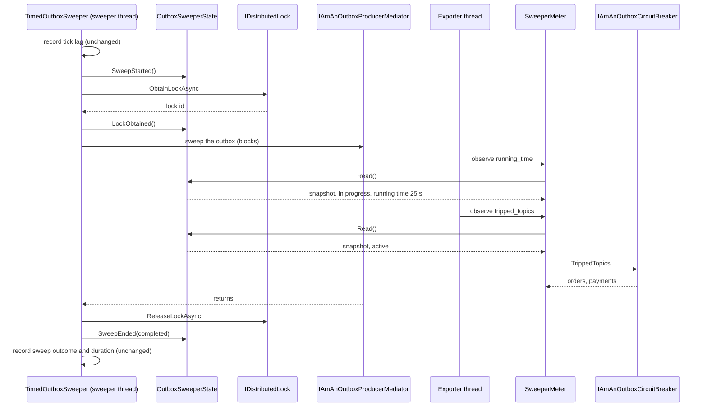
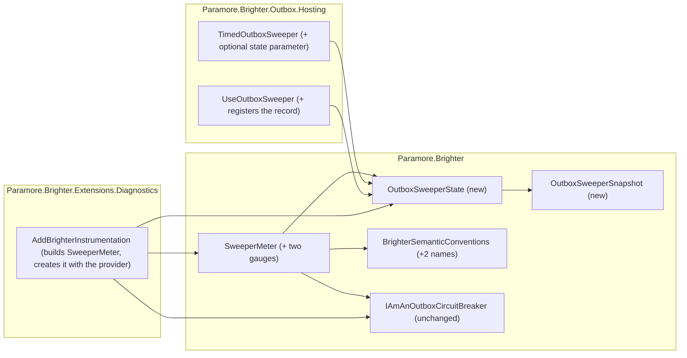

# 85. Track outbox sweeper state and publish gauges

Date: 2026-10-16

## Status

Proposed

## Context

`TimedOutboxSweeper` sweeps the outbox on its own thread, and it records how each sweep ended only after the sweep returns. While a sweep hangs, the sweeper records nothing, so the existing instruments go silent at the moment an operator needs them. Today the sweeper keeps what it knows in local variables on its own thread, and no other thread can read them. Gauges and health checks need one shared, thread-safe record of the sweeper's state that they can read while the sweeper's thread is stuck.

### Terms

These words come from the requirements' *Definitions* section, and this ADR uses them exactly as defined there: **sweep**, **sweep in progress**, **running time**, **consecutive failed sweeps**, **tripped topic**, **circuit breaker in use**, **stopped sweeper** and **active sweeper**. *The mechanism, end to end* gives the active-sweeper rule as a decision ladder. Two further words are this ADR's own.

- **The record**: the one `OutboxSweeperState` object a sweeper writes to. The sweeper writes to it, and every signal reads from it. *Key Components* gives its contract.
- **Snapshot**: one consistent copy of the record, taken by a reader at one instant. *Key Components* lists its fields.

### Scope

- **Parent requirement**: [specs/0038-add-sweeper-health-check/requirements.md](../../specs/0038-add-sweeper-health-check/requirements.md) (issue #4573).
- **In scope**
  - **FR-1, FR-1.1, FR-1.2 (track the sweep in progress)**: the sweeper writes a start, a lock-obtained mark, an end and a stop to the record. A stop sets one flag and resets nothing.
  - **FR-2 (failed count, last outcome, lock state, active sweeper)**: the record keeps the count, the last outcome and two lock flags. The record derives "active sweeper" from these fields and the stop flag.
  - **FR-3, FR-3.1, FR-3.2 (running-time gauge)**: an observable gauge on `SweeperMeter` reads a snapshot and reports its running time in seconds.
  - **FR-3.3 (registration through a type Diagnostics can see)**: the record is a class in `Paramore.Brighter`, so `AddBrighterInstrumentation` can reach it. `SweeperMeter` already exists, is already registered by `AddBrighterInstrumentation`, and is now created when the meter provider is built, as `PublishConfirmationMeter` is. No new abstraction is added, as the requirements' no-new-abstraction constraint requires.
  - **FR-3.4, NFR-8 (attributes and naming)**: both gauges have no attributes. Their names are `paramore.brighter.outbox_sweeper.*` constants in `BrighterSemanticConventions`.
  - **FR-3A, FR-6A.4, FR-6A.5, FR-6A.6 for the gauge (tripped-topics gauge)**: the gauge reads the circuit breaker in use only while the snapshot says the sweeper is active. Otherwise it reports 0.
  - **FR-4A, FR-4A.1, FR-4A.2 for the gauges (finding the sweeper)**: `UseOutboxSweeper` registers the record as a singleton, and the sweeper and `SweeperMeter` receive that one instance. When `UseOutboxSweeper` was not called, no record exists and both gauges report 0. The user's call does not change.
  - **FR-9 for the gauges (shared lock)**: no special handling. A sweeper whose sweeps are lock-unavailable has no sweep in progress between attempts and is not active.
  - **FR-13.2 and FR-13.3 for the gauges (failed reads)**: each gauge callback catches an exception, logs the exception and reports 0 for that observation.
  - **NFR-1, NFR-2 (reads while blocked, tear-free)**: a private lock guards the record's fields. The lock is held only while those fields are copied or written.
  - **NFR-3 (no allocation)**: every operation on the record writes or copies value fields, and a read returns a struct.
  - **NFR-4 (testable time)**: the record measures running time with the sweeper's `TimeProvider`.
  - **NFR-6 for these types (backward compatibility)**: `IAmABrighterSweeperMeter` and `IAmAnOutboxCircuitBreaker` gain no member. The sweeper gains one optional constructor parameter, and `SweeperMeter` gains two.
  - **NFR-9 (recording failures do not affect sweeping)**: the record's operations never throw. The gauges run on the exporter's thread, never on the sweeper's thread.
  - **FR-11 for the gauges (documentation)**: the Telemetry page entries and the release-note entries for the two gauges.
- **Contributed to here, discharged elsewhere**
  - **FR-5, FR-6, FR-6A and the investigate check's half of FR-13.2**: ADR 0086 discharges them. Those checks read the same record and the same snapshot.
- **Out of scope**
  - The sweeper remedy health checks: their package (NFR-5), registration call, tags, `Data` keys, descriptions, thresholds and the remedy-kind convention (FR-4 to FR-10, FR-13.1). ADR 0086 covers them.
  - The consumer remedy checks, the `[Obsolete]` marking of `BrighterServiceActivatorHealthCheck` and the additive `Dispatcher` members (FR-12). ADR 0087 covers them.
  - The health-check page and migration guidance of FR-11. ADRs 0086 and 0087 cover them.
  - When a topic trips and how its cooldown runs. `0028-support-circuit-breaking-of-topics.md` and `0058-outbox-circuit-breaker-trip-logging.md` cover them, and this ADR does not change them.

### Where this ADR sits

| ADR | Decides |
| --- | --- |
| **0085** *(this one)* | how the sweeper records its state in one tear-free record, how signals find that record, and the two gauges that read it |
| [0086](0086-sweeper-remedy-health-checks.md) (proposed) | the sweeper remedy health checks: package, registration, tags, data keys, descriptions, thresholds and the remedy-kind convention |
| [0087](0087-consumer-remedy-health-checks.md) (proposed) | the consumer remedy checks that split `BrighterServiceActivatorHealthCheck`, its `[Obsolete]` marking, and the additive `Dispatcher` members |

Health checks and gauges give operators actionable guidance on the sweeper and the consumers, and never stall waiting on a stuck thread.

### A hung sweep is invisible from outside the sweeper

| What is happening | What the sweeper knows | What another thread can read today |
| --- | --- | --- |
| A sweep is blocked inside `ObtainLockAsync` | The sweep's start time, in a local variable | Nothing |
| A sweep holds the lock and is blocked in the outbox | The start time and that it holds the lock, in locals | Nothing |
| Three sweeps in a row have failed | Each outcome, one at a time, as it records it | Three `failed` increments on a counter, not a current count |
| The last sweep obtained the lock, and `orders` is tripped | That it obtained the lock, in a local that has already gone | The circuit breaker's `TrippedTopics`, with no way to tell whether this sweeper is cooling it down |
| The host has requested stop | That stop was requested, in a cancellation token | Nothing |

Three consequences follow from this table.

- An operator cannot alert on a hang. The only signal is the absence of `completed` sweeps, which is indirect and hard to tune.
- A gauge or health check has nothing to read. It also cannot wait for the sweeper to report, because a hung sweeper never reports.
- A reader of the circuit breaker cannot apply the active-sweeper rule, because "did the last sweep obtain the lock" is not kept anywhere.

The mechanism behind these consequences is in the code.

- `Sweep()` keeps the start timestamp in a local, and `SweepAsync()` keeps the lock id in a local (`src/Paramore.Brighter.Outbox.Hosting/TimedOutboxSweeper.cs:217-273`).
- `Paramore.Brighter.Extensions.Diagnostics` references only `Paramore.Brighter`, so it cannot name `TimedOutboxSweeper` at all.
- `SweeperMeter` is already the one place that publishes the sweeper's instruments, and it is already registered by `AddBrighterInstrumentation` (`BrighterMetricsBuilderExtensions.cs:41`).

### The forces

- **The reader must not wait on the sweeper's thread (NFR-1).** The sweeper's thread can block forever in lock acquisition or outbox I/O. A reader may take a lock that guards only field writes, and no other lock.
- **Several fields must be read as one (NFR-2).** "Active sweeper" depends on four fields: in progress, holds lock, last sweep obtained lock, and stopped. A reader that sees half of one transition reports a state that never existed.
- **Tracking must not allocate (NFR-3, AC-48).** The sweeper changes state three times per sweep and sweeps every few seconds for the life of the process.
- **Running time uses the sweeper's clock (NFR-4).** A `TimeProvider` timestamp is meaningful only to the provider that issued it. The sweeper defaults to `TimeProvider.System` (`TimedOutboxSweeper.cs:88`).
- **The shared type must live in `Paramore.Brighter`.** The Diagnostics project references only core (`Paramore.Brighter.Extensions.Diagnostics.csproj:12`).
- **Core stays container-agnostic.** No type in `src/Paramore.Brighter` names `IServiceProvider`, following `0014-di-friendly-framework.md`.
- **The user's call to `UseOutboxSweeper` does not change (FR-4A).** What the call registers internally may change.
- **Add no abstraction without necessity.** Existing types carry a responsibility where they can. Public API changes stay source compatible (NFR-6).
- **Both signals are pulled.** The exporter and the health-check host call them on their own threads. The sweeper never pushes, so a hung sweeper cannot make a signal go stale.
- **The circuit breaker is the user's.** Brighter does not register it. The mediator resolves it with `GetService` (`ServiceCollectionExtensions.cs:1016`), so it may be absent, and a third-party implementation may throw.

## Decision

**The sweeper writes its state to one lock-guarded record in core, `UseOutboxSweeper` registers that record as a singleton, and the existing `SweeperMeter` reads it to publish the two gauges.**

The sweeper receives the record through its constructor and writes to it at four points: sweep start, lock obtained, sweep end and stop. A reader on any other thread takes a snapshot, which is a consistent copy that the record builds under a short lock. `SweeperMeter` already publishes the sweeper's instruments, so it also creates the two observable gauges, and each observation reads a snapshot. The tripped-topics gauge reads the circuit breaker only while the snapshot says the sweeper is active. ADR 0086's health checks resolve the same record from the container.

### The mechanism, end to end

The exporter's calls run while the sweeper's thread is blocked, and they complete. Each write by the sweeper changes a constant number of fields:

| Operation | Called by the sweeper | Fields written |
| --- | --- | --- |
| `SweepStarted` | after tick lag is recorded, before lock acquisition starts | start timestamp (read from the record's clock), in progress = true, holds lock = false |
| `LockObtained` | when `ObtainLockAsync` returns a lock | holds lock = true |
| `SweepEnded` | when the sweep has its outcome, after any lock release | in progress = false, last outcome, last sweep obtained lock = holds lock, holds lock = false, and the failed count (completed sets 0, failed adds 1, lock_unavailable leaves it) |
| `Stopped` | first thing in `StopAsync` and `Dispose` | stopped = true |

A snapshot derives "active sweeper" from the copied fields, in this order. The first row that matches decides.

| # | Situation in the copied fields | Active? | Example (FR-2) |
| --- | --- | --- | --- |
| 1 | Stop has been requested | no | stopped after a completed sweep with `orders` tripped |
| 2 | A sweep is in progress and holds the lock | yes | blocked in the mediator, or in `ReleaseLockAsync` |
| 3 | A sweep is in progress and is still acquiring the lock | no | blocked in `ObtainLockAsync`, even if the previous sweep completed |
| 4 | No sweep is in progress, and the last ended sweep obtained the lock | yes | last outcome completed, or failed in the outbox |
| 5 | Anything else | no | no sweep has ended yet, last outcome lock_unavailable, or failed inside `ObtainLockAsync` |

Five invariants follow from the sequence and the two tables.

- **A snapshot is one instant.** The record copies every field under one lock, so a snapshot never combines one sweep's lock state with another sweep's outcome.
- **Running time is never negative.** Running time is 0 unless the copied in-progress flag is true. When the flag is true, running time is the clock's elapsed time since the copied start, clamped at 0.
- **The failed count changes only on `SweepEnded`.** The count rises by one or returns to 0, so a reader never sees the count fall to any value other than 0.
- **A stop changes one field.** An abandoned sweep stays in progress, and its running time keeps growing (FR-1.1). If that sweep ends later, `SweepEnded` still records its outcome, and the sweeper stays inactive.
- **No reader waits on sweep work.** The record's lock is held only for field copies or field writes, never across I/O. The circuit breaker is read after the snapshot, outside that lock.

### Where the pieces live

Every dependency points into core. The sweeper and `SweeperMeter` both know the concrete record, and neither knows the other. Diagnostics still references only core: its registration names the record and the circuit breaker, which are both core types. ADR 0086's health checks will depend on the same record from whichever package ADR 0086 chooses.

### Key Components

#### The roles, and what each is responsible for

| Role | Type | Responsibilities | Responsibility classifier | Collaborators |
| --- | --- | --- | --- | --- |
| Keeps one sweeper's state | `OutboxSweeperState` (core, new) | Accepts the four transitions; holds the fields; measures running time on the sweeper's clock; decides "active sweeper"; returns one consistent snapshot without waiting on sweep work | knowing, doing, deciding | `TimeProvider`, `SweepOutcome`, `OutboxSweeperSnapshot` |
| Carries one instant of state | `OutboxSweeperSnapshot` (core, new) | Holds the values a signal needs, as copied | knowing | none |
| Publishes the sweeper's instruments | `SweeperMeter` (core, changed) | Records tick lag, sweep duration and outcomes as today; owns the two observable gauges; reads the record on each observation; reads the circuit breaker only while active; turns any failure into 0 and a log line | doing, deciding | `IMeterFactory`, `OutboxSweeperState`, `IAmAnOutboxCircuitBreaker`, `BrighterSemanticConventions` |
| Sweeps the outbox | `TimedOutboxSweeper` (Outbox.Hosting, changed) | Writes the four transitions at the right points | doing | `OutboxSweeperState` |
| Wires the sweeper into the host | `UseOutboxSweeper` (Outbox.Hosting, changed) | Registers the one record beside the options | doing | `IServiceCollection` |
| Wires the instruments into metrics | `AddBrighterInstrumentation` (Diagnostics, changed) | Builds `SweeperMeter` with the record and a circuit-breaker lookup; creates it when the meter provider is built | doing | `SweeperMeter`, `IServiceProvider` |

The record is the only type that decides "active sweeper". The gauges and ADR 0086's checks read `IsActive` and never re-derive it. The record is a concrete class and not an interface. It has one implementation and no second implementer is needed, and a role is added only when a second implementation or a test double requires one.

#### `OutboxSweeperState`

| Member | Input | Output | Error conditions |
| --- | --- | --- | --- |
| constructor | `TimeProvider clock`: the sweeper's clock | A record with nothing recorded: no sweep in progress, count 0, no last outcome, not stopped | `ArgumentNullException` when `clock` is null |
| `SweepStarted` | none. The record reads its own clock | none | Never throws |
| `LockObtained` | none | none | Never throws. Ignored when no sweep is in progress |
| `SweepEnded` | `SweepOutcome outcome` | none | Never throws for a defined `SweepOutcome` |
| `Stopped` | none | none | Never throws. Idempotent |
| `Read` | none | `OutboxSweeperSnapshot` | Never throws. Constant time. Allocates nothing |

The class is public and sealed. Tests in other assemblies drive it directly (AC-48), and ADR 0086's package reads it. Its XML `<remarks>` say that the sweeper is the only intended writer.

#### `OutboxSweeperSnapshot`

A `readonly record struct`, so returning a snapshot allocates nothing.

| Property | Type | Meaning | Main reader |
| --- | --- | --- | --- |
| `IsSweepInProgress` | `bool` | A sweep has started and not ended | ADR 0086 restart check |
| `RunningTime` | `TimeSpan` | Time since the sweep started, or `TimeSpan.Zero` when no sweep is in progress | running-time gauge, ADR 0086 restart check |
| `HoldsLock` | `bool` | The sweep in progress holds the lock | tests (AC-26) |
| `ConsecutiveFailedSweeps` | `int` | As defined in the requirements | ADR 0086 investigate check |
| `LastOutcome` | `SweepOutcome?` | Outcome of the most recent ended sweep, null before the first ends | tests |
| `IsStopped` | `bool` | Stop has been requested | tests |
| `IsActive` | `bool` | The decision-ladder result | tripped-topics gauge, ADR 0086 investigate check |

ADR 0086 needs three things from the record: running time, the consecutive-failed count and whether the sweeper is active. The snapshot carries those, and also the last outcome, the lock state and the stop flag, because FR-2 requires the record to keep them and tests read them. It does not carry `TimerInterval`. Configuration belongs to `TimedOutboxSweeperOptions`, which the container already holds, and ADR 0086 reads it from there.

#### `SweeperMeter`

| Member | Input | Output | Error conditions |
| --- | --- | --- | --- |
| constructor (existing parameter plus two optional ones) | `IMeterFactory`; `OutboxSweeperState? state = null`; `Func<IAmAnOutboxCircuitBreaker?>? findCircuitBreaker = null` | The three existing instruments, and two observable gauges on the `Paramore.Brighter` meter | unchanged for the existing parameter. The new parameters may be null |
| running-time callback | none | Seconds of running time. 0 when `state` is null | Catches any exception from `Read`, logs a Warning and reports 0 |
| tripped-topics callback | none | Number of entries in `TrippedTopics` when the snapshot is active. 0 when `state` is null, the sweeper is not active, or no breaker is registered | Catches any exception from `Read`, the lookup or `TrippedTopics`, logs a Warning and reports 0 |

| Instrument | Type | Unit | Attributes |
| --- | --- | --- | --- |
| `paramore.brighter.outbox_sweeper.sweep.running_time` | `ObservableGauge<double>` | `s` | none |
| `paramore.brighter.outbox_sweeper.tripped_topics` | `ObservableGauge<long>` | `{topic}` | none |

The circuit-breaker lookup is a plain delegate, so core stays free of container types. The registration in Diagnostics supplies it as a `GetService` call. The lookup runs on every observation, so a breaker that the user registers late, or that throws, affects one reading of one gauge and nothing else (FR-13.2).

#### `UseOutboxSweeper` and `TimedOutboxSweeper`

| Member | Input | Output | Error conditions |
| --- | --- | --- | --- |
| `UseOutboxSweeper` (same signature) | unchanged | Also registers `OutboxSweeperState` as a singleton, built with the container's `TimeProvider` or `TimeProvider.System` | unchanged |
| `TimedOutboxSweeper` constructor | existing parameters plus `OutboxSweeperState? state = null` | When `state` is null, the sweeper creates its own record from its clock | unchanged |

The container supplies the new constructor parameter, as it supplies `timeProvider` and `meter` today. The hosted-service registration is unchanged, so calling `UseOutboxSweeper` twice still adds one sweeper and one record.

#### Where each type is touched

| Assembly | Type | Change |
| --- | --- | --- |
| Paramore.Brighter | `OutboxSweeperState`, `OutboxSweeperSnapshot` | New, in `Paramore.Brighter.Observability` |
| Paramore.Brighter | `SweeperMeter` | Two optional constructor parameters; two observable gauges |
| Paramore.Brighter | `BrighterSemanticConventions` | Two new constants for the gauge names |
| Paramore.Brighter.Outbox.Hosting | `TimedOutboxSweeper` | One optional constructor parameter; writes the four transitions |
| Paramore.Brighter.Outbox.Hosting | `HostedServiceCollectionExtensions.UseOutboxSweeper` | Registers the record |
| Paramore.Brighter.Extensions.Diagnostics | `BrighterMetricsBuilderExtensions` | Builds `SweeperMeter` with the record and the breaker lookup; creates it when the meter provider is built |

The following stay unchanged:

- `IAmABrighterSweeperMeter`, `NullSweeperMeter` and `SweepOutcome`, together with the `tick.lag`, `sweep.duration` and `sweeps` instruments.
- The existing `TimedOutboxSweeper` constructor parameters, `TimedOutboxSweeperOptions`, the sweep schedule, the lock protocol and the three outcomes.
- `IAmAnOutboxCircuitBreaker`, `InMemoryOutboxCircuitBreaker`, `OutboxCircuitBreakerOptions` and when the mediator cools down (`OutboxProducerMediator.cs:749`).
- `PublishConfirmationMeter` and `BatchedCallbackQueueRegistry`.
- The hosted-service registration inside `UseOutboxSweeper`, and all of `UseOutboxArchiver`.

### Technology Choices

#### Why a short lock rather than lock-free fields or a swapped immutable record

A private lock object guards the record's fields. The writer holds the lock for at most six field writes. A reader holds the lock for seven field copies. An uncontended lock costs tens of nanoseconds, which is nothing against a sweep that does network I/O. NFR-1 permits "a lock held only while state fields are written".

- Independent `Volatile` or `Interlocked` fields would be faster. A reader could still see the lock flag of one sweep with the in-progress flag of the next, which NFR-2 forbids.
- An immutable record swapped with one atomic write is tear-free. It allocates on every transition, three times per sweep, which NFR-3 and AC-48 forbid.
- A sequence lock is tear-free and allocation-free, and a reader never blocks the writer. It needs retry loops and memory barriers that are hard to explain, for a gain nobody can measure here.

The lock is a `private readonly object`, because `System.Threading.Lock` is not available on `netstandard2.0`.

#### Why the container creates the record, with the clock the sweeper receives

The record and the sweeper must read one clock. The container supplies the sweeper's `timeProvider` parameter, and `UseOutboxSweeper` builds the record from the same container lookup, so both get the same `TimeProvider`. A sweeper built by hand with no record creates its own from its own clock, and so stays consistent. The record cannot be created by the sweeper and exposed, because then every other consumer would need a way to find the sweeper. Registering the record gives every consumer the same one-line lookup.

#### Why `SweeperMeter` owns the gauges

`SweeperMeter` already publishes the sweeper's instruments, `AddBrighterInstrumentation` already builds it, and the sweeper's health is its subject. A second class that published two more instruments about the same sweeper would split one responsibility across two types and need its own registration. `SweeperMeter` stays a concrete class with optional new parameters, so a caller that constructs it with `IMeterFactory` alone compiles and behaves as before.

#### Why no reader interface

A reader interface would let a test put a throwing double behind a gauge. Requirements AC-69 allows the alternative: a circuit breaker that throws behind the tripped-topics gauge exercises the same catch block, and `Read` never throws. No second implementation exists, and one interface for one class is an abstraction added without necessity. An interface can be extracted later without breaking any caller.

#### Why `SweeperMeter` is created when the meter provider is built

The gauges exist only when `SweeperMeter` exists. The container would otherwise build `SweeperMeter` when the sweeper is built, so a host with `AddBrighterInstrumentation` and no sweeper would publish no gauges, and the requirement is that both gauges report 0 (FR-4A.1). `AddBrighterInstrumentation` therefore creates `SweeperMeter` with the meter provider, as it already does for `PublishConfirmationMeter`.

#### Why observable gauges with no attributes

Running time is a level, so an operator compares it with `max` across instances. It is not a rate to sum, so a gauge fits rather than an up-down counter. Tripped topics is also a level for one instance. A topic attribute would grow with every topic that ever trips, which FR-3A and AC-47 forbid. Topic names are in ADR 0086's check data and in the trip logs of `0058-outbox-circuit-breaker-trip-logging.md`. An instance attribute is unnecessary, because OpenTelemetry resource attributes such as `service.instance.id` already separate instances.

#### Why the breaker is read on each observation, and only while active

FR-6A.3 makes the circuit breaker the source of truth, so the gauge keeps no copy of tripped topics. Reading the breaker only while the snapshot says the sweeper is active means two things. First, an inactive sweeper reports 0 (FR-6A.5). Second, a throwing breaker on an inactive sweeper logs nothing (AC-68).

#### How tests reach the record

- **Record tests** construct `OutboxSweeperState` with a `FakeTimeProvider` and drive the four transitions on the test thread. These tests cover the ladder, the FR-2 examples and AC-48's first bullet.
- **Sweeper tests** construct `TimedOutboxSweeper` with a `FakeTimeProvider`, an `OutboxSweeperState` they hold, and blocking `IDistributedLock` or `IAmAnOutboxProducerMediator` doubles, then read `state.Read()`.
- **Gauge tests** construct `SweeperMeter` over the `IMeterFactory` from `ServiceCollection.AddMetrics()`, with a record and a lambda for the breaker lookup, and observe with `MeterListener.RecordObservableInstruments()`. AC-66 and AC-67 instead build a container with `UseOutboxSweeper` and `AddBrighterInstrumentation`.

### Implementation Approach

1. **Structural: names.** Add `OutboxSweeperSweepRunningTime` and `OutboxSweeperTrippedTopics` to `BrighterSemanticConventions` (`src/Paramore.Brighter/Observability/BrighterSemanticConventions.cs:109-112`), beside the existing sweeper names.
2. **Behavioural, test first: the record.** Add `OutboxSweeperSnapshot` and `OutboxSweeperState` in `src/Paramore.Brighter/Observability/`. Tests drive the record directly and cover:
   - every row of the active-sweeper ladder and every FR-2 example;
   - running time at 25 s, then 0 after the sweep ends (FR-1, AC-3 at record level);
   - a stop that keeps the count and the in-progress sweep (FR-1.2, AC-45 and AC-64 at record level);
   - zero bytes from `GC.GetAllocatedBytesForCurrentThread` over 10,000 sweeps' worth of transitions after a warm-up (AC-48, first bullet).
3. **Behavioural, test first: the sweeper writes its record.** In `TimedOutboxSweeper`:
   - add the optional `OutboxSweeperState? state = null` parameter to the constructor (`TimedOutboxSweeper.cs:73-79`), and create `new OutboxSweeperState(_timeProvider)` when it is null (`:88`);
   - in `Sweep()` (`:219-221`), call `SweepStarted()` where the sweep begins, and call `SweepEnded(outcome)` immediately after `SweepOnce()` returns, before `RecordSweep`;
   - in `SweepAsync()` (`:244-249`), call `LockObtained()` after the null check on `lockId`;
   - call `Stopped()` first in `StopAsync` (`:115`), before the early return for a sweeper that never started, and first in `Dispose` (`:129`), before the `_disposed` guard.

   In `UseOutboxSweeper` (`HostedServiceCollectionExtensions.cs:47`), add `TryAddSingleton` for the record, built from `GetService<TimeProvider>() ?? TimeProvider.System`. Tests use blocking doubles and `FakeTimeProvider`: blocked in lock acquisition (AC-2, AC-65 at record level), blocked in the mediator (AC-1), failures thrown by the lock (AC-15, AC-52 at record level), and an abandoned stop (AC-45). Add the per-sweep allocation test with a meter double that reads `GC.GetAllocatedBytesForCurrentThread` (AC-48, second bullet), and a test that `UseOutboxSweeper` called twice registers one record and one hosted service.
4. **Behavioural, test first: the gauges.** In `SweeperMeter`, add the two optional constructor parameters and the two observable gauges. Log failures through `ApplicationLogging` at Warning, as the sweeper does for meter failures (`TimedOutboxSweeper.cs:301-302`). Tests in `tests/Paramore.Brighter.Core.Tests/Observability/Metrics/` cover AC-1 to AC-3, AC-33, AC-34, AC-43, AC-47, AC-53, AC-54, AC-64, AC-65, AC-69 and the gauge halves of AC-52 and AC-68.
5. **Behavioural: registration.** In `AddBrighterInstrumentation` (`src/Paramore.Brighter.Extensions.Diagnostics/BrighterMetricsBuilderExtensions.cs:41`):
   - replace the `SweeperMeter` registration with a factory that passes `sp.GetService<OutboxSweeperState>()` and `() => sp.GetService<IAmAnOutboxCircuitBreaker>()`;
   - resolve `IAmABrighterSweeperMeter` in the existing `deferred.Configure` callback beside `PublishConfirmationMeter`.

   Container tests cover AC-4, AC-44 (gauge half), AC-66 (gauge half), AC-67 (gauge half) and AC-46.
6. **Behavioural: concurrency and read cost.** Add the observer-thread test of AC-26 over the record and both gauges. ADR 0086 extends the test to the checks. Add AC-48's third bullet for the gauges.
7. **Docs.** Add the release-note entry for both gauges to `release_notes.md`. Add the Telemetry page entries in BrighterCommand/Docs, as FR-11 states: units, the two alerts, why the running-time alert replaces the absence-of-`completed` alert, and that `tripped_topics` reads 0 on an inactive sweeper and during lock acquisition.

## Consequences

### Positive

- An operator can alert on `max(paramore.brighter.outbox_sweeper.sweep.running_time) > 3 × TimerInterval`. The alert fires during a hang, including a hang inside lock acquisition, on one instance or many (FR-3, FR-9).
- A sweeper that is skipping tripped topics shows a non-zero gauge while it keeps reporting `completed` sweeps (FR-3A).
- The gauges and ADR 0086's checks read one record, so they never disagree about state, apart from the moment of observation.
- The design adds two data types and no interface, no gauge class and no sweeper property. `UseOutboxSweeper` keeps its hosted-service registration.
- Tracking adds a constant number of field writes per sweep and allocates nothing (NFR-3).
- No existing member of any public type changes, and `IAmABrighterSweeperMeter` and `IAmAnOutboxCircuitBreaker` gain none (NFR-6).
- Tests reach running time exactly through `FakeTimeProvider`, with no real delays (NFR-4).

### Negative

- Core gains two public types and one more pair of instrument names to support. `SweeperMeter` and `TimedOutboxSweeper` each gain optional constructor parameters.
- The sweeper's thread now takes a lock three times per sweep. The lock costs nanoseconds, but a reader can briefly delay a transition.
- `SweeperMeter` is now created with the meter provider, so `AddBrighterInstrumentation` builds it even when nothing else uses it.
- `InMemoryOutboxCircuitBreaker.TrippedTopics` copies its keys to an array (`InMemoryOutboxCircuitBreaker.cs:58`). Each tripped-topics observation of an active sweeper therefore allocates in proportion to the number of tripped topics. The allocation does not grow with sweeps.
- A failing breaker lookup logs a Warning on every observation, which can be noisy at short export intervals.
- A sweeper that the user builds by hand, outside `UseOutboxSweeper`, writes to its own record, which the gauges and checks do not see unless the user also registers that record.
- The tripped-topics gauge reports 0 both for "no sweeper" and for "not active". ADR 0086's checks tell "no sweeper" apart by their description, and report an inactive sweeper as having no tripped topic reported.
- A test cannot substitute a throwing reader behind the running-time gauge, because the record is a concrete class.

### Risks and Mitigations

| Risk | Mitigation |
| --- | --- |
| A refactor moves a transition call, and the record then disagrees with the sweep definition | The sweeper tests pin each transition with blocking doubles at each blocking point: lock acquisition, the mediator, and lock release |
| The sweeper and the meter get different record instances, so the gauge never moves | Both receive the one singleton the container holds. A container test (AC-67) runs a blocked sweep and reads the gauge |
| A reader holds the record's lock and delays the sweeper | The lock covers only field copies. Nothing calls out of the record while the lock is held |
| A third-party `TrippedTopics` blocks, and the tripped-topics gauge stalls the exporter's collection | Not handled, as FR-13.2 states. The docs record the limitation |
| The breaker the gauge reads is not the mediator's, because the breaker is registered with a non-singleton lifetime | Documented limitation (FR-6A.4). The gauge reads what the container returns |
| More than one sweeper is registered | Unsupported (FR-4A.2). Both sweepers would write to the one registered record, and the docs say what the signals report is undefined |

## Alternatives Considered

**1. A reader interface, `IAmAnOutboxSweeperState`, and a gauge class, `OutboxSweeperGauges`, in core.** The sweeper would own its record and expose it as the interface, and the gauge class would take two lookup delegates. **Rejected because** both types exist only to be a second place to hold what the record and `SweeperMeter` already hold. Nothing needs a second implementation of the reader, and the gauge class would split the sweeper's instruments across two types.

**2. The sweeper owns its record and `UseOutboxSweeper` registers the sweeper as a singleton, forwarding the hosted service and the reader to it.** **Rejected because** it changes the hosted-service registration, which is the one thing FR-4A keeps stable, and it makes every consumer find the sweeper in order to find the record. A user who registered the sweeper by hand could end up with two instances.

**3. Add a member to `IAmABrighterSweeperMeter` through which the sweeper hands over its state.** The interface has not shipped in a release, and an additive change is source compatible, so this was possible. **Rejected because** it makes the sweeper push a reference into the meter, which needs the sweeper to know when to do it, and the meter still needs the state. Registering the record gives the meter the state with no new member.

**4. Have the sweeper push its running time into a recorded instrument.** **Rejected because** a hung sweeper's thread cannot push, which is the case that matters. Both signals must be pulled.

**5. Swap an immutable state object with one atomic write per transition.** **Rejected because** the swap allocates three objects per sweep (NFR-3, AC-48).

**6. Separate `Volatile` or `Interlocked` fields with no lock.** **Rejected because** a reader can combine fields from two different sweeps (NFR-2).

**7. A sequence lock.** **Rejected because** it gives no measurable gain over a short lock here, and its retry and barrier protocol is hard to explain and review.

**8. A static process-wide registry of live sweepers, as `BatchedCallbackQueueRegistry` does for confirmation queues.** **Rejected because** a static registry cannot tell which service provider a sweeper belongs to. Tests run two sweepers in one process (AC-18, AC-43), and a host may build more than one provider. The container already knows which record belongs to it.

## References

- Requirements: [specs/0038-add-sweeper-health-check/requirements.md](../../specs/0038-add-sweeper-health-check/requirements.md). Issue [#4573](https://github.com/BrighterCommand/Brighter/issues/4573).
- Related ADRs (none is superseded by this ADR):
  - [0081-timed-outbox-sweeper-health-metrics.md](0081-timed-outbox-sweeper-health-metrics.md): the three sweeper instruments, `IAmABrighterSweeperMeter`, the registration route through `AddBrighterInstrumentation`, the queue-depth instrument, and the rule that recording failures do not affect sweeping.
  - [0081-report-persistent-channel-failures-in-health-checks.md](0081-report-persistent-channel-failures-in-health-checks.md): the consumer health check from #4555. ADR 0087 is the sibling that revisits it.
  - [0028-support-circuit-breaking-of-topics.md](0028-support-circuit-breaking-of-topics.md): `IAmAnOutboxCircuitBreaker`, tripped topics and cooldown on a sweep that obtained the lock.
  - [0058-outbox-circuit-breaker-trip-logging.md](0058-outbox-circuit-breaker-trip-logging.md): the trip and recovery logs, spans and metric that name topics.
  - [0084-outbox-metrics.md](0084-outbox-metrics.md): direct outbox instruments behind a meter role.
  - [0010-brighter-semantic-conventions.md](0010-brighter-semantic-conventions.md): the `paramore.brighter.*` naming.
  - [0039-opentelemetry-builder-extension.md](0039-opentelemetry-builder-extension.md): the `AddBrighterInstrumentation` entry point.
  - [0014-di-friendly-framework.md](0014-di-friendly-framework.md): core stays container-agnostic.
  - [0086-sweeper-remedy-health-checks.md](0086-sweeper-remedy-health-checks.md) and [0087-consumer-remedy-health-checks.md](0087-consumer-remedy-health-checks.md): the sibling ADRs for this requirement.
- External references:
  - [.NET metrics instrument types, including ObservableGauge](https://learn.microsoft.com/dotnet/core/diagnostics/metrics-instrumentation)
  - [OpenTelemetry metrics API: asynchronous gauge](https://opentelemetry.io/docs/specs/otel/metrics/api/#asynchronous-gauge)
