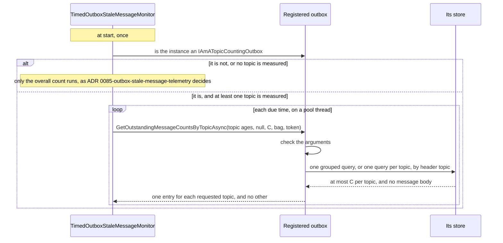
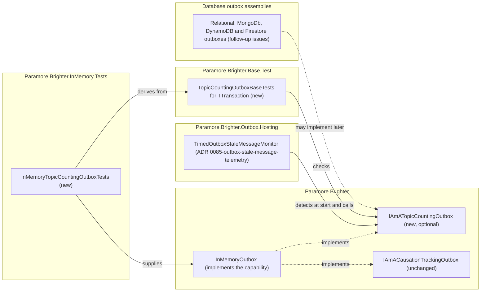

# 86. Outbox per-topic stale count

Date: 2026-10-13

## Status

Proposed

## Context

ADR 0085-outbox-stale-message-telemetry measures the outbox's stale messages on a schedule, overall and for each topic that a publication uses. The overall count uses the count every outbox already has, which covers the whole outbox at one age. No outbox can count several topics, each at its own age and each up to its own ceiling. Without such a count, a topic whose circuit breaker is open cannot show its held messages as a series of its own.

### Terms

This ADR uses these words of the parent requirement's *Terms* table with the same meaning:

- **topic**, **measured topic** and **topic age (A_t)**;
- **stale on topic t** and **topic stale count (S_t)**;
- **ceiling (C)** and **per-topic capability**.

**The monitor** has the meaning that the *Terms* of ADR 0085-outbox-stale-message-telemetry gives it.

One word is this ADR's own:

- **The capability** is `IAmATopicCountingOutbox`. *Key Components* states its contract.

### Scope

**Parent requirement**: [specs/0038-outbox-stale-message-telemetry/requirements.md](../../specs/0038-outbox-stale-message-telemetry/requirements.md)

This ADR decides one thing. An outbox may offer an optional capability that counts stale messages for several topics in one call. It records the answer to Q-15, and how the capability applies the requirement's answer to Q-16. ADR 0085-outbox-stale-message-telemetry records the other answers.

#### In scope

Each requirement below is met by the mechanism named on its bullet. Where the monitor of ADR 0085-outbox-stale-message-telemetry owns the requirement, the bullet says what this ADR contributes.

- **FR-3, what the count per topic counts.** For each requested topic, the capability counts the undispatched messages older than that topic's age, and only those. It takes no list of tripped topics, so it excludes none.
- **FR-3.1 and Q-16, the header topic.** The requirement decides that a message counts toward its header topic, `MessageHeader.Topic`. This ADR records how the capability applies the requirement's header-topic rule (Q-16). ADR 0085-outbox-stale-message-telemetry owns the rest of FR-3.1: which topics are measured, and at which age.
- **FR-4, the ceiling for each topic.** The capability stops each topic at C on its own. A topic at C does not limit the count of another. The monitor caps each returned value at C again.
- **FR-8 and FR-9, contributes.** One call answers every topic. The monitor can then keep one per-topic call in progress and bound every topic with one deadline, as ADR 0085-outbox-stale-message-telemetry decides.
- **FR-12, the arguments.** The capability receives every measured topic with its age, C, the producers' bag, a null request context and a token. It never narrows the requested topics by the bag, and never changes the bag.
- **FR-12.1 and C-6, an optional capability.** An outbox opts in by implementing the interface. The monitor detects the interface on the outbox instance once, at start. An outbox without the capability, a third-party one included, still reports the overall count.
- **FR-14 (d), and FR-14.1 for column (d).** `InMemoryOutbox` implements the capability and passes the conformance base test (AC-34). Four issues track the other families: the relational outboxes, MongoDb, DynamoDB and DynamoDB V4, and Firestore (AC-18).
- **NFR-3, additive API.** The capability is a new interface. No outbox interface gains a member, and `AddProducers` registers nothing new (AC-22).
- **NFR-4 (a), (b) and (c), bounded calls.** The capability answers every topic in one call, holds at most C for each topic, and transfers no message body (AC-23, AC-34).
- **NFR-7, documentation.** The interface's `///` documentation states the contract. The telemetry page is the last step of ADR 0085-outbox-stale-message-telemetry.

#### Answers to the open questions

- **Q-15.** Only `InMemoryOutbox` implements the capability here. Each other outbox family gets an issue of its own (alternative 9). *Why only `InMemoryOutbox` implements the capability here?* gives the reason.
- **Q-16.** The requirement answers it. This ADR records how the capability applies the requirement's header-topic rule (Q-16), under *Why count by the header topic?* (alternative 8).

#### Out of scope

- **The monitor, its schedule and its instruments.** ADR 0085-outbox-stale-message-telemetry decides them, together with how the monitor treats an invalid result.
- **`Publication.StaleMessageAge` and the smallest-age rule (Q-14).** ADR 0085-outbox-stale-message-telemetry decides them. This ADR receives each topic's age as an input.
- **The capability on the other outbox families (OOS-15).** Four follow-up issues track it, one for each family. Each follow-up adds an implementation and turns on the generated conformance tests for its outboxes (*Why only `InMemoryOutbox` implements the capability here?*).
- **An age-aware count for the overall count (Q-5).** ADR 0085-outbox-stale-message-telemetry leaves it to a follow-up. The capability counts only measured topics, so it cannot replace the overall count.
- **The overall count's gaps in FR-14 columns (a) to (c) (Q-9).** Separate issues track them, as step 13 of ADR 0085-outbox-stale-message-telemetry states.
- **The circuit breaker.** It does not change, and the capability reads no breaker state (OOS-14).

### Where this ADR sits

Two ADRs deliver spec 0038. Read ADR 0085-outbox-stale-message-telemetry first.

| ADR | Decides |
| --- | --- |
| ADR 0085-outbox-stale-message-telemetry | the monitor and its fixed schedule, the instruments that publish the counts, each publication's stale age, and the tests of the overall count |
| **ADR 0086-outbox-per-topic-stale-count** *(this one)* | the optional outbox capability that counts several topics in one call, and which outboxes offer it |

The monitor decides when each count runs, at which ages and what the meter reports, and the outbox decides only how its store counts.

### No outbox can count several topics at once

| Existing operation | What it gives | Why it is not the count per topic |
| --- | --- | --- |
| `GetOutstandingMessageCountAsync` | The undispatched messages older than one age, up to one ceiling | It covers the whole outbox at one age. Only MongoDb narrows it, to the one topic that its bag names |
| `OutstandingMessagesAsync` | The undispatched messages themselves, one page at a time | It loads message bodies. Its page size is one ceiling for all topics together, and it takes one age for every topic |
| MongoDb's bag topic, `args["Topic"]` | One topic for the overall count | The bag holds one topic for the whole process, and it narrows the overall count as well |

A count per topic therefore needs a new outbox operation. The operation must count several topics, each at its own age and each up to C. It must load no message body. NFR-3 rules out a new member on the outbox interfaces, so the operation has to be optional.

### The forces

- **No new member on the outbox interfaces (NFR-3).** A new member on `IAmAnOutbox`, `IAmAnOutboxSync` or `IAmAnOutboxAsync` breaks every implementer. Brighter targets `netstandard2.0`, which has no default interface members.
- **The store holds the header topic (FR-3.1).** The circuit breaker trips the header topic. No outbox stores the publication's topic in a column it can filter on.
- **A tripped topic must still be counted (FR-3).** The messages that a tripped topic holds back are the ones the count per topic exists to show.
- **Each topic has its own age and its own ceiling (FR-3.1, FR-4).** A busy topic must not hide a quiet one. One topic's age must not change another topic's count.
- **A due time makes at most two outbox calls (NFR-4 (a)).** One of them is the overall count, so every measured topic shares the other.
- **No message body (NFR-4 (c), FR-14 (d)).** The overall count of the relational outboxes and MongoDb loads whole rows. The count per topic must not.
- **The topics come from the publications, not from the bag (FR-12).** MongoDb narrows its overall count to the bag's topic. The count per topic must answer every requested topic, whatever the bag holds.
- **Each family needs its own query (Q-15).** The relational outboxes need one query per dialect. MongoDb, DynamoDB and Firestore each need a count that loads no bodies, and each needs a container for its tests.
- **A third-party outbox may offer the count (C-6).** Any implementer must be able to check the contract, not only Brighter's own outboxes.

## Decision

**An outbox may offer a new optional capability that counts stale messages for several topics in one call, each topic at its own age.**

The capability, `IAmATopicCountingOutbox`, takes a map from topic to age, one ceiling and the producers' bag. It returns one count for each requested topic, stopped at the ceiling for that topic alone. It counts by the header topic, excludes no tripped topic and transfers no message body. The monitor of ADR 0085-outbox-stale-message-telemetry detects the capability on the outbox instance it already resolves, once, at start. `AddProducers` registers nothing new. `InMemoryOutbox` implements the capability in this change, and four follow-up issues track the other outbox families. The interface states the contract, and a conformance base test checks it for every implementer.

### The mechanism, end to end



Seven invariants follow from this sequence:

- **One call answers every requested topic.** Each due time makes one per-topic call, whatever the number of topics. A store may still run one query per topic inside that call.
- **Each topic stops at C on its own.** A topic at C does not limit the count of another.
- **A message counts toward its header topic.** The capability compares `MessageHeader.Topic` with each requested topic, as `RoutingKey` compares values.
- **The bag never narrows the topics.** The capability counts every requested topic, whatever the bag holds, and never changes the bag.
- **No tripped topic is excluded.** The capability takes no list of tripped topics.
- **No message body is transferred.** Where the store can count, it counts on the server. Otherwise it loads at most C entries per topic, each without its body.
- **The monitor detects the capability once, on the instance.** It checks the outbox it already resolves at start. `AddProducers` registers nothing for the capability.

### Where the pieces live



Every new production dependency points into core. The capability sits in core beside `IAmACausationTrackingOutbox`, so a third-party outbox can implement it without referencing `Outbox.Hosting`. The monitor reaches the capability only through the outbox instance. The conformance base test sits beside `CausationTrackingOutboxBaseTests`. `InMemoryTopicCountingOutboxTests` derives from it, and so do the generated topic-counting tests of each follow-up.

### Key Components

#### The roles, and what each is responsible for

| Role | Type | Responsibilities | Responsibility classifier | Collaborators |
| --- | --- | --- | --- | --- |
| Counts stale messages per topic | `IAmATopicCountingOutbox` (Paramore.Brighter) | Counts each requested topic up to C at its own age, in one call. Rejects invalid arguments before it reads the store. | doing, deciding | its store |
| Counts stale messages per topic in memory | `InMemoryOutbox` (Paramore.Brighter) | Counts its undispatched entries by header topic in one pass. Stops each topic at C. | doing | its entries, `TimeProvider` |
| Checks an outbox against the contract | `TopicCountingOutboxBaseTests<TTransaction>` (Paramore.Brighter.Base.Test) | Runs the contract's cases against the outbox that a derived class supplies. | doing | `IAmATopicCountingOutbox`, one derived class per outbox |
| Detects and calls the capability | `TimedOutboxStaleMessageMonitor` (ADR 0085-outbox-stale-message-telemetry) | Checks the outbox instance once at start. Calls the capability at each due time. | deciding, doing | `IAmATopicCountingOutbox` |

The interface states what a count per topic means. Each outbox decides how its store answers. The base test checks that the answer is the same for every outbox.

#### `IAmATopicCountingOutbox`

```csharp
namespace Paramore.Brighter;

public interface IAmATopicCountingOutbox
{
    Task<IReadOnlyDictionary<RoutingKey, int>> GetOutstandingMessageCountsByTopicAsync(
        IReadOnlyDictionary<RoutingKey, TimeSpan> dispatchedSinceByTopic,
        RequestContext? requestContext,
        int maxCountPerTopic,
        Dictionary<string, object>? args = null,
        CancellationToken cancellationToken = default);
}
```

The interface and its member carry `///` documentation that states the contract below. The sketch omits it.

| Member | Input | Output | Error conditions |
| --- | --- | --- | --- |
| `GetOutstandingMessageCountsByTopicAsync` | Each topic to count, with its age. A request context, which may be null. C, the ceiling for each topic. The producers' bag, which may be null. A cancellation token | One entry for each requested topic, and no other. Each value is the number of undispatched messages on that topic older than its age, stopped at C. 0 for a requested topic with no such message. An empty result for an empty map | `ArgumentNullException` for a null map. `ArgumentException` for a null or empty topic. `ArgumentException` for an age that is not greater than zero, or is greater than 365 days. `ArgumentOutOfRangeException` for a ceiling less than 1. The store's own exception when the store fails. `OperationCanceledException`, or the store client's own cancellation exception, when the token is cancelled before the store answers |

An implementation meets this contract:

- **It counts each requested topic exactly up to C.** With no concurrent writers it returns `min(S_t, C)` for each topic. A topic that reaches C does not limit the count of another.
- **It returns one entry for each requested topic, and no other.** A requested topic with no stale message gets 0. An empty map gets an empty result.
- **It counts by the message's header topic.** It compares `MessageHeader.Topic` with each requested topic, as `RoutingKey` compares values.
- **It never narrows the requested topics by `args`.** It receives `args` for other store-specific uses. A topic set in the bag does not change which topics it counts or their values.
- **It never changes `args`.** The monitor can pass the same dictionary that the mediator's outstanding-message check passes, so a change would reach the posting path.
- **It excludes no tripped topic.** It takes no list of tripped topics.
- **It transfers no message body.** Where the store can count, it counts on the server. Otherwise it loads at most C entries per topic, each without its body.
- **It applies each age on its own clock.** At exactly that age it uses the same boundary as its overall count.
- **It answers every requested topic in the one call.** Inside the call it may run one query for all topics or one query per topic.
- **It is safe to call while other calls run on the same outbox instance.** The overall count and the posting path's calls can run at the same time, from other threads.
- **It honours its token**, as FR-14 (c) requires of the overall count.
- **It checks its arguments before it reads the store.** The contract table lists each exception. The monitor never passes an invalid argument, because it checks every age and topic at start.

The interface is not generic, because the call takes no transaction. It has no synchronous member, because measurement never calls a synchronous count (FR-12, alternative 10). The 365-day bound on each age is the maximum that ADR 0085-outbox-stale-message-telemetry sets for A. The `///` documentation states the bound in prose, because core cannot refer to `Outbox.Hosting`.

#### `InMemoryOutbox`

| Member | Input | Output | Error conditions |
| --- | --- | --- | --- |
| `GetOutstandingMessageCountsByTopicAsync` | As the interface | As the interface, in a completed task, as its overall count returns | As the interface. FR-14 (c) does not apply, because it does no I/O |

`InMemoryOutbox` counts in one pass over its entries. For each undispatched entry whose header topic is requested, it adds one to that topic's count while the count is below C. An entry counts when its `WriteTime` is at or before the outbox's current time minus that topic's age. This is the same boundary as its overall count.

It ignores `args`, as its overall count does. It creates the same database span as its overall count, so the answer to Q-12 in ADR 0085-outbox-stale-message-telemetry covers it. Its entries live in a `ConcurrentDictionary`, so the pass is safe while other calls add or mark entries.

#### `TopicCountingOutboxBaseTests<TTransaction>`

```csharp
namespace Paramore.Brighter.Base.Test.Outbox;

public abstract class TopicCountingOutboxBaseTests<TTransaction> : IDisposable
{
    protected abstract IAmAnOutboxSync<Message, TTransaction> Outbox { get; }
    protected virtual TimeSpan ReadConsistencyTimeout => TimeSpan.Zero;
    protected virtual void CreateStore() { }
    protected virtual void DeleteStore() { }
    protected abstract Task AddMessageWithAgeAsync(Message message, TimeSpan age);
    protected virtual void BeforeCount() { }
}
```

| Member | Input | Output | Error conditions |
| --- | --- | --- | --- |
| `Outbox` | None | The outbox under test. It must also implement `IAmAnOutboxAsync<Message, TTransaction>` and `IAmATopicCountingOutbox` | Every case fails for an outbox without the capability |
| `AddMessageWithAgeAsync` | A message and an age | The message is in the outbox. It is that age old on the outbox's own clock at the moment the case calls the capability | None |
| `BeforeCount` | None | The outbox's clock is ready for the count. A case calls it immediately before each call to the capability. It does nothing by default | None |
| `ReadConsistencyTimeout` | None | How long a case may retry a count against an eventually consistent index. Zero by default | None |
| `CreateStore`, `DeleteStore` | None | Create and remove the store around each case, as in `CausationTrackingOutboxBaseTests` | None |

The base test follows `CausationTrackingOutboxBaseTests`. A store project supplies its outbox and its store hooks, and inherits every case. `AddMessageWithAgeAsync` exists because each outbox measures age on its own clock (A-1, A-2). The age must hold when the case calls the capability, not only when the message is added.

The in-memory class keeps one fixed instant on its `FakeTimeProvider`, later than the clock's start by more than any age a case uses. For each message, it sets the clock to that instant minus the age with `SetUtcNow`, then adds the message. Its `BeforeCount` advances the clock to the fixed instant. In Microsoft.Extensions.TimeProvider.Testing 10.10.0, `SetUtcNow` throws for a time before the current one. The cases therefore add their messages oldest first, and all of them before the first count.

A store class sets `Header.TimeStamp` relative to the store's clock, as AC-16 does. That clock keeps moving, so the cases keep each message's age well away from every requested topic age.

#### Where each type is touched

| Assembly | Type | Change |
| --- | --- | --- |
| Paramore.Brighter | `IAmATopicCountingOutbox` | New optional capability interface, beside `IAmACausationTrackingOutbox` |
| Paramore.Brighter | `InMemoryOutbox` | Implements `IAmATopicCountingOutbox` |
| Paramore.Brighter.Base.Test | `TopicCountingOutboxBaseTests<TTransaction>` | New conformance base test, beside `CausationTrackingOutboxBaseTests` |
| Paramore.Brighter.InMemory.Tests | `InMemoryTopicCountingOutboxTests` | New, derived from the base test as `InMemoryCausationTrackingOutboxTests` is |

The following stay unchanged:

- `IAmAnOutbox`, `IAmAnOutboxSync` and `IAmAnOutboxAsync` (NFR-3).
- Both `AddProducers` overloads. The monitor detects the capability on the outbox instance it resolves, so neither overload registers it.
- `IAmACausationTrackingOutbox`, its registration in both `AddProducers` overloads, and its check in `HandlerPipelineValidationRules`.
- `InMemoryOutbox`'s existing members, including its overall count and `OutstandingMessagesAsync`.
- Every outbox other than `InMemoryOutbox`. Four follow-up issues add the capability to them.
- `IAmAnOutboxCircuitBreaker` and its implementations. The capability takes no tripped topics.
- `MessageHeader`, `WrapPipeline` and the `ProducerTopic` bag entry. The capability reads the header topic as it is.

### Technology Choices

#### Why an optional capability?

The count per topic needs a new outbox operation: count several topics, each at its own age, each up to C. NFR-3 rules out a new member on `IAmAnOutbox`, `IAmAnOutboxSync` or `IAmAnOutboxAsync`, because a new member breaks every implementer on netstandard2.0. An optional capability adds the operation without that cost (alternative 1). An outbox that does not implement it still reports the overall count (FR-12.1).

Brighter already has this shape on the outbox. `IAmACausationTrackingOutbox` (ADR 0057-replay-outbox-on-inbox-duplicate) is an opt-in role interface. `AddProducers` registers it in both overloads, and `HandlerPipelineValidationRules` also checks it with `is`.

The monitor needs no registration. It already resolves the outbox instance at start, and detects `IAmATopicCountingOutbox` on that instance with `is`, once. `AddProducers` therefore stays unchanged, and the change stays additive (NFR-3). `IHaveAChannelFailureCount`, which the requirement names as its model, is detected on the instance in the same way, by `BrighterServiceActivatorHealthCheck`. Alternative 2 records the registration that the capability does not need.

#### Why one call for every topic?

The capability takes every measured topic, with its age, in one call. Each due time then makes one per-topic call, whatever the number of topics. The bounds of the requirement follow from that shape:

- a due time makes at most two outbox calls, one overall and one per-topic (NFR-4 (a));
- at most one per-topic call is in progress (FR-8);
- one deadline bounds the answer for every topic (FR-9);
- one outcome covers all topics, as the per-topic count's FR-6 signal requires.

One call also lets a store answer every topic in one round trip, for example with a grouped query. An implementation may still run one query per topic inside the call. The cost is that one slow topic delays the whole answer. If the call passes the deadline, every topic loses its reading for that due time. Alternative 4 records the rejected shape, one call per topic.

#### How the capability applies the ceiling

The monitor passes C once, as the ceiling for each topic. The capability applies it to each topic on its own:

- it stops counting a topic at C;
- a topic at C does not stop the count of another;
- its answer holds at most C for each requested topic.

The contract bullet *It transfers no message body* states what the capability may read to reach that answer. The monitor caps each returned value at C again. V_t equal to C then means "C or more" even when an outbox returns more (ADR 0085-outbox-stale-message-telemetry).

The overall count keeps its own C. A topic at C says nothing about the overall value. With C of 3, 50 stale messages on "orders", 2 on "payments" and none on "refunds" report 3, 2 and 0 (FR-4).

One per-topic call reads at most C entries for each measured topic, or counts on the server. Its cost grows linearly with the number of measured topics, and neither ADR sets a limit on that number. The documentation explains the trade-off and how to choose C with it in mind (NFR-7). Alternative 5 records the rejected shared ceiling.

#### Why count by the header topic?

The store holds the header topic, `MessageHeader.Topic`, for every message. The circuit breaker trips the same topic. The mediator trips the header topic after a failed send, a failed batch or a failed confirmation (FR-3.1). Counting by the header topic therefore shows the messages that a tripped topic holds back.

A mapper can give a message a header topic that differs from its publication's topic. Brighter then keeps the publication's topic in the `ProducerTopic` bag entry. Such a message counts toward its header topic. It is in the per-topic count only if a publication in this process uses that header topic. It is always in the overall count. Alternative 8 records the rejected count by the bag entry.

#### Why does the bag never narrow the topics?

MongoDb narrows its overall count to `args["Topic"]` when the bag sets one. The capability does not follow that. The monitor takes the measured topics from the publications (FR-3.1). FR-14 (d) requires an answer for every requested topic, whatever `args` holds.

An outbox still receives `args`, because a store may need it for other uses. The capability never changes `args`, because the monitor can pass the mediator's own dictionary. Alternative 6 records the rejected narrowing.

#### Why does the capability exclude no tripped topic?

The sweeper passes the tripped topics to `OutstandingMessagesAsync`, so that it does not resend their messages yet. The count per topic exists to show exactly those messages. The capability therefore takes no list of tripped topics, and counts a tripped topic like any other (FR-3, AC-40). Alternative 7 records the rejected exclusion.

#### Why does the capability check its arguments?

The requirement bounds every age so that a store's `now - age` cannot overflow (FR-2). A null or empty topic names no messages that a store could match. The capability rejects both before it reads the store, so a third-party caller learns of the mistake at once. The monitor never passes either, because it checks every age at start and measures only non-empty topics.

#### Why only `InMemoryOutbox` implements the capability here?

Each outbox family needs its own query and its own container-based tests. The relational outboxes need one query per dialect. MongoDb, DynamoDB and Firestore each need a count that loads no bodies. One pull request for all of them would be large and slow to review. The work on issue #4554 was split into three small pull requests for the same reason.

This ADR therefore lands the contract, the conformance base test and the in-memory implementation. The outbox tests that every store shares are generated (ADR 0035-generated-test, `.agent_instructions/generated_tests.md`). So the first family's follow-up also adds a topic-counting suite to the test generator. The suite has a setting for each outbox, `SupportsTopicCounting`, false by default. The generator renders the suite only for an outbox whose setting is true. Each family's follow-up adds its implementation and turns the setting on in the `test-configuration.json` of its outboxes. The suite lands with the first family, not here. With the setting off for every outbox, the generator would render none of the suite's tests. Some families have a natural starting point:

- MongoDb's overall count already filters on the bag's topic, through `OutstandingMessagesAsync`;
- DynamoDB already has an outstanding index keyed by topic.

The cost is that a database outbox reports the overall count only until its follow-up lands. Four issues track the families (FR-14.1):

- the relational outboxes: MsSql, PostgreSql, MySql, Sqlite and Spanner;
- MongoDb;
- DynamoDB and DynamoDB V4;
- Firestore.

Unlike the causation suite, the topic-counting suite needs its setting. The test generator renders the causation suite for every configured outbox, with no setting, because every outbox family already implements `IAmACausationTrackingOutbox`. Rendered for every outbox, the topic-counting suite's cases would fail on each outbox that does not implement the capability yet. `SkipTest` cannot prevent that, because it skips a template only for an outbox without transactions. The overall count's suite in ADR 0085-outbox-stale-message-telemetry uses gap marks, but the topic-counting suite uses none. Implementing the capability on any outbox but `InMemoryOutbox` is out of scope (OOS-15), so no case of the suite can pass before its family's follow-up. Each column (d) gap still shows in the FR-14 table, in the family's issue and in the outbox's known limitations (AC-18).

### Implementation Approach

Line numbers refer to commit 1ce331eb2.

These steps land after step 2 of ADR 0085-outbox-stale-message-telemetry and before its step 3. They are in commit order, structural before behavioural. The behavioural step is test first.

1. **Structural: the interface.** Add `IAmATopicCountingOutbox` to `src/Paramore.Brighter/`, beside `IAmACausationTrackingOutbox` (`IAmACausationTrackingOutbox.cs:41`). Its `///` documentation states every contract bullet, and the 365-day bound in prose. Nothing implements or calls it yet.
2. **Behavioural: the conformance base test and `InMemoryOutbox` (AC-34).** Add `TopicCountingOutboxBaseTests<TTransaction>` to `tests/Paramore.Brighter.Base.Test/Outbox/`, modelled on `CausationTrackingOutboxBaseTests` (`CausationTrackingOutboxBaseTests.cs:16-64`). Derive `InMemoryTopicCountingOutboxTests` in `InMemory.Tests`, as `InMemoryCausationTrackingOutboxTests` derives (`InMemoryCausationTrackingOutboxTests.cs:34-39`). Then add the interface to `InMemoryOutbox` (`InMemoryOutbox.cs:83`). Count in one pass with the overall count's boundary (`:633-634`). Return a completed task, as its overall count does (`:646-655`). The base test's cases:
   - AC-34 as written, with C of 100 and of 3;
   - the result has exactly the requested topics: a requested topic with no message returns 0, and an unrequested topic has no entry;
   - `args` of `{"Topic": "orders"}` does not narrow the requested topics, and `args` holds the same entries after the call;
   - a message counts toward its header topic, not its `ProducerTopic` bag entry;
   - an empty map returns an empty result;
   - a null map throws `ArgumentNullException`;
   - an empty topic (`RoutingKey.Empty`) throws `ArgumentException`. Only review checks the null topic, because a `Dictionary` key cannot be null;
   - ages of zero, of -1 second and of 365 days plus one tick throw `ArgumentException`, and an age of 365 days is accepted;
   - a ceiling of 0 throws `ArgumentOutOfRangeException`;
   - the call runs while other tasks add messages, mark them dispatched and run the overall count on the same instance. Every result has one entry for each requested topic. Those tasks add through the outbox itself, not through `AddMessageWithAgeAsync`.

   The cancellation case of FR-14 (c) for the capability belongs to each family's follow-up. AC-17, the overall count's cancellation case, is part of step 13 of ADR 0085-outbox-stale-message-telemetry. `InMemoryOutbox` does no I/O, so FR-14 (c) does not apply to it.
3. **Follow-up issues (FR-14.1, OOS-15, AC-18).** Open one issue for each family: the relational outboxes (MsSql, PostgreSql, MySql, Sqlite and Spanner), MongoDb, DynamoDB and DynamoDB V4, and Firestore. Each issue points at `TopicCountingOutboxBaseTests` as the base test that the generated suite derives from. The MongoDb issue names the bag-topic filter of its overall count (`MongoDbOutbox.cs:497-500`). The DynamoDB issue names the outstanding index keyed by topic (`DynamoDbConfiguration.cs:23-25`). Each issue says that the first family to land adds the topic-counting suite to `OutboxGenerator.SuitesFor` (`OutboxGenerator.cs:146`), with the `SupportsTopicCounting` setting. *Why only `InMemoryOutbox` implements the capability here?* explains the setting. Each issue asks its family to turn the setting on for its outboxes. Step 14 of ADR 0085-outbox-stale-message-telemetry lists each family's limitation in the documentation.

## Consequences

### Positive

- A count per topic needs no change to the outbox interfaces, so no existing outbox, a third-party one included, has to change.
- An outbox opts in when its family is ready. Until then it keeps reporting the overall count.
- One call per due time keeps the store load of the count per topic at one bounded call, whatever the number of topics.
- A store can answer every topic in one round trip, for example with a grouped query.
- The header topic matches what the circuit breaker trips, so a tripped topic's held messages show under that topic.
- The conformance base test gives each follow-up, and each third-party outbox, a ready definition of done.
- `AddProducers` does not change, so the capability adds no registration to reason about.

### Negative

- Every outbox other than `InMemoryOutbox` reports the overall count only, until its family's follow-up lands. An application on a database outbox gets no per-topic series from this change alone.
- The per-topic call's cost grows linearly with the number of measured topics: up to C entries for each topic. Neither ADR sets a limit on the number of topics.
- One slow topic delays the whole per-topic answer. If the call passes the deadline, every topic loses its reading for that due time.
- A message whose header topic differs from its publication's topic counts toward its header topic. It is in the per-topic count only if a publication in this process uses that topic (FR-3.1).
- A decorator around the outbox hides the capability unless it implements the capability too. The monitor then reports the overall count only, and logs the missing capability once at start.
- `InMemoryOutbox` reads every entry to answer one call. Its cost grows with the number of entries, not only with C.
- Core gains a public interface that Brighter must support, with a contract that every implementer must meet.

### Risks and Mitigations

| Risk | Mitigation |
| --- | --- |
| A third-party capability narrows the topics by `args`, misses a requested topic or returns more than C | The `///` documentation states the contract, and the base test checks it. The monitor treats a missing topic as a failure, drops unrequested topics and caps each value at C (ADR 0085-outbox-stale-message-telemetry) |
| Many measured topics make the per-topic call pass T at every due time | The abandonments show in the counter's `per_topic` series, and the overall count is unaffected. The documentation explains the linear cost, and how a lower C or a larger T helps |
| A mapper changes a message's header topic | The message counts toward its header topic, and always toward the overall count. The documentation lists the limitation |
| A follow-up's query reads message bodies | The contract forbids it. Each follow-up's review checks the query against the *It transfers no message body* bullet |
| A follow-up implements the capability on a store whose index is eventually consistent | The base test's `ReadConsistencyTimeout` lets a case retry, as `CausationTrackingOutboxBaseTests` does for DynamoDB |
| The capability runs while posting-path calls use the same outbox instance | The contract requires the call to be safe at the same time, and the base test runs it beside adds, marks and the overall count |

## Alternatives Considered

1. **Add the count per topic as a member of `IAmAnOutboxAsync`.** This would make every outbox offer it. Rejected because a new member breaks every implementer on netstandard2.0 (NFR-3). An optional capability lets each family opt in when it is ready.
2. **Register the capability in both `AddProducers` overloads, like `IAmACausationTrackingOutbox`.** This would let a consumer resolve the capability from the container. Rejected because no consumer resolves it: the monitor already holds the outbox instance and checks it with `is`. The deferred overload would also need a descriptor that resolves to null for an outbox without the capability, as it has for causation tracking.
3. **Count per topic by listing messages with `OutstandingMessagesAsync` and grouping them in memory.** Every outbox already implements that call, so no capability is needed. Rejected because it loads message bodies, against NFR-4 (c). Its page size is one ceiling for all topics together, so a busy topic hides the others. It takes one age for every topic. On DynamoDB it would also share the sweeper's scan.
4. **One capability call per topic.** The capability would mirror `GetOutstandingMessageCountAsync`, with one topic and one age. Rejected because N topics then need N calls per due time, against NFR-4 (a). Run in sequence, one slow topic delays the rest past T. Run in parallel, N calls are in progress at once, against FR-8. One call keeps one deadline and one outcome for all topics.
5. **One ceiling shared by all topics.** This would bound the whole answer by C instead of C per topic. Rejected because a busy topic would then hide a quiet one, and FR-4 applies the ceiling to each topic.
6. **Let the bag narrow the topics, as MongoDb's overall count does.** This would treat `args` the same way in both counts. Rejected because the measured topics come from the publications (FR-3.1). A bag that names one topic would silence every other measured topic, against FR-14 (d).
7. **Exclude tripped topics, as the sweeper's call to `OutstandingMessagesAsync` does.** This would match what the sweeper resends. Rejected because the messages that a tripped topic holds back are the ones the count per topic exists to show (FR-3).
8. **Count by the `ProducerTopic` bag entry instead of the header topic (Q-16).** This would follow the publication's topic when a mapper changes the header topic. Rejected because the circuit breaker trips the header topic, so held messages would show under a topic that is not tripped. Each outbox would also have to filter on a bag value, which no store indexes.
9. **Implement the capability on the relational family in this change too (Q-15).** This would give the database outboxes a count per topic at once. Rejected because it needs one query per dialect and a database container for each, in the same pull request as the monitor. The conformance base test makes each family's follow-up small.
10. **Add a synchronous member to the capability.** This would mirror the outbox's pair of synchronous and asynchronous counts. Rejected because measurement never calls a synchronous count (FR-12). A synchronous member would double each family's work for a caller that does not exist.

## References

- Parent requirement: [specs/0038-outbox-stale-message-telemetry/requirements.md](../../specs/0038-outbox-stale-message-telemetry/requirements.md), spec 0038, issue [#4489](https://github.com/BrighterCommand/Brighter/issues/4489)
- Review on PR [#4598](https://github.com/BrighterCommand/Brighter/pull/4598): [review comment on the requirements](https://github.com/BrighterCommand/Brighter/pull/4598#discussion_r4256375898), 2026-10-13, which suggests a per-topic outstanding count beside the overall count.
- Comment on PR [#4598](https://github.com/BrighterCommand/Brighter/pull/4598): [comment on the generated tests](https://github.com/BrighterCommand/Brighter/pull/4598#issuecomment-6196267020), 2026-10-15, which points out that the box tests are generated from Liquid templates.
- Related ADRs (none is superseded by this ADR):
  - ADR [0085-outbox-stale-message-telemetry](0085-outbox-stale-message-telemetry.md) decides the monitor that detects and calls the capability, and the instruments that report its results.
  - ADR [0057-replay-outbox-on-inbox-duplicate](0057-replay-outbox-on-inbox-duplicate.md) adds `IAmACausationTrackingOutbox`, the opt-in outbox role interface beside which the capability sits.
  - ADR [0035-generated-test](0035-generated-test.md) is the test generator that renders the outbox suites, and that the first family's follow-up extends with a topic-counting suite.
  - ADR [0081-report-persistent-channel-failures-in-health-checks](0081-report-persistent-channel-failures-in-health-checks.md) adds `IHaveAChannelFailureCount`, the optional capability the requirement names as its model.
- Related issues:
  - Issue [#4554](https://github.com/BrighterCommand/Brighter/issues/4554): the cost of the outstanding-message count, and the precedent for splitting outbox work into small pull requests.
  - Issue [#4573](https://github.com/BrighterCommand/Brighter/issues/4573): the rule against new members on public roles, which NFR-3 extends to the outbox interfaces.
