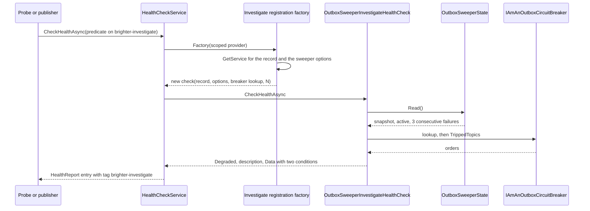
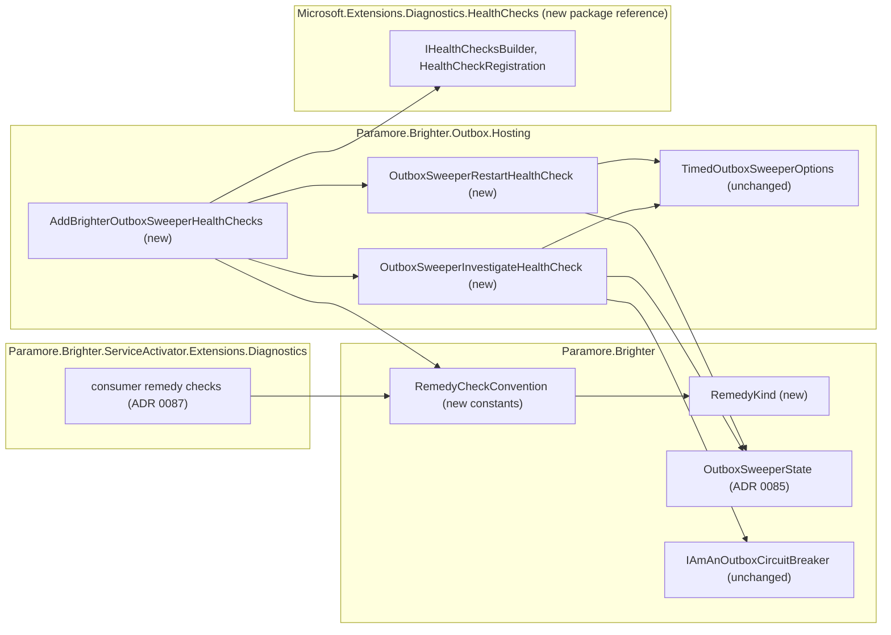

# 86. Sweeper remedy health checks

Date: 2026-10-16

## Status

Proposed

## Context

ADR 0085 gives the outbox sweeper one shared record of its state, and gauges that read that record. An orchestrator still cannot act on the sweeper's health. Brighter's only health check reports a single Degraded status, and a host maps that status to one probe. A hung sweep needs a restart. Failed sweeps and circuit-broken topics need an operator to look, and a restart or a readiness failure does not help them. Brighter needs sweeper health checks that tell an orchestrator which response each condition needs, using only standard .NET health-check concepts.

### Terms

These words come from the requirements' *Definitions* section, and this ADR uses them exactly as defined there: **remedy kind**, **remedy check**, **restart check**, **investigate check**, **condition**, **hung sweep**, **hang threshold**, **failure threshold (N)**, **consecutive failed sweeps**, **tripped topic**, **circuit breaker in use**, **active sweeper**, **stopped sweeper** and **opt in**. ADR 0085's *Terms* block defines **the record** and **snapshot**, and this ADR uses those words in the same sense. One further word is this ADR's own.

- **Remedy tag**: the one health-check tag that names a remedy check's remedy kind. *The remedy-kind convention* under *Key Components* lists the three tags.

### Scope

- **Parent requirement**: [specs/0038-add-sweeper-health-check/requirements.md](../../specs/0038-add-sweeper-health-check/requirements.md) (issue #4573).
- **In scope**
  - **FR-4 (two checks, one call)**: `AddBrighterOutboxSweeperHealthChecks` on `IHealthChecksBuilder` registers the restart check and the investigate check together.
  - **FR-4A, FR-4A.1 (sweeper not found)**: each check's registration factory looks up the record on every run. When no record is registered, both checks report Healthy and say that no outbox sweeper is registered.
  - **FR-5, FR-5.1 (hung sweep)**: the restart check compares the snapshot's running time with the hang threshold, using a strict greater-than.
  - **FR-6, FR-6.1 (consecutive failed sweeps)**: the investigate check compares the snapshot's failed count with N.
  - **FR-6A, FR-6A.1 to FR-6A.6 (tripped topics)**: while the snapshot says the sweeper is active, the investigate check looks up the circuit breaker in use and reads `TrippedTopics`.
  - **FR-7.1, FR-7.2, FR-7.3 (thresholds)**: the registration call validates both thresholds before it registers anything. Each check's constructor validates them again.
  - **FR-8 (descriptions)**: the wording rules in *Descriptions*. A check describes only its own conditions.
  - **FR-9 for the checks (shared lock)**: no special handling. A lock-unavailable sweeper is neither hung, failed nor active.
  - **FR-10.1, FR-10.3, FR-10.4, FR-10.5 (remedy-kind convention)**: a `RemedyKind` enum, three remedy tags and two `Data` keys in core, and a documented `Data` shape that each check builds itself.
  - **FR-13.1 (failure status)**: every remedy check is registered with failure status Degraded.
  - **FR-13.2 for the investigate check (tripped topics unreadable)**: the check catches a failure from the breaker lookup or from `TrippedTopics`, logs it at Error, and reports the unreadable condition with the exception type.
  - **NFR-1 for the checks (reads while blocked)**: a check reads one snapshot and, only while the sweeper is active, the breaker. Neither read waits on the sweeper's thread.
  - **NFR-5 (no forced dependency)**: the checks live in `Paramore.Brighter.Outbox.Hosting`. The package gains one reference, `Microsoft.Extensions.Diagnostics.HealthChecks`.
  - **NFR-7 (idiomatic)**: routing uses only tags, `HealthStatus`, `HealthCheckOptions.Predicate` and `ResultStatusCodes`.
  - **FR-11 for the sweeper checks (documentation)**: the health-check page sections on the sweeper checks, the remedy-kind convention, the routing example, the JSON response writer and hang-threshold sizing, and the matching release-note entries.
- **Contributed to here, discharged elsewhere**
  - **AC-26 and AC-48 (concurrency and read cost)**: ADR 0085 owns the record's half. This ADR extends both tests to the two checks.
  - **AC-49 (convention test)**: this ADR adds the reflection test and its exemption list. ADR 0087 adds the consumer registration call to the test's list of named calls.
- **Out of scope**
  - The record, its snapshot, the active-sweeper rule, and the two gauges. ADR 0085 covers them.
  - The consumer remedy checks, the `[Obsolete]` marking of `BrighterServiceActivatorHealthCheck`, the additive `Dispatcher` members, and FR-12. ADR 0087 covers them. ADR 0087 uses this ADR's convention.
  - The FR-11 migration steps and the consumer sections of the health-check page. ADR 0087 covers them, because the migration's cut-over step concerns the consumer check.
  - Endpoint mapping in ASP.NET Core. Brighter documents the mapping but does not add endpoints.

### Where this ADR sits

| ADR | Decides |
| --- | --- |
| [0085](0085-track-outbox-sweeper-state-and-publish-gauges.md) (proposed) | how the sweeper records its state in one tear-free record, how signals find that record, and the two gauges that read it |
| **0086** *(this one)* | the sweeper remedy health checks: package, registration, tags, data keys, descriptions, thresholds and the remedy-kind convention |
| [0087](0087-consumer-remedy-health-checks.md) (proposed) | the consumer remedy checks that split `BrighterServiceActivatorHealthCheck`, its `[Obsolete]` marking, and the additive `Dispatcher` members |

Health checks and gauges give operators actionable guidance on the sweeper and the consumers, and never stall waiting on a stuck thread.

### A Degraded status does not say what to do

| Condition | Response it needs | What one Degraded check on a readiness endpoint does |
| --- | --- | --- |
| A sweep has run past the hang threshold | Restart the process. Only a restart clears a hang | Removes the pod from the load balancer. The sweeper serves no traffic, so the hang stays |
| N sweeps in a row have failed | Investigate the outbox or the lock store | Removes the pod, which does not fix the outbox and stops the pod's request traffic |
| An active sweeper has topics circuit-broken | Investigate the broker or the topic | Removes the pod, which stops healthy topics too. A restart also clears an in-memory breaker's trips without curing the broker |
| The tripped topics cannot be read | Investigate the circuit breaker | As the row above |

Three consequences follow from this table.

- A host cannot route a sweeper condition to the right probe if every condition shares one check and one status.
- Brighter's existing guidance, mapping Degraded to 503 on readiness, is right for a consumer that cannot receive and wrong for every row above.
- An operator reading a status page cannot tell the response a condition needs without parsing free text.

The mechanism behind these consequences is in the code and the framework.

- `BrighterServiceActivatorHealthCheck` returns one result, with no tags and no `Data` (`src/Paramore.Brighter.ServiceActivator.Extensions.Diagnostics/HealthChecks/BrighterServiceActivatorHealthCheck.cs:83-98`).
- `Microsoft.Extensions.Diagnostics.HealthChecks` routes by registration: a predicate selects registrations, usually by tag, and an endpoint maps each `HealthStatus` to an HTTP status. One registration can be routed one way only.
- No Brighter assembly registers a health check today. No source file under `src/` names `IHealthChecksBuilder` or `HealthCheckRegistration`.

### The forces

- **Routing reads only tags and status (NFR-7, FR-10.3).** A condition that needs a different response needs a different registration.
- **One call registers both checks (FR-4).** A user opts in once and gets both remedy kinds.
- **Bad thresholds fail at registration (FR-7.1).** The host builds a check through its factory on the first probe, which is too late for validation.
- **The sweeper may be registered after the checks, or not at all (FR-4A).** The checks must find the record when they run, not when they are registered.
- **A check must not wait on the sweeper's thread (NFR-1).** The record's `Read` is safe for that, as ADR 0085 decides. `TrippedTopics` is assumed not to block.
- **A failed breaker read is a condition, not an exception (FR-13.2).** The check must catch the failure itself so that it can still report its other conditions.
- **A non-opted-in user takes at most one new package (NFR-5).** The allowed package is `Microsoft.Extensions.Diagnostics.HealthChecks`, which has no ASP.NET Core dependency.
- **ADR 0087 must reuse the same convention.** `Paramore.Brighter.ServiceActivator.Extensions.Diagnostics` and `Paramore.Brighter.Outbox.Hosting` share only one Brighter assembly, `Paramore.Brighter` (`Paramore.Brighter.ServiceActivator.csproj:12`, `Paramore.Brighter.Outbox.Hosting.csproj:19`).
- **Add no abstraction without necessity.** This constraint is in the requirements' *Constraints and Assumptions*. Constants and small value types are preferred to a new interface.
- **`Data` must serialize with any serializer (FR-10.5).** Values are strings, numbers, arrays and dictionaries of them.

## Decision

**Brighter registers two sweeper remedy checks, one per remedy kind, through one opt-in call in `Paramore.Brighter.Outbox.Hosting`, and every remedy check carries exactly one `brighter-*` remedy tag, failure status Degraded, and `Data` built by one shared core convention.**

The restart check reports a hung sweep. The investigate check reports consecutive failed sweeps, tripped topics and unreadable tripped topics. Each check reads ADR 0085's record from the container on every run, and the investigate check looks up the circuit breaker only while the sweeper is active. A check reports Healthy or Degraded, never Unhealthy. The registration call validates its thresholds before it registers anything. The tag names, the remedy-kind names and the `Data` layout live in core as constants, and each check builds its own `Data` to that documented layout, so ADR 0087's consumer checks follow the same convention.

### The mechanism, end to end



The restart check follows the same path, without the breaker. The service calls the registration factory on every run, so a check always reads the record that the container holds now. Each check evaluates its conditions in a fixed order:

| Check | Condition name | Applies when | Remedy kind | Values in `Data` |
| --- | --- | --- | --- | --- |
| restart | `hung_sweep` | a sweep is in progress and its running time is strictly greater than the hang threshold | restart | `running_time_seconds`, `hang_threshold_seconds`, `timer_interval_seconds` |
| investigate | `consecutive_failed_sweeps` | the failed count is greater than or equal to N | investigate | `count`, `threshold`, `timer_interval_seconds` |
| investigate | `tripped_topics` | the sweeper is active, and the breaker lists one or more topics | investigate | `count`, `topics` (every name, ordinal order) |
| investigate | `tripped_topics_unreadable` | the sweeper is active, and the breaker lookup or `TrippedTopics` threw | investigate | `exception_type` |

At most one of the last two rows applies on one run. The check reports Degraded when any row applies and Healthy otherwise.

Six invariants follow from the sequence and the table.

- **One registration, one remedy kind.** Each check owns only conditions of its own remedy kind, so a hung sweep never appears on the investigate check, and failures never appear on the restart check (FR-10.1, AC-16).
- **No sweeper means Healthy.** When the factory finds no record, the check reports Healthy with an empty conditions collection and does no other work (FR-4A.1).
- **An inactive sweeper never touches the breaker.** A breaker that throws on an inactive sweeper therefore logs nothing (FR-6A.5, AC-68).
- **A failed breaker read never hides another condition.** The check catches the failure, adds the unreadable condition, and still reports the failed count (FR-13.2).
- **The status is Healthy or Degraded.** A check returns Degraded for a reported condition. An unexpected exception thrown inside a check becomes Degraded through the registration's failure status (FR-13.1).
- **A run is synchronous and short.** A check takes one snapshot and makes at most one breaker read, and it completes with `Task.FromResult` (NFR-1, AC-17).

### Where the pieces live



Every Brighter dependency points into core. The convention types sit in core because core is the one Brighter assembly that both `Outbox.Hosting` and `ServiceActivator.Extensions.Diagnostics` reference. The convention types name no health-check type. `Data` is a plain `IReadOnlyDictionary<string, object>`, so core gains no package reference.

### Key Components

#### The roles, and what each is responsible for

| Role | Type | Responsibilities | Responsibility classifier | Collaborators |
| --- | --- | --- | --- | --- |
| Names a remedy kind | `RemedyKind` (core, new enum) | Distinguishes restart, take out of service and investigate | knowing | none |
| States the remedy-kind convention | `RemedyCheckConvention` (core, new static class) | Holds the three remedy tags and the two `Data` keys; maps a kind to its tag and its `Data` value | knowing | `RemedyKind` |
| Reports whether a sweep is hung | `OutboxSweeperRestartHealthCheck` (Outbox.Hosting, new) | Reads one snapshot; decides the hung-sweep condition; describes it; builds its own `Data` to the convention | knowing, deciding | `OutboxSweeperState`, `TimedOutboxSweeperOptions`, `RemedyCheckConvention` |
| Reports sweeper conditions that need an operator | `OutboxSweeperInvestigateHealthCheck` (Outbox.Hosting, new) | Reads one snapshot; decides the failure condition; while active, reads the breaker and decides the tripped and unreadable conditions; logs an unreadable breaker; describes it; builds its own `Data` to the convention | knowing, doing, deciding | `OutboxSweeperState`, `TimedOutboxSweeperOptions`, `IAmAnOutboxCircuitBreaker`, `RemedyCheckConvention` |
| Opts a host in to the sweeper checks | `AddBrighterOutboxSweeperHealthChecks` (Outbox.Hosting, new extension) | Validates thresholds; registers both checks with their names, remedy tags, failure status and per-run factories | doing | `IHealthChecksBuilder`, `HealthCheckRegistration` |

The record decides "active sweeper", and the investigate check reads `IsActive` without re-deriving it. Each check decides only its own conditions. Neither check holds state between runs, so the host may build a fresh check on every run.

#### The remedy-kind convention

The convention is the rule every Brighter remedy check follows, now and in future (FR-10.4):

- A remedy check reports conditions of one remedy kind only.
- A remedy check is registered with exactly one tag, its remedy tag, and no other tag.
- A remedy check is registered with failure status Degraded.
- A remedy check's `Data` always holds the remedy kind and the conditions collection, whether the check is Healthy or Degraded.
- `BrighterServiceActivatorHealthCheck` is the one documented exception. ADR 0087 decides its future.

| Remedy kind | Remedy tag | `Data` value of `remedy_kind` | Typical endpoint |
| --- | --- | --- | --- |
| `RemedyKind.Restart` | `brighter-restart` | `restart` | liveness, with Degraded mapped to 503 |
| `RemedyKind.TakeOutOfService` | `brighter-out-of-service` | `take_out_of_service` | readiness, with Degraded mapped to 503 |
| `RemedyKind.Investigate` | `brighter-investigate` | `investigate` | operator monitoring, with the default status codes |

| Member of `RemedyCheckConvention` | Input | Output | Error conditions |
| --- | --- | --- | --- |
| `RestartTag`, `TakeOutOfServiceTag`, `InvestigateTag` | none | the tag strings above, as `const` | none |
| `RemedyKindKey` | none | `"remedy_kind"`, as `const` | none |
| `ConditionsKey` | none | `"conditions"`, as `const` | none |
| `Tag(RemedyKind kind)` | a kind | its remedy tag | `ArgumentOutOfRangeException` for an undefined value |
| `Name(RemedyKind kind)` | a kind | its `remedy_kind` value | `ArgumentOutOfRangeException` for an undefined value |

The tags are constants so that a host's predicate can name them, for example `Predicate = r => r.Tags.Contains(RemedyCheckConvention.RestartTag)`.

#### The `Data` shape

Every remedy check builds the same `Data` dictionary, with the keys from `RemedyCheckConvention`:

- `remedy_kind` holds the kind's name from `RemedyCheckConvention.Name`.
- `conditions` holds a `string[]` of the condition names that apply, in evaluation order. It is empty when the check is Healthy.
- One entry per reported condition has the condition's name as its key. Its value is a dictionary of that condition's values.

Example `Data` for AC-38, with N = 3 and `TimerInterval` = 10 s:

```json
{
  "remedy_kind": "investigate",
  "conditions": ["consecutive_failed_sweeps", "tripped_topics"],
  "consecutive_failed_sweeps": { "count": 3, "threshold": 3, "timer_interval_seconds": 10.0 },
  "tripped_topics": { "count": 1, "topics": ["orders"] }
}
```

Value types are fixed: seconds are `double`, counts and thresholds are `int`, topic names are a `string[]`, and the exception type is the exception's full type name as a `string`.

#### `OutboxSweeperRestartHealthCheck`

| Member | Input | Output | Error conditions |
| --- | --- | --- | --- |
| `HungSweep` | none | `"hung_sweep"`, as `const` | none |
| constructor | `OutboxSweeperState? state`, `TimedOutboxSweeperOptions? options`, `TimeSpan? hangThreshold = null` | a check. A null threshold means 3 × `TimerInterval` | `ArgumentOutOfRangeException` when `hangThreshold` is zero or negative (FR-7.3) |
| `CheckHealthAsync` | `HealthCheckContext`, `CancellationToken` | Healthy, or Degraded with `hung_sweep` | Never throws for a valid check |

#### `OutboxSweeperInvestigateHealthCheck`

| Member | Input | Output | Error conditions |
| --- | --- | --- | --- |
| `ConsecutiveFailedSweeps`, `TrippedTopics`, `TrippedTopicsUnreadable` | none | the three condition names, as `const` | none |
| constructor | `OutboxSweeperState? state`, `TimedOutboxSweeperOptions? options`, `Func<IAmAnOutboxCircuitBreaker?>? findCircuitBreaker = null`, `int failureThreshold = 3` | a check. A null lookup means no breaker | `ArgumentOutOfRangeException` when `failureThreshold` is less than 1 (FR-7.3) |
| `CheckHealthAsync` | `HealthCheckContext`, `CancellationToken` | Healthy, or Degraded with one or more of its three conditions | Never throws. Catches a breaker failure and reports it as `tripped_topics_unreadable` |

The breaker lookup is a delegate, as it is on ADR 0085's `SweeperMeter`. The check calls the delegate inside `CheckHealthAsync`, so a lookup that throws becomes a condition rather than a factory failure. When `options` is null, both checks use the defaults of a new `TimedOutboxSweeperOptions`. That case arises only when a record is registered without `UseOutboxSweeper`.

#### `AddBrighterOutboxSweeperHealthChecks`

| Member | Input | Output | Error conditions |
| --- | --- | --- | --- |
| `AddBrighterOutboxSweeperHealthChecks` (extension on `IHealthChecksBuilder`) | `TimeSpan? hangThreshold = null`, `int failureThreshold = 3` | the builder, with two registrations added | `ArgumentOutOfRangeException` from the call itself for an invalid threshold, before anything is registered (FR-7.1, FR-7.2) |

| Registration name | Check | Tags | Failure status | Factory resolves on each run |
| --- | --- | --- | --- | --- |
| `brighter-outbox-sweeper-restart` | `OutboxSweeperRestartHealthCheck` | `brighter-restart` | Degraded | `OutboxSweeperState`, `TimedOutboxSweeperOptions` |
| `brighter-outbox-sweeper-investigate` | `OutboxSweeperInvestigateHealthCheck` | `brighter-investigate` | Degraded | `OutboxSweeperState`, `TimedOutboxSweeperOptions`, and a delegate over `GetService<IAmAnOutboxCircuitBreaker>` |

Each factory uses `GetService`, never `GetRequiredService`, so a missing sweeper produces a null record and a Healthy result. The extension lives in the `Paramore.Brighter.Outbox.Hosting` namespace beside `UseOutboxSweeper`. The two checks live in `Paramore.Brighter.Outbox.Hosting.HealthChecks`, which mirrors `Paramore.Brighter.ServiceActivator.Extensions.Diagnostics.HealthChecks`.

#### Descriptions

A description names each condition that applies, with the values an operator needs. Seconds use up to three decimal places in the invariant culture, so 3.001 s reads `3.001s` and 30 s reads `30s`. Several conditions on the investigate check are joined with `"; "`.

| Situation | Check | Wording |
| --- | --- | --- |
| No record registered | both | `No outbox sweeper is registered.` |
| Healthy | restart | `No outbox sweep is hung (threshold 30s).` |
| `hung_sweep` | restart | `Outbox sweep has been running for 31s, longer than the 30s threshold (TimerInterval 10s).` |
| Healthy | investigate | `No outbox sweeper condition needs investigation: fewer than 3 consecutive failed sweeps, no tripped topic is reported, and no tripped-topic read failed.` |
| `consecutive_failed_sweeps` | investigate | `3 consecutive outbox sweeps have failed (threshold 3, TimerInterval 10s).` |
| `tripped_topics` | investigate | `2 topics are circuit-broken and are not being swept until their cooldown ends: orders, payments.` |
| `tripped_topics`, more than 10 | investigate | names the first 10 in ordinal order, then `and 2 more (12 in total).` |
| `tripped_topics_unreadable` | investigate | `The tripped topics could not be read from the circuit breaker (System.InvalidOperationException).` |

The tests check the values and not the exact text, as FR-8 states. The wording above is the shipped default.

#### Where each type is touched

| Assembly | Type | Change |
| --- | --- | --- |
| Paramore.Brighter | `RemedyKind`, `RemedyCheckConvention` | New, in `Paramore.Brighter.Observability` |
| Paramore.Brighter.Outbox.Hosting | `Paramore.Brighter.Outbox.Hosting.csproj` | New package reference to `Microsoft.Extensions.Diagnostics.HealthChecks` |
| Paramore.Brighter.Outbox.Hosting | `OutboxSweeperRestartHealthCheck`, `OutboxSweeperInvestigateHealthCheck` | New |
| Paramore.Brighter.Outbox.Hosting | `OutboxSweeperHealthChecksBuilderExtensions` | New static class holding `AddBrighterOutboxSweeperHealthChecks` |

The following stay unchanged:

- ADR 0085's `OutboxSweeperState`, `OutboxSweeperSnapshot`, `SweeperMeter` and gauges.
- `TimedOutboxSweeper`, `TimedOutboxSweeperOptions`, `UseOutboxSweeper` and `UseOutboxArchiver`.
- `IAmAnOutboxCircuitBreaker`, `InMemoryOutboxCircuitBreaker` and `OutboxCircuitBreakerOptions`.
- `BrighterServiceActivatorHealthCheck`, which keeps its behaviour, carries no tag and no `Data`, and is still registered by the user with `AddCheck`. ADR 0087 adds its `[Obsolete]` marking.
- Every existing health endpoint a user has mapped. An endpoint without a predicate does start to select the new checks, which the documentation covers (AC-56).

### Technology Choices

#### Why the checks live in `Paramore.Brighter.Outbox.Hosting`

Every user of the sweeper already references `Paramore.Brighter.Outbox.Hosting`. The checks need `TimedOutboxSweeperOptions`, which lives there, so a separate package would have to reference `Outbox.Hosting` anyway. The extra dependency is small, and NFR-5 names it as allowed:

- `Outbox.Hosting` references `Microsoft.Extensions.Hosting` 10.0.12 (`Paramore.Brighter.Outbox.Hosting.csproj:15`). That package already brings `Microsoft.Extensions.Hosting.Abstractions`, `Microsoft.Extensions.Logging.Abstractions` and `Microsoft.Extensions.Options`.
- `Microsoft.Extensions.Diagnostics.HealthChecks` 10.0.12 depends on those three packages, on `Microsoft.Extensions.Diagnostics.HealthChecks.Abstractions`, and on `Microsoft.Bcl.AsyncInterfaces`. The net new packages are the health-checks package and its abstractions.
- The package ships `netstandard2.0`, `net462` and `net10.0` assets, so it covers every framework in `$(BrighterTargetFrameworks)`.
- The package has no ASP.NET Core and no OpenTelemetry dependency.
- Central package management already pins the version (`Directory.Packages.props:93`).

The full package is needed, not only the abstractions, because `IHealthChecksBuilder` is defined in `Microsoft.Extensions.Diagnostics.HealthChecks`.

#### Why the convention lives in core, as constants

Core is the only Brighter assembly that both the sweeper checks and ADR 0087's consumer checks reference. The convention is data: three tags, two keys, and one dictionary shape. Constants carry the tags and keys. The `RemedyKind` enum keeps a remedy kind from being an arbitrary string, as the design principles' rule on primitive obsession asks. None of these types is a role, because each holds a value and decides nothing. Each check builds its own `Data` to the documented shape, which is a few lines per check. The AC-49 reflection test checks the remedy kind and the conditions entry of every remedy check's `Data`, so the packages cannot drift apart unnoticed. No marker interface or builder is needed.

#### Why one extension with optional parameters rather than an options object

Each check has one threshold. Two optional parameters cover the whole configuration without adding a type, and later parameters can be added source-compatibly (NFR-6). The call reads like the framework's own `AddCheck` overloads, which also take plain parameters.

#### Why validation happens in the call and again in the constructors

The host builds a check through its registration factory on the first probe. Validation in the constructor alone would let a bad threshold survive start-up and fail the first probe. The registration call therefore validates first and throws `ArgumentOutOfRangeException` before it adds anything (AC-9, AC-14). The constructors validate again, so a check built directly cannot hold an invalid threshold (FR-7.3). `BrighterServiceActivatorHealthCheck` follows the same pattern in its constructor (`BrighterServiceActivatorHealthCheck.cs:59-60`).

#### Why the factories look up the record on every run

`HealthCheckService` calls a registration's factory on every run, in a fresh scope. A lookup in the factory therefore finds a sweeper whatever order the user registered services in, and finds nothing, cleanly, when there is no sweeper (FR-4A). `AddTypeActivatedCheck` would also resolve per run, but it would bind the threshold arguments only at first construction, which is too late for FR-7.1.

#### Why the breaker lookup is a delegate called inside the check

An exception thrown inside `CheckHealthAsync` becomes the registration's failure status with empty `Data`, so the check would lose its other conditions and the exception type. FR-13.2 wants both reported. Calling the lookup inside `CheckHealthAsync`, and only while active, lets the check catch the failure, report it as a condition, and keep the active-sweeper rule inside the check.

#### Why a failure to build a check is not caught

The health-check service does not catch an exception thrown by a registration's factory, and `AddCheck<T>` behaves the same way. A factory here resolves the record and the options with `GetService`. Absence is a valid setup and gives Healthy (FR-4A.1). A factory that throws means a registered dependency cannot be built, which is a misconfiguration. The failure then surfaces loudly, as it does for every other health check registration, and the host's own start-up already fails for the same cause in most cases. Wrapping the factory to hide the failure as Degraded would make the misconfiguration harder to find.

#### Why the checks return Degraded themselves rather than the context's failure status

A reported condition is Degraded by requirement, whatever failure status the registration carries (FR-4). A check built directly in a test has no meaningful registration, so the checks name `HealthStatus.Degraded` explicitly. The registration's failure status, also Degraded, covers only unexpected exceptions (FR-13.1).

#### Why the tags carry a `brighter-` prefix

A host often already tags its own checks `live` or `ready`. Brighter checks with those tags would join those endpoints silently. The prefix keeps Brighter's routing opt-in, and it names the source of the check on a status page. One tag per remedy kind means the tag alone decides routing, as FR-10.3 requires.

#### Why `Data` nests each condition's values under the condition name

A writer that iterates `Data` sees the remedy kind, the list of conditions, and one object per condition. Flat keys such as `hung_sweep.running_time_seconds` would be harder to read and to group. Nesting stays within FR-10.5's allowed types, because the value is a dictionary of numbers, strings and string arrays.

#### How tests reach the checks

- **Unit tests** construct each check directly with an `OutboxSweeperState`, a `FakeTimeProvider` and options. They drive the record's transitions on the test thread, so boundaries such as exactly 30 s and 31 s need no sweeper (AC-6, AC-8, AC-10).
- **Sweeper tests** run a real `TimedOutboxSweeper` with blocking doubles and read both checks from another thread (AC-17, AC-18, AC-40, AC-45, AC-65).
- **Host tests** build a container with `UseOutboxSweeper` and `AddHealthChecks().AddBrighterOutboxSweeperHealthChecks()`, then run `HealthCheckService.CheckHealthAsync` with predicates (AC-21 at service level, AC-37, AC-50, AC-66, AC-67, AC-70).
- **Endpoint tests** use an ASP.NET Core test host for the HTTP status codes and the JSON writer (AC-21, AC-35, AC-56, AC-57).

### Implementation Approach

1. **Structural: the package reference.** Add `<PackageReference Include="Microsoft.Extensions.Diagnostics.HealthChecks"/>` to `src/Paramore.Brighter.Outbox.Hosting/Paramore.Brighter.Outbox.Hosting.csproj:12-15`. No behaviour changes. Add a test that the assembly references no ASP.NET Core, OpenTelemetry or `ServiceActivator.Extensions.Diagnostics` assembly, which guards AC-24.
2. **Behavioural, test first: the convention.** Add `RemedyKind` and `RemedyCheckConvention` in `src/Paramore.Brighter/Observability/`. Tests cover the tag and name of each kind and the rejection of an undefined kind. Each check's tests cover its own `Data` shape.
3. **Behavioural, test first: the restart check.** Add `OutboxSweeperRestartHealthCheck` in `src/Paramore.Brighter.Outbox.Hosting/HealthChecks/`. Tests in `tests/Paramore.Brighter.Core.Tests/Sweeping/` cover AC-6, AC-7, AC-8, AC-10, AC-40, AC-45, the restart half of AC-51, the restart half of AC-66, and constructor validation (FR-7.3).
4. **Behavioural, test first: the investigate check.** Add `OutboxSweeperInvestigateHealthCheck`. Log an unreadable breaker at Error with a `[LoggerMessage]` method, as `TimedOutboxSweeper` logs its failures (`TimedOutboxSweeper.cs:281-303`). Tests cover AC-11 to AC-15, AC-28 to AC-32, AC-36, AC-38, AC-41, AC-43, AC-44, AC-51 to AC-54, AC-64, AC-65 and AC-68.
5. **Behavioural, test first: the registration call.** Add `OutboxSweeperHealthChecksBuilderExtensions` in `src/Paramore.Brighter.Outbox.Hosting/`. Tests cover AC-9 and AC-14 (validation before the service is built), AC-37 (two registrations, one tag each), AC-66 and AC-67 (with and without `UseOutboxSweeper`), and AC-70 (failure status Degraded).
6. **Behavioural, test first: results across checks.** Add the tests for AC-16, AC-19, AC-20, AC-25, AC-39 and AC-42. Extend ADR 0085's AC-26 observer-thread test to run both checks, and add the check half of AC-48's third bullet.
7. **Behavioural, test first: the convention test.** Add the AC-49 test in `tests/Paramore.Brighter.Extensions.AspNetCore.Tests`, adding a project reference to `Paramore.Brighter.Outbox.Hosting`. ADR 0087 step 9 adds the reference to `Paramore.Brighter.ServiceActivator.Extensions.Diagnostics` to the same project, so the project can load both registration calls. The test works in four parts:
   - It calls each named registration call on a `ServiceCollection` and reads `HealthCheckServiceOptions.Registrations`.
   - It invokes each registration's factory to learn the check type, and asserts that the registration has exactly one tag, its remedy tag.
   - It compares the check types it found with the public `IHealthCheck` types in the Brighter assemblies, less an exemption list that holds `BrighterServiceActivatorHealthCheck`. Any other type fails the test.
   - It runs each check in a Healthy scenario and a Degraded scenario, and asserts that `Data` holds the remedy kind that matches the tag, and a conditions entry.
   - Each per-check scenario test in steps 3 and 4 also asserts the remedy kind, which together with the fixed scenarios covers "every scenario" in AC-49(c).

   The list of named registration calls holds `AddBrighterOutboxSweeperHealthChecks`. ADR 0087 adds its consumer call to that list.
8. **Behavioural: endpoint tests.** In `tests/Paramore.Brighter.Extensions.AspNetCore.Tests`, which step 7 already references to `Paramore.Brighter.Outbox.Hosting`, map liveness, readiness and operator endpoints as the docs show. Tests cover AC-21, AC-35, AC-50, AC-56 and AC-57, using the documented `System.Text.Json` writer.
9. **Docs.** Add release-note entries to `release_notes.md` for the sweeper checks, their defaults and the remedy-kind convention. Add the health-check page sections in BrighterCommand/Docs that FR-11 lists for the sweeper:
   - the four conditions and their boundaries;
   - opt-in and threshold validation;
   - the convention and the liveness, readiness and operator routing example, including mapping Degraded to 503 on liveness;
   - the JSON response writer;
   - hang-threshold sizing, the duplicate-send risk, and the `InMemoryOutbox` warning;
   - one sweeper per service provider;
   - the breaker-registration and blocking-breaker limitations;
   - the tripped-topic gaps.

## Consequences

### Positive

- An orchestrator can restart a process with a hung sweep, and leave failures and tripped topics to an operator, using only tags and status codes (FR-10.3, NFR-7).
- An operator sees why messages for some topics lag, by name, while the sweeper still reports `completed` sweeps (FR-6A).
- A status page or alert router reads the remedy kind and every value from `Data`, without parsing text (FR-10.5).
- The checks read ADR 0085's record, so the checks and the gauges never disagree about the sweeper's state, apart from the moment of observation.
- ADR 0087 reuses the same tags and keys, and builds `Data` to the same shape, so consumer and sweeper checks share one convention.
- Users who do not opt in see no new check and no behaviour change.

### Negative

- Every user of `Paramore.Brighter.Outbox.Hosting` now takes `Microsoft.Extensions.Diagnostics.HealthChecks` and its abstractions transitively, even without opting in. NFR-5 allows these two packages.
- Core gains two public types. The tag strings, the `Data` keys and the condition names become a public contract that changes only with a major version.
- The registration names are fixed. A second call to `AddBrighterOutboxSweeperHealthChecks` registers duplicate names, and `HealthCheckService` rejects them when it is built.
- The investigate check reports three conditions under one status. An operator who wants to page on failures but not on tripped topics must read `Data` or the description.
- An unexpected exception in the restart check reports Degraded, which a liveness endpoint turns into a restart (FR-13.1).
- A registration factory that throws is not caught. `HealthCheckService.CheckHealthAsync` throws, so every check on that endpoint fails, normally with a 500, and on a liveness endpoint that normally means a restart. The cause is a misconfiguration, and the docs say so (FR-11).
- An existing endpoint with no predicate selects the new checks once they are registered. A hung sweep would then fail that endpoint. The migration steps cover this hazard (AC-56).
- The checks read `TimerInterval` from the registered `TimedOutboxSweeperOptions`. A sweeper built by hand with different options reports another interval.
- An unreadable breaker logs an Error on every probe while the sweeper is active.

### Risks and Mitigations

| Risk | Mitigation |
| --- | --- |
| A host maps the restart check to liveness with a hang threshold below its slowest healthy sweep, and restarts in the middle of slow sweeps | The docs explain sizing against `BatchSize`, send latency and the `sweep.duration` histogram, and warn about duplicate sends and `InMemoryOutbox` loss |
| A future Brighter check forgets the convention | The AC-49 reflection test fails for any `IHealthCheck` that is neither exempt nor registered by a named call |
| A registration factory throws because a registered dependency cannot be built | A misconfiguration that surfaces loudly, as for any health check registration. The record and options resolve without side effects, so this cannot arise from the sweeper checks' own dependencies |
| A breaker's `TrippedTopics` blocks and a probe times out | Not handled, as FR-13.2 states. The docs record the limitation |
| `Data` values do not serialize with a user's writer | Values are limited to strings, numbers, string arrays and dictionaries of them. AC-57 serializes them with `System.Text.Json` |
| The two packages' checks drift apart in `Data` shape | Both build `Data` to the documented shape with the shared keys, and the AC-49 test checks the remedy kind and the conditions entry in every remedy check's `Data` |

## Alternatives Considered

**1. A new package, `Paramore.Brighter.Outbox.Hosting.Diagnostics`.** This package would keep the health-checks dependency away from non-opted-in users. **Rejected because** the package would hold two checks and one extension, it would still reference `Outbox.Hosting`, and the dependency it avoids is the one NFR-5 allows. Users would also have one more package to find.

**2. One sweeper check that reports every condition.** **Rejected because** one registration routes one way. A hung sweep and a tripped topic need different probes (FR-10.4).

**3. An options type, `OutboxSweeperHealthCheckOptions`, configured through an `Action`.** **Rejected because** two values do not justify a new type, and optional parameters extend source-compatibly.

**4. Register the checks with `AddTypeActivatedCheck` and let the container build them.** **Rejected because** the container would validate the thresholds only on the first probe (FR-7.1), and a breaker lookup in the container would fail outside the check (FR-13.2).

**5. A marker interface, `IAmARemedyHealthCheck`, that exposes a check's remedy kind.** **Rejected because** routing reads tags, not types, and the AC-49 test enforces the convention without a new abstraction.

**6. Put the convention in `Paramore.Brighter.Extensions.Diagnostics`.** **Rejected because** neither `Outbox.Hosting` nor `ServiceActivator.Extensions.Diagnostics` references it, and it would bring OpenTelemetry to both.

**7. Unprefixed tags, `live`, `ready` and `operator`.** **Rejected because** those tags often already exist on a host's own checks. Brighter checks would join existing endpoints without the user asking.

**8. A `RemedyCheckData` builder in core that every check uses to produce `Data`.** **Rejected because** it adds a role where none is necessary. The shape is a few lines per check, and the AC-49 test enforces it.

**9. Flat `Data` keys such as `hung_sweep.running_time_seconds`.** **Rejected because** a writer would have to parse the keys to group a condition's values. A nested dictionary groups them by structure.

## References

- Requirements: [specs/0038-add-sweeper-health-check/requirements.md](../../specs/0038-add-sweeper-health-check/requirements.md). Issue [#4573](https://github.com/BrighterCommand/Brighter/issues/4573).
- Related ADRs (none is superseded by this ADR):
  - [0085-track-outbox-sweeper-state-and-publish-gauges.md](0085-track-outbox-sweeper-state-and-publish-gauges.md): `OutboxSweeperState`, `OutboxSweeperSnapshot` and the gauges that these checks sit beside.
  - [0087-consumer-remedy-health-checks.md](0087-consumer-remedy-health-checks.md): the consumer remedy checks that reuse this ADR's convention.
  - [0081-report-persistent-channel-failures-in-health-checks.md](0081-report-persistent-channel-failures-in-health-checks.md): the consumer check from #4555, its positive threshold defaulting to 3, and its readiness guidance, which this ADR's convention qualifies.
  - [0081-timed-outbox-sweeper-health-metrics.md](0081-timed-outbox-sweeper-health-metrics.md): the sweep outcomes these conditions count, and the rule that Brighter does not cancel a sweep in flight.
  - [0028-support-circuit-breaking-of-topics.md](0028-support-circuit-breaking-of-topics.md): `IAmAnOutboxCircuitBreaker` and tripped topics.
  - [0058-outbox-circuit-breaker-trip-logging.md](0058-outbox-circuit-breaker-trip-logging.md): the trip and recovery logs that also name topics.
- External references:
  - [Health checks in ASP.NET Core: filtering, status codes and publishers](https://learn.microsoft.com/aspnet/core/host-and-deploy/health-checks)
  - [`Microsoft.Extensions.Diagnostics.HealthChecks` on NuGet](https://www.nuget.org/packages/Microsoft.Extensions.Diagnostics.HealthChecks)
  - [Kubernetes liveness, readiness and startup probes](https://kubernetes.io/docs/tasks/configure-pod-container/configure-liveness-readiness-startup-probes/)
