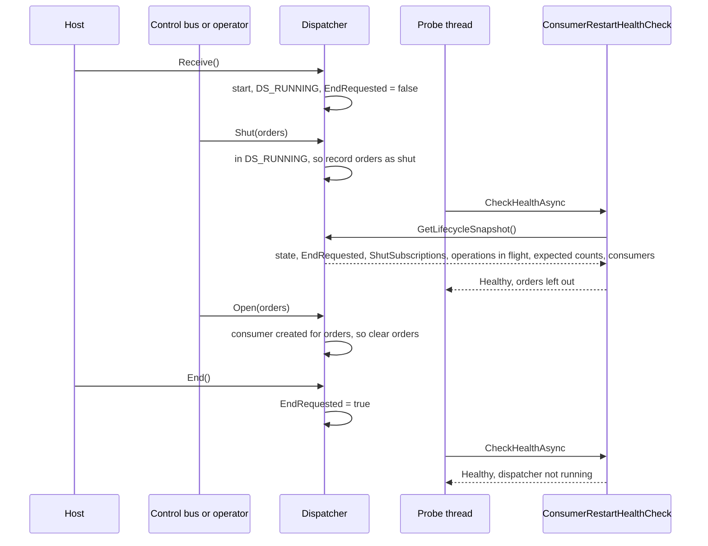
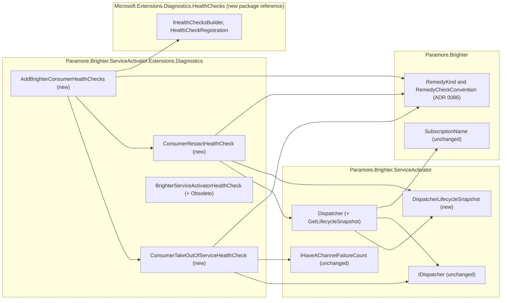

# 87. Consumer remedy health checks

Date: 2026-10-16

## Status

Accepted

## Context

`BrighterServiceActivatorHealthCheck` reports every consumer problem as one status. That status cannot say whether the instance needs a restart or needs to stop receiving work. The check also reports Degraded or Unhealthy before the dispatcher starts, during shutdown, and after an operator shuts a subscription on purpose. A probe that acts on those results restarts or removes an instance that is behaving as intended. Brighter needs consumer checks that follow the remedy-kind convention of ADR 0086, and that ignore the states the dispatcher entered on purpose.

### Terms

These words come from the requirements' *Definitions* section and FR-12.2, and this ADR uses them exactly as defined there: **existing consumer check**, **consumer take-out-of-service check**, **consumer restart check**, **consumer remedy checks**, **remedy kind**, **remedy check**, **condition**, **dispatcher running**, **shut on purpose**, **running consumer**, **totals** and **opt in**. ADR 0086's *Terms* block defines **remedy tag**, and this ADR uses that word in the same sense.

### Scope

- **Parent requirement**: [specs/0038-add-sweeper-health-check/requirements.md](../../specs/0038-add-sweeper-health-check/requirements.md) (issue #4573).
- **In scope**
  - **FR-12 (two checks, one call)**: `AddBrighterConsumerHealthChecks` on `IHealthChecksBuilder` registers both consumer remedy checks. Each registration resolves `IDispatcher` on every run.
  - **FR-12.1 (persistent channel failures)**: the take-out-of-service check reads every consumer's `IHaveAChannelFailureCount`, whatever the dispatcher's state, as the existing check does.
  - **FR-12.2 (missing consumers)**: the restart check compares running and expected totals only while the dispatcher is running and no consumer operation is in progress. It leaves out subscriptions shut on purpose, and reports Unhealthy when no consumer is running.
  - **FR-12.2's dispatcher members**: `Dispatcher` gains `GetLifecycleSnapshot`, which takes its values under the lifecycle lock. The snapshot holds the state, whether `End` was requested, the subscriptions shut on purpose, and the number of consumer operations in progress. It also holds copies of the consumers and of each subscription's expected consumer count. `IDispatcher` does not change.
  - **FR-12.3 (threshold)**: the registration call validates the channel-failure threshold before it registers anything. The check's constructor validates it again.
  - **FR-12.4 (agreement with the existing check)**: both checks reuse the existing check's description phrases and status rules.
  - **FR-12.5, FR-10.5 (`Data`)**: each check builds `Data` to ADR 0086's documented shape, with the two consumer conditions defined here.
  - **FR-12.6, FR-10.2.1 (coexistence)**: documented, not enforced.
  - **FR-12.7 (no dispatcher)**: each factory uses `GetService`. A null dispatcher gives Healthy.
  - **FR-10.2 (the existing check)**: `[Obsolete]`, with `IsError` false and a message that names `AddBrighterConsumerHealthChecks`. Behaviour, statuses and descriptions do not change.
  - **FR-13.1, FR-13.4 (failure status)**: both registrations carry failure status Degraded. A dispatcher that is not the Brighter `Dispatcher` makes the restart check throw, and the health-check service reports Degraded.
  - **NFR-5 for this package**: one new package reference, `Microsoft.Extensions.Diagnostics.HealthChecks`.
  - **NFR-6 (no new warnings)**: Brighter's tests suppress CS0618 where they use the existing check. The one sample that uses it moves to the new call.
  - **FR-11 for the consumer checks and the migration**: the health-check page's consumer sections, the six migration steps, and the consumer endpoints in the routing example. The release-note entries cover the consumer checks, the `[Obsolete]` marking with the CS0618 note, and the change to #4555's readiness guidance.
  - **AC-5 (public API unchanged)**: a reflection test holds a baseline of the public members of the types the criterion names and asserts that each still exists with the same signature, and that `IAmAnOutboxCircuitBreaker` declares the same members. It lives in `tests/Paramore.Brighter.Extensions.AspNetCore.Tests` beside the AC-49 test, because that project references every assembly involved. Step 9 adds it.
  - **AC-49 (convention test)**: `AddBrighterConsumerHealthChecks` joins the list of named registration calls in ADR 0086's reflection test.
- **Contributed to here, discharged elsewhere**
  - **FR-10.1, FR-10.3, FR-10.4 (the remedy-kind convention)**: ADR 0086 defines the convention, the tags and the `Data` keys. This ADR applies them to two more checks.
  - **FR-11's routing example and JSON response writer**: ADR 0086 writes the page section for the sweeper checks. This ADR adds the readiness endpoint, the consumer checks and the Unhealthy mapping to the same section. It reuses the one writer, unchanged.
- **Out of scope**
  - The sweeper's state, the gauges, and the sweeper remedy checks. ADRs 0085 and 0086 cover them.
  - The dispatcher's admission and shutdown protocol. `0083-coordinate-dispatcher-startup-and-shutdown.md` covers it, and this ADR does not change it.
  - Removing the existing consumer check. That happens in V11, under a separate change.
  - Recreating a consumer whose pump has stopped. Brighter reports a restart remedy, and the orchestrator acts on it.

### Where this ADR sits

| ADR | Decides |
| --- | --- |
| [0085](0085-track-outbox-sweeper-state-and-publish-gauges.md) (proposed) | how the sweeper records its state in one tear-free record, how signals find that record, and the two gauges that read it |
| [0086](0086-sweeper-remedy-health-checks.md) (proposed) | the sweeper remedy health checks: package, registration, tags, data keys, descriptions, thresholds and the remedy-kind convention |
| **0087** *(this one)* | the consumer remedy checks that split `BrighterServiceActivatorHealthCheck`, its `[Obsolete]` marking, and the additive `Dispatcher` members |

Health checks and gauges give operators actionable guidance on the sweeper and the consumers, and never stall waiting on a stuck thread.

### One status cannot carry two remedies

| Dispatcher situation | Existing check reports | The right report |
| --- | --- | --- |
| A running consumer reached the channel-failure threshold | Degraded | take out of service: Degraded |
| One of two expected consumers is missing | Degraded | restart: Degraded |
| No consumer is running, and the dispatcher is running | Unhealthy | restart: Unhealthy |
| The dispatcher is awaiting, so `Receive` has not been called | Unhealthy, because 0 of N consumers run | Healthy, because the dispatcher is not running |
| `End` has been called, and consumers are draining or gone | Degraded or Unhealthy | Healthy, because the dispatcher is not running |
| `orders` was shut on purpose with `Dispatcher.Shut` | Degraded or Unhealthy | Healthy, with `orders` left out |
| A scale-down leaves 3 running of 2 expected | Degraded, because the counts differ | Healthy, because a restart does not cure an excess consumer |

Three consequences follow from this table.

- A host that maps the existing check to readiness takes an instance out of service for a missing consumer. That action does not bring the consumer back.
- A host that maps the existing check to liveness restarts an instance while it starts up, while it shuts down, and after a deliberate shut.
- Neither mapping is right, because one registration routes one way.

The mechanism behind these consequences is in the code.

- The existing check returns one result for both conditions. It uses `activeConsumers > 0 ? Degraded : Unhealthy` whenever counts differ or a threshold is reached (`BrighterServiceActivatorHealthCheck.cs:65-95`).
- `Dispatcher` keeps nothing that tells a deliberate shut from a dead pump. `Shut` tells the consumers to stop and records nothing (`Dispatcher.cs:427-439`).
- `Dispatcher` keeps nothing that says `End` has been called. `End` sets `_stopping` only in `DS_RUNNING` (`Dispatcher.cs:356-359`). The next start clears it (`:537`). `DS_RUNNING` itself persists while consumers drain.

### The forces

- **Routing reads only tags and status (FR-10.3).** Each remedy kind needs its own registration.
- **The existing check stays exactly as it is (NFR-6, FR-10.2).** Its behaviour, statuses, descriptions, lack of tags and registration through `AddCheck` do not change. Only the `[Obsolete]` attribute is added.
- **The remedy checks must agree with the existing check where both apply (FR-12.4).** The dispatcher is running, nothing is shut, and nothing is in excess.
- **`IDispatcher` gets no new member (FR-12.2).** Additive members go on the `Dispatcher` class.
- **Add no role without necessity.** This constraint is in the requirements. `IHealthCheck`, `IHaveAChannelFailureCount` and `Dispatcher` already exist.
- **A probe thread reads the dispatcher while the dispatcher's own threads change it.** The dispatcher guards its lifecycle decisions with `_lifecycleLock` (`Dispatcher.cs:52`), and ADR 0083 keeps I/O out of that lock.
- **ADR 0083's admission rules must hold.** A new flag must not change when `Receive`, `Open` or `SetActivePerformers` are rejected.
- **`src/` builds with warnings as errors (`src/Directory.Build.props:17`).** No source file may use the obsolete type. Tests must suppress CS0618 so that the build adds no warning.
- **A non-opted-in user takes at most the health-checks package and what it brings (NFR-5, AC-24).**

## Decision

**The consumer check splits into a take-out-of-service check and a restart check, which one opt-in call registers beside the existing check.**

The take-out-of-service check reports persistent channel failures, as the existing check does today. The restart check reports missing consumers, and only while the dispatcher has been started, `End` has not been called since, and no consumer operation is in progress. Both checks follow ADR 0086's convention: one `brighter-*` remedy tag each, failure status Degraded, and `Data` in the documented shape. `Dispatcher` also gains one read-only snapshot method, so the restart check can ignore a dispatcher that is not running and subscriptions shut on purpose. The dispatcher records when `End` was requested, and which subscriptions an operator shut, and it returns both with its state and consumers in one snapshot taken under its lifecycle lock. It records nothing else, and its admission and shutdown rules do not change. The existing check keeps working and is marked obsolete in favour of the new call.

### The mechanism, end to end



The dispatcher changes the two new facts at four points. Each change happens under `_lifecycleLock`:

| Dispatcher operation | Change | Matches |
| --- | --- | --- |
| `End`, in any state | `EndRequested` = true | "A call to `End` counts even though it does nothing in a state other than `DS_RUNNING`" |
| An operation that starts the dispatcher (`Receive`, `Open` or `SetActivePerformers` when the state is not `DS_RUNNING`) | `EndRequested` = false | "A later start clears the call" |
| `Shut`, when the state is `DS_RUNNING` | adds the subscription's name to `ShutSubscriptions` | "a `Dispatcher.Shut` that took effect" |
| A consumer is added to the dispatcher's consumers | removes that consumer's subscription name from `ShutSubscriptions` | "until at least one consumer is created for it again" |

The restart check decides in this order. The first row that matches decides.

| # | Situation | Status | Description says |
| --- | --- | --- | --- |
| 1 | No `IDispatcher` is registered | Healthy | no dispatcher is registered |
| 2 | The registered `IDispatcher` is not a `Dispatcher` | the check throws, and the service reports Degraded (failure status) | the service's exception message |
| 3 | `State` is `DS_NOTREADY` or `DS_AWAITING`, so the dispatcher was never started | Healthy | the dispatcher is not running |
| 4 | `EndRequested` is true | Healthy | the dispatcher is not running |
| 5 | One or more consumer operations are in progress (`Receive`, `Open` or `SetActivePerformers` has not finished creating and opening its consumers) | Healthy | a consumer operation is in progress |
| 6 | The running total is at least the expected total | Healthy | all expected consumers are running |
| 7 | The running total is 0 | Unhealthy | `missing_consumers`, every short subscription |
| 8 | Otherwise | Degraded | `missing_consumers`, every subscription whose count differs |

Rows 3 and 4 together are FR-12.2's "dispatcher running". `DS_STOPPED` passes both rows when `End` was not called, so a dispatcher whose pumps all died still reaches rows 6 to 8 once no operation is in progress. Row 5 exists because a start is not one locked step: the dispatcher enters `DS_RUNNING` under its lock, creates its consumers outside the lock (channel creation is broker I/O), and registers them under the lock afterwards. Without row 5, a probe in that window would see a running dispatcher with no consumers and report Unhealthy. The totals leave out every subscription in `ShutSubscriptions` and every consumer of those subscriptions. The restart check decides from one snapshot. A concurrent `End`, `Shut` or `SetActivePerformers` cannot give it a mixture of the states before and after the change, and a start in progress is reported through row 5.

The take-out-of-service check has no ladder. It reads every consumer in `Consumers`, whatever the dispatcher's state. It is Degraded when any consumer's `ConsecutiveChannelFailures` is at least the threshold, and Healthy otherwise. A null dispatcher gives Healthy.

Five invariants follow from the tables.

- **A deliberate state or a start in progress never fails a restart probe.** A dispatcher before its start, after `End`, with a subscription shut on purpose, or while a consumer operation is in progress reports Healthy on the restart check.
- **The existing check's verdicts survive in the common state.** When the dispatcher is running, no consumer operation is in progress, nothing is shut and nothing is in excess, the worse of the two remedy statuses equals the existing check's status (FR-12.4). Missing consumers give Degraded or Unhealthy exactly as before. Failures on a running consumer give Degraded.
- **The restart check reports Unhealthy only for zero running consumers.** That is a reported condition, not a check failure (FR-13.1).
- **Admission does not change.** `EndRequested` is a new field. `_stopping` still decides admission, so `End` before `Receive` does not make `Receive` throw.
- **A probe never waits on a pump.** The snapshot takes `_lifecycleLock` only to read three fields and copy three collections. ADR 0083 keeps I/O and task waits outside that lock.

### Where the pieces live



Every Brighter dependency points inward. The diagnostics package reaches core through `Paramore.Brighter.ServiceActivator`, which references `Paramore.Brighter` (`Paramore.Brighter.ServiceActivator.csproj:12`), so ADR 0086's convention types are in reach without a new project reference. The take-out-of-service check needs only `IDispatcher`. The restart check needs the `Dispatcher` class, as the existing check does.

### Key Components

#### The roles, and what each is responsible for

| Role | Type | Responsibilities | Responsibility classifier | Collaborators |
| --- | --- | --- | --- | --- |
| Runs consumers | `Dispatcher` (ServiceActivator, changed) | As today; also knows whether `End` was requested since the last start, which subscriptions are shut on purpose, and how many consumer operations are in progress | knowing, doing, deciding | `IAmAConsumer`, `Subscription`, `SubscriptionName` |
| Reports consumers that cannot receive | `ConsumerTakeOutOfServiceHealthCheck` (Diagnostics, new) | Reads every consumer's failure count; decides the persistent-channel-failures condition; describes it; builds its own `Data` to the convention | knowing, deciding | `IDispatcher`, `IHaveAChannelFailureCount`, `RemedyCheckConvention` |
| Reports consumers that are missing while running | `ConsumerRestartHealthCheck` (Diagnostics, new) | Decides whether the dispatcher is running and no consumer operation is in progress; totals running and expected consumers outside shut subscriptions; decides Healthy, Degraded or Unhealthy; describes it; builds its own `Data` to the convention | knowing, deciding | `Dispatcher`, `RemedyCheckConvention` |
| Opts a host in to the consumer checks | `AddBrighterConsumerHealthChecks` (Diagnostics, new extension) | Validates the threshold; registers both checks with names, one remedy tag each, failure status Degraded and per-run factories | doing | `IHealthChecksBuilder`, `HealthCheckRegistration` |
| Reports every consumer condition at once | `BrighterServiceActivatorHealthCheck` (Diagnostics, obsolete) | Unchanged | knowing, deciding | `IDispatcher` |

No new role is added. Each check fills the existing `IHealthCheck` role. The failure count comes from the existing `IHaveAChannelFailureCount` role. The lifecycle facts go on `Dispatcher`, which already owns the lifecycle that the facts describe. "Dispatcher running" is a health rule, as FR-12.2's "for this purpose" says. The restart check therefore decides it from facts the dispatcher knows, and the dispatcher does not gain a second, conflicting meaning of "running".

#### The new `Dispatcher` members

| Member | Input | Output | Error conditions |
| --- | --- | --- | --- |
| `GetLifecycleSnapshot` | none | `DispatcherLifecycleSnapshot`, taken under `_lifecycleLock` | Never throws. Holds the lock only to read fields and to copy collections |

`DispatcherLifecycleSnapshot` is a `readonly record struct`, a value and not a role:

| Property | Type | Meaning |
| --- | --- | --- |
| `State` | `DispatcherState` | The dispatcher's state at the snapshot |
| `EndRequested` | `bool` | True from any call to `End` until the next operation that moves the dispatcher to `DS_RUNNING` |
| `ShutSubscriptions` | `IReadOnlyCollection<SubscriptionName>` | The subscriptions shut on purpose |
| `ConsumerOperationsInFlight` | `int` | The number of consumer operations that have begun and not finished |
| `ExpectedConsumers` | `IReadOnlyDictionary<SubscriptionName, int>` | Each subscription's expected consumer count, copied under the lock. Counts for subscriptions with the same name are summed, as the existing check sums them |
| `Consumers` | `IReadOnlyList<IAmAConsumer>` | A copy of the dispatcher's consumers |

The backing fields are a `bool` and a `HashSet<SubscriptionName>`, and neither is public. `SubscriptionName` implements value equality (`src/Paramore.Brighter/SubscriptionName.cs:37`). `Dispose` and `DisposeAsync` call `End`, so a disposed dispatcher also reports `EndRequested`. A pump that stops and removes its consumer after the snapshot is read leaves the snapshot unchanged, so a probe can be one probe period stale and no more. `ConsumerOperationsInFlight` is the existing `_pendingConsumerOperations` counter, which `BeginConsumerOperation` raises and `ExecuteConsumerOperation` lowers under `_lifecycleLock`.

Two existing members change inside their bodies only. Their signatures and their effect on consumers do not change:

- `End` sets `EndRequested` under the lock before its existing state test.
- `Shut(Subscription)` makes its `DS_RUNNING` test, records the name, and snapshots the subscription's consumers under `_lifecycleLock`. It then tells those consumers to stop outside the lock, as `End` already does.

#### `ConsumerTakeOutOfServiceHealthCheck`

| Member | Input | Output | Error conditions |
| --- | --- | --- | --- |
| `PersistentChannelFailures` | none | `"persistent_channel_failures"`, as `const` | none |
| constructor | `IDispatcher? dispatcher`, `int channelFailureThreshold = 3` | a check | `ArgumentOutOfRangeException` when the threshold is less than 1 (FR-7.3, FR-12.3) |
| `CheckHealthAsync` | `HealthCheckContext`, `CancellationToken` | Healthy, or Degraded with `persistent_channel_failures`. Never Unhealthy | Never throws for a valid check |

#### `ConsumerRestartHealthCheck`

| Member | Input | Output | Error conditions |
| --- | --- | --- | --- |
| `MissingConsumers` | none | `"missing_consumers"`, as `const` | none |
| constructor | `IDispatcher? dispatcher` | a check | none |
| `CheckHealthAsync` | `HealthCheckContext`, `CancellationToken` | Healthy; Degraded or Unhealthy with `missing_consumers` | `InvalidCastException` when the dispatcher is not a `Dispatcher` (FR-13.4). The service reports that exception as Degraded |

#### `AddBrighterConsumerHealthChecks`

| Member | Input | Output | Error conditions |
| --- | --- | --- | --- |
| `AddBrighterConsumerHealthChecks` (extension on `IHealthChecksBuilder`) | `int channelFailureThreshold = 3` | the builder, with two registrations added | `ArgumentOutOfRangeException` from the call itself when the threshold is less than 1, before anything is registered |

| Registration name | Check | Tag | Failure status | Factory resolves on each run |
| --- | --- | --- | --- | --- |
| `brighter-consumer-take-out-of-service` | `ConsumerTakeOutOfServiceHealthCheck` | `brighter-take-out-of-service` | Degraded | `GetService<IDispatcher>()` |
| `brighter-consumer-restart` | `ConsumerRestartHealthCheck` | `brighter-restart` | Degraded | `GetService<IDispatcher>()` |

The extension and both checks live in `Paramore.Brighter.ServiceActivator.Extensions.Diagnostics.HealthChecks`, beside the existing check. A user who already imports that namespace for the existing check finds the new call without a new `using` directive.

#### `Data`

Both checks build `Data` to ADR 0086's documented shape: `remedy_kind`, `conditions`, and one entry per reported condition. The restart check also adds `consumer_operations_in_flight` (`int`) at the top level of `Data`, whether it is Healthy or Degraded. The consumer conditions carry these values:

| Condition | Value key | Type |
| --- | --- | --- |
| `persistent_channel_failures` | `threshold` | `int` |
| `persistent_channel_failures` | `consumers` | array of dictionaries, each with `subscription` (`string`), `consumer` (`string`) and `count` (`int`) |
| `missing_consumers` | `running_total`, `expected_total` | `int` |
| `missing_consumers` | `subscriptions` | array of dictionaries, each with `subscription` (`string`), `running` (`int`) and `expected` (`int`), for every subscription not shut on purpose whose running count differs from its expected count |

Example `Data` from the restart check for AC-63:

```json
{
  "remedy_kind": "restart",
  "conditions": ["missing_consumers"],
  "missing_consumers": {
    "running_total": 1,
    "expected_total": 2,
    "subscriptions": [ { "subscription": "payments", "running": 1, "expected": 2 } ]
  }
}
```

#### Descriptions

The condition phrases repeat the existing check's phrases, so the two describe a condition with the same values (FR-12.4). Several entries are joined with `"; "`.

| Situation | Check | Wording |
| --- | --- | --- |
| No dispatcher registered | both | `No dispatcher is registered.` |
| Dispatcher not running | restart | `The dispatcher is not running, so missing consumers are not reported.` |
| Consumer operation in progress | restart | `A consumer operation is in progress, so missing consumers are not reported.` |
| Healthy | restart | `All 2 expected consumers are running.` |
| `missing_consumers`, Degraded | restart | `orders has 1 of 2 expected consumers` |
| `missing_consumers`, Unhealthy | restart | `No consumers are running: orders has 0 of 2 expected consumers` |
| Healthy | take out of service | `No consumer has reached 3 consecutive channel failures.` |
| `persistent_channel_failures` | take out of service | `orders consumer orders-1 has 3 consecutive channel failures` |

The tests check values and not exact text, apart from the shared phrases that AC-62 compares.

#### The obsolete marking

`BrighterServiceActivatorHealthCheck` gains `[Obsolete("BrighterServiceActivatorHealthCheck reports every consumer condition with one status. Register the consumer remedy checks with IHealthChecksBuilder.AddBrighterConsumerHealthChecks instead. This type is removed in V11.")]`. `IsError` is false. No other line of the type changes.

#### Where each type is touched

| Assembly | Type | Change |
| --- | --- | --- |
| Paramore.Brighter.ServiceActivator | `Dispatcher` | One read-only method and two private fields. `End`, `Shut(Subscription)`, `BeginConsumerOperation` and `ExecuteConsumerOperation` write the fields under `_lifecycleLock` |
| Paramore.Brighter.ServiceActivator | `DispatcherLifecycleSnapshot` | New value type |
| Paramore.Brighter.ServiceActivator.Extensions.Diagnostics | `Paramore.Brighter.ServiceActivator.Extensions.Diagnostics.csproj` | New package reference to `Microsoft.Extensions.Diagnostics.HealthChecks` |
| Paramore.Brighter.ServiceActivator.Extensions.Diagnostics | `ConsumerTakeOutOfServiceHealthCheck`, `ConsumerRestartHealthCheck` | New |
| Paramore.Brighter.ServiceActivator.Extensions.Diagnostics | `ConsumerHealthChecksBuilderExtensions` | New static class holding `AddBrighterConsumerHealthChecks` |
| Paramore.Brighter.ServiceActivator.Extensions.Diagnostics | `BrighterServiceActivatorHealthCheck` | `[Obsolete]` only |
| tests | every test file that names `BrighterServiceActivatorHealthCheck`: two in `tests/Paramore.Brighter.Extensions.Tests`, and the AC-5, AC-49, AC-55, AC-56 and AC-62 tests | `#pragma warning disable CS0618` |
| samples/TaskQueue/ASBTaskQueue/GreetingsWorker | `Program.cs` | Moves from `AddCheck<BrighterServiceActivatorHealthCheck>` to `AddBrighterConsumerHealthChecks` |

The following stay unchanged:

- `IDispatcher`, `DispatcherState`, `IHaveAChannelFailureCount`, `Consumer` and `GetState`.
- The dispatcher's state transitions, its admission rules (`_stopping`, `_pendingConsumerOperations`) and its control loop, as ADR 0083 decides them.
- The behaviour, statuses, descriptions, constructors and lack of tags of `BrighterServiceActivatorHealthCheck`.
- ADR 0086's `RemedyKind`, `RemedyCheckConvention`, tags and keys, which this ADR uses as they are.
- The sweeper checks, the sweeper state and the gauges.

### Technology Choices

#### Why the checks sit beside the existing check

Users of the existing check already reference `Paramore.Brighter.ServiceActivator.Extensions.Diagnostics`, and the new checks read the same dispatcher. One package keeps migration to a change of registration call. The package needs one more reference, because `IHealthChecksBuilder` is defined in `Microsoft.Extensions.Diagnostics.HealthChecks` and not in the abstractions package the project references today (`Paramore.Brighter.ServiceActivator.Extensions.Diagnostics.csproj:12`). Central package management pins version 10.0.12 (`Directory.Packages.props:93`). The package ships `netstandard2.0`, `net462` and `net10.0` assets and has no ASP.NET Core dependency.

#### Why one snapshot method on `Dispatcher`, rather than a "running" property or a new role

The dispatcher owns its lifecycle, so it is the only object that knows when `End` was called and which subscriptions were shut. A property named `IsRunning` would be true in `DS_STOPPED`, which contradicts the `DispatcherState` documentation. The facts are therefore named for what happened: `EndRequested` and `ShutSubscriptions`. The restart check combines them with the state and the consumers in one snapshot. Separate property reads can cross a transition: `End` followed by a pump drain between two reads would show no consumers with the dispatcher still running, which is a false Unhealthy on a liveness probe during graceful shutdown. The requirements' constraint rules out an interface such as `IAmADispatcherLifecycle`, which would have one implementation and one reader. Adding the facts to `IDispatcher` would break every implementer, and FR-12.2 places the additions on the class.

#### Why `EndRequested` is a new field and not `_stopping`

`_stopping` decides admission. `End` sets `_stopping` only in `DS_RUNNING`, and `BeginConsumerOperation` rejects new operations while `_stopping` is true and the control task has not completed (`Dispatcher.cs:530`). FR-12.2 needs a flag that `End` sets in every state. If `End` set `_stopping` in `DS_AWAITING`, a later `Receive` would throw, because `_controlTask` is null. A separate field records the call without changing who may start.

#### Why shut subscriptions are recorded under the lifecycle lock and cleared on consumer registration

Today `Shut` reads `State` outside the lock. Recording the name in the same locked block as the state test makes "took effect" exact. A probe then never sees a recorded shut for a dispatcher that was not running. `ExecuteConsumerOperation` already adds new consumers under the lock (`Dispatcher.cs:491-495`). Clearing the name there covers `Receive`, `Open` and `SetActivePerformers` in one place. A `SetActivePerformers` call that creates no consumer leaves the name in the set, as FR-12.2 requires. The stop signal to consumers stays outside the lock, as ADR 0083 requires for anything that may block.

#### Why the restart check keeps Unhealthy for zero consumers

The existing check reports Unhealthy when no consumer runs, and FR-12.4 requires the remedy checks to keep that verdict. Unhealthy and Degraded both fail a liveness endpoint that maps both to 503, so routing is unaffected. The registration's failure status is Degraded, so an exception never produces Unhealthy. Only this reported condition does.

#### Why the take-out-of-service check reads every consumer in every state

A consumer that keeps failing to receive should not take work, whether it is draining after `End` or belongs to a shut subscription. The existing check reads every consumer this way, and FR-12.1 keeps that rule. The check needs no lifecycle facts, so it works with any `IDispatcher`.

#### Why a failure to build the dispatcher is not caught

Each registration resolves `IDispatcher` with `GetService`, so a publisher-only service gives Healthy (FR-12.7). A dispatcher that is registered but cannot be built is a misconfiguration, and in most cases the host's consumer service fails at start-up for the same cause. ADR 0086 explains why a failure to build a check is not caught and reported as Degraded. This ADR follows the same rule.

#### Why a consumer operation in progress reports Healthy

The counter that already guards the dispatcher's shutdown, `_pendingConsumerOperations`, covers the whole of a start, a reopen and a scale-up. While it is above zero, some consumers may not be registered yet, so a shortfall says nothing about a dead pump. Reporting Healthy then removes a restart loop that a slow broker could cause at start-up. The cost is that an operation that hangs, such as a channel creation that never returns, keeps the check Healthy. A hung operation at any time, including one that a control-bus command triggers after start-up, hides missing consumers on every subscription. Detecting a hung operation is not this check's job. The restart check reports the number of operations in progress in its `Data`, so an operator can alert on an operation that stays in flight, and the docs say so.

#### Why the existing check is marked obsolete and not changed

Changing its statuses would change the result of every existing liveness or readiness endpoint that selects it (NFR-6). A compile warning points users to the new call without breaking their builds. A build that treats warnings as errors must suppress CS0618 or migrate, and the release notes say so.

#### Why coexistence is documented, not enforced

The existing check is registered through `AddCheck`, which the user may call before or after the new call. No registration-time hook sees both registrations reliably. Running both would report each condition twice, and the docs state the rule (FR-10.2.1).

#### How tests reach the checks

- **Dispatcher tests** in `tests/Paramore.Brighter.Core.Tests/MessageDispatch/` drive a real `Dispatcher` over in-memory channels. They cover every row of the fact-change table: `End` in each state, start after `End`, `Shut` in and out of `DS_RUNNING`, and `Open` or `SetActivePerformers` after a shut.
- **Check tests** in `tests/Paramore.Brighter.Extensions.Tests/` reuse the receive-health test host and its failing in-memory transport. They cover AC-58 to AC-63, AC-71 and AC-72.
- **Endpoint tests** in `tests/Paramore.Brighter.Extensions.AspNetCore.Tests` cover AC-22.

### Implementation Approach

1. **Structural: the package reference.** Add `<PackageReference Include="Microsoft.Extensions.Diagnostics.HealthChecks"/>` to `src/Paramore.Brighter.ServiceActivator.Extensions.Diagnostics/Paramore.Brighter.ServiceActivator.Extensions.Diagnostics.csproj:11-13`. No behaviour changes. Add the package half of AC-24: no ASP.NET Core and no OpenTelemetry assembly is referenced.
2. **Behavioural, test first: `EndRequested`, kept in a private field.** In `Dispatcher.End` (`src/Paramore.Brighter.ServiceActivator/Dispatcher.cs:353-357`), set the field inside the lock, before the state test. In `BeginConsumerOperation` (`:537-538`), clear it in the start branch. Tests cover:
   - awaiting, then `End`, then `Receive`, which must not throw;
   - `End` in `DS_RUNNING`;
   - `End` after the dispatcher reached `DS_STOPPED`;
   - restart after an awaited `End`;
   - `Dispose`.
3. **Behavioural, test first: `ShutSubscriptions` and the snapshot.** Add `DispatcherLifecycleSnapshot` and `Dispatcher.GetLifecycleSnapshot`, which copies the state, `EndRequested`, the shut names, the operations in flight, each subscription's expected count and the consumers under `_lifecycleLock`. Tests also assert that a snapshot taken after `End` reports `EndRequested`, that a snapshot taken while channel creation blocks reports one operation in flight, and that a returned snapshot does not change after later operations. In `Shut(Subscription)` (`:427-439`), move the state test and the consumer snapshot under `_lifecycleLock`, record the name, and tell the consumers to stop outside the lock. In `ExecuteConsumerOperation` (`:491-495`), remove each added consumer's subscription name. Tests cover a `Shut` while awaiting (no effect), a `Shut` while running, `Open` after a shut, `SetActivePerformers` that creates none and that creates some, and a copy that does not change after it is read.
4. **Behavioural, test first: the take-out-of-service check.** Tests cover AC-59, the take-out-of-service half of AC-63, AC-71, and constructor validation (AC-60).
5. **Behavioural, test first: the restart check.** Tests cover every case in AC-58, the restart half of AC-63, AC-71, AC-72 (using a channel factory double that blocks), and the throw for a dispatcher that is not a `Dispatcher` (AC-70).
6. **Behavioural, test first: the registration call.** Add `ConsumerHealthChecksBuilderExtensions`. Tests cover AC-60 (validation before the service is built), AC-61 (two registrations, one tag each), and AC-70 (failure status Degraded, and Degraded for a non-Brighter `IDispatcher`).
7. **Behavioural, test first: agreement.** Add AC-62, which runs the existing check and both remedy checks over the four #4555 states. The existing tests for the existing check must pass unchanged (AC-23).
8. **Behavioural: the obsolete marking.** Add `[Obsolete]` to `BrighterServiceActivatorHealthCheck` (`BrighterServiceActivatorHealthCheck.cs:36`). Add `#pragma warning disable CS0618` to every test file that names the obsolete type: `tests/Paramore.Brighter.Extensions.Tests/When_a_running_consumer_repeatedly_fails_to_receive_should_report_degraded.cs`, `tests/Paramore.Brighter.Extensions.Tests/TestDoubles/ReceiveHealthTestHost.cs`, and each test this spec adds that names it, such as the AC-49, AC-55, AC-56 and AC-62 tests. Move `samples/TaskQueue/ASBTaskQueue/GreetingsWorker/Program.cs:88` to the new call. Add the AC-55 reflection test. Confirm that a full build adds no warning.
9. **Behavioural: the convention test.** In `tests/Paramore.Brighter.Extensions.AspNetCore.Tests`, which ADR 0086 step 7 already references to the diagnostics package:
   - add `AddBrighterConsumerHealthChecks` to the named registration calls in ADR 0086's AC-49 test;
   - add a Healthy and a Degraded scenario for each consumer check;
   - add the AC-5 public-API test, with `#pragma warning disable CS0618` because it names the obsolete type.

   The exemption list keeps `BrighterServiceActivatorHealthCheck` only.
10. **Behavioural: endpoint tests.** In `tests/Paramore.Brighter.Extensions.AspNetCore.Tests`, which ADR 0086 step 7 already references to the diagnostics package, map liveness (restart tag, Degraded and Unhealthy mapped to 503) and readiness (take-out-of-service tag, Degraded and Unhealthy mapped to 503). Tests cover AC-22.
11. **Docs.** Add release-note entries to `release_notes.md`:
    - the consumer remedy checks, the call, and the default threshold;
    - the `[Obsolete]` marking, with the CS0618 note for builds that treat warnings as errors;
    - the change to #4555's guidance, which now maps Degraded to 503 on readiness for the take-out-of-service tag only.

    In BrighterCommand/Docs, add to the health-check page:
    - the consumer remedy checks, their two conditions, their remedy kinds and their boundaries;
    - when the restart check is Healthy (not running, a consumer operation in progress, shut on purpose, excess consumers), and that a consumer operation that never finishes is not detected and needs an operator alert on the number of consumer operations in progress, which the restart check's `Data` reports;
    - probe period and failure-threshold advice for scale-up and reopen;
    - the coexistence rule, and that the existing check is untagged and obsolete;
    - the readiness endpoint and the consumer checks in the routing example from ADR 0086;
    - the six migration steps of FR-11, in the order the requirements give, with the exclusion predicate and the silent-drop hazard.

## Consequences

### Positive

- An orchestrator removes an instance whose consumer cannot receive, and restarts an instance that lost a consumer, from two separate probes (FR-10.3, AC-22).
- A probe during start-up, shutdown or a deliberate shut no longer fails (FR-12.2).
- Consumer checks and sweeper checks share one tag set and one `Data` shape, so one predicate per endpoint and one writer serve both.
- Users of the existing check keep their behaviour and get a compile-time pointer to the replacement.
- `Dispatcher` gains one snapshot method, and `IDispatcher` gains nothing, so no implementer of the interface breaks.

### Negative

- Users of `Paramore.Brighter.ServiceActivator.Extensions.Diagnostics` take `Microsoft.Extensions.Diagnostics.HealthChecks` transitively, with the packages it brings. Those include `Microsoft.Extensions.Hosting.Abstractions` and its dependencies, which the package does not bring today. AC-24 allows them.
- Builds that treat warnings as errors and use the existing check fail with CS0618 until they suppress the warning or migrate.
- `Dispatcher` gains one public method and one public value type that Brighter must support, and `Shut` and the snapshot take `_lifecycleLock` briefly.
- The totals rule lets an excess consumer on one subscription mask a missing one on another (FR-12.2, accepted).
- After a raise that follows a `Shut`, the restart check is Degraded until `Open` is used (FR-12.2, accepted).
- The restart check still requires the Brighter `Dispatcher`. Any other `IDispatcher` reports Degraded with no `Data`.
- Running both the existing check and the remedy checks reports each condition twice. Brighter documents the rule but does not prevent it.

### Risks and Mitigations

| Risk | Mitigation |
| --- | --- |
| The new lock in `Shut` deadlocks with a consumer callback | `Shut` holds the lock only for the state test, the record and the snapshot. Consumers are told to stop outside the lock, as in `End` |
| `EndRequested` drifts from the real lifecycle after a later change to `End` or `BeginConsumerOperation` | The dispatcher tests pin each transition, including `End` in `DS_AWAITING` and `DS_STOPPED`, and restart |
| A probe reads the lifecycle facts across a concurrent start, `End` or `Shut` | The restart check reads one snapshot taken under `_lifecycleLock`, so it never mixes the states before and after a change. A pump that stops after the snapshot makes one probe stale, which the probe-period advice covers |
| A liveness probe fires after a scale-up finishes with consumers still missing | The docs advise a probe period and failure threshold that tolerate a short Degraded window (FR-12.2, FR-11) |
| `BeginConsumerOperation` raises the operation counter and then fails to start the control loop, so the counter never falls and the restart check stays Healthy | The counter's life cycle is ADR 0083's. The failure needs a thread that cannot be created, so the process is already failing. A later structural change can move the increment after the loop starts |
| A consumer operation hangs, so the restart check stays Healthy | Accepted. The restart check reports missing consumers, and a hung operation needs an operator alert on `consumer_operations_in_flight` in `Data`. The docs say so (FR-11) |
| A host keeps an untagged endpoint that selected the existing check, and its monitoring stops silently after the cut-over | Migration step 5 calls out the silent-drop hazard, and AC-56 tests the exclusion predicate |

## Alternatives Considered

**1. Change `BrighterServiceActivatorHealthCheck` to add tags and ignore deliberate states.** **Rejected because** NFR-6 and FR-10.2 keep its behaviour, statuses and descriptions, and one registration still routes one way.

**2. Add `IsRunning` and shut-subscription members to `IDispatcher`.** **Rejected because** every implementer of the interface would break, and FR-12.2 places the additions on `Dispatcher`.

**3. A single `Dispatcher.IsRunning` property that is true in `DS_STOPPED` until `End`.** **Rejected because** the name contradicts `DispatcherState`, and "running" in FR-12.2 is a health rule ("for this purpose"). The check owns that rule, and the dispatcher reports facts.

**4. Reuse `_stopping` as the end flag.** **Rejected because** setting it in `DS_AWAITING` makes the next `Receive` throw, which changes ADR 0083's admission rules.

**5. A lifecycle observer role that the dispatcher notifies, such as `IAmADispatcherLifecycleObserver`.** **Rejected because** it adds a role with one implementation and one reader. One snapshot method on the owner of the lifecycle carries the same knowledge.

**6. Infer a deliberate shut from consumer state, for example a consumer in `Shut` state.** **Rejected because** a shut consumer is removed when its pump stops, so a subscription shut on purpose and one whose pumps died look the same: both have no consumers.

**7. Put the consumer checks in a new package.** **Rejected because** users of the existing check already reference this package, and the dependency it would avoid is the one NFR-5 allows.

**8. Public `EndRequested` and `ShutSubscriptions` properties on `Dispatcher`, read separately by the check.** **Rejected because** reads of separate properties can cross a transition and report a false Unhealthy during shutdown. One snapshot taken under the lifecycle lock cannot.

**9. Enforce coexistence by throwing when both registrations exist.** **Rejected because** registration order belongs to the user and no hook sees both reliably. A health-check-time throw would turn a configuration mistake into a Degraded probe.

## References

- Requirements: [specs/0038-add-sweeper-health-check/requirements.md](../../specs/0038-add-sweeper-health-check/requirements.md). Issue [#4573](https://github.com/BrighterCommand/Brighter/issues/4573).
- Related ADRs (none is superseded by this ADR):
  - [0085-track-outbox-sweeper-state-and-publish-gauges.md](0085-track-outbox-sweeper-state-and-publish-gauges.md): the sweeper's record and gauges.
  - [0086-sweeper-remedy-health-checks.md](0086-sweeper-remedy-health-checks.md): the remedy-kind convention, tags and `Data` shape these checks follow, and the AC-49 reflection test.
  - [0081-report-persistent-channel-failures-in-health-checks.md](0081-report-persistent-channel-failures-in-health-checks.md): the existing consumer check, its failure count, its default threshold of 3, and the readiness guidance this ADR narrows to the take-out-of-service tag.
  - [0083-coordinate-dispatcher-startup-and-shutdown.md](0083-coordinate-dispatcher-startup-and-shutdown.md): the admission, shutdown and lifecycle-lock rules that the new members keep.
- External references:
  - [Health checks in ASP.NET Core: filtering, status codes and publishers](https://learn.microsoft.com/aspnet/core/host-and-deploy/health-checks)
  - [Kubernetes liveness, readiness and startup probes](https://kubernetes.io/docs/tasks/configure-pod-container/configure-liveness-readiness-startup-probes/)
  - [`ObsoleteAttribute` and CS0618](https://learn.microsoft.com/dotnet/csharp/language-reference/compiler-messages/cs0618)
