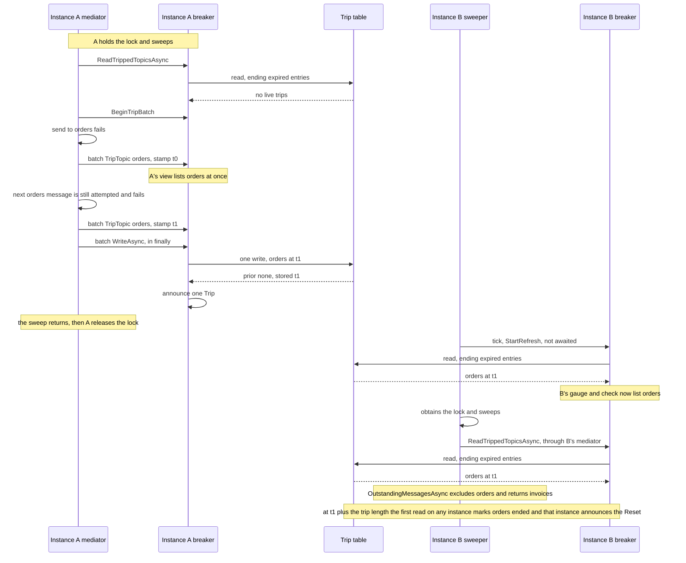
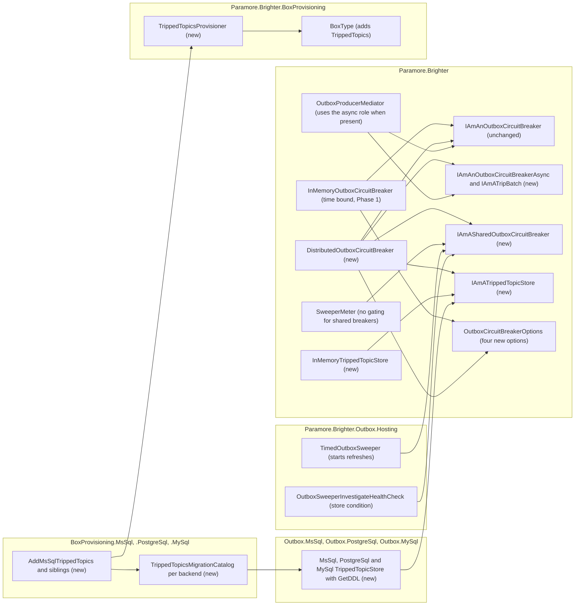

# 89. Distributed outbox circuit breaker with elapsed-time cooldown

Date: 2026-10-25

## Status

Proposed

This ADR amends ADR 0028 (`0028-support-circuit-breaking-of-topics.md`), ADR 0085 (`0085-track-outbox-sweeper-state-and-publish-gauges.md`) and ADR 0086 (`0086-sweeper-remedy-health-checks.md`). It also amends ADR 0058 (`0058-outbox-circuit-breaker-trip-logging.md`): the Reset log names its cause, and the distributed breaker has its own announcer rules and span tag. *Scope* lists exactly which parts change.

## Context

The outbox sweeper leaves a circuit-broken topic out of its sweeps until the topic's cooldown ends. Today the cooldown is a count of sweeps, kept in each process, and it advances only on a sweep that obtained the distributed lock. An instance that stops obtaining the lock keeps its trips for ever, and when it next obtains the lock it holds back messages for a topic whose broker recovered long ago. No other instance can see or end those trips, and the health signals hide them rather than end them.

### Terms

The requirements' *Definitions* section defines **instance**, **deployment**, **sweeper instance**, **running sweeper**, **active sweeper**, **trip**, **re-trip**, **tripped topic**, **cooldown cycle**, **cooldown count**, **maximum trip duration (D)**, **cooldown duration (C)**, **trip end (reset)**, **distributed circuit breaker**, **shared trip store**, **store failure**, **view**, **dispatch call**, **unshared trip** and **fallback view**. This ADR uses them exactly as defined there. ADR 0085's *Terms* block defines **the record** and **snapshot**. Five words are this ADR's own.

- **Trip length**: C plus `ClockSkewLeeway`. A distributed trip is live while the time since its stamp is less than the trip length. Every rule below that says a trip "has ended" or "has run out" means this. *Why a user-set leeway for clock skew* gives the leeway.
- **Trip table**: the shared trip store as this ADR builds it, one table beside the outbox. *The trip table and the SQL stores* gives its schema.
- **Stamp**: the wall-clock time at which an instance recorded a trip, cut down to a whole number of microseconds when it is taken. Every store holds at least microsecond precision, so the trip table stores the stamp unchanged and a stamp read back equals the stamp written.
- **Trip batch**: the object that holds one dispatch call's trips and writes them once. *`IAmAnOutboxCircuitBreakerAsync` and `IAmATripBatch`* gives its contract.
- **Refresh**: a store read that the sweeper starts and no sweep awaits. *Refresh on every running sweeper* gives its rules.

### Scope

**Parent Requirement**: [specs/0039-circuit-breaker-stale-tripped-topics/requirements.md](../../specs/0039-circuit-breaker-stale-tripped-topics/requirements.md) (issue #4628).

**In scope, Phase 1 (core only, mergeable on its own)**

- **FR-1, FR-1.1, FR-1.2, FR-1.3**: each in-memory trip entry holds its remaining cooldown count and a monotonic timestamp from the breaker's `TimeProvider`. A trip ends at whichever limit comes first. Every read filters by time, so no sweep or lock is needed.
- **FR-1.4, FR-8.6 (in-memory)**: the first `CoolDown`, `TripTopic` or `TrippedTopics` call at or after the end time removes the entry with a conditional remove and announces one Reset. Time-ended trips are processed before cooldown decrements, so the log names the maximum trip duration when D had passed.
- **FR-2, FR-2.1, FR-2.2, FR-2.3, FR-2.5 (D half)**: `OutboxCircuitBreakerOptions.MaximumTripDuration`, default 5 minutes, validated at construction to the range greater than zero and at most 24 hours. `InMemoryOutboxCircuitBreaker` gains a trailing optional `TimeProvider`.
- **FR-7.2**: an existing registration keeps a per-instance breaker. The changes it sees are the D limit and the Reset cause in the log.
- **NFR-1 (in-memory half), NFR-5 and NFR-8 for the in-memory breaker, NFR-6 (D half)**: the constructor change is additive, and the conditional remove compares entries by reference.

**In scope, Phase 2 (distributed breaker)**

- **FR-2.4, FR-2.5 (C half), NFR-3 (configuration)**: `OutboxCircuitBreakerOptions.CooldownDuration` (default 50 s), `ClockSkewLeeway` (default zero) and `StoreTimeout` (default 2 s), all validated when `DistributedOutboxCircuitBreaker` is constructed.
- **FR-3, FR-3.1, FR-3.4**: `DistributedOutboxCircuitBreaker` keeps trips in the trip table. A sweep reads the table before it selects messages, so a written trip is excluded from the next sweep on every instance, and trips survive restarts.
- **FR-3.2, FR-3.3, FR-3.8, NFR-5 (distributed)**: the store's write keeps the later of the stored and written stamps and returns the prior stamp, atomically per topic. The writer classifies Trip, ReTrip or Reset-then-Trip from that answer.
- **FR-3.5, FR-3.6, FR-3.7, NFR-2, NFR-3**: the mediator uses the new async role. A trip batch updates the view at once and makes one batched store write per dispatch call, in a `finally`, before the sweep returns. Confirmation callbacks use a pending write per topic that runs off the callback thread.
- **FR-3.9, FR-5.2**: a failed write logs a Warning and leaves the trip unshared. Nothing throws to the caller.
- **FR-4, FR-4.1, FR-4.2, FR-4.3**: every instance judges a distributed trip by its own clock against the stored stamp. Cooldown cycles do nothing to a distributed trip.
- **FR-4.4**: one read operation marks ended entries as ended with a conditional update that returns the marked rows. Only the instance whose update marked a row announces its Reset. A write over an unmarked row whose trip length has run out announces it too (row 4 of *How a write is announced*).
- **FR-4A, NFR-4 (freshness)**: `TimedOutboxSweeper` starts a refresh on every tick before its lock attempt, and from a timer while a sweep overruns. A refresh is never awaited and never overlaps another.
- **FR-5, FR-5.1, FR-5.3 to FR-5.8**: a store failure or timeout leaves the breaker on its fallback view. The view is bounded by the trip length, and the fallback state follows the read-failed and unshared rules exactly.
- **FR-6, FR-6.1, FR-6.2**: unchanged per-topic exclusion through `OutstandingMessagesAsync`.
- **FR-7.1, FR-7.3**: Brighter still registers no breaker. The user registers the distributed breaker as a singleton.
- **FR-7.4, NFR-7**: `InMemoryTrippedTopicStore` in core. `MsSqlTrippedTopicStore`, `PostgreSqlTrippedTopicStore` and `MySqlTrippedTopicStore` in the existing Outbox packages, with provisioning in the existing BoxProvisioning packages.
- **NFR-6 (C half)**: stamps are instance time taken when the trip occurs. Every judgement that a trip has ended uses the trip length.
- **FR-8.6 (distributed)**: the announcer rules in *How a write is announced* and *How a read ends trips*. The counter's attribute set does not change.
- **FR-8.1, FR-8.2, FR-8.5, FR-8.7**: a breaker that implements `IAmASharedOutboxCircuitBreaker` is reported on every running sweeper from its view, without `IsActive` gating.
- **FR-8.3**: in-memory and third-party breakers keep the spec 0038 gating.
- **FR-8.4**: the investigate check reports `tripped_topics_store_unavailable` with `exception_type` while the breaker is in its fallback state.
- **NFR-1, NFR-8, NFR-9 (distributed)**: `IAmAnOutboxCircuitBreaker` is unchanged. Every breaker member and every store call is contained, bounded and thread-safe.
- **FR-9.1, FR-9.2, FR-9.3**: this ADR, the release notes and the Docs list.

**Deliberate readings of the requirements**

- **One batched write per dispatch call (FR-3.5, FR-3.7, NFR-2, NFR-3, AC-36).** The store takes all of a call's topics in one operation. "One write per distinct topic" counts topic entries written, not store calls.
- **A new breaker reads before it lists (AC-12).** A recreated breaker lists a stored trip after its first read or refresh, because `TrippedTopics` never touches the store.
- **Ending a trip marks a row and never deletes it (FR-4.4).** Wherever a requirement says an ended entry is removed, finds it gone or is not yet removed, it means marks the entry ended and finds it already ended. The view and `TrippedTopics` never list an ended row.
- **`CooldownCount` stays live (FR-2.1, AC-6).** "Options are read once at construction" applies to D, C, the leeway and the store timeout. The in-memory breaker keeps reading `CooldownCount` at each trip, as it does today (NFR-1).
- **Trip length (NFR-6).** Where an FR or AC says C for a distributed trip, the trip length is C plus `ClockSkewLeeway`. The two are equal at the default leeway of zero.

**Amends**

- **ADR 0028**: this ADR amends ADR 0028 and does not supersede it. It replaces three decisions.
  - "an In-Memory collection of tripped topics" as the only state. Option 1 (persistence-backed) now ships as an opt-in beside Option 2.
  - "On each sweep the OnTick method will be called to decrement the CoolDownCount". The cooldown no longer advances only on the lock holder's sweep. An in-memory trip also ends at D. A distributed trip ends one trip length after its latest stamp.
  - "If a topic exceeds a configurable failure threshold within a time window" and "reset failure count on success". These were never built. As built, a single failed publish trips a topic, and a success does not end a trip. This ADR records that rule and does not change it.
  ADR 0028's problem statement, the `trippedTopics` filter on `OutstandingMessagesAsync` and the bulk-dispatch change stand.
- **ADR 0085**: the decision "reading the DI-registered `IAmAnOutboxCircuitBreaker` only while the sweeper is active" now holds only for breakers that do not implement `IAmASharedOutboxCircuitBreaker`. For a shared breaker, the tripped-topics gauge reads the breaker on every running sweeper. ADR 0085's statement that `TimedOutboxSweeper`'s schedule and lock protocol stay unchanged still holds. The sweeper gains one optional constructor parameter and starts refreshes.
- **ADR 0086**: the `tripped_topics` row's "applies when" becomes "the sweeper is active, or the sweeper is running and the breaker shares trips". The invariant "an inactive sweeper never touches the breaker" holds only for breakers that do not share trips. The condition table gains `tripped_topics_store_unavailable`.
- **ADR 0088**: not amended. The new condition's `Data` is one `exception_type` string inside the shared `RemedyCondition` values, which is the existing key and shape. The value is the short type name. `tripped_topics_unreadable` writes the full name today, and aligning it is outside this ADR.
- **ADR 0058 (trip logging)**: extended. The in-memory Reset log names its cause. For the distributed breaker, one Trip or ReTrip is announced per coalesced write, and the instance that ends the row announces the Reset. The span gains one optional attribute, `circuit_breaker.cooldown_duration`. The counter's attribute set does not change.

**Out of scope**

- When a topic trips, retry policy, failure thresholds and half-open probing. ADR 0028, as amended above, and the resilience pipeline cover them.
- The sync `Dispatch()` path, which never trips. ADR 0058 records that gap.
- Distributed breakers for the control bus. `ControlBusSenderFactory` and `ControlBusReceiverBuilder` keep their private `InMemoryOutboxCircuitBreaker`, which gains D.
- Trip stores for Sqlite, DynamoDB, MongoDb, Firestore and Spanner. *Why the outbox database* states what a later backend must provide.
- The lock-acquisition and lock-handover gaps for per-instance and third-party breakers (spec 0038 FR-6A.6). ADR 0085 covers them, and they stay.

### A tripped topic outlives its cooldown on an instance that stops sweeping

| Situation (defaults, `TimerInterval` 5 s) | When the trip ends today | What the operator sees |
| --- | --- | --- |
| One instance, every sweep obtains the lock | On the 11th sweep, about 55 s | Nothing wrong |
| Instance A trips `orders`, then gets `lock_unavailable` for an hour while B sweeps | Never on A. B never knew of the trip | A's gauge reads 0, because spec 0038 hides trips on an inactive sweeper |
| A obtains the lock again after that hour | 10 more sweeps of A | `orders` messages wait about 50 s on A for no current reason |
| Three instances with offset timers | After 10 of the tripping instance's lock-obtaining sweeps, whatever the elapsed time | Cooldown length depends on lock luck |
| Any instance restarts | At once, even if the broker is still down | The topic fails again and trips again |

Three consequences follow.

- A trip's length depends on which instance holds the lock, not on time. An instance that stops sweeping holds a stale trip indefinitely.
- No instance can see another instance's trips, so a failing topic is rediscovered by a failed batch on every instance.
- The health signals hide a stale trip and do not end it.

The cause is in how the cooldown advances. `CoolDown()` runs only inside a sweep that obtained the lock, and the trips live in a per-process dictionary. *Implementation Approach* gives the locations.

### The forces

- **`IAmAnOutboxCircuitBreaker` must not change (NFR-1).** Third-party breakers and the test doubles `ListedTopicsCircuitBreaker` and `ThrowingOutboxCircuitBreaker` must compile unchanged. New capabilities arrive as new roles.
- **The lock serialises sweeps but does not space them.** N instances can run N sweeps per `TimerInterval`, so a shared cooldown cannot be a count of sweeps.
- **Synchronous broker callbacks must never wait on I/O (FR-3.6).** A confirmation callback runs on a broker client thread.
- **A store failure must never stop sweeping or publishing (FR-5, NFR-9).** Trip sharing is best-effort (FR-3.9). Messages stay in the outbox either way.
- **Every store operation is bounded (NFR-3), and health signals never wait on it (NFR-4).**
- **The sweeper's schedule and lock protocol do not change.** The sweeper runs on a dedicated thread, and a sweep blocks that thread.
- **No new package or transitive dependency for a user who does not opt in (NFR-7).** Core targets `netstandard2.0`.
- **Lock and outbox backends do not match.** Sqlite and Spanner have no lock. Azure Blob has a lock but no outbox.
- **Clocks differ between instances (NFR-6).** Stamps are instance time, taken when the trip occurs.

## Decision

**Every outbox circuit-breaker trip ends after a fixed elapsed time.**

The in-memory breaker gains a maximum trip duration. A new opt-in distributed breaker shares trips through a table beside the outbox, and each shared trip ends one trip length after its latest stamp. The work ships in two phases. Phase 1 bounds `InMemoryOutboxCircuitBreaker` in time and touches only core, so it can merge as its own pull request. Phase 2 adds `DistributedOutboxCircuitBreaker`, a trip-store role with an in-memory and three SQL implementations, a new async role that the mediator uses, a role that marks a breaker as sharing trips, sweeper-driven refresh, and the health-signal changes. Throughout, a distributed instance acts on its own view at once, writes to the store in coalesced, bounded operations, and falls back to that view when the store fails.

### The mechanism, end to end

#### Phase 1: an in-memory trip ends by count or by time

Each call to `CoolDown`, `TripTopic` or `TrippedTopics` first removes every entry whose time since its latest trip has reached D. The call then does its own work. The first matching row decides.

| # | Situation when the call runs | Outcome | Reset announced, and cause in the log |
| --- | --- | --- | --- |
| 1 | Time since the latest trip is D or more | Entry removed by conditional remove | One Reset, `maximum trip duration`, by this call, whatever topic the call is for |
| 2 | `CoolDown` takes the count below 0 | Entry removed by conditional remove | One Reset, `cooldown` |
| 3 | `TripTopic` for a topic that row 1 just removed | New entry | Reset first (row 1), then a Trip, not a ReTrip |
| 4 | `TripTopic` for a live topic | Count reset to `CooldownCount`, timestamp restarted | ReTrip |
| 5 | Anything else | No change | None |

Three invariants follow.

- **A Reset is announced once.** The conditional remove compares entry objects by reference, and every trip creates a new entry. Only the call whose remove succeeds announces, and a remove never takes away a newer trip (NFR-5).
- **Time wins when both limits have passed.** Row 1 runs before any decrement (FR-1.4, AC-5).
- **`TrippedTopics` never lists an ended trip**, even when another thread wins the remove (FR-1.2, FR-1.3).

#### Phase 2: a distributed trip, from trip to reset



Six invariants follow from the diagram.

- **A trip is visible to its own instance at once, and to others after its write completes (FR-3.1).** The write runs before the sweep returns, so it completes before `TimedOutboxSweeper` releases the lock.
- **One write per distinct topic per dispatch call (FR-3.7, NFR-2).** The batch keeps the latest stamp per topic and writes once, in one store operation.
- **The stored stamp only moves forward (FR-3.8).** The store keeps the later of stored and written, and the writer's view takes the stored stamp.
- **Elapsed time ends a trip, judged locally (FR-4).** Every instance compares its own clock with the stamp. Sweep counts and lock ownership play no part.
- **A Reset has exactly one announcer while the store works (FR-4.4).** The row goes to exactly one ender, through a conditional update that marks it ended or an upsert over an unmarked entry whose trip length has run out.
- **No read waits on the store from a health signal (NFR-4).** `TrippedTopics` returns the view under a short lock and never does I/O.

#### How a write is announced

The writer decides from the store's answer: whether the row is left ended after the write, and the prior stamp. Rows are in evaluation order.

| # | Situation | Store effect | Announced by the writer |
| --- | --- | --- | --- |
| 1 | The stamp is one trip length or more before the writer's clock when it issues the write | None. The write is not issued | Nothing. The topic leaves the view silently (FR-3.8) |
| 2 | The write fails or times out | None | Trip or ReTrip from the writer's own view, once. The topic becomes unshared (FR-5.2, FR-5.7) |
| 3 | The row is not left ended, and the answer has no prior stamp: the row was inserted, or an ended row was revived by a later stamp | Row inserted or revived | Trip |
| 4 | The row is not left ended, the answer has a prior stamp, and that stamp's trip length has run out by the writer's clock | Row overwritten | Reset of the prior entry, then Trip |
| 5 | The row is not left ended, the answer has a prior stamp, and that stamp's trip length has not run out. | Later stamp kept | ReTrip |
| 6 | The row is left ended: it was ended and the written stamp is not later than its stamp, equal stamps included | None. The row stays ended | Nothing. The topic leaves the view, because its stamp has ended (FR-3.8) |
| 7 | Rows 3 to 5 for a topic whose Trip or ReTrip row 2 already announced and that this write now shares | As above | No second Trip or ReTrip. A Reset from row 4 is still announced, because it ends the store's entry |

Before it applies a row 3, 4 or 5 outcome, the writer checks the stored stamp in the answer. If that stamp's trip length has already run out by the writer's clock, the writer drops the topic from its view and announces nothing. The next reader marks the row ended and announces its Reset, so no Trip is left without a Reset.

#### How a read ends trips

One read operation does two things in one round trip, or one transaction on MySQL. It marks as ended every unmarked row whose stamp is at or before the reader's clock minus the trip length, and returns exactly the rows it marked. Then it returns the remaining unmarked rows. The reader announces one Reset for each row it marked. A second instance's update finds no live row to mark, so it announces nothing. The store never deletes rows, so the application's database user needs no `DELETE` permission. A separate purge script, run under a different account, removes ended rows (see the trip table). An instance whose read merely finds a row already ended announces nothing (FR-4.4).

A re-trip that races the update is never lost (NFR-5). If the upsert commits first, the row is live and the update does not match it. If the update commits first, the upsert revives the ended row and announces a Trip when its stamp is later than the ended stamp, and otherwise leaves the row ended and announces nothing.

#### Refresh on every running sweeper

| Trigger | When | Effect |
| --- | --- | --- |
| Tick | Each time the sweeper's loop wakes for a sweep, before `ObtainLockAsync` | Requests a refresh |
| Overrun timer | Armed from the sweeper's `TimeProvider` at sweep start, due one `TimerInterval` later, repeating each `TimerInterval`. Disarmed when the sweep ends | Requests a refresh while a sweep overruns |
| Request guard | A request less than half a `TimerInterval` after the previous request | Ignored, so a refresh runs at most about once per `TimerInterval` |
| In-flight guard | A refresh is already running | Ignored. Refreshes never overlap or queue |

A refresh runs on the thread pool through `Task.Run`, so a store that does synchronous work cannot block the sweeper's thread. No sweep awaits a refresh. The refresh catches every exception, logs a Warning, and clears its in-flight flag in a `finally` once its store task has completed, so no exception reaches the sweeper, the timer or the unobserved-task handler. On stop, the sweeper disposes the overrun timer and requests no more refreshes. A refresh already in flight ends when its store task completes, which the command-timeout rule bounds, or when the guard is released after four times the store timeout, with a Warning. Its only effect is on the view.

The refresh guard covers the read only, so a running sweeper's view shows a completed write within `TimerInterval` plus the store timeout, whatever its lock outcome and however long its sweeps take, while the store works and `StoreTimeout` is less than `TimerInterval` (FR-4A, AC-16).

#### Store failure and the health signals

The first matching row decides what a sweeper reports.

| # | Situation | `tripped_topics` gauge | `tripped_topics` condition | `tripped_topics_store_unavailable` |
| --- | --- | --- | --- | --- |
| 1 | No record (no sweeper), or the sweeper is stopped | 0 | not reported | not reported |
| 2 | Breaker does not share trips (in-memory, third party), sweeper not active | 0 | not reported | not reported |
| 3 | Breaker does not share trips, sweeper active | count of `TrippedTopics` | reported if any | not reported |
| 4 | Shared breaker, the most recent read failed | count of the fallback view | from the fallback view | reported, `exception_type` of the latest failure |
| 5 | Shared breaker, the most recent read succeeded, an unshared trip exists | count of the fallback view | from the fallback view | reported |
| 6 | Shared breaker, the most recent read succeeded, no unshared trip | count of the view | from the view | not reported |
| 7 | Shared breaker, no read has completed yet, an unshared trip exists | count of local trips | from local trips | reported |
| 8 | Shared breaker, no read has completed yet, no unshared trip | count of local trips only (0 if none) | from local trips | not reported until a read fails |

Rows 4, 5 and 7 are the fallback state, and `StoreStatus.IsUsingFallback` is true exactly then: the most recent read failed, or an unshared trip exists. The read-failure part follows the newest read outcome by sequence number, success or failure: an outcome older than the newest one applied changes no fallback state and sets no `LastFailure`. A sweep read that is skipped because the previous one is still running starts no read, so it changes no state and logs no Warning. Only a successful read ends the read-failure part. Only a successful write, or the trip's end, ends an unshared trip. So the state does not flip on an operation of the other kind (FR-5.5, AC-21).

The view after a successful read follows these rules.

- **Merge.** The view is the store's unmarked rows merged with this instance's unshared, held, pending and recently written trips that have not ended. The later stamp wins per topic.
- **Stale reads.** Each read takes a sequence number when it starts. A read older than one already applied has its `Live` rows discarded, so a slow refresh cannot undo a newer sweep read.
- **Ended rows are always announced.** A stale read still keeps its `Ended` rows. The read marked them and is their only announcer. The breaker announces each Reset and removes the topic from the view when the view's stamp is no later than the ended stamp.
- **Recently written trips.** A trip that this instance wrote stays in the merge until a read that started after the write completed has been applied. A read that started before the write cannot drop it.
- **Recovery write.** After a successful read, any unshared trip that has not ended is submitted as a batch write of its own, outside the refresh guard (OQ-5).

### Where the pieces live



Every dependency points into core, or from a BoxProvisioning backend package into the Outbox package that it already references (`Paramore.Brighter.BoxProvisioning.MsSql.csproj` references `Paramore.Brighter.Outbox.MsSql`). The meter and the check find the breaker through the existing `GetService<IAmAnOutboxCircuitBreaker>` lookups and test its type. The sweeper receives it through a new optional constructor parameter, which Microsoft's container fills with the registered breaker, or with `null` when none is registered. No new container registration is added.

### Key Components

#### The roles, and what each is responsible for

| Role | Type | Responsibilities | Responsibility classifier | Collaborators |
| --- | --- | --- | --- | --- |
| Keeps this process's trips, bounded by count and time | `InMemoryOutboxCircuitBreaker` (core, changed) | Records trips; ends them by count or D; announces each transition once | knowing, doing, deciding | `OutboxCircuitBreakerOptions`, `TimeProvider`, `IAmABrighterTracer` |
| Shares trips across a deployment and keeps a bounded local view | `DistributedOutboxCircuitBreaker` (core, new) | Holds the view; writes and reads the store within the timeout; classifies and announces transitions; tracks the fallback state; refreshes on request | knowing, doing, deciding | `IAmATrippedTopicStore`, `OutboxCircuitBreakerOptions`, `TimeProvider`, `IAmABrighterTracer` |
| Offers awaited trips and reads | `IAmAnOutboxCircuitBreakerAsync` (core, new role) | Creates a trip batch; reads tripped topics asynchronously | doing | `OutboxProducerMediator` |
| Collects one dispatch call's trips and writes them once | `IAmATripBatch` (core, new role) | Updates the view at once; keeps the latest stamp per topic; writes once, never throws | knowing, doing | the breaker that created it |
| Declares that trips are shared, and reports on the store | `IAmASharedOutboxCircuitBreaker` (core, new role) | Starts a refresh without blocking; reports the fallback state and the latest failure | doing, knowing | `TimedOutboxSweeper`, `SweeperMeter`, `OutboxSweeperInvestigateHealthCheck` |
| Stores trips durably for a deployment | `IAmATrippedTopicStore` (core, new role) | Upserts the later stamp and returns the prior; marks ended rows and returns exactly those; reads unmarked rows | knowing, doing | the database |
| Stores trips in memory, for tests | `InMemoryTrippedTopicStore` (core, new) | The store contract under one lock | knowing, doing | none |
| Stores trips in one SQL dialect | `MsSqlTrippedTopicStore`, `PostgreSqlTrippedTopicStore`, `MySqlTrippedTopicStore` (Outbox packages, new) | The store contract in that dialect; publishes its DDL | doing | `IAmARelationalDbConnectionProvider` |
| Provisions the trip table | `TrippedTopicsProvisioner` (BoxProvisioning, new) | Runs the backend's migration runner for the trip table | doing | `IAmABoxMigrationRunner` |
| Knows the trip table's migrations | `{Backend}TrippedTopicsMigrationCatalog` (BoxProvisioning backends, new) | Returns the V1 migration and the fresh-install DDL | knowing | the backend's store `GetDDL` |
| Starts refreshes on its schedule | `TimedOutboxSweeper` (Outbox.Hosting, changed) | Requests a refresh on each tick and while a sweep overruns | doing | `IAmASharedOutboxCircuitBreaker`, `TimeProvider` |

`DistributedOutboxCircuitBreaker` implements three roles: `IAmAnOutboxCircuitBreaker`, `IAmAnOutboxCircuitBreakerAsync` and `IAmASharedOutboxCircuitBreaker`. All three are aspects of one role, keeping a deployment's trips, so the class stays cohesive. The two new breaker roles are separate because their collaborators differ. The mediator needs only async trips and reads. The sweeper and the health signals need only refresh and store status. A third-party breaker can be async without sharing trips.

#### `OutboxCircuitBreakerOptions`

| Property | Type | Default | Used by | Valid range, checked at the breaker's construction |
| --- | --- | --- | --- | --- |
| `CooldownCount` | `int` | 10 | in-memory | unchanged |
| `MaximumTripDuration` (D) | `TimeSpan` | 5 minutes | in-memory | greater than zero, at most 24 hours |
| `CooldownDuration` (C) | `TimeSpan` | 50 seconds | distributed | greater than zero, at most 24 hours |
| `ClockSkewLeeway` | `TimeSpan` | zero | distributed | zero or more, at most 24 hours. The distributed breaker judges a trip ended once C plus the leeway has passed since its stamp |
| `StoreTimeout` | `TimeSpan` | 2 seconds | distributed | greater than zero, at most 60 seconds |

Each breaker validates only what it uses and throws `ArgumentOutOfRangeException`. The range rejects `TimeSpan.Zero`, negative values, `Timeout.InfiniteTimeSpan` and `TimeSpan.MaxValue`. Each breaker copies the values at construction, so later changes to the options object have no effect (FR-2.1). `CooldownCount` is unchanged: the in-memory breaker keeps reading it from the options object at each trip, as it does today.

#### `InMemoryOutboxCircuitBreaker`

```csharp
public partial class InMemoryOutboxCircuitBreaker(
    OutboxCircuitBreakerOptions? options = null,
    IAmABrighterTracer? tracer = null,
    InstrumentationOptions instrumentationOptions = InstrumentationOptions.All,
    TimeProvider? timeProvider = null) : IAmAnOutboxCircuitBreaker
```

| Member | Input | Output | Error conditions |
| --- | --- | --- | --- |
| constructor | as above | A breaker with no trips | `ArgumentOutOfRangeException` when D is out of range |
| `TripTopic` | a topic | Ended trips are announced first. Then a Trip or ReTrip, and the count and timestamp restart | none new |
| `CoolDown` | none | Time-ended trips are announced with cause `maximum trip duration`. Then decrements, and count-ended trips are announced with cause `cooldown` | none new |
| `TrippedTopics` | none | Topics whose entry is live by both limits. Announces any time-ended trip first | none new |

The dictionary value becomes a private sealed record holding the remaining count and a `TimeProvider.GetTimestamp()` value. Each trip creates a new instance. D is measured with `GetElapsedTime`, a monotonic clock, so a wall-clock step cannot lengthen an in-memory trip. The Reset log gains a `{ResetCause}` placeholder. The span and the counter are unchanged.

#### `IAmAnOutboxCircuitBreakerAsync` and `IAmATripBatch`

```csharp
public interface IAmAnOutboxCircuitBreakerAsync
{
    IAmATripBatch BeginTripBatch();
    Task<IReadOnlyCollection<RoutingKey>> ReadTrippedTopicsAsync(CancellationToken cancellationToken = default);
}

public interface IAmATripBatch
{
    void TripTopic(RoutingKey topic);
    Task WriteAsync();
}
```

| Member | Input | Output | Error conditions |
| --- | --- | --- | --- |
| `BeginTripBatch` | none | A new, empty batch for one dispatch call | Never throws |
| `ReadTrippedTopicsAsync` | caller's token | The topics to exclude: one store read merged into the view, or the fallback view if the read fails or times out | Throws `OperationCanceledException` only when the caller's token is cancelled. A store failure never throws |
| `IAmATripBatch.TripTopic` | a topic | The view lists the topic at once with a fresh stamp. The batch keeps the latest stamp per topic | Never throws. Never waits on the store |
| `IAmATripBatch.WriteAsync` | none | One store write for the distinct topics, then announcements per *How a write is announced* | Never throws. Takes no token and is bounded only by `StoreTimeout`. On failure the topics become unshared. A second call does nothing |

`WriteAsync` takes no token on purpose. A cancelled sweep or `PostAsync` is exactly the case in which the trip should still reach the store before the lock is released, and the store timeout already bounds the wait (OQ-14).

#### `IAmASharedOutboxCircuitBreaker`

```csharp
public interface IAmASharedOutboxCircuitBreaker
{
    void StartRefresh();
    TrippedTopicStoreStatus StoreStatus { get; }
}

public readonly record struct TrippedTopicStoreStatus(bool IsUsingFallback, string? LastFailure);
```

| Member | Input | Output | Error conditions |
| --- | --- | --- | --- |
| `StartRefresh` | none | Starts one refresh on the thread pool unless one is in flight | Never throws. Never blocks |
| `StoreStatus` | none | Whether the breaker is in its fallback state. `LastFailure` holds the short type name of the latest failure, or `timeout` | Never throws. Never waits on the store |

Implementing this interface is the declaration that a breaker shares trips (FR-8.1). No marker type or flag is added.

#### `IAmATrippedTopicStore`

```csharp
public interface IAmATrippedTopicStore
{
    Task<TrippedTopicStoreRead> ReadAsync(DateTimeOffset now, TimeSpan tripLength, CancellationToken cancellationToken = default);
    Task<IReadOnlyList<TripWriteResult>> WriteAsync(IReadOnlyList<TopicTrip> trips, CancellationToken cancellationToken = default);
}

public readonly record struct TopicTrip(RoutingKey Topic, DateTimeOffset TripTime);
public readonly record struct TripWriteResult(RoutingKey Topic, DateTimeOffset? PriorTripTime, DateTimeOffset StoredTripTime, bool LeftEnded);
public sealed record TrippedTopicStoreRead(IReadOnlyList<TopicTrip> Live, IReadOnlyList<TopicTrip> Ended);
```

| Member | Input | Output | Error conditions |
| --- | --- | --- | --- |
| `ReadAsync` | the reader's clock, and the trip length | `Ended`: unmarked rows stamped at or before `now` minus `tripLength` that this call marked ended, with `EndedAt` set to `now`. `Live`: the remaining unmarked rows | Throws on a store failure. Honours the token. A row appears in `Ended` for exactly one caller |
| `WriteAsync` | distinct topics with stamps | Per topic, the prior stamp (null when the row was inserted or was marked ended, whether it is revived or not), the stored stamp, which is the later of the two, and `LeftEnded`, true when the row is marked ended after the write | `ArgumentException` for duplicate topics. Throws on a store failure. All-or-nothing in one transaction. Rows are written in ordinal topic order |

The breaker enforces `StoreTimeout` around every call in two ways. It passes a token from `TimeProvider.CreateCancellationTokenSource`, and it stops waiting through `WaitAsync` on the breaker's `TimeProvider`. Both are available on `netstandard2.0` through `Microsoft.Bcl.TimeProvider`, which core already references. An abandoned store task has a continuation that observes its exception, so the exception is never unobserved.

#### `DistributedOutboxCircuitBreaker`

```csharp
public partial class DistributedOutboxCircuitBreaker(
    IAmATrippedTopicStore store,
    OutboxCircuitBreakerOptions? options = null,
    IAmABrighterTracer? tracer = null,
    InstrumentationOptions instrumentationOptions = InstrumentationOptions.All,
    TimeProvider? timeProvider = null)
    : IAmAnOutboxCircuitBreaker, IAmAnOutboxCircuitBreakerAsync, IAmASharedOutboxCircuitBreaker
```

| Member | Input | Output | Error conditions |
| --- | --- | --- | --- |
| constructor | as above | A breaker whose view holds no store trips | `ArgumentNullException` for `store`. `ArgumentOutOfRangeException` for C, `ClockSkewLeeway` or `StoreTimeout` out of range |
| `TripTopic` (sync) | a topic | Announces any unshared trip whose trip length has run out. Updates the view at once. Records a pending write for the topic and starts it off the calling thread if no write of that topic is in flight | Never throws. Never waits on the store |
| `TrippedTopics` | none | View topics whose time since the stamp is less than the trip length | Never throws. Never touches the store. Never announces |
| `CoolDown` | none | Announces the Reset of every unshared trip whose trip length has run out | Never throws. Never touches the store |
| batch `TripTopic`, `ReadTrippedTopicsAsync` and `StartRefresh` | | As in the two role tables above. Each first announces any unshared trip whose trip length has run out (FR-5.7), as `CoolDown` and sync `TripTopic` do | |

A private lock guards the view and the fallback state. The lock is held only to copy or change fields, never across I/O, so readers see a state from before or after a transition (NFR-5, NFR-8). Pending writes are bounded by the number of topics: at most one pending stamp and one in-flight write per topic (FR-3.7, AC-30). The breaker's spans use `CircuitBreakerSpanInfo` with a `CooldownCount` of 0, which is the value a Reset carries today. `CircuitBreakerSpanInfo` gains an optional `TimeSpan? CooldownDuration { get; init; }` property, not a positional parameter, so `Deconstruct` and every existing construction stay source compatible. `BrighterSemanticConventions` gains `circuit_breaker.cooldown_duration` (seconds), which `BrighterTracer.CreateCircuitBreakerSpan` sets only when the property is present. The distributed breaker sets it to C, so `CooldownCount` never carries a new meaning. Its own `Log` class names C in its messages. The counter's attributes are unchanged.

#### The trip table and the SQL stores

Each table has four columns and is keyed by topic. A secondary index on the ended marker and stamp serves the ranged update. The store never deletes a row. A row is bounded by the number of distinct topics, so the table does not grow without limit.

| Column | MsSql | PostgreSql | MySql |
| --- | --- | --- | --- |
| Topic, primary key | `NVARCHAR(255) NOT NULL` | `character varying(255) NOT NULL` | `VARCHAR(255) NOT NULL` |
| Stamp | `TripTime DATETIMEOFFSET(7) NOT NULL` | `trip_time timestamptz NOT NULL` | `TripTime DATETIME(6) NOT NULL`, UTC |
| Prior stamp | `PriorTripTime DATETIMEOFFSET(7) NULL` | `prior_trip_time timestamptz NULL` | `PriorTripTime DATETIME(6) NULL` |
| Ended marker | `EndedAt DATETIMEOFFSET(7) NULL` | `ended_at timestamptz NULL` | `EndedAt DATETIME(6) NULL`, UTC |

The topic length and the collation match the outbox's `Topic` column in each dialect, so a trip excludes exactly the messages that the outbox's own topic comparison would match. The table name is a parameter with a default of `BrighterTrippedTopics`, as the outbox table name is a configuration value with a default of `Outbox`. Deployments that share one database pass distinct names, as they do for the outbox. `EndedAt` is NULL while the row is unmarked. A write sets the prior stamp to the old stamp when the old row was unmarked, so the write returns the prior atomically. A NULL prior means the row was inserted or was marked ended. The instance that marked a row ended announced its Reset, so a revive announces a Trip only, and a write that leaves the row ended announces nothing. A write over an ended row revives it only when the written stamp is later than the ended stamp. The store keeps the later stamp for every row, so a stored stamp never moves backwards (FR-3.8). The write returns `EndedAt` after the update, so the writer reads whether the row stayed ended from that value and never infers it by comparing stamps.

| Operation | MsSql | PostgreSql | MySql |
| --- | --- | --- | --- |
| Write, one transaction, topics in ordinal order | `UPDATE ... WITH (UPDLOCK, SERIALIZABLE) SET PriorTripTime = CASE WHEN EndedAt IS NULL THEN TripTime END, EndedAt = CASE WHEN EndedAt IS NOT NULL AND @t <= TripTime THEN EndedAt END, TripTime = CASE WHEN @t > TripTime THEN @t ELSE TripTime END OUTPUT INSERTED.PriorTripTime, INSERTED.TripTime, INSERTED.EndedAt`, then `INSERT` with the same `OUTPUT` when `@@ROWCOUNT` is 0. The store runs one such pair per topic, in ordinal topic order, inside one transaction and one command batch. The key-range lock serialises two first trips | One `INSERT ... VALUES (...) ON CONFLICT (topic) DO UPDATE SET prior_trip_time = CASE WHEN t.ended_at IS NULL THEN t.trip_time END, ended_at = CASE WHEN t.ended_at IS NOT NULL AND EXCLUDED.trip_time <= t.trip_time THEN t.ended_at END, trip_time = GREATEST(t.trip_time, EXCLUDED.trip_time) RETURNING topic, prior_trip_time, trip_time, ended_at` | `INSERT ... VALUES (...) ON DUPLICATE KEY UPDATE PriorTripTime = IF(EndedAt IS NULL, TripTime, NULL), EndedAt = IF(EndedAt IS NOT NULL AND VALUES(TripTime) <= TripTime, EndedAt, NULL), TripTime = GREATEST(TripTime, VALUES(TripTime))`, then `SELECT Topic, PriorTripTime, TripTime, EndedAt ... WHERE Topic IN (...)` in the same transaction |
| Read | One batch: `UPDATE ... SET EndedAt = @now OUTPUT INSERTED.Topic, INSERTED.TripTime WHERE EndedAt IS NULL AND TripTime <= @cutoff`, then `SELECT ... WHERE EndedAt IS NULL` | One batch: `UPDATE ... SET ended_at = @now WHERE ended_at IS NULL AND trip_time <= @cutoff RETURNING ...`, then `SELECT ... WHERE ended_at IS NULL` | One transaction at `REPEATABLE READ`, set explicitly: `SELECT ... WHERE EndedAt IS NULL AND TripTime <= @cutoff FOR UPDATE`, `UPDATE` with the same predicate, then `SELECT ... WHERE EndedAt IS NULL` |

SQL Server and PostgreSQL evaluate every right-hand side of `SET` against the old row. MySQL evaluates assignments left to right, so `PriorTripTime` is assigned first, `EndedAt` second and `TripTime` last, and each assignment reads only columns that are not yet assigned, so every one sees the old row. The `VALUES()` form works on every MySQL 8.0 release and on MariaDB. MySQL deprecates it from 8.0.20, and a later store version can move to the row alias. SQL Server has no `GREATEST` before 2022, so the store uses `CASE`. `Live` is whatever the final `SELECT` returns for unmarked rows, that is rows with a NULL `EndedAt`. The batch does not remove an `Ended` topic from `Live` by name, so a row that another instance revived between the two statements stays live. The MySQL store sets `REPEATABLE READ` for the read transaction so that the locking `SELECT` and the `UPDATE` see the same rows. Writing topics in ordinal order gives every instance the same lock order, which prevents deadlocks between overlapping batches. Each store publishes `public static string GetDDL(string tableName, string? schemaName = null)`, as the outbox builders do (`SqlOutboxBuilder.GetDDL`), for users who do not use box provisioning. Each store also publishes `GetPurgeSql(string tableName, string? schemaName = null)`, a `DELETE` of rows whose `EndedAt` is older than a retention the operator chooses. Brighter never runs it. An operator runs it under an account with `DELETE` permission, so the application account needs only `SELECT`, `INSERT` and `UPDATE`.

#### Provisioning the trip table

`BoxType` gains a third value, `TrippedTopics`, appended so that existing values keep their numbers. `BoxProvisioningHostedService.OrderingOrdinal` orders it after outboxes and before inboxes. `TrippedTopicsProvisioner` implements `IAmABoxProvisioner` directly, as the Spanner provisioners do. It guards the identifiers and calls the backend's existing runner. The runner re-detects table state under its advisory lock and records history keyed by the trip table's name, so the provisioner needs no detection of its own and no payload validation. Each relational backend package adds a catalog, an `Add{Backend}TrippedTopics(this BoxProvisioningOptions, IAmARelationalDatabaseConfiguration, string tableName = "BrighterTrippedTopics")` extension, and a case in its detection helper's `DiscriminatorFor`, spelled `TripTime` for MsSql and MySql and `trip_time` for PostgreSql. The bootstrap path needs that case for a trip table that someone created by hand from `GetDDL`.

#### Health signals

`SweeperMeter.ObserveTrippedTopics` and `OutboxSweeperInvestigateHealthCheck` follow the ladder in *Store failure and the health signals*. For a breaker that does not share trips, they read it only while active, exactly as today. For a shared breaker, they read the view and `StoreStatus` on every running sweeper. A running sweeper is one whose record exists and whose snapshot is not stopped. The new condition is:

| Check | Condition name | Applies when | Remedy kind | Values in `Data` |
| --- | --- | --- | --- | --- |
| investigate | `tripped_topics_store_unavailable` | the sweeper is running, the breaker shares trips, and `StoreStatus.IsUsingFallback` | investigate | `exception_type`: the exception's short type name (`Type.Name`), or `timeout` |

The description reads: "The tripped topics could not be read from or written to the shared store ({exception_type}); this instance is using its own view." The check evaluates its conditions in the order `consecutive_failed_sweeps`, `tripped_topics` or `tripped_topics_unreadable`, then `tripped_topics_store_unavailable`, and reports every condition that applies. `tripped_topics_unreadable` keeps its meaning.

#### Where each type is touched

| Assembly | Type | Change | Phase |
| --- | --- | --- | --- |
| Paramore.Brighter | `OutboxCircuitBreakerOptions` | `MaximumTripDuration` | 1 |
| Paramore.Brighter | `InMemoryOutboxCircuitBreaker` | Optional `TimeProvider`; time bound; Reset cause | 1 |
| Paramore.Brighter | `OutboxCircuitBreakerOptions` | `CooldownDuration`, `ClockSkewLeeway`, `StoreTimeout` | 2 |
| Paramore.Brighter | `CircuitBreakerSpanInfo`, `BrighterSemanticConventions`, `BrighterTracer` | An optional `CooldownDuration` property and the `circuit_breaker.cooldown_duration` attribute that `CreateCircuitBreakerSpan` sets when it is present | 2 |
| Paramore.Brighter | `IAmAnOutboxCircuitBreakerAsync`, `IAmATripBatch`, `IAmASharedOutboxCircuitBreaker`, `TrippedTopicStoreStatus` | New, in `Paramore.Brighter.CircuitBreaker` | 2 |
| Paramore.Brighter | `IAmATrippedTopicStore`, `TopicTrip`, `TripWriteResult`, `TrippedTopicStoreRead`, `InMemoryTrippedTopicStore`, `DistributedOutboxCircuitBreaker` | New, in `Paramore.Brighter.CircuitBreaker` | 2 |
| Paramore.Brighter | `OutboxProducerMediator` | Uses a trip batch per dispatch call and the async read, when the breaker implements the async role | 2 |
| Paramore.Brighter | `SweeperMeter` | No `IsActive` gating for a shared breaker | 2 |
| Paramore.Brighter.Outbox.Hosting | `TimedOutboxSweeper` | Optional `IAmAnOutboxCircuitBreaker?` constructor parameter; refresh requests; overrun timer | 2 |
| Paramore.Brighter.Outbox.Hosting | `OutboxSweeperInvestigateHealthCheck` | Shared-breaker rule; `TrippedTopicsStoreUnavailable` condition | 2 |
| Paramore.Brighter.Outbox.MsSql, .PostgreSql, .MySql | `{Backend}TrippedTopicStore` | New | 2 |
| Paramore.Brighter.BoxProvisioning | `BoxType`, `BoxProvisioningHostedService` | `TrippedTopics` value and its ordering | 2 |
| Paramore.Brighter.BoxProvisioning | `TrippedTopicsProvisioner` | New | 2 |
| Paramore.Brighter.BoxProvisioning.MsSql, .PostgreSql, .MySql | `{Backend}TrippedTopicsMigrationCatalog`, `Add{Backend}TrippedTopics`, `{Backend}BoxDetectionHelper.DiscriminatorFor` | New, new, one case | 2 |

The following stay unchanged:

- `IAmAnOutboxCircuitBreaker` and its members.
- The `ListedTopicsCircuitBreaker` and `ThrowingOutboxCircuitBreaker` test doubles.
- `ServiceCollectionExtensions.OutboxCircuitBreaker`, which still resolves with `GetService`, so the breaker stays opt-in.
- The sweeper's schedule (`NextDue`), its lock resource and protocol, and its three outcomes.
- `OutboxSweeperState`, `OutboxSweeperSnapshot`, `RemedyCheckConvention` and `RemedyCondition`.
- The `paramore.brighter.circuit_breaker.trips` counter and its attributes, and the positional members of `CircuitBreakerSpanInfo`.
- The sync `Dispatch()` path, and the explicit path's choice not to consult tripped topics.
- `SqlBoxProvisioner`, `SqlBoxMigrationRunner` and every outbox and inbox catalog.
- The control-bus breakers, which stay in-memory.

### Technology Choices

The requirements leave fourteen open questions to this ADR. The table answers each one, and the sub-headings below justify the answers.

| Question | Answer |
| --- | --- |
| OQ-1 store | The outbox database: a trip table beside the outbox, provisioned by box provisioning. MsSql, PostgreSql and MySql ship first |
| OQ-2 default D | 5 minutes |
| OQ-3 default selection | Opt-in. Brighter registers no breaker |
| OQ-4 skew bound | The user sets `ClockSkewLeeway`, default zero. A distributed trip lasts at least C on every instance when the leeway is at least the clock skew |
| OQ-5 local trips after recovery | Written by the next refresh after a successful read, if they have not ended. A request-only instance has no refresh, so it retries its unshared trips with the next successful trip write |
| OQ-6 store timeout | 2 seconds, independent of `TimerInterval`, valid range greater than zero and at most 60 seconds |
| OQ-7 interfaces | `IAmAnOutboxCircuitBreakerAsync` with `IAmATripBatch`, and `IAmASharedOutboxCircuitBreaker` |
| OQ-8 per-instance trips on inactive instances | Keep the spec 0038 gating |
| OQ-9 ended trips | Conditional update that marks rows ended and returns them (rows are never deleted), and an atomic later-of upsert returning the prior stamp |
| OQ-10 names | `MaximumTripDuration`, `CooldownDuration`, `StoreTimeout`, `DistributedOutboxCircuitBreaker`, `tripped_topics_store_unavailable` |
| OQ-11 amend or supersede | Amend ADR 0028 |
| OQ-12 refresh | The sweeper's tick, before the lock attempt, plus an overrun timer. The breaker has no timer of its own |
| OQ-13 split | One spec in two phases, the first mergeable alone |
| OQ-14 small points | No second announcement when sharing. The end-of-call write ignores the caller's token. Refreshes never overlap |

#### Why the outbox database rather than the lock store or a separate store

Every deployment that needs a shared breaker already has a durable outbox. Not every deployment has a lock store that can hold data. `IDistributedLock` exposes only obtain and release. Azure Blob has a lock and no outbox. Sqlite and Spanner have an outbox and no lock. The outbox database is reachable with credentials and a connection provider that the application already configures, so the stores add no package (NFR-7). A Redis or cache store would add infrastructure and a dependency for every user who opts in.

MsSql, PostgreSql and MySql ship first because each has a lock provider, so each supports a multi-instance deployment today, and each has a box-provisioning package. A later backend (Sqlite, DynamoDB, MongoDb, Firestore, Spanner) must provide five things:

- an atomic per-topic upsert that keeps the later stamp and returns the prior one and whether the row is left ended;
- a marking of unmarked rows at or before a cutoff as ended, returning each marked row to exactly one caller;
- a read of the unmarked rows;
- durability across restarts;
- a fixed number of operations per read, or a stated bound if the backend cannot mark a range in one operation.

DynamoDB can do the first with `ReturnValues = ALL_OLD`. Its conditional updates are per item, so its read cost grows with the number of ended trips, and its ADR must state that bound.

#### Why 5 minutes for D

D must exceed the default count-based cooldown (10 × 5 s = 50 s) by a wide margin, so that late sweeps do not let D end a trip early (FR-2.2, AC-7). Five minutes is six times that figure. It tolerates sweeps that start minutes late. It also caps how long an instance that lost the lock can hold a stale trip, at a length that fits ordinary alert windows. A shorter D, such as 2 minutes, leaves less margin under thread-pool starvation (#4560). A longer D, such as 15 minutes, lets a stale trip delay messages for a quarter of an hour.

#### Why a user-set leeway for clock skew, defaulting to zero

Every instance judges a trip by its own clock against the stored stamp. A clock that runs δ ahead ends a trip δ early, and a clock that runs δ behind ends it δ late. Brighter cannot enforce clock agreement, and a skew bound that no code reads would only be documentation.

`ClockSkewLeeway` makes the bound an input. Every instance, every reader and the ender of a row use C plus the leeway as the length of a trip. A trip lasts between the trip length minus δ and the trip length plus δ on an instance whose clock is δ away from the tripping instance's. With a leeway at least as large as the skew, a trip therefore lasts at least C on every instance and at most C plus twice the leeway. The failure mode is a topic held out a few seconds longer, which is the safe side for a breaker.

The default is zero, so a deployment that does nothing gets the exact boundaries of FR-4.3 and a 50 s default cooldown, and the NTP-synchronised hosts that most deployments run need no leeway. The option lives on `OutboxCircuitBreakerOptions`, not on `TimedOutboxSweeperOptions`, because the breaker is built in core before and apart from any sweeper, and request-only instances stamp and judge trips with no sweeper at all. With a skew larger than the leeway, a trip can still end before C on the instance whose clock runs ahead. The bound degrades with the skew and never becomes unbounded. Write latency does not lengthen a trip, because the stamp is taken when the trip occurs (NFR-6).

#### Why 2 seconds for the store timeout, and why it is not tied to `TimerInterval`

A trip-table operation on a healthy outbox database takes milliseconds, so 2 seconds marks a store as failed long before a sweep feels it. The worst case for one sweep is one read plus one batched write, 4 seconds in total. That is less than the default 5-second `TimerInterval`. The breaker lives in core and is built before, and apart from, any `TimedOutboxSweeperOptions`, and request-only instances have no sweeper. So the timeout is the breaker's own option, and the docs advise keeping it at or under half of `TimerInterval`. The 60-second ceiling rejects values that would let a hung database stall a sweep, and a refresh, for minutes.

#### Why the sweeper's tick drives refresh, plus an overrun timer

The sweeper already knows `TimerInterval`, whether it is running, and when it stops. A breaker-owned timer would duplicate that schedule. It would also run on request-only instances, where nothing reads the view, and it would need a start and stop lifecycle in core. The tick runs before `ObtainLockAsync`, so every outcome, including `lock_unavailable`, refreshes the view (FR-4A). The tick and the sweep share one dedicated thread, so a tick cannot fire during an overrunning sweep. The overrun timer supplements the sweeper's schedule by monitoring it. It never changes when sweeps run. It is armed only while a sweep is in progress and only for a shared breaker, so an in-memory user's sweeper creates no timer at all.

#### Why the async role uses a batch object

Coalescing needs per-call state: the topics tripped in this call and their latest stamps. A batch object keeps that state on the caller's stack, where concurrent dispatch calls cannot mix it up, with no call identifiers and no `AsyncLocal`. The sync `TripTopic` cannot serve the dispatch path, because for the distributed breaker it starts a pending write at once, which is the callback rule. The batch's `WriteAsync` signature has no token, which makes the cancellation decision visible in the type.

#### Why one batched write rather than one write per topic

NFR-3 allows a worst case of (reads + distinct topics) × timeout. With 50 tripped topics and a 2-second timeout, sequential writes could hold the sweep, and the lock, for 100 seconds. One transaction over all of a call's topics costs one timeout at worst, and one round trip in the normal case. The cost is all-or-nothing: if the write fails, every topic in it becomes unshared. Trip sharing is best-effort, so that cost is acceptable.

#### Why a monotonic clock for D and a wall clock for C

An in-memory trip never leaves its process, so it can use `TimeProvider.GetTimestamp()`. That timestamp is immune to wall-clock steps. A distributed stamp must mean the same moment on another host, so it must be wall-clock UTC from `TimeProvider.GetUtcNow()`. *Why a user-set leeway for clock skew* covers what that costs.

#### Why one ADR covers both phases

Both phases make one rule true: every trip ends after a fixed elapsed time, whichever process holds it and whatever the sweeper does. Phase 1 states the rule for the in-memory breaker, and Phase 2 states it for the shared breaker. The two share `OutboxCircuitBreakerOptions`, the Reset announcement and the validation rule, so a split would leave the second ADR amending the first before either was in use. Phase 1 still merges on its own as a pull request, because acceptance of the ADR does not oblige the second phase to land in the same release.

#### Why ADR 0028 is amended rather than superseded

ADR 0028's problem, its per-topic exclusion through `OutstandingMessagesAsync`, its interface and its bulk-dispatch change all still hold. This ADR replaces three of its decisions, listed under *Scope*, and keeps the rest. A superseded ADR is skipped as prior art by default, which would hide the parts that still govern the code.

#### Why the per-instance gating stays (OQ-8)

An inactive instance does not sweep, so its in-memory trips exclude nothing. Reporting them would show an operator a condition that affects no message. A per-instance count cannot be aggregated with `max` across instances either, because each instance holds different trips. D now bounds how long a hidden trip can last, which removes the reason to show it.

#### Why the breaker stays opt-in (OQ-3)

The distributed breaker needs a table, adds a database write to the async request path when a publish fails (FR-3.5), and changes health signals. A durable outbox plus a lock does not show that the user wants those costs. Today the user always chooses the breaker, so this change keeps that rule.

#### How the remaining small points are settled (OQ-5, OQ-14)

- **Recovery writes.** A trip that is shared helps the other instances avoid a failed batch. Writing it on the next refresh after a successful read costs one batched write. The stale-write rule still applies. A request-only instance runs no refresh, so its unshared trips are included in the batch of the next trip write that succeeds on that instance, and are written with it. If the instance trips nothing further, they end after the trip length and are never shared (FR-3.9).
- **No second announcement.** An instance that announced a trip from its fallback view does not announce it again when a later write shares it. Otherwise one failure episode would count two trips on the counter.
- **Cancellation.** The end-of-call write ignores the caller's token and is bounded by `StoreTimeout`. If the write fails or times out, the held trips stay in the view as unshared trips, and nothing is lost.
- **No overlapping calls.** The breaker holds a refresh as in flight until its store task completes, not only until the timeout. A request while one is in flight is dropped, not queued. The same rule holds for the sweep's read and for each topic's callback write. Every store sets a command timeout no longer than `StoreTimeout`, so an abandoned call ends in the database within about one `StoreTimeout`. A hung store therefore holds at most one refresh, one sweep read and one write per tripped topic, plus one recovery write, plus the batch writes that dispatch calls started within the last `StoreTimeout`. The recovery write has its own in-flight guard, so a refresh starts one only when none is running. A guard is also released after four times `StoreTimeout`, with a Warning, so a store task that never completes cannot disable refresh for good. A sweep read that finds the previous one still running uses the current view and changes no state (see *Store failure and the health signals*).

### Implementation Approach

Each behavioural step is red first through `/tdd:test-first`. Each structural step keeps the existing suites green before and after, per Tidy First.

#### Phase 1: time bound on the in-memory breaker (core only, its own pull request)

1. **Structural: entry type and clock.** In `src/Paramore.Brighter/CircuitBreaker/InMemoryOutboxCircuitBreaker.cs:44-53`, add the trailing `TimeProvider? timeProvider = null` parameter. Change the dictionary value from `int` to a private sealed entry record holding the count and a timestamp. Make the entry immutable. A decrement replaces the entry with `TryUpdate(key, entry with count minus one, observed entry)` and retries from the new value if the update fails. It has no add branch, which replaces today's `AddOrUpdate` at `:75`, so a key that another thread removed is never added back. `TripTopic` checks the entry it observes against D, and treats an ended entry as a fresh trip whose Reset it announces first. Make the conditional remove at `:81-98` compare entries by reference. Leave the read of `CooldownCount` at each trip as it is. No behaviour changes for a single caller. `When_cooldown_runs_concurrently_should_be_atomic` and `When_Cooldown_On_TrippedTopic` stay green.
2. **Behavioural: D and its validation.** Add `MaximumTripDuration` to `src/Paramore.Brighter/CircuitBreaker/OutboxCircuitBreakerOptions.cs:37`, with validation in the breaker's constructor. Tests cover AC-6 for D.
3. **Behavioural: expiry and the Reset cause.** Add an expiry pass at the head of `TrippedTopics` (`:58`), `CoolDown` (`:66`) and `TripTopic` (`:104`). Add the cause to the Reset `LoggerMessage` (`:127-137`). Tests cover AC-1, AC-2, AC-3, AC-5, AC-7 and the in-memory half of AC-37, all with `FakeTimeProvider`, plus two concurrent `CoolDown` calls at expiry that produce exactly one Reset and never list the topic again. The change to the Reset template makes `When_a_tripped_topic_cools_down_should_log_information_and_export_a_reset_span` (`:50`) fail. Update that test in this step to the new template.
4. **Behavioural: the stale-trip sweep.** Add AC-4 in `tests/Paramore.Brighter.Core.Tests/Sweeping/`, using a lock double that withholds and then grants the lock.
5. **Docs.** Add the release-note entry to `release_notes.md`: D, its default, and the Reset log wording (FR-7.2, FR-9.2 Phase 1 items).

Phase 1 ends here. It changes no interface, no package graph and no health signal, so AC-31 holds at the boundary except for the one Reset-template assertion that FR-1.4 and NFR-1 change on purpose, and AC-38 holds.

#### Phase 2: the distributed breaker

6. **Structural: thread a trip sink through dispatch.** In `src/Paramore.Brighter/OutboxProducerMediator.cs`, give `DispatchAsync` (`:1257`) and `BulkDispatchAsync` (`:1152`) a trailing `IAmATripBatch? trips` parameter. Pass `null` from every caller (`:486`, `:776`, `:780`). Make the helper at `:1542-1546` call `trips?.TripTopic` when a batch is present, and otherwise the breaker's `TripTopic`. Add the empty role interfaces needed to compile. No behaviour changes.
7. **Behavioural: options and store contract.** Add `CooldownDuration`, `ClockSkewLeeway` and `StoreTimeout`. Add `IAmATrippedTopicStore`, its value types and `InMemoryTrippedTopicStore`. Store contract tests cover the later-of rule, a stamp with sub-microsecond ticks that is truncated when taken and read back equal, equal and earlier stamps over an ended row, the prior stamp, removal returned to one caller under 1,000 parallel repetitions, and duplicate-topic rejection. Write this contract suite so that the SQL stores can reuse it in step 15.
8. **Behavioural: the breaker's view and writes.** Add `DistributedOutboxCircuitBreaker`, `IAmAnOutboxCircuitBreakerAsync` and `IAmATripBatch`, in TDD slices: sync trip and view (AC-30), batch coalescing and announcement (AC-36, AC-40, AC-42), concurrent trips (AC-11), re-trip across instances (AC-10), elapsed-time end (AC-13, AC-14, AC-15), restart (AC-12) and validation (AC-6 for C, the leeway and the store timeout).
9. **Behavioural: failure and fallback.** Add timeout enforcement, the fallback state, unshared trips, the recovery write and `StoreStatus`. Tests use blocking, throwing and ordered-apply store doubles: AC-17 to AC-23, AC-29, AC-37 (distributed half), AC-43 and AC-44.
10. **Behavioural: the mediator uses the async role.** In `BackgroundDispatchUsingAsync` (`:740-790`), keep `CoolDown()` at `:749`. Replace the `TrippedTopics` argument at `:763` with `await ReadTrippedTopicsAsync` when the breaker implements the async role. Create a batch around the dispatch and call `WriteAsync` first in the `finally` at `:791`. In `ClearOutboxAsync` (`:447-498`), create one batch around the whole loop and write it in the outer `finally`. The confirmation callbacks at `:946` and `:1040` keep the sync `TripTopic`. Tests cover AC-8, AC-9, AC-24 (distributed), AC-39 and AC-41.
11. **Behavioural: the sweeper starts refreshes.** In `src/Paramore.Brighter.Outbox.Hosting/TimedOutboxSweeper.cs`, add a trailing `IAmAnOutboxCircuitBreaker? circuitBreaker = null` parameter to the constructor (`:75-95`). In `SweepUntilStopped` (`:164-187`), request a refresh before `Sweep()` at `:178`, and create the overrun timer once with an infinite due time. Arm it at the start of `Sweep()` (`:224`) and disarm it in a `finally`. Dispose it in the loop's `finally` (`:183`). Guard every request as `Record` does (`:286-290`). Tests cover AC-16, including the held sweep, and that an in-memory breaker creates no timer.
12. **Behavioural: health signals.** Change `SweeperMeter.ObserveTrippedTopics` (`src/Paramore.Brighter/Observability/SweeperMeter.cs:123-130`) and `OutboxSweeperInvestigateHealthCheck.TrippedTopicsConditionOrNone` (`src/Paramore.Brighter.Outbox.Hosting/HealthChecks/OutboxSweeperInvestigateHealthCheck.cs:104-117`) to the ladder. Add the `TrippedTopicsStoreUnavailable` constant beside `:49-55`. Tests cover AC-26 to AC-29, and all existing `Sweeping/` and `Observability/Metrics/` tests stay green (AC-27, AC-31).
13. **Behavioural: SQL stores.** Add `MsSqlTrippedTopicStore` in `src/Paramore.Brighter.Outbox.MsSql/`, `PostgreSqlTrippedTopicStore` in `src/Paramore.Brighter.Outbox.PostgreSql/` and `MySqlTrippedTopicStore` in `src/Paramore.Brighter.Outbox.MySql/`, each with `GetDDL`, over the package's existing connection provider.
14. **Behavioural: provisioning.** Append `TrippedTopics` to `src/Paramore.Brighter.BoxProvisioning/BoxType.cs:29-41` and order it in `BoxProvisioningHostedService.cs:111-118`. Add `TrippedTopicsProvisioner`. In each relational backend package, add the catalog that calls the store's `GetDDL` (as `MsSqlOutboxMigrationCatalog.cs:97` calls `SqlOutboxBuilder.GetDDL`), the `Add{Backend}TrippedTopics` extension beside `AddMsSqlOutbox` (`MsSqlBoxProvisioningExtensions.cs:17`), and the case in `DiscriminatorFor` (for example `MsSqlBoxDetectionHelper.cs:199-204`), named `TripTime` for MsSql and MySql and `trip_time` for PostgreSql (`PostgreSqlBoxDetectionHelper.cs:245-247` uses lower-case names).
15. **Behavioural: real-database tests.** Run the step 7 contract suite against each store, plus AC-33, in `tests/Paramore.Brighter.MSSQL.Tests`, `tests/Paramore.Brighter.PostgresSQL.Tests` and `tests/Paramore.Brighter.MySQL.Tests`. Add provisioning tests for fresh install, re-run and hand-created tables.
16. **Docs.** Add an amendment note to the Status sections of ADRs 0028, 0058, 0085 and 0086 that points here. Complete the FR-9.2 release notes. List the BrighterCommand/Docs changes in the pull request (FR-9.3, AC-35): the circuit-breaker page with registration as a singleton and the clock assumption, the Telemetry page with `max` rather than `sum`, and the health-check page with the new condition.

#### Testing strategy

Core behaviour is proved in `tests/Paramore.Brighter.Core.Tests` with `FakeTimeProvider` and `InMemoryTrippedTopicStore`, so every boundary in FR-1.3 and FR-4.3 is exact. Multi-instance criteria run two or three breakers, each with its own mediator and its own `FakeTimeProvider`, over one store. AC-32 offsets two fake clocks by a skew, sets `ClockSkewLeeway` to that skew, and then to half of it. Failure criteria use store doubles that block for ever, throw, count operations, or apply writes in a chosen order. The counting double counts topics written, so the 50 topic entries in AC-36 are counted as entries, not store calls. Sweeper criteria drive `TimedOutboxSweeper` with lock and mediator doubles, as the existing `Sweeping/` tests do. Production stores are tested against real databases only, in their backend test projects, never against mocks. Those tests reuse the core store contract suite, and they repeat the concurrent-trip test against the database, because the database's locking, not the breaker, makes FR-3.3 true. AC-12 asserts that the recreated breaker lists `orders` after its first `ReadTrippedTopicsAsync`, because a new breaker's view holds no store trips until a read. AC-38 is a package-graph test on a project that references only `Paramore.Brighter`.

## Consequences

### Positive

- No trip is in force for ever. An in-memory trip lasts at most D, and a distributed trip lasts one trip length, give or take the clock skew, on every instance (FR-1, FR-4, FR-5.6).
- A failing topic is discovered once per deployment by the sweepers, rather than once per instance, and a re-trip anywhere extends the cooldown everywhere (FR-3).
- Cooldown length no longer depends on lock luck or instance count (FR-4).
- An operator sees deployment-wide trips on every running sweeper, and sees when the store is failing (FR-8.1, FR-8.4).
- A store outage degrades to per-instance behaviour, bounded by the trip length, and never stops a sweep or a publish (FR-5).
- Phase 1 alone fixes the stale-trip symptom for every existing user, with no API change and no new package.
- `IAmAnOutboxCircuitBreaker` and every third-party breaker are untouched (NFR-1).

### Negative

- Core gains ten public types. The Outbox packages gain three stores, and the BoxProvisioning packages gain one provisioner, three catalogs and three extension methods. Each one is public API to support.
- A failed publish on the async request path now costs a database write, of up to `StoreTimeout`, before `PostAsync` returns (FR-3.5).
- The read operation updates rows, so the application's database user needs `UPDATE` on the trip table, and a "read" is not read-only. Ended rows stay until an operator runs the purge script, which needs a separate `DELETE` permission.
- A Reset is announced when an instance marks the ended row, which can be up to `TimerInterval` plus the store timeout after the trip ends. If no instance reads, no Reset is announced until one does.
- Telemetry differs between breakers. The in-memory breaker announces every failed message. The distributed breaker announces once per coalesced write.
- A store that breaks the command-timeout rule can still leave abandoned calls running against the outbox's connection pool until the database ends them.
- Correctness of C depends on instance clocks agreeing within the stated bound, which Brighter cannot enforce.
- `BoxType` gains a third value. Code outside Brighter that switches on `BoxType` without a default arm will not handle it.
- The MySQL upsert uses `VALUES()`, which MySQL deprecates from 8.0.20.
- `TimedOutboxSweeper` gains a timer and a constructor parameter, and a running but inactive sweeper now looks up the breaker on each observation.
- A request-only instance retries its unshared trips only when it next trips a topic, so a lone failed write on a quiet instance is never shared. The trip still ends after the trip length and sharing stays best-effort (FR-3.9).
- Sqlite, DynamoDB, MongoDb, Firestore and Spanner users cannot use the distributed breaker until a backend ships.

### Risks and Mitigations

| Risk | Mitigation |
| --- | --- |
| A store that ignores cancellation holds a sweep beyond `StoreTimeout`, or piles up abandoned calls against the outbox's connection pool | The breaker stops waiting through `WaitAsync` on its `TimeProvider`, observes the abandoned task, holds its in-flight guards until that task completes or four times `StoreTimeout` has passed, and requires every store to set a command timeout no longer than `StoreTimeout` |
| Two instances' batches deadlock on overlapping topics, or a read deadlocks with a write | Every store writes topics in ordinal order inside one transaction. A store retries once on a deadlock error (SQL Server 1205, PostgreSQL SQLSTATE 40P01, MySQL ER_LOCK_DEADLOCK). A second failure is a store failure, and the instance falls back |
| Two first trips both insert and both announce a Trip | MsSql takes a key-range lock (`SERIALIZABLE`). PostgreSql and MySql use a native upsert on the primary key. AC-11 runs against each real database |
| A slow refresh overwrites a newer sweep read in the view, or drops a trip this instance has just written | Reads carry a sequence number. An older result keeps only its `Ended` rows. A written trip stays in the merge until a later read has been applied |
| A clock steps backwards and lengthens distributed trips | Documented: hosts must run NTP. The in-memory breaker uses a monotonic clock |
| A hung store produces a Warning on every refresh | One refresh per interval at most, and the check reports the condition, so an operator can alert on the check rather than on logs |
| A user registers the distributed breaker with a non-singleton lifetime | The docs require a singleton (FR-7.3), as they already do for the in-memory breaker |
| The overrun timer fires under thread-pool starvation late or not at all | A late refresh only delays the view. The sweep's own read is on the sweeper's thread |
| `GetDDL` and the provisioning catalog drift apart | The catalog calls the store's `GetDDL`, so one string serves both |

## Alternatives Considered

**1. Ship only the time bound (Phase 1) and stop.** No new types, no I/O. **Rejected because** it leaves every instance rediscovering a failing topic with a failed batch, and leaves cooldown length dependent on lock luck. Issue #4628 asks for shared trips.

**2. Store trips in the lock store.** **Rejected because** `IDistributedLock` has no data API, Sqlite and Spanner have no lock, and Azure Blob has no outbox. Every lock backend would need a second, data-bearing interface.

**3. A separate store such as Redis.** **Rejected because** it adds infrastructure and a package for every user who opts in, while the outbox database is already present and configured.

**4. Count cooldown cycles in the shared store.** **Rejected because** the lock serialises sweeps without spacing them, so N instances advance a shared count N times as fast.

**5. Make `IAmAnOutboxCircuitBreaker` async.** **Rejected because** NFR-1 forbids changing it, and synchronous broker callbacks would then block or fire and forget anyway.

**6. One role interface for async trips, refresh and store status.** **Rejected because** the mediator and the sweeper with the health signals are different collaborators. A third-party breaker could be async without sharing trips, and would have to implement refresh members it cannot honour.

**7. Write each trip as it happens.** **Rejected because** a batch of 100 failed messages would cost 100 writes, and the synchronous callback path would block on I/O (FR-3.6, FR-3.7).

**8. Write each topic of a batch as a separate operation.** **Rejected because** the worst case grows to one store timeout per topic while the sweep holds the lock.

**9. Let each instance announce a Reset when its own view sees the end.** **Rejected because** a deployment of N instances would announce N Resets for one trip (FR-4.4).

**10. A breaker-owned refresh timer.** **Rejected because** it duplicates the sweeper's schedule, runs on request-only instances where nothing reads the view, and needs a lifecycle in core. The sweeper already knows the interval and when it stops.

**11. Generalise `SqlBoxProvisioner` for the trip table.** **Rejected because** its table name comes from `IAmARelationalDatabaseConfiguration`, which has no trip-table property and cannot gain one without breaking every implementation, and it always validates a payload column that the trip table does not have. The runner already re-detects state under its lock, so a thin provisioner needs neither.

**12. Report per-instance trips on inactive instances (OQ-8).** **Rejected because** those trips exclude nothing while the instance is inactive, and per-instance counts cannot be aggregated across instances.

**13. Register the distributed breaker automatically when a durable outbox and a lock are present (OQ-3).** **Rejected because** it would add a table and request-path writes that the user did not ask for. Today the breaker is always the user's choice.

**14. Supersede ADR 0028.** **Rejected because** most of ADR 0028 still governs the code, and a superseded ADR is skipped as prior art by default.

**15. Delete ended rows with a conditional `DELETE` that returns them.** **Rejected because** it needs `DELETE` permission for every instance's application account on every read. Marking a row ended needs only `UPDATE`, keeps the row for a revive, and moves the `DELETE` to a purge script that an operator runs under a separate account.

## References

- Requirements: [specs/0039-circuit-breaker-stale-tripped-topics/requirements.md](../../specs/0039-circuit-breaker-stale-tripped-topics/requirements.md). Issue [#4628](https://github.com/BrighterCommand/Brighter/issues/4628).
- Related ADRs:
  - [0028-support-circuit-breaking-of-topics.md](0028-support-circuit-breaking-of-topics.md): amended here.
  - [0058-outbox-circuit-breaker-trip-logging.md](0058-outbox-circuit-breaker-trip-logging.md): trip, re-trip and reset logs, spans and counter. Extended here.
  - [0085-track-outbox-sweeper-state-and-publish-gauges.md](0085-track-outbox-sweeper-state-and-publish-gauges.md): the record, the snapshot and the tripped-topics gauge. Amended here.
  - [0086-sweeper-remedy-health-checks.md](0086-sweeper-remedy-health-checks.md): the investigate check and its conditions. Amended here.
  - [0088-shared-remedy-check-data-and-condition.md](0088-shared-remedy-check-data-and-condition.md): `RemedyCondition` and the `Data` builder, used unchanged.
  - [0081-timed-outbox-sweeper-health-metrics.md](0081-timed-outbox-sweeper-health-metrics.md): the sweeper's dedicated thread and outcomes.
  - [0058-box-provisioning-rdd-role-interfaces.md](0058-box-provisioning-rdd-role-interfaces.md): `IAmABoxProvisioner`, the migration runner and catalog roles, and the Spanner pattern of a free-standing provisioner.
- External references:
  - [SQL Server table hints: UPDLOCK and SERIALIZABLE](https://learn.microsoft.com/sql/t-sql/queries/hints-transact-sql-table)
  - [PostgreSQL INSERT ... ON CONFLICT](https://www.postgresql.org/docs/current/sql-insert.html)
  - [MySQL INSERT ... ON DUPLICATE KEY UPDATE](https://dev.mysql.com/doc/refman/8.0/en/insert-on-duplicate.html)
  - [`TimeProvider` and `Microsoft.Bcl.TimeProvider`](https://learn.microsoft.com/dotnet/standard/datetime/timeprovider-overview)
