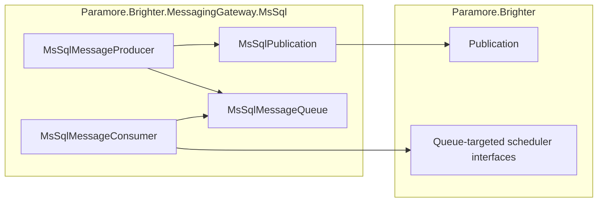

# 89. MS SQL explicit subscriber queues

Date: 2026-10-28

## Status

Proposed

## Context

The SQL transport removes a queued row when a receiver reads it.
Receivers sharing a channel therefore compete, even when their subscription names differ.
Applications also need independent receiver groups to receive copies of the same event.

### Terms

- Logical topic: the event destination in the message header.
- Subscriber channel: the physical SQL queue assigned to a receiver group.
- Fan-out: publication of a separate copy to each subscriber channel.

### Scope

- Parent requirement: [issue #2792](https://github.com/BrighterCommand/Brighter/issues/2792), which reports competing delivery with a shared topic and channel.
- In scope: explicit subscriber channels, atomic publication, and queue-scoped retries and purge.
- In scope: preserving existing shared-channel competition and documenting the configuration needed for independent copies.
- Out of scope: automatic subscriber discovery, durable processing acknowledgements, and a persistent SQL retry scheduler.
- Out of scope: changes to rejection routing, which remains governed by [ADR 0040](0040-mssql-dlq-brighter-managed.md).

### Delivering to independent receiver groups

| Configuration | Result |
|---|---|
| Plain publication, shared topic and channel | One receiver removes each message |
| Fan-out publication, distinct subscriber channels | Each configured group receives a copy |
| Multiple workers sharing one subscriber channel | Workers compete for that group's copy |

The configuration reported in the issue continues to compete. Independent groups must use distinct subscriber channels and enable fan-out on the publisher.

### The forces

- Existing applications depend on shared-channel competition.
- Offline subscribers need copies to remain queued until a receiver starts.
- One failed insertion must not leave a partial set of subscriber copies.
- SQL collation determines whether two names identify the same queue.
- The existing queue schema and delete-on-receive contract must remain compatible.

## Decision

**Publish one copy to each explicitly configured subscriber queue in a single atomic SQL statement.**

`MsSqlPublication.SubscriberChannels` selects the queues. One SQL statement inserts their copies.
The existing `Topic` column holds the physical channel; the serialized message retains its logical topic.

### The mechanism, end to end

| Step | Action | Result |
|---|---|---|
| 1 | Validate publication and snapshot the channel list | Invalid configuration fails before opening a connection |
| 2 | Compare channel parameters under the queue column's collation | Equivalent names receive one copy |
| 3 | Insert all destinations with one statement | Failure or transaction rollback removes every inserted copy |
| 4 | Receive from a physical channel | One worker removes that group's copy |
| 5 | Retry or purge through the consumer | The operation targets only the receiving queue |

Copies preserve the message ID, logical topic, body, and headers.
Receivers can start after publication because subscriber membership belongs to publisher configuration.
Adding a channel affects future sends only. Removing a channel leaves its backlog intact.

### Where the pieces live

All new transport behavior lives in the SQL gateway assembly. The core publication and scheduler interfaces remain unchanged.

### Key Components

#### The roles, and what each is responsible for

| Role | Type | Responsibilities | Responsibility classifier | Collaborators |
|---|---|---|---|---|
| Publication configuration | `MsSqlPublication` | Know the logical topic and subscriber channels; validate their constraints | knowing, deciding | Producer and producer factory |
| Publisher | `MsSqlMessageProducer` | Select plain or fan-out delivery | doing, deciding | Publication, SQL queue |
| Queue storage | `MsSqlMessageQueue` | Execute atomic inserts and channel-scoped purge | doing | Connection provider |
| Subscriber receiver | `MsSqlMessageConsumer` | Receive, retry, and purge its physical queue | doing | SQL queue, targeted scheduler |
| Consumer construction | `MsSqlMessageConsumerFactory` | Validate retry capabilities before creating a consumer | deciding | Channel factory, scheduler |

#### Publication and send contracts

| Member | Input | Output | Error conditions |
|---|---|---|---|
| `Topic` | Nonblank logical topic | Topic used to validate messages | Missing topic or a message with a different topic |
| `SubscriberChannels` | 1–1,000 names, each 1–255 UTF-16 code units | One copy per SQL-distinct name | Null, blank, oversized, or a name exactly equal to the logical topic |
| `Send` / `SendAsync` | Message for the configured topic | Atomic insertion into every destination | SQL failure propagates; async cancellation propagates |

#### Consumer contract

| Member | Input | Output | Error conditions |
|---|---|---|---|
| `Requeue` / `RequeueAsync` | Message and optional delay | Retry targets the receiving queue | Delayed subscriber retries require the matching targeted scheduler interface |
| `Purge` / `PurgeAsync` | Consumer's physical queue | Deletes rows only for that queue | SQL failure propagates; async cancellation propagates |
| Channel creation | Subscription and scheduler | Consumer for the physical queue | Incompatible delayed-retry configuration fails before provisioning |

A pre-cancelled async retry neither modifies metadata nor invokes the scheduler.
The subscriber channel must differ from the logical topic so retries cannot use legacy topic-based scheduling and broadcast again.

#### Where each type is touched

| Assembly | Type | Change |
|---|---|---|
| SQL gateway | `MsSqlPublication` | New opt-in configuration |
| SQL gateway | Producer and producer factory | Validate and select fan-out |
| SQL gateway | SQL queue | Add atomic fan-out and channel-scoped purge |
| SQL gateway | Consumer and factories | Preserve retry destinations and validate scheduling |
| SQL gateway | `MsSqlSubscription` | Explain physical channel semantics |

Plain publication behavior, the queue schema, acknowledgements, and rejection routing remain unchanged.
The low-level queue's table-wide `Purge()` remains available for administration.

### Technology Choices

#### One parameterized statement

One `INSERT ... SELECT` keeps publication atomic without client-side transaction coordination.
Channel names are parameter values, so SQL characters remain data.
The 1,000-destination limit bounds statement size and keeps the parameter count below SQL Server's command limit.

#### SQL-defined queue identity

An empty projection from the queue table gives `UNION` the `Topic` column's collation.
Equivalent channel names therefore receive one copy, including case, accent, and trailing-space equivalence where the collation defines it.

#### Explicit membership

Publisher configuration avoids a subscription registry and its registration lifecycle.
All publishers for a logical topic must use the same destination configuration.

#### Targeted delayed retries

Delayed retries require `IAmAMessageRequeueSchedulerSync` or its async counterpart, configured for this SQL store.
The transport rejects an incompatible scheduler when a subscription requests a positive requeue delay.
No built-in persistent SQL retry scheduler is added.

### Implementation Approach

1. Characterize shared-channel competition through the public producer and channel factories.
2. Add publication validation and a single parameterized SQL fan-out statement.
3. Route retry and purge operations to the receiving queue; validate delayed scheduling before provisioning.
4. Cover both I/O paths, failure atomicity, transactions, collation, Unicode boundaries, and simultaneous publishers and consumers.
5. Run the complete SQL test project and document the configuration needed to opt in.

## Consequences

### Positive

- Independent receiver groups receive copies without changing existing work queues.
- Atomic insertion prevents partial delivery when a destination fails a constraint.
- No schema migration or subscriber-registration service is required.

### Negative

- Subscriber changes require coordinated publisher configuration.
- Delete-on-receive can lose a subscriber's copy if the receiver crashes before processing finishes.
- A lost commit acknowledgement can cause duplicates when a publisher retries.
- Delayed subscriber retries require a compatible scheduler supplied by the application.

### Risks and Mitigations

- Retired queues retain their backlog. Drain them before removing consumers or reverting to plain publication.
- SQL collation can merge names. Tests cover equivalent names and distinct names under binary collation.
- `READPAST` requires compatible isolation. Use locking Read Committed or Repeatable Read for application scopes sharing the consumer pool.
- Snapshot-based Read Committed needs different dequeue hints. The deployment configuration query detects that unsupported default configuration.

## Alternatives Considered

| Alternative | Reason not selected |
|---|---|
| Document competing consumers only | Explains the report but does not provide independent delivery |
| Broadcast to all receivers sharing a channel | Breaks existing work-queue semantics |
| Register subscribers dynamically in SQL | Requires schema, lifecycle, and cleanup decisions beyond explicit fan-out |
| Insert separately for each subscriber | Needs extra transaction coordination to prevent partial publication |
| Use a broker with durable topic subscriptions | Appropriate for dynamic bindings or stronger guarantees, but does not extend the existing SQL transport |

## References

- [Issue #2792](https://github.com/BrighterCommand/Brighter/issues/2792)
- [MS SQL sample and configuration](../../samples/TaskQueue/MsSqlMessagingGateway/README.md#multiple-receivers-competing-queues-and-fan-out)
- [MS SQL rejection routing](0040-mssql-dlq-brighter-managed.md)
- [Fan-out integration coverage](../../tests/Paramore.Brighter.MSSQL.Tests/MessagingGateway/When_publishing_to_subscriber_queues_should_deliver_a_copy_to_each.cs)
- [Shared-channel regression coverage](../../tests/Paramore.Brighter.MSSQL.Tests/MessagingGateway/When_receivers_share_a_topic_and_channel_should_deliver_each_message_to_only_one_receiver.cs)
