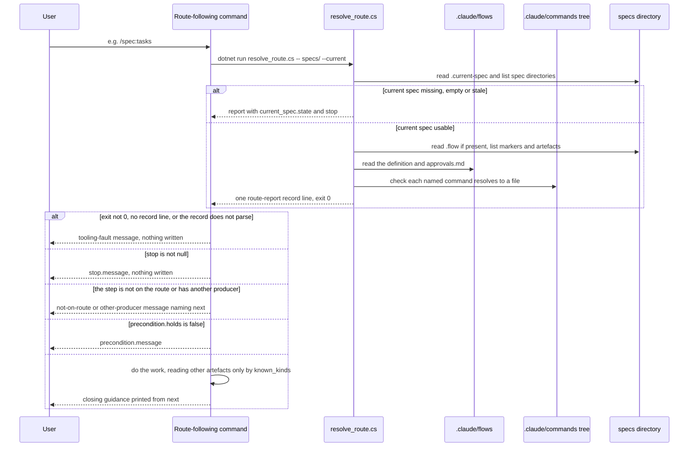
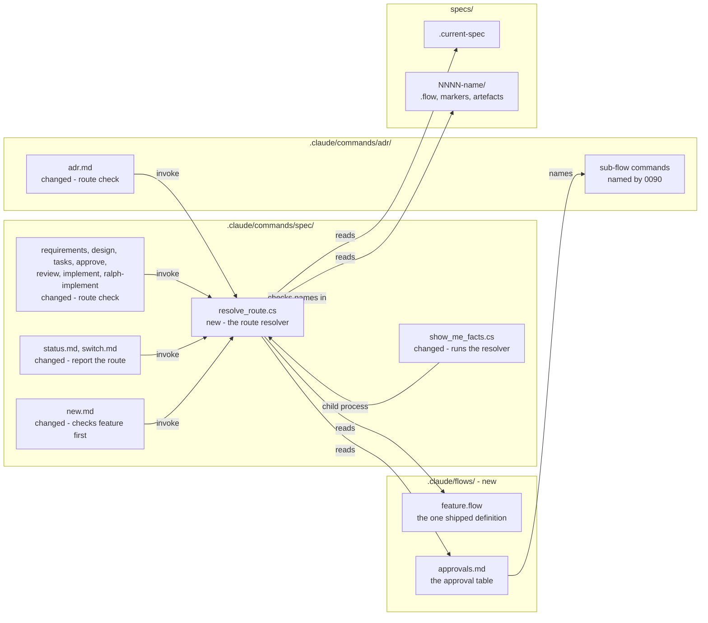
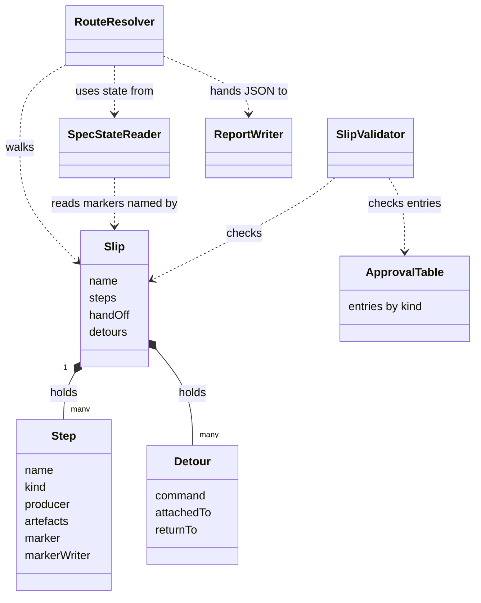

# 89. Routing Slips, the Route Resolver and the Approval Table

Date: 2026-10-28

## Status

Proposed

Implements part of [issue #4661](https://github.com/BrighterCommand/Brighter/issues/4661). Supersedes no prior ADR. This is a decision about the project's own agent tooling, not its runtime. [ADR 0065](0065-add-frontmatter-to-adrs.md) and [ADR 0071](0071-tdd-review-gear.md) set the precedent.

## Context

Every `/spec:*` command carries the `requirements → design → tasks` route in its own prose: which marker it checks, which file it needs, and which command to suggest next. A spec directory does not record which route it is on, so a spec that follows a different route is sent through the wrong steps. Spec 0039's `/modules:*` flow shows the problem: once its gate writes `.requirements-approved`, `/spec:status` tells the user to run `/spec:design`. Adding a lookup table keyed on flow name to every command would mean editing every command again for each new flow, and none of that prose can be tested.

### Terms

The requirements document defines the route vocabulary. This ADR uses those definitions and does not restate them: **flow**, **flow definition**, **slip**, **spec slip**, **step**, **artefact**, **artefact kind** (and **known kinds**), **gate**, **approval table**, **approval sub-flow**, **approval marker**, **hand-off**, **detour**, **intent marker**, **stray marker**, **ignored marker**, **out-of-order approval**, **legacy spec** and **route-following command**. They are stated once in [requirements § Definitions](../../specs/0040-routing-slips/requirements.md#definitions).

The Decision also depends on these words, which this ADR introduces:

- **Route resolver** — the script `.claude/commands/spec/resolve_route.cs`. *Key Components* gives its contract.
- **Route report** — the one JSON object the resolver prints for a spec, or for a flow name. *The route report* below defines its fields.
- **Record line** — one line of the resolver's standard output that begins with a fixed prefix (`route-report: ` or `route-current: `) and is followed by one JSON object. Only record lines are the resolver's output. Any other line is toolchain noise.
- **Violation** — one broken validity rule, identified by a rule id from *The validity rules* table.
- **Stop** — the report field that tells a route-following command to halt before it does any work, and gives the message to print.

### Scope

**Parent requirement**: [specs/0040-routing-slips/requirements.md](../../specs/0040-routing-slips/requirements.md)

**In scope**:

- FR-1 — every flow definition is `.claude/flows/{name}.flow`. Only `feature.flow` ships. Rule R16 rejects a definition whose name differs from its filename stem.
- FR-2 — the slip grammar: a heading, one step table, one `hand-off:` line and any `detour:` lines (*The slip format*).
- FR-3 — rules R0–R16, reported as violations with a rule id, the offending step and a message (*The validity rules*). This includes FR-27's structural rules, R9 and R10, and the report's `gates` list.
- FR-4 — the content of `.claude/flows/feature.flow`.
- FR-5 — a spec with no `.flow` resolves to `feature`, from the definition current at resolution time, with `flow.source` set to `default`. A marker counts as approved when it exists, whatever it contains.
- FR-6 — the report schema, the four modes (`--spec`, `--current`, `--all`, `--flow`) and the `--flows-dir` option.
- FR-7 — the shared *route check* each command runs, the `stop` field, and the grep check over the command files.
- FR-8 — each step's `precondition` and its fixed message, and the `known_kinds` lookup that a producing command uses to find its step.
- FR-9 — `hand_off.precondition`. `known_kinds.design` decides whether `/spec:implement` runs its ADR-status check.
- FR-10 — each command checks `known_kinds` before it reads, requires or grades another step's artefact (*How each command consults the resolver*).
- FR-11 — the `next` field, computed by the next-step ladder.
- FR-12, routing side — step lookup, the `approve_steps` list, and each step's `approval_subflow`. How a sub-flow runs is 0090's.
- FR-14 — `/spec:review` takes its phase from `next.kind`, and accepts an explicit phase only when `known_kinds` has a step of that kind.
- FR-15 — `--all` mode: one summary record per spec directory, plus the `.current-spec` state.
- FR-20 — the resolver classifies `.current-spec` as missing, empty or stale, and sets `stop`.
- FR-21 — `stray_markers` and `out_of_order`. Ignored markers are never read into the report.
- FR-22 — a spec's own `.flow` is authoritative. `flow.definition_present` is reported for information.
- FR-26, route-model part — the README describes flows, flow definitions and `.flow`, the `feature` default, the legacy rule, intent, stray and ignored markers, known and flow-specific kinds, gates, and the approval table. It also updates the File Structure block, the Workflow diagram label and the slip-based preconditions (Implementation Approach step 11). 0090, 0091 and 0092 each document their own parts.
- FR-23, production side — `show_me_facts.cs` runs the route resolver (`resolve_route.cs`) as a child process, passes `--flows-dir` through to it, and records `route.has_requirements_step` in its ledger. The output strings belong to `show-me.md`. The fixture tests are 0092's.
- FR-29, table side — `.claude/flows/approvals.md`: its format and location, at most one entry per kind, rule R12, and each step's reported sub-flow. How a sub-flow runs is 0090's.
- FR-30 — `detour:` lines, `next.detours`, and rule R15.
- NFR-1 — the deterministic serialisation rules (*The report is deterministic*).
- NFR-2 — Markdown text files, read by a .NET file-based app that uses only the base class library.
- NFR-3 — the resolver opens files for reading only.
- NFR-4 — `--all` resolves every spec in one process.
- NFR-6 — legacy specs follow `feature`, and `show_me_facts_tests.cs` passes with its assertions unedited.
- Scope no tagged requirement carries: the `allowed-tools` entry each consuming command gains, and the report fields for tampering and route changes (FR-16, FR-17). This ADR fixes those fields' names and types. 0091 supplies the values.

**Out of scope**:

- How a command runs a sub-flow: questions before writes, idempotence, the marker written only after completion, and failure handling. Approval is the first trigger of a sub-flow, and the only one these requirements define (FR-29). All are decided by 0090.
- The `/adr:*` commands extracted from `approve.md`, with their names and arguments. Also the provenance line (FR-13) and the gate run contract (FR-27). All are decided by 0090.
- The creation record, the tamper cases (a), (b) and (c), CRLF-tolerant comparison, the route-change command with its name, arguments and record, `/spec:new` copying `feature`, the spec numbering rule, and the starter contract (FR-16–FR-19, NFR-5). All are decided by 0091.
- The resolver's test script, the fixture directory layout, the primary and extra fixture flow-definition directories, the `light` and `bugfix` fixture definitions, and the `show_me_facts.cs` fixture tests (FR-24, FR-25, FR-28, and the test side of FR-23). All are decided by 0092.
- The risk model and F5's forced level, which [ADR 0073](0073-show-me-advisory-risk-model.md) decides. This ADR changes neither.
- The parts of FR-26's README content that the sibling ADRs own:
  - approval sub-flows, including how a flow adds an entry, and the provenance line, owned by 0090;
  - the route-change command and the starter-command checklist, owned by 0091;
  - how to run the resolver tests, and FR-28's record of what a `/bugfix:*` migration would have to decide (AC-64), owned by 0092.

  This ADR documents the rest of FR-26, including the approval table's format.

### Where this ADR sits

| ADR | Decides |
| --- | --- |
| **0089** *(this one)* | The slip and approval-table formats, the route resolver and its report, and how commands consult it |
| 0090 | How a command runs a sub-flow (approval is the first trigger), the provenance line, the gate run contract, and the `/adr:*` commands that carry the `design` sub-flow |
| 0091 | How a slip is frozen at creation, how tampering is detected, and how a route is changed |
| 0092 | The resolver's fixture tests and the fixture flow-definition directories |

*"A spec's route is data it carries; commands ask the resolver, not themselves, where it is going."*

### Every command decides the route for itself

| Routing question | Answered today by | After this ADR |
| --- | --- | --- |
| Which route is this spec on? | Nobody. Every command assumes `feature` | `flow` in the route report |
| May `/spec:tasks` run? | `tasks.md` checks for `.design-approved` | `steps[tasks].precondition` |
| What runs next? | Fixed text in each command's closing guidance | `next` |
| Is `requirements.md` part of this route? | Every command assumes it is | `known_kinds.requirements` |
| May implementation start? | `implement.md` lists the three markers | `hand_off.precondition` |
| Which phase does `/spec:review` review? | Fixed marker order | `next.kind` |
| What does approving a `design` step do? | Steps written into `approve.md` | `steps[design].approval_subflow`, from the approval table |
| Is `.current-spec` usable? | Each command checks in its own way, if it checks at all | `current_spec.state` and `stop` |

The table has the same shape in every row: a routing decision lives in prose that an agent interprets, separately in each command. That arrangement has three consequences:

- The commands drift apart. `README.md` says `/spec:ralph-implement` checks ADR status, but the command does not check it.
- A new flow would need an edit to every command that holds one of these answers. That is ten command files.
- No test reaches any of these answers, because a slash command is an instruction for an agent, not code.

The mechanism behind all three is the same. The route exists only as text that each command repeats, and nothing makes the repetitions agree.

### The forces

- **Only executable logic can be tested.** A command's routing can be tested only through a program that it consults (Constraints, first bullet).
- **The same inputs must give byte-identical output.** NFR-1 names those inputs, and they exclude the clock, the network and `gh`.
- **Resolution must never write.** Only starters, the route-change command and marker-writing commands write routing state (NFR-3).
- **No new runtime, package or parser.** The commands' shell tools, or a .NET file-based app, must be able to read every routing file (NFR-2).
- **The toolchain owns standard output.** On a recompile, `dotnet run` writes compiler warnings to standard output ahead of the program's own output, as ADR 0072 measured.
- **No interpreter grant, and no `settings.json` change.** `Bash(dotnet run:*)` would let a command run any C# file. The requirements also rule out new allow-list entries in `.claude/settings.json` (Out of Scope).
- **Existing specs must not change.** Forty-odd legacy specs hold empty, free-text or multi-paragraph markers, and one holds `.code-approved` (FR-5, FR-21).
- **Spec directory names are awkward.** Spec numbers are not unique, and `specs/0021-Expose Unacceptable Message Window/` contains spaces.
- **`/spec:status` covers every spec within 10 seconds.** The first `dotnet run` after an edit costs seconds (NFR-4).
- **`show_me_facts.cs` has a frozen contract.** Its test script must pass with no assertion edited (FR-23, NFR-6).
- **A new flow must add files only.** No file under `.claude/commands/` may change to add `light` or `bugfix` (FR-25, FR-28).

## Decision

**A spec's route is a strictly parsed Markdown slip, and one read-only C# script answers every routing question about it in one JSON report.**

Each flow is defined once, as a Markdown file that holds its step table, and one shared approval table sits beside the definitions. A spec started under this design carries an exact copy of its flow's slip. The route resolver is a small .NET script, a sibling of the show-me measurement script. It reads the slip, the approval table, the list of commands and the spec directory, and prints one record line holding the route report. Every route-following command, `/spec:status`, `/spec:switch` and `/spec:new` runs the resolver first and acts on the report's fields. The show-me measurement script runs the resolver as a child process to learn whether the slip has a `requirements`-kind step. The report holds every answer FR-6 lists, so a "query" is a field lookup and not a separate invocation. *Where the pieces live* names the files.

### The mechanism, end to end



These invariants follow from the diagram:

- **The resolver decides and the command acts.** A command makes no route decision of its own. It reads one field and branches on it.
- **The protocol is small.** The exit status, the last record line and a small, named set of report fields decide every routing branch. Most commands need only `stop`, `known_kinds`, a precondition and `next`. *How each command consults the resolver* lists the fields each command reads.
- **A stop writes nothing.** Every stop comes before the command's first write, and the resolver never writes.
- **Exit 0 means the report is trustworthy, whatever it says.** An invalid slip, a tampered slip and a stale `.current-spec` are all data in a report that exits 0. A non-zero exit always means the resolver itself failed.

#### The next-step ladder

The resolver works out the next step in this order and stops at the first row that matches. Rows 3–5 look at the **first unapproved step**: the earliest step on the slip whose marker does not exist. The commands they name come from that step's row in the slip: its Producer, which creates the artefact, and its Marker-writer, which approves it.

| # | Situation | What the user is told to do next | Example |
| --- | --- | --- | --- |
| 1 | The slip is invalid | Nothing. The command stops and shows the violation | A `feature` copy that names `/spec:designx` |
| 2 | Every step is approved, so the route is complete | Run the hand-off, `/spec:implement`. `/spec:ralph-implement` is offered as the unattended driver of the same `tasks.md`. Any detours attached to the hand-off are listed as optional | `feature`, all three markers: `/spec:implement`, or `/spec:ralph-implement` |
| 3 | The first unapproved step's artefacts do not all exist yet | Run that step's producer, which creates them | `feature`, requirements approved, no `.adr-list`: `/spec:design` |
| 4 | The artefacts exist, and the step is a known kind (`requirements`, `design` or `tasks`) | Review the artefacts, then run that step's marker-writer to approve them | `feature`, `.adr-list` present, not approved: `/spec:review design`, then `/spec:approve design` |
| 5 | The artefacts exist, and the step is a flow-specific kind, which `/spec:review` has no criteria for | Run that step's marker-writer to approve them | `bugfix` fixture, `bugfix.md` present: `/bugfix:confirm` |

Rows 3–5 also list any detours attached to the first unapproved step, as optional. A gate needs no row of its own. A gate is the producer or marker-writer of the steps it serves, so rows 3–5 already name it.

In the route report, each row sets the `next` fields as follows:

- Row 1: `step` is `null` and `commands` is empty. `stop` carries the violation.
- Row 2: `step` is `null`, because no slip step remains. `commands` is `["/spec:implement"]`, `unattended_driver` is `"/spec:ralph-implement"`, and `detours` holds the hand-off's detours.
- Row 3: `step` is the first unapproved step, and `commands` is `[producer]`.
- Row 4: `step` is the first unapproved step, and `commands` is `["/spec:review {kind}", marker-writer]`.
- Row 5: `step` is the first unapproved step, and `commands` is `[marker-writer]`.
- In rows 1 and 3–5, `unattended_driver` is `null`.

Stray markers and ignored markers never count as approval. With an out-of-order approval, row 3, 4 or 5 still uses the first unapproved step in slip order (FR-21). A tampered slip still gets a `next`, so that `/spec:status` can show it. Route-following commands never reach `next` on a tampered slip, because `stop` halts them first.

#### The stop ladder

The resolver sets `stop` from the first row that matches. Otherwise `stop` is `null`.

| # | Situation | `stop.reason` | Recoveries named in `stop.message` |
| --- | --- | --- | --- |
| 1 | `--current`, and `.current-spec` does not exist | `current-spec-missing` | `/spec:switch {spec-id}`, or `/spec:new {name}` |
| 2 | `--current`, and `.current-spec` holds only whitespace | `current-spec-empty` | the same |
| 3 | `--current`, and the trimmed value is not, by ordinal comparison, the name of a directory listed directly under the specs root | `current-spec-stale` | the same, plus the value |
| 4 | The slip is tampered (0091 decides when) | `tampered` | restore `.flow` from version control (cases a and b), or the route-change command with a reason |
| 5 | The slip has at least one violation | `invalid` | for a spec: the route-change command's re-copy with a reason, or fixing, or adding, `.claude/flows/{flow}.flow` or `approvals.md` first when the fault is there. In flow form, where no spec exists: only fixing, or adding, the definition or `approvals.md` |

The three state names in rows 1–3 are fixed by FR-20. Tampered comes before invalid because restoring `.flow` from version control can also clear the violations of a hand-edited copy. Both `tampered` and `violations` are always reported in full, whichever row sets `stop`. Until 0091 names the route-change command, `stop.message` uses the placeholder `{route-change command}`.

### Where the pieces live



Every arrow out of `resolve_route.cs` is a read. Dependencies point one way: commands depend on the resolver, and the resolver depends on data files and the command tree's file names. The resolver never reads a command file's contents. Nothing is added under `src/` or `tests/`, and none of these files is part of the product build.

### Key Components

#### The roles, and what each is responsible for

The resolver is one file, so its roles are file-local classes and records, not public interfaces. Each role is cohesive enough to test through the report alone.

| Role | Type | Responsibilities | Responsibility classifier | Collaborators |
| --- | --- | --- | --- | --- |
| Reads the command line | `Invocation` | Parses the argument grammar and rejects anything else as a usage error | doing | — |
| Knows the slip format | `SlipReader` | Turns slip text into a `Slip`, or reports the first malformed line | knowing, doing | `Slip`, `Step`, `Detour` |
| Knows the table format | `ApprovalTableReader` | Turns `approvals.md` into an `ApprovalTable`, or reports why it cannot | knowing, doing | `ApprovalTable` |
| Knows which commands exist | `CommandCatalogue` | Answers whether `/{family}:{name}` resolves to `{commands}/{family}/{name}.md` | knowing | — |
| Decides whether a slip is valid | `SlipValidator` | Applies R1–R16 and returns every violation in rule order | deciding | `Slip`, `ApprovalTable`, `CommandCatalogue` |
| Decides which spec is current | `CurrentSpecLocator` | Classifies `.current-spec` as ok, missing, empty or stale | deciding | — |
| Knows a spec's state | `SpecStateReader` | Lists the markers and artefacts present, and the stray markers, using the intent-marker set | knowing | `Slip` |
| Decides the route record | `RouteRecordInspector` (contract here, logic in 0091) | Reports tampered or not, the tamper case, and the most recent route change | deciding | `Slip` |
| Decides the route | `RouteResolver` | Computes preconditions, `known_kinds`, gates, out-of-order approvals, `next`, `approve_steps` and `stop` | deciding | `Slip`, `SpecState`, `ApprovalTable`, `RouteRecordInspector` |
| Writes the report | `ReportWriter` | Serialises one `JsonObject` as one record line on standard output | doing | — |
| Asks for the route on show-me's behalf | `RouteProbe` in `show_me_facts.cs` | Runs the resolver, reads `has_requirements_step`, and fails as a tooling fault when the resolver fails | doing | resolver process |



#### The slip format

A flow definition, and a spec's `.flow`, is a Markdown file of this shape. This is the shipped `feature.flow`, FR-4's table as data:

```
# flow: feature

| Step | Kind | Producer | Artefacts | Marker | Marker-writer |
| --- | --- | --- | --- | --- | --- |
| requirements | requirements | /spec:requirements | requirements.md | .requirements-approved | /spec:approve requirements |
| design | design | /spec:design | .adr-list | .design-approved | /spec:approve design |
| tasks | tasks | /spec:tasks | tasks.md | .tasks-approved | /spec:approve tasks |

hand-off: /spec:implement
```

A slip with a detour adds lines after the hand-off. The `light` fixture (0092) will carry this line:

```
detour: /refactor:smells @ hand-off -> hand-off
```

The parser accepts exactly the following. Anything else makes the file malformed, which is violation R0 and names the line number.

1. **Line endings.** The parser converts CRLF to LF before it parses, in line with `* text=auto`. It ignores trailing spaces and tabs on every line. No other normalisation happens. In particular, a leading byte-order mark makes line 1 malformed.
2. **Line 1** is exactly `# flow: {name}`, where `{name}` matches `[a-z][a-z0-9-]*`.
3. **Blank lines** may appear between blocks. A blank line ends the step table. A table row after that blank line and before the hand-off is R0.
4. **The step table.**
   - The header row is exactly `| Step | Kind | Producer | Artefacts | Marker | Marker-writer |`. Spacing inside cells is free, but the cell text and its case are fixed.
   - The delimiter row has six cells, and each cell matches `:?-{3,}:?`.
   - The table then has zero or more data rows. Every row starts and ends with `|` and has exactly six cells, each trimmed. A `|` inside a cell is not supported.
   - A table with no data rows is R1, not R0.
5. **Cell syntax.**
   - Step: `[a-z][a-z0-9-]*`. The name `hand-off` is reserved.
   - Kind: the same pattern, or empty. An empty kind is R6, not R0.
   - Producer and Marker-writer: a command, `/[a-z][a-z0-9-]*:[a-z][a-z0-9_-]*`, optionally followed by space-separated argument tokens, as in `/spec:approve design`.
   - Artefacts: one or more file names relative to the spec directory, separated by `, `. Each name matches `[A-Za-z0-9._-]+`, with no `/`.
   - Marker: `\.[a-z0-9-]+-approved`. The `-approved` suffix keeps every marker inside the ignored-marker definition.
   - Cell text is taken literally. Backticks are not stripped, so a backticked command is malformed.
6. **The hand-off.** Exactly one line `hand-off: {command}` follows the table. A table row after it is R11, not R0. Such a row is reported only by R11. It is not added to `steps`, so it never feeds R2, R5 or R13.
7. **Detours.** Zero or more lines `detour: {command} @ {attached-to} -> {return-point}` follow the hand-off. `{attached-to}` and `{return-point}` are each a step name or the literal `hand-off`. A detour line before the hand-off is R0. Detours are reported in file order.
8. **Nothing else.** Any other non-blank line, including prose, is R0.

Commands are compared as their full text after runs of spaces are collapsed to one. A command resolves when the file `{commands}/{family}/{name}.md` exists for its first token. So `/spec:approve design` resolves to `.claude/commands/spec/approve.md`, and `/spec:ralph-implement` resolves to `ralph-implement.md`.

#### The approval table

`.claude/flows/approvals.md`, one per flow-definition directory:

```
# approvals

| Kind | Approval sub-flow |
| --- | --- |
| requirements | (empty) |
| design | {the design sub-flow commands, in order, named by ADR 0090} |
| tasks | (empty) |
```

- The table follows the slip format's line-ending rule (rule 1). Blank lines may come before the table. A blank line ends the table, and a data row after it makes the table malformed (R12 (c)).
- Line 1 is exactly `# approvals`. The header row is exactly `| Kind | Approval sub-flow |`, followed by a delimiter row and then the data rows. Any other non-blank line makes the table malformed.
- A Kind cell matches `[a-z][a-z0-9-]*`, the same pattern as a slip's Kind cell.
- A sub-flow cell is either the literal `(empty)`, or bare command names (`/{family}:{name}`, with no arguments) separated by `, `, in the order they run. The arguments each command receives are 0090's to decide.
- The `design` row names whatever commands 0090 extracts from `approve.md:34-58` and `:60-61`, with the index regeneration section from `:102`. This ADR does not name them.
- The file is not a `*.flow`, so it is never taken for a flow definition, and its contents never count toward the intent-marker set.

#### The validity rules

The resolver reports every violation, not only the first. Violations are ordered by rule id, then by slip order. `stop.message` quotes the first violation. Each violation is reported as `{rule, code, step, detail, message}`.

| Rule | Code | Rule (FR-3 clause) | Message template |
| --- | --- | --- | --- |
| R0 | `malformed` | The file follows *The slip format* | `{file} line {n} is not valid slip syntax: {what}.` |
| R1 | `no-steps` | At least one step | `Flow {flow} has no steps.` |
| R2 | `duplicate-step` | Step names are unique | `Step {step} appears more than once.` |
| R3 | `duplicate-marker` | Markers are unique | `Marker {marker} is named by more than one step ({steps}).` |
| R4 | `unknown-command` | Every producer and marker-writer resolves | `Step {step} names a command that does not exist, {command}.` |
| R5 | `shared-producer` | No producer is named by two steps | `{command} is the producer of more than one step ({steps}).` |
| R6 | `missing-kind` | Every step declares a kind | `Step {step} declares no artefact kind.` |
| R7 | `known-kind-artefact` | A known-kind step names its kind's artefact | `Step {step} is of kind {kind} but does not name {artefact}.` |
| R8 | `duplicate-known-kind` | At most one step per known kind | `More than one step is of kind {kind} ({steps}).` |
| R9 | `gate-not-adjacent` | A command that is the marker-writer of step N and the producer of a different step M is valid only when M is N+1 | `{command} approves step {n} but produces step {m}, which does not immediately follow it.` |
| R10 | `self-approval` | Producer equals marker-writer only for a gate approving the step before | `Step {step} is produced and approved by {command} with no gate before it.` |
| R11 | `step-after-hand-off` | No step follows the hand-off | `A step follows the hand-off at line {n}.` |
| R12 | `approval-entry` | (a) every kind has an entry, (b) the table has no duplicate kind, (c) the table parses and every sub-flow command resolves | (a) `Step {step} is of kind {kind}, which has no entry in {table}.` (b) `{table} has more than one entry for kind {kind}.` (c) `{table} is unreadable or names a command that does not exist: {what}.` |
| R13 | `last-step-not-tasks` | The last step is kind `tasks`, its artefact list is exactly `tasks.md`, and its marker is `.tasks-approved` | `The last step, {step}, is not the tasks step (kind tasks, tasks.md, .tasks-approved).` |
| R14 | `hand-off-not-implement` | The hand-off is `/spec:implement` | `The hand-off is {command}, not /spec:implement.` |
| R15 | `bad-detour` | A detour's command resolves, and its attach point and return point are steps or `hand-off` | `Detour {command} at line {n}: {which part} is unknown.` |
| R16 | `name-mismatch` | A definition's name equals its filename stem (definitions only) | `{file} declares flow {name}, which differs from its filename.` |

R9 and R10 divide the gate rules between them. R9 judges a command that serves two different steps. R10 alone judges a step whose producer is also its own marker-writer. The `bugfix` slip (FR-28) passes both rules:

- `/bugfix:confirm` is the marker-writer of `diagnosis` (step 1) and the producer of `tasks` (step 2). Step 2 immediately follows step 1, so R9 holds.
- `/bugfix:confirm` is both the producer and the marker-writer of `tasks`. It is also the marker-writer of the step before, `diagnosis`, so it is a gate approving the step before, and R10 holds.

R12 (b) and (c) make every slip resolved against that table invalid, as FR-3 and FR-29 require for a duplicate entry. R12 (c) goes beyond FR-3's list: an approval table that names a missing command would fail at approval time, so the resolver reports it before then. A missing definition is violation R0 in two cases only: a legacy spec when `feature.flow` is missing, and flow form when `{name}.flow` is missing. The violation's `step` is `null`, its detail is `definition missing`, `flow.definition_present` is `false`, and its message is `Flow {name} has no definition at {flows-dir}/{name}.flow.` For a spec with its own `.flow`, a missing definition sets only `definition_present` to `false`, and the spec stays valid (FR-22). In flow form, a name that does not match `[a-z][a-z0-9-]*` is also R0, with the detail `bad name` and the message `{name} is not a valid flow name.` `/spec:new` then stops before creating anything and names that fault (FR-18).

#### The resolver's command line

```
dotnet run .claude/commands/spec/resolve_route.cs -- {specs-root} {mode} [--flows-dir {dir}]
```

| Mode | Arguments | Record lines on standard output | Exit status |
| --- | --- | --- | --- |
| One spec | `--spec {dir-name}` | one `route-report:` line | `0`, or `1` if `{dir-name}` is not, by ordinal comparison, one of the spec directories |
| Current spec | `--current` | one `route-report:` line, which includes `current_spec` | `0` |
| Every spec | `--all` | one `route-current:` line, then one `route-report:` summary line per spec directory | `0` |
| One flow, no spec | `--flow {name}` | one `route-report:` line in flow form | `0`. A `{name}` that does not match `[a-z][a-z0-9-]*` is reported in the flow form, not as an exit status |
| Anything else | — | none | `1` (usage error) |

- `{specs-root}` always comes first, and every command passes `specs/`. Fixture tests pass their own root. Because the first argument after the separator is always `specs/` in a command, one `allowed-tools` entry covers every mode: `Bash(dotnet run .claude/commands/spec/resolve_route.cs -- specs/:*)`.
- The `--` is required, for the reason ADR 0072 records: without it, `dotnet run` reads later options as its own.
- `--flows-dir` replaces the default `.claude/flows`, together with that directory's `approvals.md` and its intent-marker set. The command tree is always `.claude/commands`, resolved from the working directory, which must be the repository root. If `.claude/commands` does not exist, the run is a tooling fault and exits `1`.
- A directory name with spaces is passed as one quoted argument: `--spec "0021-Expose Unacceptable Message Window"`.
- The resolver removes any trailing `/` from `{specs-root}` before it joins a directory name to it, so `specs/` and `specs` give the same paths.
- Spec directories are the immediate subdirectories of `{specs-root}` whose names do not start with `.`, sorted by ordinal string order. A spec name is matched against that list by ordinal comparison, never by a file-system lookup, so the answer is the same on case-insensitive and case-sensitive file systems.
- Exit `1` covers both a usage error and an I/O fault, as in `show_me_facts.cs`. No record line is written on `1`. There is no exit `2`: every outcome that is not a fault travels in the report.

#### The route report

Each field below is written in the order given, so that key order is fixed. Fields that 0091 fills are marked.

| Field | Type | Meaning |
| --- | --- | --- |
| `schema_version` | number | `1` |
| `mode` | string | `spec`, `current` or `flow` |
| `current_spec` | object or null | `current` mode only: `{state: "ok"\|"missing"\|"empty"\|"stale", value: string or null}`, where `value` is the trimmed content |
| `spec` | string or null | `{specs-root}/{dir-name}`, with forward slashes and no trailing slash. `null` in the no-spec form. The flow form has no `spec` key |
| `flow` | object | `{name, source: "slip"\|"default"\|"definition", definition_present: bool}`. `definition` is used in flow form only |
| `valid` | bool | `true` when `violations` is empty |
| `violations` | array | `{rule, code, step: string or null, detail, message}`, ordered as above |
| `tampered` | object | `{value: bool, case: "a"\|"b"\|"c" or null}`. 0091 fills it. Always `{false, null}` for a legacy spec |
| `route_change` | object or null | The most recent change: `{date, from, to, reason}`. 0091 fills it |
| `steps` | array, in slip order | One object per step. Empty when the slip is malformed |
| `known_kinds` | object | Keys `requirements`, `design`, `tasks`, in that order. Each is `null`, or `{step, producer, marker_writer}` |
| `gates` | array | `{command, approves, produces, also_approves_produced: bool}` |
| `stray_markers` | array of strings | In ordinal order |
| `out_of_order` | array | `{approved, earlier_unapproved: [step names]}`, in slip order |
| `next` | object | `{step: string or null, kind: string or null, commands: [..], unattended_driver: string or null, detours: [{command, return_to}]}` |
| `hand_off` | object | `{command, precondition}` |
| `approve_steps` | array of strings | Steps whose marker-writer is exactly `/spec:approve {step}`, in slip order |
| `stop` | object or null | `{reason, message}` |

Each `steps` entry is `{name, kind, known_kind: bool, producer, artefacts: [..], artefacts_present: bool, marker, marker_writer, approved: bool, approval_subflow: [..] or null, gate, precondition}`.

- `gate` is `null`, or `{command, approves_previous, previous_approved: bool, also_marker_writer: bool}`.
- `precondition` is `{holds: bool, unapproved: [{step, marker_writer}], message: string or null}`.
- A step's precondition holds when the step is first, or when the previous step is approved. Its message is ``{producer} needs step {previous} approved — run {previous marker_writer}.``, with each name in backticks.
- `hand_off.precondition` holds when every step is approved. Its `unapproved` list names every unapproved step in slip order. Its message is ``Implementation needs every step approved — unapproved: {step} (run {marker_writer}), ….``, listing every unapproved step in slip order, with each name in backticks. The message names no command, so `/spec:implement` and `/spec:ralph-implement` both print it unchanged.
- An artefact is present when the file exists. `.adr-list` must also hold at least one non-blank line, matching today's "at least one ADR" check in `approve.md`.
- A step is approved when its marker file exists, whatever it contains.

The flow form, from `--flow`, carries only `schema_version`, `mode`, `flow`, `valid`, `violations` and `stop`.

The no-spec form is the report from `--current` when `current_spec.state` is `missing`, `empty` or `stale`. There is no slip to resolve, so it carries only `schema_version`, `mode`, `current_spec`, `spec` (always `null`) and `stop`. `/adr:adr` reads `current_spec.state` from this form and proceeds with no linked spec.

An `--all` summary line carries `spec`, `flow`, `valid`, `violations`, `tampered`, `route_change`, `steps` (each reduced to `name`, `kind`, `artefacts_present` and `approved`), `stray_markers`, `out_of_order`, `next` and `stop`. The `route-current:` line carries `{schema_version, mode: "all", current_spec, specs: count}`.

The intent-marker set is the union of the markers named by every `*.flow` in the flow-definition directory that passes R0, whatever its other violations. A definition that fails R0 adds nothing to the set. Any `.*-approved` file that is neither on the spec's slip nor in that set is ignored, and the resolver never reports it.

#### The report is deterministic

- The resolver builds the report as a `JsonObject` with keys inserted in the order of the table above, and writes it with `ToJsonString`. Indentation is off and the encoder is `JavaScriptEncoder.UnsafeRelaxedJsonEscaping`, as for `show_me_facts.cs`'s stderr records. ADR 0072 records why reflection-based serialisation is not used.
- Every list has a defined order: slip order, file order, or ordinal string order.
- The report holds no clock reading, absolute path, environment value or machine name. Paths are built from the arguments given, with `/`.
- Each record line ends in `\n`, never `Environment.NewLine`.
- The resolver compiles with no warnings, so the whole of its standard output is byte-identical on unchanged inputs, as NFR-1 requires. 0092 compares whole outputs. A warning appears only on a recompile, so that comparison catches one only when a test run recompiles the script. Consumers still read only the record lines, so a warning from a future SDK does not break a command.

#### `show_me_facts.cs` and the route probe

| Member | Input | Output | Error conditions |
| --- | --- | --- | --- |
| Argument grammar | Today's grammar, plus an optional `--flows-dir {path}` in any position after the target. It is a test-only input, like `--pinned` | — | A missing path after the flag is a usage error, exit `1` |
| `RouteProbe` | The target directory, with any trailing `/` removed, split into parent (specs root) and leaf (directory name), and the optional flows directory. A leaf whose case differs from the directory's name makes the resolver exit `1`, which is a tooling fault | `has_requirements_step` (bool or null) and the flow name | Exit status not `0`, no `route-report:` line, or a line that does not parse: the script exits `ToolingFaultExitCode` and writes no ledger |
| Ledger field `route` | — | `{flow: string or null, has_requirements_step: bool or null}` | `null` values, with a `null_reasons.route` entry, when the slip fails R0 |

- `RouteProbe` runs after the completeness gate and before any ref resolution. The gate's exit-`2` path is therefore unchanged, and a resolver fault happens before any `git` or `gh` call.
- When `has_requirements_step` is `false`, the script does not read `requirements.md`, as FR-10 requires. It keeps today's shape for an absent file, `requirements: {present: false, bytes: null, windows: null}` (`show_me_facts.cs:290-295`), so the conditions in `show-me.md` that test `requirements.present` still hold and F5 stays `Medium`. It sets the null reason for `requirements` and for each `declared_*` field to `not on this spec's route`, in place of today's `not present`, and writes the `declared_*` fields as `null`, so `declared_total` is never `0` for such a spec. Row 8 and Inputs-used row 1 choose FR-23's route wording when `route.has_requirements_step` is `false`, and today's missing-file wording otherwise.
- When `has_requirements_step` is `true`, `null`, or a legacy spec's `true`, the ledger is exactly as today, apart from the additive `route` field.
- `schema_version` stays `1`, because the field is additive and the existing test asserts `1`.
- `/spec:show-me` already maps any status other than `0` or `2` to its tooling-fault message (`show-me.md:96`), so a failed resolver needs no new branch in the command.

#### How each command consults the resolver

Every consuming command carries the same *route check* block. The block's canonical text lives in `.claude/commands/spec/README.md`:

> Run `dotnet run .claude/commands/spec/resolve_route.cs -- specs/ --current`. If the exit status is not `0`, or standard output has no line beginning `route-report: `, or the JSON after that prefix on the last such line does not parse, stop. Print `{command} could not run the route resolver (.claude/commands/spec/resolve_route.cs): {state}. This is a tooling fault, not a fault in the spec — re-run after restoring the script.` Create or modify no file. Otherwise hold that JSON object as the route report. If `stop` is not `null`, print `stop.message` and stop, creating or modifying no file.

Two message templates complete the block, and each is filled from report fields:

- **Not on the route:** ``{command} is not on flow `{flow}`'s route. Next step: {next.commands joined with " then "}.``
- **Another producer:** ``Step `{step}` on flow `{flow}` is produced by `{producer}`, not {command}. Run `{producer}`.``

| Command | Mode | Fields it uses | What it does with them |
| --- | --- | --- | --- |
| `/spec:requirements` | `--current` | `stop`; `known_kinds.requirements`; that step's `precondition`; `next` | Stops on `stop`. Not on route if the kind is null. Another-producer message if the producer differs. Prints `next` as closing guidance. It no longer creates a spec directory |
| `/spec:design` | `--current` | as above, with `design`; `known_kinds.requirements` | Reads `requirements.md` and claims FR ids only if a `requirements` step exists. Otherwise the parent is `.issue-number`, else `README.md` (FR-10) |
| `/spec:tasks` | `--current` | as above, with `tasks`; `known_kinds.requirements`, `known_kinds.design` | Checks FR coverage only with a `requirements` step. Reads ADRs only with a `design` step |
| `/spec:approve {step}` | `--current` | `steps[name]`, `approve_steps`, `artefacts_present`, `approval_subflow`, `next` | Lists `approve_steps` when the argument is missing or unknown. Names `marker_writer` when it is not `/spec:approve {step}`. Checks presence, then runs the sub-flow and writes the marker as 0090 decides. Prints `next` |
| `/spec:review [phase]` | `--current` | `next.step`, `next.kind`, `known_kinds`, `steps` | With no phase: reviews `next.kind` if it is known, `code` if `next.step` is null, otherwise names the step and its marker-writer. An explicit phase needs a `known_kinds` entry, and `code` is always accepted. Leaves out FR criteria with no `requirements` step. The closing Spec Status block lists `steps` |
| `/spec:implement` | `--current` | `hand_off.precondition`, `known_kinds.design` | Stops with the precondition message. Runs the ADR-`Accepted` check and the ADR reads only with a `design` step |
| `/spec:ralph-implement` | `--current` | `hand_off.precondition`, `known_kinds.requirements`, `known_kinds.design` | Stops with the precondition message. Passes `requirements.md` and the ADR paths to sub-agents only for kinds on the slip |
| `/adr:adr` | `--current` | `current_spec.state`, `stop`, `known_kinds.design`, `known_kinds.requirements`, `next` | A missing, empty or stale state means no linked spec, and it proceeds. Otherwise it stops on `stop`, and stops with no design step, naming `next` and leaving `.adr-list` untouched. Prints `next` as closing guidance |
| `/spec:status` | `--all` | every summary field, and `current_spec` | Reports flow and source, steps, stray and out-of-order markers, invalid or tampered state, missing definitions, route change, and `next`. Never stops on `stop`. It still reads ADR statuses from `docs/adr/` itself for a `design` step |
| `/spec:switch {id}` | `--spec {dir}` after writing `.current-spec` | as status, for one spec | Shows the same per-spec report and next step |
| `/spec:new {name}` | `--flow feature` | `valid`, `violations`, `flow.definition_present` | Stops before creating anything and names the fault. What it then copies and records is 0091's |
| Route-change command (0091) | `--flow {target}`, `--spec {dir}` | `valid`, `tampered`, `flow` | Its checks and writes are 0091's. It passes `--flows-dir` through for tests |
| `/spec:show-me` | through `show_me_facts.cs` | `route.has_requirements_step` in the ledger | Row 8 checks the route first and writes FR-23's route line. Inputs-used row 1 reads `not available: not on this spec's route` |

#### Where each type is touched

| Assembly | Type | Change |
| --- | --- | --- |
| `.claude/flows/` | `feature.flow` | **new** — FR-4's slip as data |
| `.claude/flows/` | `approvals.md` | **new** — three entries. The `design` row names 0090's commands |
| `.claude/commands/spec/` | `resolve_route.cs` | **new** — the resolver, committed at mode `100644` with no shebang, as `show_me_facts.cs` is |
| `.claude/commands/spec/` | `show_me_facts.cs` | `--flows-dir`, `RouteProbe`, and the ledger's `route` field |
| `.claude/commands/spec/` | `show-me.md` | Row 8's route branch, and Inputs-used row 1, using FR-23's strings |
| `.claude/commands/spec/` | `requirements.md`, `design.md`, `tasks.md`, `approve.md`, `review.md`, `implement.md`, `ralph-implement.md` | The route check, the field-driven branches, and the `allowed-tools` entry where needed. The literal markers are removed |
| `.claude/commands/spec/` | `status.md`, `switch.md` | `--all` and `--spec` reporting |
| `.claude/commands/spec/` | `new.md` | The `--flow feature` check. 0091 makes its other changes |
| `.claude/commands/spec/` | `README.md` | The resolver's invocation and the canonical route check, in *Supporting scripts*. The route-model section, the Workflow label, the slip-based preconditions and `.flow` in the File Structure block (FR-26) |
| `.claude/commands/adr/` | `adr.md` | The route check, with its `.current-spec` exemption |

These are deliberately **unchanged**:

- `.claude/settings.json`. The resolver gets no allow-list entry there.
- `show_me_facts_tests.cs` assertions, and the existing show-me fixtures.
- `gear.md`, `write_release_notes.md`, every `/bugfix:*` command, and `generate_adr_index.awk`.
- Every file in an existing spec directory.

`implement.md` and `ralph-implement.md` already allow `Bash(dotnet:*)`, and `adr.md` allows `Bash`, so those three files need no new `allowed-tools` entry.

### Technology Choices

#### Why Markdown tables, strictly parsed

- **A reviewer already reads this form.** FR-4's own table is the step table. A diff of a slip shows which cell of which step changed.
- **The parse is short and needs no library.** A line-oriented grammar with fixed headers is a few dozen lines of C# over `string.Split` and `Regex`, all in the base class library (NFR-2).
- **The parse is strict because a slip is a contract.** A lenient parser has to guess what a near-miss line meant. A strict one names the line, and route-following commands stop with that message (FR-7). Prose belongs in the README, not in a definition.
- **Definitions keep the `.flow` suffix.** A spec's slip must be `.flow` (requirements § Definitions), and a byte copy is easiest to see when the suffixes match. On GitHub a `.flow` file shows as plain text. A pipe table is still legible as plain text.

#### Why the approval table is its own file

FR-29 requires one table per flow-definition directory, keyed by kind and shared by every flow in that directory. An entry inside each `.flow` would repeat the `design` entry in every flow that has a design step, and the "at most one entry per kind" rule would then span files. A separate `approvals.md` holds each entry once. It renders on GitHub, and its suffix keeps it out of flow enumeration and the intent-marker set.

#### Why the resolver is a C# file-based app

ADR 0072 made this choice for `show_me_facts.cs`, and its reasons carry over. Every contributor has the .NET 10 SDK, and this checkout reports `dotnet --version` 10.0.401 with no `global.json`. `System.Text.Json` escapes correctly without help, and `dotnet run {file}.cs` needs no project or build step. The resolver also inherits the cost ADR 0072 measured on this repository: about 7.8 s on a first run, 1.3 s after an edit, and 0.2 s warm. A sibling of `show_me_facts.cs` also lets 0092's test script follow `show_me_facts_tests.cs` exactly.

#### Why the report travels on standard output behind a prefix

ADR 0072 put its payload in a file because the toolchain writes compiler warnings to standard output on a recompile. The resolver cannot write a file, because NFR-3 forbids it. The record-line prefix solves the same problem: a consumer takes the last line that begins `route-report: `, and no compiler warning begins that way. Standard output, and not standard error, carries the record because the report is the program's result, and standard error stays free for unhandled exceptions. The record is one line, so the agent's shell tool and `RouteProbe` both read it whole.

#### Why one complete report, not query arguments

FR-6's questions are cheap to answer together. Each one is a walk over at most a handful of steps and a few `File.Exists` calls. One report per spec means one grammar, one schema and one set of tests, and every command sees the same answers. With query arguments, the grammar would grow with each question, and two commands could ask overlapping questions and get answers computed by different code paths. FR-6's "queries are by step, not by command" becomes a lookup into `steps[name]`.

#### Why an all-specs mode

`/spec:status` reports every spec. One process per spec would pay the warm start of about 0.2 s for each of nearly 50 directories, and a cold or post-edit start much more. That would put NFR-4's 10 seconds at risk. `--all` pays one start and then reads directories. Its summary records leave out each spec's preconditions, sub-flows and gates, which status does not print, so the output stays small.

#### Why `show_me_facts.cs` runs `resolve_route.cs` rather than sharing its code

Copying the parser and resolver into `show_me_facts.cs` would create two implementations of FR-3 and FR-11, which would drift apart. A file-based app is a single file run by path. Sharing source between two of them would need a project file or a build step, and ADR 0072's convention is to have neither. A child process keeps one implementation. `show_me_facts_tests.cs` already starts `dotnet run` from inside a file-based app, so the nesting is proven on this repository.

#### Why the permission lives in each command's `allowed-tools`

The requirements exclude `.claude/settings.json` entries and accept a permission prompt on first use. A command file's `allowed-tools` grants a tool only while that command runs, so the entry `Bash(dotnet run .claude/commands/spec/resolve_route.cs -- specs/:*)` lets the consuming commands run the resolver without a prompt. That changes no project-wide setting. The entry names the script and the `specs/` prefix for the same reasons ADR 0072's entry does, so it grants no general `dotnet run`. `show_me_facts.cs`'s child process needs no entry.

### Implementation Approach

Numbered in commit order. Structural steps add files that nothing yet reads. Each behavioural step on the resolver is test-first, with 0092's test row before the code that satisfies it.

1. **Prerequisite, 0090.** 0090's `design` sub-flow commands exist under `.claude/commands/adr/`, so that `approvals.md` can name them without violating R12 (c).
2. **Structural.** Add `.claude/flows/feature.flow` and `.claude/flows/approvals.md`. No command reads them yet.
3. **Structural.** Add `resolve_route.cs` with the argument grammar, usage errors (exit `1`), `ReportWriter`, and an empty `--flow` report. Model the exit constants on `show_me_facts.cs:10-12`.
4. **Behavioural.** Add `SlipReader`, `ApprovalTableReader`, `CommandCatalogue` and `SlipValidator`, giving `--flow` mode its R0–R16 output. Each rule gets a 0092 fixture first.
5. **Behavioural.** Add `--spec` mode: `SpecStateReader` and `RouteResolver`, covering steps, `known_kinds`, gates, preconditions and their messages, the stray and out-of-order lists, `next` from the ladder, detours, sub-flows and `approve_steps`. Run it against every legacy spec under `specs/`. `0036-universal-transport-conformance-tests`, `0031-test_naming_conventions` and `0028-box-provisioning-rdd-role-interfaces` (with its `.code-approved`) must each give the hand-off.
6. **Behavioural.** Add `--current` and `--all` modes, `CurrentSpecLocator`, and the stop ladder. Use the missing/empty/stale wording that `show-me.md:51-56` already uses.
7. **Behavioural, 0091.** `RouteRecordInspector` fills `tampered` and `route_change`. Until 0091 lands, they report `{false, null}` and `null`. No starter writes `.flow` before then.
8. **Behavioural.** In `show_me_facts.cs`, add `--flows-dir` to the option loop (`show_me_facts.cs:45-70`), call `RouteProbe` after the gate (after `:72-100`), and branch the `requirements.md` block (`show_me_facts.cs:272-304`) on `has_requirements_step`. In `show-me.md`, add the route branch to row 8 at `:447` and `:559-560`, and the Inputs-used row at `:689-691`. Then run `dotnet run .claude/commands/spec/show_me_facts_tests.cs` and confirm it passes with no assertion edited.
9. **Behavioural, one commit per command.** Do the reporters first, because they cannot block work. Each commit adds the route check and the `allowed-tools` entry where needed, and replaces the cited text:
   1. `status.md:16-21`, `:45-60` and `:71`, with `--all`. Then `switch.md:15-18`, with `--spec`.
   2. `review.md:30` (auto-detect), `:57`, `:68`, `:78`, `:182-185`, `:294` and `:316` (FR criteria by kind), `:462` (closing reminder) and `:466-472` (Spec Status).
   3. `requirements.md:30-33` (no longer creates a directory) and `:203-208`.
   4. `design.md:31-37`, `:97`, `:108`, `:164-166` and `:413-424`.
   5. `tasks.md:24-31`, `:172-173` and `:201-206`.
   6. `approve.md:15-28`, `:64`, `:81-87` and `:95-100`. The kind-specific `design` text at `:34-58` and the report at `:60-61` move out in 0090's extraction. The "Regenerate the ADR index" section from `:102` moves with them. The presence check at `:32`, reading `.adr-list` at `:33`, and the marker write at `:59` stay in `approve.md` as the generic presence check, artefact read and marker write. The route-independent advice at `:62-63` and `:66-79` stays as it is.
   7. `implement.md:65-70` and `:113-118`, then `ralph-implement.md:152-155` and `:222`.
   8. `adr.md:40-50` and `:345`.
10. **Verification.** `grep -l -e '.requirements-approved' -e '.design-approved' .claude/commands/spec/*.md .claude/commands/adr/adr.md` matches only `README.md` (AC-9). 0092's test script compares each command's route-check block with the README's canonical text.
11. **Documentation.** In `.claude/commands/spec/README.md`, one commit:
    1. Extend *Supporting scripts* with the resolver's invocation, its modes and the canonical route check, next to `show_me_facts.cs` (`README.md:704-747`).
    2. Add a section on the route model: flows, flow definitions and `.flow`, `feature` as the default, the legacy rule, intent, stray and ignored markers, known and flow-specific kinds, gates, and the approval table, including how a flow adds an entry.
    3. Label the Workflow diagram (`README.md:15`) as the `feature` flow.
    4. Restate the marker lists at `README.md:403-405` and `:609-612` as slip-based preconditions.
    5. Add `.flow` to the File Structure block (`README.md:809`). 0091 adds the creation record beside it.

## Consequences

### Positive

- A new flow takes one `.flow` file and, for a new kind, one row in `approvals.md`. No command file changes (FR-25, FR-28).
- Every routing answer is computed once, by code that 0092 tests, and every command prints the same next step for the same spec (FR-7, FR-11).
- Legacy specs need nothing. They resolve to `feature` and behave as today (FR-5, NFR-6).
- `/spec:status` and `/spec:switch` show route faults, stray markers and out-of-order approvals that today go unseen (FR-15, FR-21).
- A stale `.current-spec` is now named, and no longer causes `/spec:requirements` to create a stray spec (FR-20).
- `show_me_facts.cs` gains the route without a second implementation of it (FR-23).

### Negative

- Every route-following command now starts a .NET process. That costs about 0.2 s warm, and seconds on the first run after a fresh clone or an edit to the script.
- The resolver becomes a single point of failure. If it is broken, every route-following command halts with a tooling-fault message until the script is fixed.
- `/spec:show-me` gains a new way to fail. A broken resolver now stops it as a tooling fault, where today it would have run.
- Message wording for preconditions, violations and stops lives in C#. Changing a sentence needs a code change and a test update.
- The route-check block is repeated in about ten command files. Only 0092's comparison test keeps the copies identical.
- The grammar is strict. A helpful comment line in a definition makes it malformed, and every spec on that flow stops until it is removed.
- `.flow` files show as plain text, not as rendered tables, on GitHub.
- Legacy specs follow whatever `feature.flow` says now. An edit to `feature.flow` changes the route of every legacy spec at once, guarded only by 0092's all-specs check.

### Risks and Mitigations

- **Risk: a compiler warning, or another line, is taken for the report.** Mitigation: the script compiles with no warnings, and 0092's whole-output comparison fails if a test run that recompiles the script shows one. Consumers read only the last line with the `route-report: ` prefix, as ADR 0072's stderr records do.
- **Risk: `--all` output grows past what the agent's shell tool shows in one result as `specs/` grows.** Mitigation: summary records leave out per-step detail, and each spec is one line. Status can fall back to `--spec` for individual specs.
- **Risk: an agent ignores the report and decides from its own reading of the files.** Mitigation: the FR-7 grep check removes the marker names that such reasoning would start from (`AC-9`). Each command branches on named fields.
- **Risk: CRLF checkouts on Windows make slips malformed.** Mitigation: the parser converts CRLF to LF before parsing, and `.gitattributes:2` already normalises text.
- **Risk: a nested `dotnet run` from `show_me_facts.cs` inherits an environment that breaks it.** Mitigation: `show_me_facts_tests.cs` already starts `dotnet run` from a file-based app. `RouteProbe` builds its arguments with `ArgumentList`, so spaces in names are safe.
- **Risk: R12 (c) makes every slip invalid if 0090's commands are renamed without updating `approvals.md`.** Mitigation: the stop message names the table and the missing command, so the fix is obvious. 0092's tests run against the shipped table.

## Alternatives Considered

### Alternative 1: YAML or JSON slips

YAML needs a parser, and the base class library has none, so it would mean a package or a hand-written parser for an indentation-sensitive grammar (NFR-2). JSON can be parsed with `System.Text.Json`. However, a JSON slip is harder to review than FR-4's table, gives a noisier diff, and cannot hold the explanatory heading a person sees first. It would also be the only JSON file a person edits by hand in the spec family. Markdown tables keep the format the requirements already use.

### Alternative 2: A shell-script resolver

Shell would need a PowerShell twin for Windows contributors, as ADR 0072 found. It would build JSON by hand-escaping strings, which is the defect class ADR 0072 removed. It would also have to be tested through text comparison. `awk` runs `generate_adr_index.awk`, but it has no JSON writer and no simple way to model a slip.

### Alternative 3: A lookup table per command, keyed on flow name

This extends today's arrangement, which the Problem Statement rejects. Every new flow edits every command, the tables drift, and no test reaches them. It also cannot express a gate or a flow-specific kind without a further special case in each command.

### Alternative 4: `show_me_facts.cs` duplicates or shares the resolver's logic

Duplication creates two implementations of FR-3 and FR-11 that drift apart without warning. Sharing source needs a project or a build step, which ADR 0072's single-file, no-build convention rejects. A child process costs one warm start, and that cost is small beside the `git` and `gh` calls the script already makes.

### Alternative 5: Plain-text resolver output

`key: value` lines cannot represent nested lists, such as steps with their unapproved predecessors or detours with return points, without an ad hoc grammar and its own escaping rules. Agents read JSON fields reliably. `System.Text.Json` writes JSON correctly, and `JsonDocument` lets 0092's tests assert on decoded values.

### Alternative 6: One invocation per question

A grammar such as `--precondition design` or `--next` multiplies modes and tests, and lets two commands ask overlapping questions answered by different code paths. One complete report answers every question at once, with the same cost and one schema.

### Alternative 7: The resolver writes its report to a file

This is ADR 0072's ledger pattern. NFR-3 forbids the resolver to create a file. A report file would also have to be gitignored, cleaned up, and protected against concurrent commands.

### Alternative 8: Commands read `.flow` themselves

Each command would parse the slip in prose, which brings back the defect class that this ADR and ADR 0072 remove, now multiplied by ten commands. No test could reach the parse.

## References

- Parent requirement: [specs/0040-routing-slips/requirements.md](../../specs/0040-routing-slips/requirements.md)
- Issue: [#4661](https://github.com/BrighterCommand/Brighter/issues/4661)
- Siblings: 0090 (how a command runs a sub-flow, the provenance line, the gate run contract, and the `/adr:*` commands that carry the `design` sub-flow), 0091 (tamper detection and route change), 0092 (fixtures and test scripts)
- [ADR 0072 — The Measurement Seam and Output of `/spec:show-me`](0072-show-me-command-resolution-and-output.md): file-based app, exit codes, the `--` separator, standard output pollution, the allow-list entry form, and the test-script pattern this ADR follows
- [ADR 0073 — /spec:show-me advisory risk model](0073-show-me-advisory-risk-model.md): F5 and FR-16 row 8, which FR-23's route branch sits beside and does not change
- [ADR 0071 — Shiftable Review Gear for the TDD Approval Gate](0071-tdd-review-gear.md): per-spec state with a reason. It is the analogue of the route-change command, but its state is untracked, while routing state is tracked (NFR-5)
- [ADR 0078 — Machine-Readable Forms in the `/spec` Family](0078-spec-family-machine-readable-forms.md): precedent for spec-family files written in forms a tool reads
- [ADR 0065 — Add frontmatter to ADRs](0065-add-frontmatter-to-adrs.md): `write_adr_metadata` and index regeneration, which the `design` sub-flow (0090) carries
- `.agent_instructions/documentation.md`, `.agent_instructions/design_principles.md`
