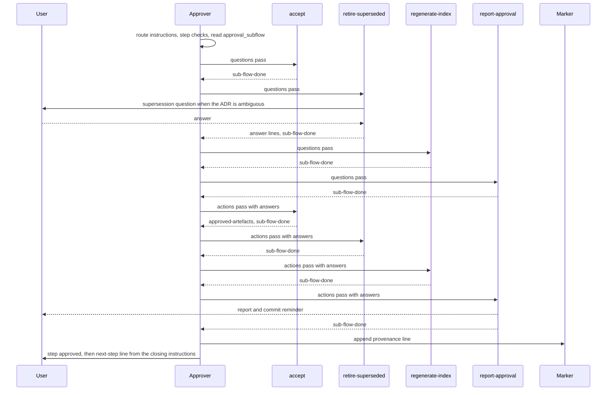
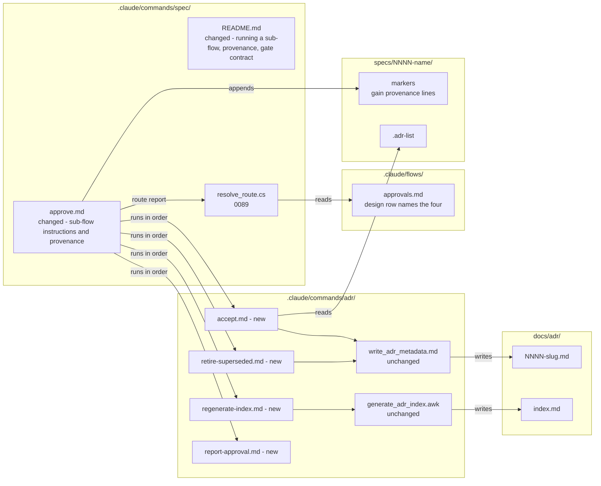

# 90. Approval Sub-flows, Provenance Lines and the Gate Run Contract

Date: 2026-10-31

## Status

Proposed

Implements part of [issue #4661](https://github.com/BrighterCommand/Brighter/issues/4661). Supersedes no prior ADR. This decision is about the project's own agent tooling, not its runtime. [ADR 0089](0089-slips-resolver-and-routing.md) is its accepted sibling.

## Context

Today `/spec:approve design` holds its own ADR work: it flips each ADR to `Accepted`, retires the ADRs that the approved ones supersede, regenerates `docs/adr/index.md` and reports the result. No other command can approve a `design` step and get the same result. An approval marker records only that the step was approved, not what was approved or at which commit. A flow that brings its own approving command, or a gate, would have to copy that work by hand. The copies would drift, and nothing says how such a command must behave when it stops part-way through.

### Terms

These words keep the meaning that [requirements § Definitions](../../specs/0040-routing-slips/requirements.md#definitions) gives them: **step**, **artefact**, **artefact kind**, **gate**, **approval table**, **approval sub-flow**, **approval marker**, **provenance line** and **marker-writing command**. **Route report**, **route instructions** and **closing instructions** are defined in [ADR 0089 § Terms](0089-slips-resolver-and-routing.md#terms). This ADR introduces these words:

- **Approver** — any command that writes a step's approval marker: `/spec:approve`, a gate, or a flow's own marker-writing command.
- **Sub-flow command** — one command named in an approval-table entry. *The sub-flow command shape* gives its form.
- **Questions section** — the `## Questions` section of a sub-flow command. It asks the user and checks its inputs, and never writes.
- **Actions section** — the `## Actions` section of a sub-flow command. It makes the command's writes and asks nothing.
- **Answers** — the values that Questions sections produce. They reach every Actions section as arguments.
- **Protocol line** — one line, in a fixed form, that a sub-flow command prints for its approver to read (*The protocol lines*).
- **Sub-flow instructions** — the canonical procedure every approver follows to run a sub-flow and write the marker. Its text lives in `.claude/commands/spec/README.md`.
- **Gate run** — one run of a gate command under the run contract (*The gate run contract*).

### Scope

**Parent requirement**: [specs/0040-routing-slips/requirements.md](../../specs/0040-routing-slips/requirements.md)

**In scope**:

- FR-12, approve side — `/spec:approve` runs the sub-flow instructions after 0089's checks. It writes the marker only when every sub-flow command completes, and it holds no kind-specific action. A `null` sub-flow stops it, naming the kind. The words after the step name reach the sub-flow as `--select` arguments.
- FR-13 — the provenance line: its format, the append-only write, and the `unavailable` sha.
- FR-27, run side — the gate ladder, its questions, the three interrupted states and the never-overwrite rule. The structural rules (R9, R10) and the `gates` report fields are 0089's.
- FR-29, run side — the two-pass protocol, the argument convention, the protocol lines, failure and re-run, and per-command idempotence. It also names the four `/adr:*` commands that carry the `design` sub-flow and fills the `design` row of `.claude/flows/approvals.md`.
- FR-19, contributing — the checklist clauses on provenance lines, on running the sub-flow before the marker, and on the run contract point at this ADR's README text. 0091 owns the checklist.
- FR-26, two parts — the README notes on running a sub-flow (and the gate run contract) and on the provenance line.
- NFR-2 — a provenance line is one plain-text line that `grep` and `awk` read.
- NFR-3, contributing — sub-flow commands write ADR files and the index, which are not routing state. Only the approver writes the marker.
- AC-24, AC-25, AC-26, AC-27, AC-76, AC-77 and AC-79 are verified by this ADR's mechanism (Implementation Approach step 7).
- Scope no tagged requirement carries: the `allowed-tools` of the four new commands and the two entries `approve.md` gains, and the doc touch-ups in `.claude/commands/adr/` and `.agent_instructions/adr_frontmatter.md`.

**Out of scope**:

- The approval table's format, location and rule R12, the `approval_subflow`, `approve_steps`, `artefacts`, `artefacts_present`, `marker_writer` and `gate` report fields, the route instructions and closing instructions, and the step-not-on-the-slip, another-marker-writer and artefacts-missing templates. All are 0089's.
- That a marker counts as approved whatever it holds (FR-5). The resolver decides that (0089). It never reads a provenance line.
- Tampering, route change, slip creation and the starter-command checklist itself. All are 0091's.
- Fixture directories, a fixture gate, a fixture sub-flow command and every test script. All are 0092's. *What 0092 needs from this ADR* lists the inputs.
- Any change to what the `design` sub-flow does to ADRs and the index (requirements, Out of Scope). Only its location moves.

### Where this ADR sits

| ADR | Decides |
| --- | --- |
| 0089 | The slip and approval-table formats, the route resolver and its report, and how commands consult it |
| **0090** *(this one)* | How a command runs a sub-flow (approval is the first trigger), the provenance line, the gate run contract, the `/adr:*` commands that carry the `design` sub-flow, and the README's notes on running a sub-flow and on the provenance line |
| 0091 | How a slip is installed and frozen at creation (`/spec:new`'s copy and record, numbering, the starter contract), how tampering is detected, how a route is changed, and the README's notes on the route-change command and the starter checklist |
| 0092 | The resolver's and show-me's fixture tests, the fixture flow-definition directories, and the README's notes on running the tests and on a `/bugfix:*` migration |

*"A spec's route is data it carries; commands ask the resolver, not themselves, where it is going."*

### Only one command knows how to approve a design

| Approval question | Answered today by | After this ADR |
| --- | --- | --- |
| Which ADRs become `Accepted`? | Prose in `/spec:approve` | `/adr:accept` |
| Which older ADRs are retired? | Prose in `/spec:approve`, asking mid-write | `/adr:retire-superseded`, asking before any write |
| Who regenerates the index? | A section of `approve.md` | `/adr:regenerate-index` |
| Who reports the outcome? | Prose in `/spec:approve` | `/adr:report-approval` |
| What does the marker record? | Nothing; `touch` | One provenance line per approval |
| What if approval stops part-way? | Undefined | No marker; re-run from the first command |

Every row has the same shape: approval behaviour lives in one command's prose. That arrangement has three consequences:

- A gate or a flow's own approver cannot produce the same outcome without copying the prose.
- The supersession question can come after the first ADR write, so a cancelled question leaves a half-approved design.
- A marker cannot say which ADRs, or which commit, an approval covered.

The mechanism behind all three is the same. Approval is a procedure, but it is written as part of one command instead of as a contract that any approver can follow.

### The forces

- **A command is an instruction for an agent, not code.** The run procedure must be concrete enough for an agent to follow step by step, and for a person to check from a transcript.
- **Questions before writes.** A sub-flow asks everything before its first write, and a re-run asks again (FR-29).
- **No progress record.** A failed sub-flow re-runs from its first command, so every command must be idempotent for the same answers (FR-29).
- **The approver stays generic.** `/spec:approve` holds no kind-specific action, and the table cell holds bare command names (FR-12, 0089).
- **Same outcome as today.** A `feature` spec's design approval must end with the same ADRs, statuses and index as `approve.md` produces now (AC-24, AC-77).
- **Markers stay valid as they are.** Existing markers hold nothing, free text or paragraphs, and the resolver tests only that the file exists (FR-5).
- **A flow adds files, not edits.** A flow-specific kind adds a table row and its own commands. It edits no `/spec:*` file (FR-25, FR-28).
- **No new runtime or parser.** A provenance line must be readable with the shell tools the commands already use (NFR-2).

## Decision

**Every approver runs a sub-flow in two passes — all Questions sections, then all Actions sections in table order — and writes the marker, with one appended provenance line, only when every command has completed.**

The approval table names the commands. The approver runs each one through the Skill tool, first with the mode word `questions` and then with `actions`. It passes the same common arguments each time, and in the second pass it adds every answer collected in the first. Each command reports completion or failure in a fixed protocol line. A failure stops the approver with no marker written, and a re-run starts again from the first command. The `design` sub-flow is four narrow `/adr:*` commands extracted from `approve.md`. A gate follows the same procedure for each step it approves, inside a run contract that never overwrites an artefact without asking.

### The mechanism, end to end



These invariants follow from the diagram:

- **No write precedes the last question.** Every Questions section runs, and every input fault surfaces, before the first Actions section.
- **The marker is the last write of the sub-flow.** A missing `sub-flow-done` line from any command means no marker.
- **The approver decides nothing about the kind.** It reads command names from the report and protocol lines from the commands.
- **A re-run is a full re-run.** The approver keeps no record of which commands finished.

#### The sub-flow instructions

The canonical text lives in `.claude/commands/spec/README.md`. `approve.md` carries an identical copy, and so does every gate or flow approver. An approver runs them after 0089's route instructions and step checks:

1. Read `steps[{step}].approval_subflow`. If it is `null`, print the no-usable-entry message and stop.
2. If it is empty, go to step 7.
3. Build the common arguments: `"{spec}" {step} {artefacts}`, then `--select {word}` for each word after the step name in the approver's own arguments, in order. `{spec}` is the report's `spec`, and `{artefacts}` is `steps[{step}].artefacts` joined with `,`.
4. Questions pass. For each command in table order, run it through the Skill tool (its name without the leading `/`), with arguments `questions` and the common arguments. Keep every `answer:` line it prints, in order.
5. Actions pass. For each command in table order, run it with `actions`, the common arguments, and `--answer {key}={value}` for every kept answer.
6. After each run in steps 4 and 5, the command has completed only when the last protocol line it printed is `sub-flow-done: {command} {pass}`. Otherwise print the sub-flow-failed message for that pass and stop. Write no marker.
7. Append the provenance line to `steps[{step}].marker` (*The provenance line*), and print the step-approved message.

Then the approver runs 0089's closing instructions. With no `--select` words and an empty sub-flow, extra words are ignored, as `approve.md` ignores them today.

#### Arguments and answers

Every sub-flow command takes one argument form:

```
[questions|actions] "{spec}" {step} {artefacts} [--select {word}]... [--answer {key}={value}]...
```

- With no mode word the command was run directly. It runs its Questions section, then its Actions section.
- `{spec}` is always double-quoted, because a spec directory name may contain spaces.
- An answer key is `{command}.{name}`, for example `/adr:retire-superseded.0090-approval-sub-flows`. The prefix keeps keys from two commands apart. Every command receives every answer.
- A value that contains a space is quoted as `--answer "{key}={value}"`. A value may not contain `"` or a newline.
- `/spec:approve design 0043` therefore reaches each `design` command as `questions "specs/0040-routing-slips" design .adr-list --select 0043`.

#### The protocol lines

A sub-flow command prints these lines, each alone on a line. Their canonical text lives in `.claude/commands/spec/README.md`.

| Line | Printed in | Meaning |
| --- | --- | --- |
| `answer: {key}={value}` | the questions pass | One answer, whether the user gave it or the command derived it |
| `approved-artefacts: {paths joined with ","}` | the actions pass, optional | The files this approval covered. The approver uses the last such line |
| `sub-flow-done: {command} {pass}` | the last line of each pass | The pass completed |
| `sub-flow-failed: {command} {pass}: {reason}` | instead of `sub-flow-done` | The pass failed. A question the user dismissed has the reason `question not answered` |

#### Failure and re-runs

| Command | Re-run with the same answers | Why it changes nothing further |
| --- | --- | --- |
| `/adr:accept` | No change | It skips an ADR whose frontmatter and body Status are both `Accepted` |
| `/adr:retire-superseded` | No change | It skips a target already `Superseded` by the same ADR, or already `Deprecated` |
| `/adr:regenerate-index` | The same `index.md` | The awk generator is deterministic |
| `/adr:report-approval` | The same report | It writes nothing and reads the same inputs |

A failure in the questions pass leaves nothing written. A failure in the actions pass leaves the writes of earlier commands in place, and the message says so. Idempotence holds only for the same answers. A re-run that gives a different supersession answer leaves the earlier retirement in place. That limitation is accepted (requirements, Constraints). The user sees it in `git diff` and reverts it with git.

#### The provenance line

One line is appended per approval:

```
approved: step={step} artefacts={artefacts joined with ","} sha={full HEAD sha, or unavailable}
```

- `{artefacts}` comes from the last `approved-artefacts:` line, or from `steps[{step}].artefacts` when no command printed one. For `design` it lists each ADR file approved.
- Existing content is kept. If the marker is non-empty and lacks a final newline, a newline is added first, so the line always starts a line.
- Re-approving appends a further line. The resolver never reads the content (0089).

The approver writes the line with this shell, run from the repository root:

```sh
m="specs/0040-routing-slips/.tasks-approved"
if [ -s "$m" ] && [ -n "$(tail -c 1 "$m")" ]; then echo >> "$m"; fi
echo "approved: step=tasks artefacts=tasks.md sha=$(git rev-parse --verify --quiet HEAD 2>/dev/null || echo unavailable)" >> "$m"
```

`git rev-parse --verify --quiet HEAD` prints the full sha. With no commits it exits `1` silently, and outside a git work tree it exits `128`. Both print `unavailable`. Worked examples, at HEAD `0691e67beb1ce7242c734bcd0a9a5960610d432d`:

```
approved: step=tasks artefacts=tasks.md sha=0691e67beb1ce7242c734bcd0a9a5960610d432d
approved: step=design artefacts=docs/adr/0089-slips-resolver-and-routing.md,docs/adr/0090-approval-sub-flows.md sha=0691e67beb1ce7242c734bcd0a9a5960610d432d
approved: step=requirements artefacts=requirements.md sha=unavailable
```

A free-text marker keeps its text, and the line follows it. `grep '^approved: ' {marker}` lists every approval. `awk '/^approved: /{print $2, $NF}' {marker}` prints each step and sha. `test -f` still decides approval.

#### The gate run contract

This spec ships no gate. The contract binds every flow that owns one (FR-19). A gate approves step N and produces step N+1. It finds its row as the step whose `gate.command` is itself, and reads `steps[N].approved`, `steps[N+1].artefacts_present`, `steps[N+1].approved` and `gate.also_approves_produced`.

| # | Starting state | Interrupted state | What the gate does |
| --- | --- | --- | --- |
| 1 | N unapproved, N+1 absent | A, when N's sub-flow failed before | First question, approve N, produce N+1, then second question |
| 2 | N unapproved, N+1 present and unapproved | A, when N's sub-flow failed before | First question, approve N, existing-artefact question |
| 3 | N approved, N+1 absent | B: stopped after N's marker | Produce N+1, then second question |
| 4 | N approved, N+1 present and unapproved | C: stopped after N+1's artefact | Existing-artefact question |
| 5 | N+1 approved | — | First question if N is unapproved. Never touches N+1 |

The gate applies the row in this order:

1. Ask the first question in rows 1, 2 and 5 when N is unapproved. On `Cancel`, print the declined message and stop. Nothing is written.
2. Approve N with the sub-flow instructions. A failure stops the gate with no marker for N, and a re-run lands on row 1 or 2.
3. In rows 1 and 3, produce N+1. In rows 2 and 4, ask the existing-artefact question. `Regenerate` produces N+1 again. `Cancel` stops, leaving the state of row 4.
4. When `also_approves_produced` is true, ask the second question after a fresh production or `Regenerate`. Choosing `Approve as is` at the existing-artefact question counts as approval.
5. On approval, run the sub-flow instructions for N+1. `Not now` stops with the state of row 4.
6. Run the closing instructions.

A gate produces N+1 only in rows 1 and 3, or after `Regenerate`, so it never overwrites an artefact without asking. A gate that is not N+1's marker-writer offers `Keep as is`, and stops after it.

### Where the pieces live



Dependencies point one way. The approver depends on the resolver's report and on the commands it names. The `/adr:*` commands depend on `write_adr_metadata` and the awk generator, and know nothing of slips. A gate or flow approver sits where `approve.md` sits, and carries the same sub-flow instructions.

### Key Components

#### The roles, and what each is responsible for

These types are agent instructions and named sections, not compiled types. Each role is still one phrase, and each can be checked from what it prints.

| Role | Type | Responsibilities | Responsibility classifier | Collaborators |
| --- | --- | --- | --- | --- |
| Runs a sub-flow | sub-flow instructions (section of each approver) | Runs both passes in table order, judges completion, writes the marker last | doing, deciding | route report, sub-flow commands, provenance line |
| Asks before acting | Questions section | Checks inputs read-only, asks the user, prints answers | knowing, doing | the user |
| Acts on answers | Actions section | Makes the command's writes, asks nothing | doing | `write_adr_metadata`, awk |
| Accepts ADRs | `/adr:accept` | Flips each selected ADR to `Accepted` | doing | `write_adr_metadata`, `.adr-list` |
| Retires older ADRs | `/adr:retire-superseded` | Learns what each ADR supersedes, then supersedes or deprecates | deciding, doing | `write_adr_metadata`, the user |
| Rebuilds the index | `/adr:regenerate-index` | Regenerates `docs/adr/index.md` | doing | `generate_adr_index.awk` |
| Reports the approval | `/adr:report-approval` | Prints the outcome and the commit reminder | knowing | answers, `.adr-list` |
| Records provenance | provenance step (sub-flow instructions step 7) | Appends one line, keeping existing content | doing | `git rev-parse` |
| Approves and produces | a flow's gate | Follows the gate ladder | deciding | sub-flow instructions, route report |

#### The sub-flow command shape

Every sub-flow command, in any flow, is one Markdown command file with these parts:

| Member | Input | Output | Error conditions |
| --- | --- | --- | --- |
| `## Arguments` | the argument form above | dispatch on the mode word | a missing `{spec}`, `{step}` or `{artefacts}`: `sub-flow-failed`, reason `usage` |
| `## Questions` | common arguments | `answer:` lines, then `sub-flow-done` | an input fault, or a dismissed question: `sub-flow-failed` |
| `## Actions` | common arguments and every answer | its writes, optional `approved-artefacts:`, then `sub-flow-done` | any failed write: `sub-flow-failed` |

A command with no questions has a Questions section that checks its inputs, or says it has nothing to ask, and prints `sub-flow-done`.

#### The `design` sub-flow commands

The `design` row of `.claude/flows/approvals.md` reads `/adr:accept, /adr:retire-superseded, /adr:regenerate-index, /adr:report-approval`. Three commands apply the **ADR selection rule**, whose canonical text lives in `.claude/commands/adr/README.md`:

1. Read `{spec}/.adr-list`. Each non-blank line, trimmed, names one ADR. A leading `docs/adr/` is removed, because both forms occur in existing specs. The path is `docs/adr/{name}`.
2. With no `--select`, select every ADR. With one, select the line whose stem equals the word. Failing that, select the lines whose name starts with `{word}-`.
3. Fail on an empty list, more than one `--select`, no match, more than one match, or a selected file that does not exist.

| Member | Input | Output | Error conditions (the `{reason}`) |
| --- | --- | --- | --- |
| `/adr:accept` Questions | common arguments | `sub-flow-done` | a selection fault; `docs/adr/{name} has no frontmatter; run write_adr_metadata docs/adr/{name} init first` |
| `/adr:accept` Actions | common arguments | `write_adr_metadata docs/adr/{name} status Accepted` per ADR not yet `Accepted`; `approved-artefacts:` | `write_adr_metadata did not pass its checks for docs/adr/{name}`, which includes any question it would ask |
| `/adr:retire-superseded` Questions | common arguments | one `answer:` per selected ADR. The key is the ADR's stem, and the value is `none` or a `,`-list of `supersede:{stem}` and `deprecate:{stem}` | a selection fault; `question not answered` |
| `/adr:retire-superseded` Actions | answers | `supersede --by {approved stem}` or `deprecate` on each target, through `write_adr_metadata` | `write_adr_metadata did not pass its checks for docs/adr/{stem}.md` |
| `/adr:regenerate-index` both passes | ignored | `awk -f .claude/commands/adr/generate_adr_index.awk docs/adr/[0-9]*.md > docs/adr/index.md` in Actions | `awk exited {code}` |
| `/adr:report-approval` Actions | common arguments, the retire answers | the four report lines | a selection fault |

`/adr:retire-superseded` asks only when needed, as `approve.md` does today. An ADR whose `## Status` and `## References` name no earlier ADR after "Supersedes" gets `none` without a question. An ADR that names exactly one existing ADR, with no section mark (`§`), gets `supersede:{stem}` without a question. Every other ADR gets the supersession question. An answer that names a missing file, the ADR itself, or a target already `Superseded` by a different ADR repeats the question with the reason.

#### Message templates

The approver's templates and the gate's templates have canonical text in `.claude/commands/spec/README.md`. The `/adr:*` templates have canonical text in `.claude/commands/adr/README.md`. Each command that prints one carries an identical copy, and 0092 compares the copies. `{approver}` is the approver's own invocation as typed, `{pass}` is `questions` or `actions`, and `{reason}` comes from the `sub-flow-failed` line, or is `no sub-flow-done line`.

| Template | Printed by | Text |
| --- | --- | --- |
| No usable entry | every approver | ``Step `{step}` cannot be approved: kind `{steps[step].kind}` has no usable entry in the approval table. Nothing was written.`` |
| Sub-flow failed, questions | every approver | ``{approver} stopped: `{command}` failed in its questions pass: {reason}. Nothing was written.`` |
| Sub-flow failed, actions | every approver | ``{approver} stopped: `{command}` failed in its actions pass: {reason}. {steps[step].marker} was not written. Writes made by earlier sub-flow commands stay. Re-run {approver} to run the sub-flow again from `{approval_subflow[0]}`.`` |
| Step approved | every approver | ``Approved step `{step}` on flow `{flow.name}`: {steps[step].marker} gained a provenance line.`` |
| Gate, first question | a gate | ``Approve step `{N}` ({steps[N].artefacts joined with ", "}) and go on to produce step `{N+1}`?`` Options `Approve`, `Cancel` |
| Gate, declined | a gate | ``{approver} stopped: step `{N}` was not approved. Nothing was written.`` |
| Gate, existing artefact | a gate | ``Step `{N+1}`'s artefacts ({steps[N+1].artefacts joined with ", "}) already exist. What should {approver} do?`` Options `Approve as is` (or `Keep as is`), `Regenerate`, `Cancel` |
| Gate, second question | a gate | ``Approve step `{N+1}` ({steps[N+1].artefacts joined with ", "})?`` Options `Approve`, `Not now` |
| Supersession question | `/adr:retire-superseded` | ``Does `{adr}` supersede or retire an earlier ADR?`` Options `No`, then `Supersedes {stem}` for each ADR its text names (at most three). The tool's free-text answer is read as `supersede {stem}` or `deprecate {stem}` |
| Report | `/adr:report-approval` | ``ADRs approved: {selected stems joined with ", "}.`` then ``ADRs superseded: {old} by {new}, ….`` or ``ADRs superseded: none.``, then ``ADRs deprecated: {old}, ….`` or ``ADRs deprecated: none.``, then ``Commit the approved ADRs and the regenerated docs/adr/index.md to git.`` |

In a gate, `{N}` is `steps[i].gate.approves` and `{N+1}` is `steps[i].name`, for the step `i` that the gate produces.

#### Where each type is touched

| Assembly | Type | Change |
| --- | --- | --- |
| `.claude/commands/adr/` | `accept.md`, `retire-superseded.md`, `regenerate-index.md`, `report-approval.md` | **new** — none collides with an existing command name |
| `.claude/commands/spec/` | `approve.md` | `approve.md:34-58`, `:60-61`, `:102-112` and `:130` move out. `:59` becomes the provenance step. `:32-33` become generic (0089 step 9.6). The sub-flow instructions and templates are added. `allowed-tools` (`approve.md:2`) gains `Bash(git rev-parse:*)` and `Bash(tail:*)` |
| `.claude/commands/spec/` | `README.md` | Sections on running a sub-flow, the protocol lines, the gate run contract and the provenance line. Templates. The approve entry (`README.md:244-260`). The marker comments in File Structure (`README.md:817-819`) |
| `.claude/commands/adr/` | `README.md` | The four commands, the ADR selection rule and their templates. `README.md:51-52`, `:64-66` and `:182-194` name the `design` sub-flow |
| `.claude/flows/` | `approvals.md` | The `design` row names the four commands (0089 creates the file) |
| `.agent_instructions/` | `adr_frontmatter.md` | `:78-79` and `:159` name the `design` sub-flow, not `/spec:approve` alone |
| `.claude/commands/adr/` | `write_adr_metadata.md` | `:116` adds the two new callers to its list |

These are deliberately **unchanged**:

- What `write_adr_metadata` does, and `generate_adr_index.awk` including its header (`generate_adr_index.awk:41`), so `index.md` regenerates byte-identically.
- `adr.md`'s own index regeneration when it creates an ADR.
- `.claude/commands/README.md` and `.agent_instructions/skills_overview.md`. Neither lists the ADR helper skills today, so neither lists the four.
- `.claude/settings.json`, and every existing marker under `specs/`.

### Technology Choices

#### Why four narrow commands

Each command does one thing that a re-run can repeat safely. A failure message that names `/adr:regenerate-index` tells the user exactly which write did not happen. One combined command would hide that, and a flow could not reuse index regeneration alone.

#### Why two passes and not questions asked inline

A question asked inside a command's work comes after earlier commands have written. Cancelling it then leaves a half-done approval. Asking everything first makes "nothing was written" true for every cancel and every input fault.

#### Why the Skill tool with a mode word

The Skill tool runs a command under its own name, with its own instructions loaded, so the transcript shows each command run. The mode word keeps each file whole and runnable by hand: `/adr:regenerate-index` with no arguments rebuilds the index. Reading files and following their sections inline would leave no record of which command ran.

#### Why answers travel as arguments

Arguments keep the sub-flow free of state. A file of answers would be a progress record by another name, which FR-29 rules out, and it would need clean-up after a failure.

#### Why a `key=value` line

Fixed fields separated by single spaces read with `grep` and `awk`, and no field holds a space. A JSON line would read worse in an IDE and gains nothing, because no program parses the line.

### Implementation Approach

Numbered in commit order. Structural steps add files that nothing yet runs, or move behaviour without changing its outcome.

1. **Structural, prerequisite for 0089 step 1.** Add the four `/adr:*` commands, each with Arguments, Questions and Actions sections and its template copies. Their text comes from `approve.md:38-46` (accept), `:48-54` (retire), `:56-57` and `:102-112` (index) and `:60-61` (report). Their `allowed-tools` are: accept `Read, Glob, Bash(grep:*), Skill`; retire `Read, Glob, Bash(grep:*), AskUserQuestion, Skill`; regenerate `Bash(awk:*)`; report `Read, Glob, Bash(grep:*)`. 0089 step 2 then names them in `approvals.md`.
2. **Documentation.** Add the canonical sub-flow instructions, protocol lines, templates, gate run contract and provenance-line notes to `.claude/commands/spec/README.md`. Add the ADR selection rule and `/adr:*` templates to `.claude/commands/adr/README.md`.
3. **Structural, after 0089 step 9.6.** In `approve.md`, replace `:34-58` and `:60-61` with the sub-flow instructions, and remove `:102-112` and `:130`. Keep `touch` for the marker in this commit, so the outcome equals today's.
4. **Behavioural.** Replace the `touch` at `approve.md:59` with the provenance shell, and add the two `allowed-tools` entries at `approve.md:2`. Change `argument-hint` at `approve.md:4` to `<step> [selector]`.
5. **Documentation.** Update `adr_frontmatter.md:78-79` and `:159`, `adr/README.md:51-52`, `:64-66` and `:182-194`, `write_adr_metadata.md:116`, and `spec/README.md:244-260` and `:817-819`.
6. **Verification of AC-79.** `grep -n -e write_adr_metadata -e supersede -e deprecate -e generate_adr_index -e index.md .claude/commands/spec/approve.md` matches nothing.
7. **Verification of AC-24, AC-76 and AC-77, by hand on a throwaway branch.** Use a `feature` spec with two `Proposed` ADRs, one recording "Supersedes" an `Accepted` ADR. Record the outcome of today's `approve.md` before step 3, then repeat after step 4, and compare:
   1. Each approved ADR has frontmatter `status: Accepted` and body Status `Accepted`.
   2. The superseded ADR is `Superseded`, with one `Superseded by` link.
   3. Re-running the awk command leaves `git diff --exit-code docs/adr/index.md` clean.
   4. `.design-approved` exists. After step 4 it also ends with one provenance line listing both ADR files.
   5. The report names both ADRs and the superseded one, then the commit reminder.
   6. `/spec:approve design {number}` changes only that ADR's status and the index, and writes the marker.
   7. With the superseded ADR made read-only (`chmod a-w`), approval stops naming `/adr:retire-superseded`, and no marker is written. After `chmod u+w` a re-run completes, with no duplicated link and one provenance line.
   8. In a directory where `git rev-parse HEAD` fails, the line ends `sha=unavailable`.

#### What 0092 needs from this ADR

- The gate ladder's five rows as test cases. The resolver states for rows 1–4 already appear as AC-56, AC-57, AC-73 and AC-89.
- The sub-flow command shape and the protocol lines, if 0092 ships a fixture sub-flow command or a fixture gate. Whether to ship them, and where, is 0092's to decide.
- The canonical texts and template copies to compare: the sub-flow instructions in `approve.md`, and the `/adr:*` templates in their four files.
- The provenance-line pattern `^approved: step=[a-z][a-z0-9-]* artefacts=[^ ]+ sha=([0-9a-f]{40}|[0-9a-f]{64}|unavailable)$`.

## Consequences

### Positive

- Every approver of a `design` step produces the same outcome, because the table names the commands and the README holds the procedure (FR-29).
- `/spec:approve` holds no kind-specific action, so a new kind needs a table row and commands, not an edit to `approve.md` (FR-12).
- A cancelled question or a bad ADR number writes nothing, where today's flow can stop after the first status flip.
- Each marker shows which step, which files and which commit an approval covered (FR-13).
- A gate has one ladder for every starting state, so an interrupted run resumes without overwriting anything (FR-27).
- `/adr:regenerate-index` can be run by hand.

### Negative

- Four more files under `.claude/commands/adr/`, and the ADR family now holds part of the spec workflow.
- An agent must follow a two-pass protocol and read protocol lines. A careless agent that skips the questions pass breaks the "nothing written" promise.
- A `design` approval makes eight Skill runs where today it makes none, which costs time and context.
- Answers travel as arguments, so a value cannot hold a double quote or a newline.
- There is no progress record. A failure in the actions pass leaves earlier writes in place, and the user reverts them by hand.
- Idempotence holds only for the same answers.
- Sub-flow instructions and templates are copied into every approver. Only 0092's comparison keeps the copies identical.
- The provenance line adds the commit sha the approver was on, which does not prove the artefact was committed (requirements, Constraints).

### Risks and Mitigations

- **Risk: a sub-flow command needs a tool outside the approver's grants.** Mitigation: the harness prompts, which is not a failure. A denied prompt makes the command fail, and the approver stops with no marker.
- **Risk: `write_adr_metadata` asks a question during the actions pass.** Mitigation: `/adr:accept` checks every frontmatter block in its questions pass, and treats any later question as a failure with a named fix.
- **Risk: re-approving an old spec re-accepts an ADR superseded since.** Mitigation: the behaviour is today's and stays out of scope. The report names every ADR accepted, and `git diff` shows the change before commit.
- **Risk: a marker without a final newline joins the line to its last line of text.** Mitigation: the shell adds a newline first.

## Alternatives Considered

### Do nothing: keep the ADR work in `approve.md`

FR-12 and AC-79 forbid kind-specific actions in `/spec:approve`. A gate or flow approver could not reach the work without copying it.

### One `/adr:approve-design` command

It would be shorter, but a failure could not name the write that failed. No other flow could reuse index regeneration alone. Its questions would still need a separate pass to come before its own first write.

### Commands that write progress records

A per-command record would let a re-run skip finished commands. FR-29 rules it out, and it would add state that must be cleaned up, ignored by git and kept consistent with the files.

### A table cell that carries arguments

0089 fixed bare command names. Arguments in the cell would put a second grammar in the table and tie the table to each command's signature.

### Questions asked inline by each command

This is today's arrangement. It lets a cancel or an input fault arrive after the first write.

### A runner in code that calls the commands

A C# runner cannot run agent instructions, ask the user, or call `write_adr_metadata`. It would replace one agent procedure with two halves.

### A JSON or YAML provenance record

No program reads the record, and the requirements ask for readability with shell tools (NFR-2). One `key=value` line is easier to read in an IDE and in a diff.

## References

- Parent requirement: [specs/0040-routing-slips/requirements.md](../../specs/0040-routing-slips/requirements.md)
- Issue: [#4661](https://github.com/BrighterCommand/Brighter/issues/4661)
- [ADR 0089 — Routing Slips, the Route Resolver and the Approval Table](0089-slips-resolver-and-routing.md): the approval table, rule R12, the report fields, the route and closing instructions, and the templates this ADR reuses
- Siblings 0091 and 0092, as *Where this ADR sits* words them
- [ADR 0065 — Add frontmatter to ADRs](0065-add-frontmatter-to-adrs.md): `write_adr_metadata`, status vocabulary and the derived index
- [ADR 0071 — Shiftable Review Gear for the TDD Approval Gate](0071-tdd-review-gear.md): per-spec state with a reason, and asking before a write
- [ADR 0078 — Machine-Readable Forms in the `/spec` Family](0078-spec-family-machine-readable-forms.md): fixed forms that a command writes and another reads
- `.agent_instructions/adr_frontmatter.md`, `.agent_instructions/documentation.md`, `.agent_instructions/design_principles.md`
