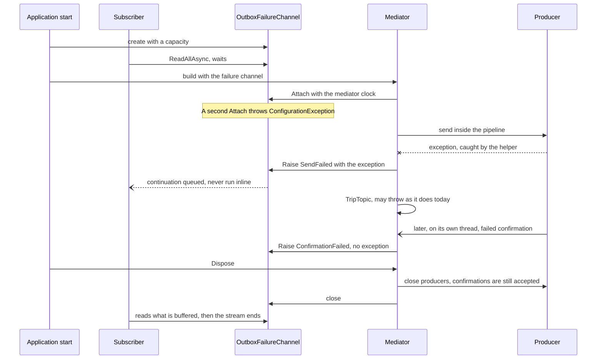
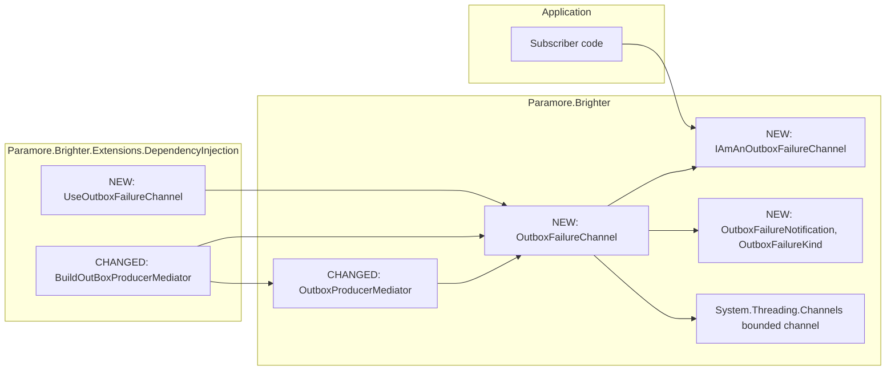

# 90. Outbox failure channel

Date: 2026-11-05

## Status

Proposed

## Context

A send from the outbox can fail without anyone in the application being told. The mediator catches the exception and writes a log entry, and `PostAsync` returns normally. A broker refusal can also arrive later on another thread, and a message that was sent can fail to be marked as dispatched. An application that wants to alert, compensate or delete the message learns of the failure only from a log or from the message's age.

### Terms

The requirements of spec 0040 define *clear*, *attempt*, *raise*, *kind*, *capacity* and *dropped count*. This ADR uses those words with those meanings, and adds these:

- **Failure channel**: the requirements' *notification channel*. It is one bounded in-memory buffer of notifications with one dropped count. *Where the pieces live* names its type.
- **Attach**: the single call in which a mediator claims a failure channel. *Key Components* gives the contract.
- **Close**: the call after which a failure channel accepts nothing more and a reader can drain what remains.

### Scope

**Parent requirement**: [specs/0040-outbox-failure-channel/requirements.md](../../specs/0040-outbox-failure-channel/requirements.md)

**In scope**:

- FR-1, FR-15, NFR-4: a builder step on the DI path and a constructor argument on the direct path turn the feature on. Without either step, no failure channel exists.
- FR-2: the failure channel validates capacity. The DI step does so before registering anything.
- FR-3, FR-5, FR-6, D-2, D-3, D-4: the mediator raises at the sites listed in Implementation Approach, and carries the swallowed exception through a new pair of private helpers.
- FR-4, FR-7, D-10: no other site raises, and each raise comes before any code that can throw.
- FR-8, FR-9, FR-10, NFR-5, NFR-6: a bounded channel from `System.Threading.Channels` holds the notifications in drop-oldest mode, with an exact dropped count.
- FR-11, FR-12, NFR-1, NFR-2, NFR-3, NFR-7: raising is a guarded, non-blocking write with asynchronous continuations.
- FR-13: the mediator closes the failure channel after it has closed its producers.
- FR-14, NFR-8: each failure channel accepts one mediator, and no listed interface changes.
- NFR-9, NFR-10: the failure channel takes its clock from the mediator, its drop warning names only the dropped count, and its guards log the exception type only.
- Q-1 and Q-5: this ADR answers both. P-1 to P-5 are confirmed, with detail added under Technology Choices. Q-3, Q-4 and Q-7 stay as the requirements leave them: OOS-9, OOS-8 and FR-5.

**Out of scope**:

- Which failures notify. FR-3 and FR-4 set that, and Q-6 records the narrowing.
- A reason on `PublishConfirmationResult`, a record ADR 0063-failed-delivery-context defined (OOS-11, Q-2).
- Which failures trip the breaker of ADR 0089-distributed-outbox-circuit-breaker (OOS-10).
- New instruments beside those of ADR 0084-outbox-metrics, ADR 0081-timed-outbox-sweeper-health-metrics and ADR 0085-outbox-stale-message-telemetry (OOS-8).
- A notification for a sweep that fails as a whole. The failed-sweep count of ADR 0081-timed-outbox-sweeper-health-metrics and the investigate check of ADR 0086-sweeper-remedy-health-checks report that.
- A count of waiting messages per topic, which ADR 0086-outbox-per-topic-stale-count provides.
- The page in BrighterCommand/Docs that NFR-11 asks for. It follows this ADR and is not part of its decision.

### A failed clear reaches nothing the application can read

| What fails | What the mediator does today | What application code can see at the time |
| --- | --- | --- |
| A send throws, after the pipeline's retries | Logs, returns false, may trip the topic | Nothing. `PostAsync` returns |
| The broker refuses the message, and the producer reports that in a confirmation, usually on another thread | Logs, trips the topic | Nothing. On async Kafka the send looked successful |
| `MarkDispatched` throws after a good send | Logs | Nothing. A sweeper will send the message again |

Three consequences follow. A subscriber cannot tell a message that is too large from a broker outage, because the exception goes no further than the log. A sweeper retries in silence, so the first sign is often the age of the message. Without a sweeper, the message may wait until someone looks.

The mechanism is one private pair of helpers. `ExecuteWithResiliencePipeline` and its async twin catch every exception, log it and return a bool. The same helpers also write to the outbox and send a `Call`, where that behaviour must stay as it is.

### The forces

- A raise can happen on a request thread, on the sweeper's own thread or on a producer's confirmation thread. Producers wait on those callbacks, so subscriber code must never run there.
- A subscriber can start before the mediator exists. The DI path builds the mediator lazily, on first resolve, and a hosted service starts earlier.
- `IAmAnOutboxProducerMediator` gains no member under NFR-8, and the DI path registers only that interface. A subscriber therefore cannot reach a failure channel through the mediator.
- `IAmProducersConfiguration` gains no member, and an application's own implementation of it is replaced when the mediator is built (`ServiceCollectionExtensions.cs:565`). A setting on the configuration class would leave the feature off in silence.
- `Paramore.Brighter` also targets netstandard2.0, so the buffer and the dropped count can use only what exists there.
- `TripTopic`, a logger and the store can all throw on the same paths. Each of those exceptions must keep its current effect under FR-7.
- Producers report confirmations while they close (`KafkaMessageProducer.cs:408`), so a failure channel cannot close before the producers do.

## Decision

**Each mediator can be given one `OutboxFailureChannel`, an object created before the mediator, and raises one `OutboxFailureNotification` into it at each failure site without blocking.**

The failure channel is a separate object because a subscriber must reach it before the mediator exists. That route adds nothing to the mediator's interfaces. No failure channel exists when the feature is off, so a forgotten step surfaces where the subscriber asks for the failure channel. It never looks like a normal end of the stream. The mediator reports what it observes and changes no outcome.

### The mechanism, end to end



Four rules hold:

| Rule | What it protects |
| --- | --- |
| A raise never throws, because the failure channel guards it end to end | A clear's outcome stays the same as with the feature off |
| A raise comes before any code that can throw at that site | A throwing `TripTopic`, or a logger at that site, cannot suppress the notification. The one gap is a fault inside the helper's own catch, under *Why the helper returns the exception* |
| On a confirmation, a catch raises only if the result reported success | A failed confirmation whose `TripTopic` throws raises once |
| A raise that is the last statement of the `try` cannot reach the catch | A failed `MarkDispatched` on a confirmation raises once |

When the buffer is full, the oldest notification goes and the dropped count rises by 1. After close, a raise is discarded and the dropped count rises by 1, with no log entry. A raise that reaches the bounded channel therefore ends in one of three states: delivered, still buffered, or counted as dropped.

### Where the pieces live



The dependencies point inward to the core. The mediator knows the failure channel, and the failure channel does not know the mediator. Transports, stores and the sweeper have no dependency on any new type.

### Key Components

#### The roles, and what each is responsible for

| Role | Type | Responsibilities | Responsibility classifier | Collaborators |
| --- | --- | --- | --- | --- |
| Reports one failed clear of one message | `OutboxFailureNotification` (core) | Holds id, topic, kind, exception and time | **knowing** | `OutboxFailureKind` |
| Names what failed | `OutboxFailureKind` (core) | Distinguishes the three kinds | **knowing** | None |
| Lets a subscriber read failures | `IAmAnOutboxFailureChannel` (core) | Yields notifications, reports the end, reports the dropped count | **doing**, **knowing** | `OutboxFailureNotification` |
| Holds notifications between raising and reading | `OutboxFailureChannel` (core) | Bounds the buffer, counts drops, limits the drop warning, accepts one mediator, closes | **doing**, **knowing**, **deciding** | Bounded channel, `TimeProvider`, logger |
| Observes failures and decides their kind | `OutboxProducerMediator` (core) | Raises at each site, attaches the failure channel, closes it after the producers | **deciding**, **doing** | `OutboxFailureChannel` |
| Turns the feature on in a container | `UseOutboxFailureChannel` (DI) | Validates capacity, registers a failure channel per container | **doing** | `OutboxFailureChannel`, `IBrighterBuilder` |

The mediator alone knows what failed and which kind that is. The failure channel alone knows what happens to a notification afterwards.

#### `OutboxFailureNotification` and `OutboxFailureKind`

```csharp
public enum OutboxFailureKind { SendFailed, ConfirmationFailed, MarkDispatchedFailed }

public sealed record OutboxFailureNotification(
    Id MessageId,
    RoutingKey Topic,
    OutboxFailureKind Kind,
    Exception? Exception,
    DateTimeOffset OccurredAt);
```

| Member | Input | Output | Error conditions |
| --- | --- | --- | --- |
| `MessageId` | None | The message, or `Id.Empty` when a confirmation carries no id | None |
| `Topic` | None | The wire topic, or `RoutingKey.Empty` when a confirmation carries none | None |
| `Kind` | None | The kind of failure | None |
| `Exception` | None | The exception object, or null for `ConfirmationFailed` | None |
| `OccurredAt` | None | The time of the raise, from the mediator's `TimeProvider` | None |

The record has a public constructor, so an application can build one to test its subscriber.

#### `IAmAnOutboxFailureChannel`

```csharp
public interface IAmAnOutboxFailureChannel
{
    long DroppedCount { get; }
    IAsyncEnumerable<OutboxFailureNotification> ReadAllAsync(CancellationToken cancellationToken = default);
}
```

| Member | Input | Output | Error conditions |
| --- | --- | --- | --- |
| `ReadAllAsync` | The reader's token | Notifications in raise order. The stream ends after close, once the buffer is empty. The token cancels a wait on an empty buffer at once, and it is checked before each notification is taken, so a cancelled read leaves the rest in the buffer | `OperationCanceledException` from the reader's own token only. It does not throw at the end or after close |
| `DroppedCount` | None | The total dropped so far, readable at any time | None |

Several readers may read one failure channel. They compete, and each notification reaches one of them. A loop that ended because subscriber code threw can start again.

#### `OutboxFailureChannel`

```csharp
public sealed class OutboxFailureChannel : IAmAnOutboxFailureChannel, IDisposable
{
    public const int DEFAULT_CAPACITY = 1024;
    public const int MAX_CAPACITY = 1048576;
    public OutboxFailureChannel(int capacity = DEFAULT_CAPACITY);
    public int Capacity { get; }
    public void Dispose();
    internal void Attach(TimeProvider timeProvider);
    internal void Raise(Id messageId, RoutingKey? topic, OutboxFailureKind kind, Exception? exception);
    internal void Close();
}
```

| Member | Input | Output | Error conditions |
| --- | --- | --- | --- |
| Constructor | Capacity | A failure channel with an empty buffer | `ConfigurationException` naming `capacity` and the value, outside 1 to `MAX_CAPACITY` |
| `Dispose` | None | Calls `Close`, for the failure channel's owner | None |
| `Attach` | The mediator's clock | Stores the clock. A stored clock marks the failure channel as claimed | `ConfigurationException` if a mediator already holds the failure channel |
| `Raise` | The fields, with a null topic read as `RoutingKey.Empty` | Written, or counted as dropped | None. Every exception is caught, and logged where the logger allows |
| `Close` | None | `TryComplete`. Buffered notifications stay readable. It is safe to call more than once | None |

`Attach`, `Raise` and `Close` are internal because a subscriber must not be able to claim or write to a failure channel. The mediator is in the same assembly, and tests reach a raise by making a clear fail.

#### `UseOutboxFailureChannel`

```csharp
public static IBrighterBuilder UseOutboxFailureChannel(
    this IBrighterBuilder brighterBuilder,
    int capacity = OutboxFailureChannel.DEFAULT_CAPACITY);
```

| Member | Input | Output | Error conditions |
| --- | --- | --- | --- |
| The step | Builder, capacity | The builder. Registers `IAmAnOutboxFailureChannel` as a singleton created by a factory, whose instance is an `OutboxFailureChannel`. It does not register the class, so the container tracks the object once | `ArgumentNullException` for the builder. `ConfigurationException` for the capacity, before anything is registered, because the step first builds and disposes a failure channel of that capacity |

When the step runs twice, the capacity of the first call is kept, as `UseOutboxStaleMessageMonitor` does.

#### Where each type is touched

| Assembly | Type | Change |
| --- | --- | --- |
| `Paramore.Brighter` | `OutboxFailureNotification`, `OutboxFailureKind`, `IAmAnOutboxFailureChannel`, `OutboxFailureChannel` | New |
| `Paramore.Brighter` | `OutboxProducerMediator` | One trailing optional constructor parameter, `failureChannel`. Two private helpers, the raises and the close |
| `Paramore.Brighter.Extensions.DependencyInjection` | `ServiceCollectionExtensions` | The new step, and one more positional argument when building the mediator |
| `release_notes.md` | None | One entry for the feature, and a `#### Breaking changes` line marking the constructor parameter *(binary)* |

These stay unchanged:

- `IAmAnOutbox`, `IAmAnOutboxSync`, `IAmAnOutboxAsync`, `IAmAnOutboxProducerMediator` and its generic form.
- `IAmAMessageProducer` and its roles, `ISupportPublishConfirmation` and `ISupportPublishConfirmationAsync`.
- `IAmAnOutboxCircuitBreaker`, `IAmABrighterOutboxMeter`, `IAmABrighterTracer` and every instrument.
- `IAmProducersConfiguration` and `ProducersConfiguration`. Neither gains a member.
- `PublishConfirmationResult`, every transport, every outbox store and its schema, and the sweeper.
- The outbox-write sites and the `Call` send, which keep the bool-returning helpers.
- The two mediators that the control bus builds. They receive no failure channel, so their failures do not notify.

### Technology Choices

#### Why a builder step and not a property on `ProducersConfiguration`

The failure channel reaches the mediator from the container and not from the configuration. The outbox meter and the circuit breaker reach it the same way. The DI path looks for a registered failure channel when it builds the mediator, whichever `AddProducers` overload ran. An application with its own `IAmProducersConfiguration` therefore gets the feature with the same step, and the replacement of its configuration cannot turn the feature off.

The step registers a factory and not an instance. Two containers built from one service collection then get two failure channels, which FR-14 requires, and each container disposes its own.

The step registers only the interface. The default container records a disposable once per descriptor and disposes in reverse order. A second descriptor for the class, first resolved after the mediator, would therefore close the failure channel before the mediator closes its producers. That order is ordinary, because `ValidatePipelines` and a consumer's hosted service build the mediator when the host creates them. With one descriptor, the mediator's build resolves the failure channel or finds it already built, so the container always disposes the mediator first.

#### What a subscriber sees when the feature is off

There is no failure channel to see. On the DI path, a constructor that takes `IAmAnOutboxFailureChannel` fails at resolve, with the container's normal exception, and `GetService` returns null. On the direct path, the application has no object to hold. No read can end at once and look like a normal end. An application that forgets the step finds out when its subscriber starts.

#### How a waiting reader ends when no mediator was built

A reader has two ways out. One is its own cancellation token, such as a hosted service's stopping token. It cancels a wait on an empty buffer at once, and otherwise cancels the read before the next notification is taken, with `OperationCanceledException`. The other is `Dispose` on the failure channel, which ends the read as a close does. On the DI path a factory created the failure channel, so the container disposes it at teardown, after the host has stopped its hosted services. On the direct path the application that created the failure channel disposes it. A mediator that the application registers itself, without passing the failure channel, raises nothing and never closes it, so the same two ways out apply.

#### Why two mediators cannot share a failure channel

The second `Attach` throws `ConfigurationException`, so the second mediator's constructor fails. Sharing would break FR-14 twice. The dropped count would no longer belong to one mediator, and the first `Dispose` would close the failure channel under the second. A shared producer stays possible where FR-14 expects it: a producer shared by two mediators raises on each mediator's own failure channel.

#### Why the interface does not expose `ChannelReader`

`ChannelReader.ReadAsync` throws `ChannelClosedException` at the end of the stream, and FR-13 says that reaching the failure channel after `Dispose` does not throw. A narrow surface makes the promise true for every read that the interface offers. The narrow surface also keeps the buffer's type internal. An application can test a subscriber with a double by constructing the subscriber directly, because a double registered beside a real mediator makes that mediator's build throw.

`ReadAllAsync` is its own iterator over `WaitToReadAsync` and `TryRead`, and it does not forward to `ChannelReader.ReadAllAsync`. The .NET method checks its token only when the buffer runs dry, so a cancelled reader of a full buffer would go on through every notification and any new ones. A full buffer during an outage is when a host most needs the reader to stop. Forwarding and documenting the limit would need less code, but a hosted reader would then hold up shutdown.

#### Why the helper returns the exception

A new private pair, `TryExecuteWithResiliencePipeline` and `TryExecuteWithResiliencePipelineAsync`, holds the current bodies unchanged and returns the caught exception, or null. The bool-returning helpers become one-line wrappers. The outbox-write sites and the `Call` send do not change by a line, and neither do their logs or checks.

The return value needs no new type and costs nothing on a successful clear. An `async` method cannot have an `out` parameter, so an `out` exception cannot serve both helpers. The return value also keeps the raise at the site, where the kind and the id are known.

One case loses a notification. If the logger or `CheckOutstandingMessages` throws inside the helper's catch, then the helper throws and the site never runs. That exception reaches the caller, as it does today, so the failure is not silent. Microsoft's `LoggerFactory` wraps a provider's exception in an `AggregateException`, so that wrapper is what the caller sees. On a confirmation path the same exception reaches the catch, which raises once and carries that exception and not the store's.

#### Why capacity is 1,024, with a maximum of 1,048,576

The sweeper's defaults are 100 messages every 5 seconds, so one sweeper raises at most about 20 notifications per second. Against a broker that is down, that sweeper alone therefore takes at least 50 seconds to fill 1,024 notifications, and longer without bulk, because each failed message also waits for the default pipeline's retries. A failing `Post` or explicit clear raises as well, at the application's rate, so the buffer can fill sooner. A notification is small, but it keeps its exception, and capacity bounds the number of notifications and not their bytes. The maximum exists to reject a mistake such as `int.MaxValue`. It is not a recommendation: at that size, an outage could retain a million exceptions. A smaller default loses more in a burst, and a larger one retains more exceptions (P-2).

#### Why drop the oldest

Waiting would block a publisher, which NFR-1 forbids. Dropping the newest would hide the failures that are happening now. The cost of dropping the oldest: with no sweeper, a dropped failure does not recur, and only the stale gauge of ADR 0085-outbox-stale-message-telemetry can show its message. In the example of FR-9, a read after n1, n2 and n3 at capacity 2 returns n2 and n3.

#### How the dropped count stays exact on every target framework

Two paths lose a notification, and each has one exact count:

| Path | Signal | Action |
| --- | --- | --- |
| The buffer is full | The `itemDropped` delegate of `Channel.CreateBounded`, called once per dropped item | `Interlocked.Increment`, then the rate-limited warning |
| The failure channel is closed | `TryWrite` returns false, which in drop-oldest mode has no other cause | `Interlocked.Increment`, with no log entry |

`DroppedCount` reads through `Interlocked.Read`, which is safe for a `long` on a 32-bit process.

`Paramore.Brighter.csproj` references `System.Threading.Channels` only for netstandard2.0, where `Directory.Packages.props` pins 10.0.12. net8.0, net9.0 and net10.0 use the copy in the shared framework, so a runtime update decides their version. The package's netstandard2.0 asset and the reference packs of .NET 8, 9 and 10 declare the overload.

The IL of `BoundedChannelWriter.TryWrite` in the netstandard2.0 asset shows the order. A closed bounded channel returns false. A full one removes the oldest item, adds the new one, releases the lock, and only then calls the delegate. So the delegate runs on the raising thread, outside the bounded channel's lock, and a slow logger cannot hold up other writers there. The new item is in the buffer before the delegate runs, so a logger fault cannot lose it.

Test projects run on net9.0 and net10.0 only, so no test executes the netstandard2.0 asset or the net8.0 shared framework. For those two targets, the exactness rests on the inspection above and on a design that uses only `Interlocked` and the documented overload.

#### How the drop warning stays limited

The delegate reads the attached `TimeProvider` and compares it with the next permitted time, a `long` of ticks. It claims the slot with `Interlocked.CompareExchange`, so only one thread logs per interval. The interval is 60 seconds of `TimeProvider` time. The first drop always logs, and the entry names the count at that moment. Nothing runs on a timer, and a raise that drops nothing does not read the clock for this purpose.

#### How FR-12 and the close hold

The bounded channel is created with `AllowSynchronousContinuations = false`, so a reader's continuation is queued and never runs on the raising thread. `InMemoryJobChannel` sets the opposite, so that setting cannot be copied from there. `SingleReader` and `SingleWriter` are both false, because raises come from many threads and readers may compete.

The mediator closes the failure channel after its existing guarded `CloseAll`, so confirmations reported during producer disposal are still accepted. A close is `TryComplete`, which cannot throw and can repeat. A raise that loses the race with a close is counted, and one that wins is buffered. Neither `Close` nor `Dispose` waits for any reader.

#### Public names

`OutboxFailureChannel`, `IAmAnOutboxFailureChannel`, `OutboxFailureNotification`, `OutboxFailureKind` and `UseOutboxFailureChannel` answer Q-5. "Channel" is the word issue #4489 uses. In Brighter that word usually means a consumer's channel to a broker, so the type names carry the `Outbox` qualifier, as `IAmAJobChannel` carries `Job`. The alternative was a word of its own, such as "feed". "Feed" cannot read as a consumer's channel, but no type in `src/` uses it. The three kinds keep their working names, which say what failed.

#### How the proposals resolve

| Item | Outcome |
| --- | --- |
| P-1 | Confirmed. The bounded channel adds no dependency |
| P-2 | Confirmed: default 1,024, valid values 1 to 1,048,576 |
| P-3 | Confirmed: drop the oldest |
| P-4 | Confirmed: at most one `Warning` per 60 seconds of `TimeProvider` time |
| P-5 | Confirmed. A second reader competes and is not rejected. Fan-out is the application's |
| D-1, D-3 to D-10 | Stand as the requirements state them |
| D-2 | Settled by the helper pair above |

### Implementation Approach

Code locations are at commit 14850234f. A bare `:NNN` is in `src/Paramore.Brighter/OutboxProducerMediator.cs`, except in step 6, which names its own file. Each behavioural step starts with its failing tests, as `CONTRIBUTING.md` asks, and this ADR precedes the code.

1. Structural. Move the bodies of `:1475-1498` and `:1500-1540` into the two `TryExecute` helpers, returning the exception or null. Leave the bool helpers as wrappers. The async wrapper awaits with `ConfigureAwait(continueOnCapturedContext)`. No behaviour changes, and the existing suite stays green.
2. Add `OutboxFailureKind`, `OutboxFailureNotification`, `IAmAnOutboxFailureChannel` and `OutboxFailureChannel`, with capacity validation, reads and close.
3. Add `failureChannel` after `outboxMeter` at `:156`, and a field beside `:93`. At `:205`, create the request context first, then call `Attach`, then `ConfigureCallbacks`. A rejected second mediator then leaves no callback on a shared producer. Call `Close` in a `finally` on the `try` at `:231-232`, before the owned factories are disposed. `ControlBusSenderFactory.cs:62` and `ControlBusReceiverBuilder.cs:177` bind optional arguments and need no change.
4. Raise at the send sites below, then at the mark-dispatched sites, then at the confirmation sites, each as its own commit.
5. Add the `itemDropped` count and the rate-limited `Warning` to the failure channel, with its own `LoggerMessage` entries. The guards use their own `LoggerMessage` at `Error`, with the exception type and no message. The failure channel's logger comes from `ApplicationLogging.CreateLogger<OutboxFailureChannel>()`, as `OutboxMeter` and `InMemoryOutboxCircuitBreaker` use their own type.
6. Add `UseOutboxFailureChannel` to `src/Paramore.Brighter.Extensions.DependencyInjection/ServiceCollectionExtensions.cs` beside `:583`. Add a private `FailureChannel(serviceProvider)` beside `:1016`. It calls `GetService<IAmAnOutboxFailureChannel>()` and returns null when nothing is registered, so a mediator with the feature off is built as it is today. An `OutboxFailureChannel` comes back as that type, and any other implementation throws `ConfigurationException`, naming the registered type. Pass it after `OutboxMeter(serviceProvider)` at `:852`.
7. Add the XML documentation and the `release_notes.md` entry.

Every failure site, with its place in the code:

| Site | Kind | Today | Where the raise sits |
| --- | --- | --- | --- |
| `Dispatch`, confirming send, `:1113-1115` | `SendFailed` | Result discarded | Directly after the helper returns an exception |
| `Dispatch`, send, `:1119-1122` | `SendFailed` | `sent` false, and nothing trips | Directly after the helper returns an exception |
| `Dispatch`, mark, `:1126-1134` | `MarkDispatchedFailed` | `marked` false | Directly after the helper returns an exception |
| `DispatchAsync`, send, `:1285-1292` | `SendFailed` | `TripTopic` at `:1313` | At `:1313`, before `TripTopic`. The mark block is skipped when `sent` is false, so nothing runs between |
| `DispatchAsync`, mark, `:1297-1309` | `MarkDispatchedFailed` | `marked` false | Directly after the helper returns an exception |
| `BulkDispatchAsync`, send, `:1201-1208` | `SendFailed`, per id | `TripTopic` at `:1240` | At `:1238`, before `TripTopic`. One raise per `batch.Ids()`, with `batch.RoutingKey` and the same exception |
| `BulkDispatchAsync`, mark, `:1215-1226` | `MarkDispatchedFailed`, per id | `marked` false | Directly after the helper returns, with the id and `topicBatch.Key.WireTopic` |
| Async callback, failure, `:940-947` | `ConfirmationFailed` | Logs at `:942`, trips at `:946` | First statement of the `else`, before `:942` |
| Async callback, mark, `:932-937` | `MarkDispatchedFailed` | Result discarded | Directly after the helper returns, as the last statement of the `try` |
| Async callback, catch, `:949` | `MarkDispatchedFailed` | Logs at `:953` | First statement of the catch, only when `result.Success`, before `:953` |
| Sync callback, failure, `:1034-1041` | `ConfirmationFailed` | Logs at `:1036`, trips at `:1040` | First statement of the `else`, before `:1036` |
| Sync callback, mark, `:1029-1031` | `MarkDispatchedFailed` | Result discarded | Directly after the helper returns, as the last statement of the `try` |
| Sync callback, catch, `:1043` | `MarkDispatchedFailed` | Logs at `:1051` | First statement of the catch, only when `result.Success`, before `:1051` |

Reading the table:

- A `TripTopic` that throws at `:946`, `:1040`, `:1240` or `:1313` runs after the raise, so the notification already exists. Its exception then goes where it goes today.
- A failed confirmation reaches a catch only with `result.Success` false, so the catch raises nothing more. A successful confirmation that raised at a mark site has no statement left in the `try`. `Raise` does not throw, so that confirmation cannot reach the catch either.
- The pipeline lookup at `:1477` and `:1506` sits outside the helper's `try`. On a confirmation, a missing pipeline therefore reaches the catch and raises once, with the `KeyNotFoundException` that AC-13 names. At a send site the exception reaches the caller, as it does today, and nothing raises.
- `CallViaExternalBus` at `:363` and the outbox writes at `:293`, `:338`, `:650` and `:681` keep the bool helpers and raise nothing.

The batch raise lives in one small mediator method with its own guard. Enumerating a third-party `batch.Ids()` can throw before the failure channel's guard applies. That guard also logs the exception type only. Every site first checks whether it has a failure channel, so a mediator with none builds no arguments.

The tests use the doubles of the requirements' setup section. `FakeTimeProvider` drives time, and the `CapturingLogger` family in `tests/Paramore.Brighter.Core.Tests/Observability/StaleMessages/TestDoubles` captures log entries. The process-wide `ApplicationLogging.LoggerFactory` means that tests which capture logs share one xUnit collection, as the stale-message tests do. No test needs a broker.

| Test group | Project | Criteria | How it shows the behaviour |
| --- | --- | --- | --- |
| Off, and capacity | Core, and `Paramore.Brighter.Extensions.AspNetCore.Tests` for the DI forms | AC-1, AC-2, AC-3 | On the DI path, `GetService` returns null with the feature off. The step throws for 0 |
| Each site raises once | Core | AC-4 to AC-13, AC-18, AC-19 | One test per row of the site table, sync and async, reading the fields of the notification |
| Nothing else raises | Core | AC-14 to AC-17 | The FR-4 cases, with the existing exceptions asserted as well |
| Behaviour unchanged | Core | AC-20, AC-21 | The same script runs with a failure channel and with none, using counting doubles, and compares the captured log entries. A throwing breaker covers each `TripTopic` site |
| Delivery and order | Core | AC-22, AC-25, AC-26, AC-27, AC-38 | Real readers with bounded waits |
| Full buffer | Core | AC-23, AC-24, AC-35, AC-36 | Fake clock at T, at T + 60 seconds minus 1 second, and at T + 60 seconds. AC-23 asserts n2 and n3 |
| Never blocks | Core | AC-28, AC-29 | A reader blocked after its read. A producer double that raises on its own thread and must regain control |
| Shutdown | Core | AC-30, AC-31 | A producer double that raises a failed confirmation from `Dispose`, and one raise after `Dispose` returned |
| Scope | Core | AC-32, AC-33, AC-37 | Two mediators, single-role outbox doubles, 8 threads at capacity 8,000 |
| Hosted | `Paramore.Brighter.Extensions.AspNetCore.Tests` | AC-34 | A hosted service reads from `IAmAnOutboxFailureChannel`, before and after the mediator's first resolve |
| Content and documents | Core, and by reading | AC-39, AC-36, AC-40 | Captured entries hold no body. Reflection finds no `Message` member. A person reads the page |

Further tests pin decisions of this ADR:

- A second mediator on one failure channel throws, and adds no handler to a shared producer.
- `Dispose` on an unattached failure channel ends a waiting read.
- A token cancelled after the first read of a full buffer throws `OperationCanceledException` before the next notification is taken, and the rest stays readable.
- A token cancelled while a read waits on an empty buffer throws `OperationCanceledException`, with no mediator built and nothing raised.
- `CloseAll` throws and its log entry throws, and a waiting read still ends.
- An application with its own `IAmProducersConfiguration` still receives notifications with the step.
- Two containers from one collection get two failure channels, and each disposes its own.
- With the mediator resolved before the interface and a producer that raises from `Dispose`, the notification is delivered, and the container disposes the failure channel once.
- A registered implementation other than `OutboxFailureChannel` makes the mediator's build throw `ConfigurationException`.
- An invalid capacity registers nothing.
- A second call of the step keeps the first capacity.

## Consequences

### Positive

- An application learns of a failed send, a failed confirmation or a failed `MarkDispatched` soon after it happens. The notification carries the id, topic, kind and exception (FR-3, FR-5).
- A forgotten step surfaces where the subscriber asks for the failure channel. The replacement of an application's configuration cannot turn the feature off (FR-1, FR-15).
- A subscriber can start at any time before or after the mediator exists, and a slow one costs only drops (FR-11).
- With the feature off there is no buffer and no allocation, and with it on, a successful clear raises nothing (NFR-3, NFR-4).
- The dropped count accounts for every raise that reached the bounded channel and was not delivered or buffered (FR-9, FR-13, NFR-6).

### Negative

- A notification is lost when the logger or `CheckOutstandingMessages` throws inside the helper's catch on a send or non-confirmation mark path. The caller still receives that exception.
- A failure channel keeps exceptions, and on Kafka's sync path an exception can hold a body, so capacity bounds notifications and not bytes (NFR-5).
- The mediator closes a failure channel that it did not create. It does not dispose it, which ADR 0069-factory-registry-ownership-and-disposal-cascade keeps for the owner. It only ends the writing side through an internal `Close`, because it is the only writer. The container or the application still disposes the failure channel. The mediator already closes the producers of a registry it did not create in the same way (`OutboxProducerMediator.cs:231`).
- A trailing optional parameter is source-compatible, as in ADR 0084-outbox-metrics, but binary-breaking: an assembly compiled against the old constructor must be rebuilt. The release note says so, as it does for `InMemoryOutboxCircuitBreaker` and `TimedOutboxSweeper`.
- The first call's capacity is kept when the step runs twice, so a second value is ignored in silence. This matches the existing `UseOutboxStaleMessageMonitor`.
- On stores that throw for a missing row, each successful `Call` on a confirming producer raises a false `MarkDispatchedFailed` (D-10).
- The bounded channel takes a short lock on each raise. The lock holds no subscriber code, but raising is not lock-free.
- `OutboxFailureChannel` reads close to `ChannelFailureException` and `IHaveAChannelFailureCount`, which are about consumers. The XML documentation states the difference.
- On async Kafka a refused message notifies with no exception. A subscriber there cannot tell a size limit from an outage until Q-2 is answered.
- A hosted reader should pass its stopping token. A host stops its hosted services before it disposes the container. A loop that waits for the end of the stream therefore holds up shutdown until the host's timeout. A reader that does pass the token has gone before the mediator closes. Whatever the buffer holds then stays unread, as does a confirmation accepted during shutdown, and the dropped count includes neither. A reader that wants that backlog can read once more with a short timeout token.
- If a later constructor step throws after `Attach`, the failure channel stays claimed, and a retried resolve reports the second-mediator error.
- The container registers only the interface. `GetService<OutboxFailureChannel>()` returns null, `Capacity` is reachable only on the direct path or through a cast, and the mediator's build casts what it resolves. An application's own implementation of the interface, registered beside a real mediator, makes that build throw `ConfigurationException`.
- An exception that escapes a `BackgroundService` reader stops the host by default. It does not reach the publishing path, but the reader's code decides whether the application keeps running.

### Risks and Mitigations

- A subscriber that asks for a clear on every notification can repeat without end. The documentation of NFR-11 states this risk, and Brighter never reacts to a notification by itself (OOS-12).
- The Warning runs on the raising thread, so a slow logging provider slows a failing publish. The rate limit bounds the delay to one entry per interval, and NFR-1 names this exception.
- A later version could change when `itemDropped` runs, on the package for netstandard2.0 or through a runtime update on the others. AC-23, AC-24, AC-36 and AC-37 pin the behaviour on net9.0 and net10.0.
- net8.0 and netstandard2.0 run no tests. The design uses only documented API on those targets, and the order that matters was read from the IL of the netstandard2.0 asset.
- A third-party container that disposes singletons in another order could close the failure channel before the mediator closes its producers. Confirmations raised in that window would be discarded and added to the dropped count, with no log entry. On the direct path, the same happens if the application disposes the failure channel before the mediator. A test pins the order on the default container.
- An application's own mediator registration that doesn't pass the failure channel leaves it silent. The documentation states this, because the mediator's interfaces gain nothing. A rule in `ValidatePipelines` could report it later, and this ADR does not add one.

## Alternatives Considered

### A property on `ProducersConfiguration`

A property needs no new extension method, and capacity sits with the other settings. The DI path would replace an application's own configuration with a new one, which leaves the feature off in silence. On the deferred overload, a subscriber would also have to build the configuration before it could reach the failure channel. Copying a member across needs a member on `IAmProducersConfiguration`, which NFR-8 forbids.

### The mediator creates the failure channel and exposes it

This is the simplest form on the direct path, with one object fewer to pass. It fails on the DI path. The container registers only `IAmAnOutboxProducerMediator`, which gains no member, and a subscriber that resolves the mediator early would build it early, against FR-11.

### A closed or empty failure channel when the feature is off

A failure channel that always resolves frees a subscriber from a null check or a failed resolve. A read that ends at once looks like a normal end and hides the forgotten step. FR-1 also allows no buffer when the feature is off.

### A .NET event, or a handler role

An event is the familiar .NET form and needs no read loop. Raised inline, it runs subscriber code on the raising thread, against FR-12. A handler role would make Brighter run subscriber code, and it needs its own loop, exception handling and lifetime. A reader that owns its loop keeps those with the application.

### Exposing `ChannelReader` directly

This needs no new interface, and .NET developers know the type. `ReadAsync` then throws at the end of the stream, against FR-13, and an application test would need a real bounded channel.

### An exception callback passed into the helpers

The helper would call a delegate first in its catch, before the log. A logger that throws could not then lose a notification, which is the advantage. On a confirmation path, the same logger fault would reach the catch after the raise. The site would then need a flag to avoid a second raise. Each attempt also allocates a delegate, including on a success. The return value has neither cost, and the case it gives up still surfaces as the logger's exception.

### Changing the helpers' return type in place

One pair of helpers would avoid the wrappers. Every outbox-write site and the `Call` send would then change for a value they do not use. That change puts the widest behaviour guarantee of FR-7 at risk for no gain.

### Storing the last exception on the mediator

An instance field or an `AsyncLocal` needs no signature change. The mediator is a singleton used by many threads, so a field would mix up failures. An `AsyncLocal` hides the data flow from a future reader.

### Raising from `TripTopic`

This needs one site. A sync send trips nothing and a failed mark trips nothing, so the feature would miss both (D-3).

### Counting drops without `itemDropped`

A buffer of Brighter's own under a lock could count exactly and would need no delegate. That buffer reimplements the waiting readers and asynchronous continuations that the bounded channel already provides. Wait mode with `TryRead` to evict the oldest needs no delegate either. It can race a real reader, and it makes eviction and write two separate steps.

### A constructor overload that keeps the old signature

An assembly compiled against the old constructor would keep working without a rebuild. The cost is a second public constructor on the mediator. A trailing optional parameter follows ADR 0084-outbox-metrics, and the release note tells such an assembly to rebuild, as it does for `InMemoryOutboxCircuitBreaker` and `TimedOutboxSweeper` (`release_notes.md:161`, `:338`).

### Registering the class as well as the interface

A subscriber or a test could then resolve `OutboxFailureChannel` and read `Capacity`. The container would track one object under two descriptors, and resolving the interface after the mediator would close the failure channel before the producers. Resolving both inside the mediator's build avoids that order, but it hangs the guarantee on the order of two calls and leaves a public `Dispose` with any resolver. A non-disposable wrapper for the interface also works, at the cost of a second type.

### A clock in the failure channel's constructor

The failure channel could take an optional `TimeProvider`, as `InMemoryOutboxCircuitBreaker` does, and `Attach` would only claim it. A stored clock would then no longer also mean "claimed". A test on the direct path would pass its clock twice, and a notification's time could differ from the mediator's, against NFR-9.

### Rejecting a second reader, or built-in fan-out

Rejection would make "one reader" explicit, but it needs state to tell a restarted loop from a second reader. FR-11 expects a loop that ended to count as absent. Fan-out needs a buffer and a dropped count per reader, and an application can build it on one reader.

## References

- Requirements: [specs/0040-outbox-failure-channel/requirements.md](../../specs/0040-outbox-failure-channel/requirements.md)
- Related ADRs:
  - [0063-failed-delivery-context](0063-failed-delivery-context.md) defines `PublishConfirmationResult`, which is unchanged.
  - [0069-factory-registry-ownership-and-disposal-cascade](0069-factory-registry-ownership-and-disposal-cascade.md) keeps disposal with the creator, so the mediator closes and does not dispose.
  - [0084-outbox-metrics](0084-outbox-metrics.md) counts successes and set the precedent of a trailing optional constructor parameter.
  - [0085-outbox-stale-message-telemetry](0085-outbox-stale-message-telemetry.md) remains the way to learn of a message whose notification was lost.
  - [0086-outbox-per-topic-stale-count](0086-outbox-per-topic-stale-count.md) gives that count per topic.
  - [0081-timed-outbox-sweeper-health-metrics](0081-timed-outbox-sweeper-health-metrics.md) and [0086-sweeper-remedy-health-checks](0086-sweeper-remedy-health-checks.md) report a sweep that fails as a whole.
  - [0089-distributed-outbox-circuit-breaker](0089-distributed-outbox-circuit-breaker.md) depends on the `TripTopic` calls, which keep their sites and their effect.
- External references:
  - Issue #4489 and PR #4598, the telemetry half of that issue.
  - [`Channel.CreateBounded`](https://learn.microsoft.com/dotnet/api/system.threading.channels.channel.createbounded) and [`BoundedChannelFullMode`](https://learn.microsoft.com/dotnet/api/system.threading.channels.boundedchannelfullmode).
