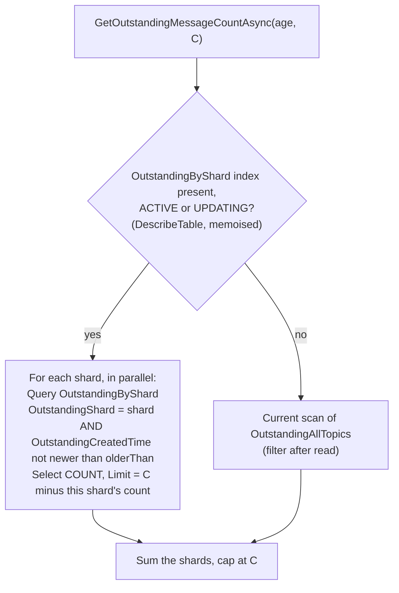
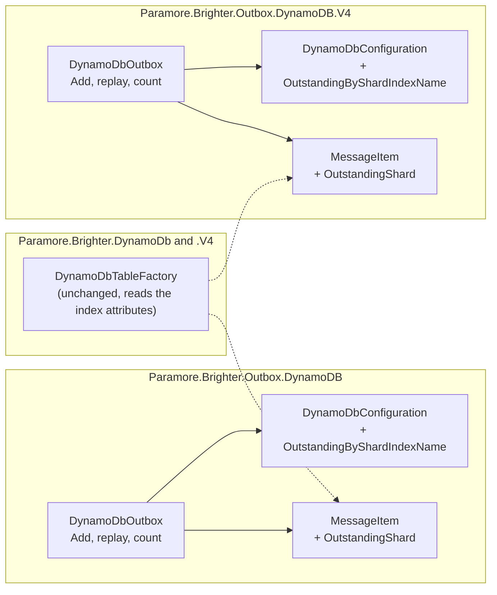

# 91. DynamoDB outstanding count reads only stale items

Date: 2026-11-13

## Status

Proposed

## Context

The DynamoDB outbox counts stale messages by scanning the `OutstandingAllTopics` index. That index cannot sort by age, so the scan can read every outstanding message before it finds C stale ones. It drops the young ones after the read. The cost of one count grows with the whole backlog, not with the stale messages or with the ceiling C. A large backlog of young messages can also make every count run past the outbox's 500 ms default timeout.

### Terms

- **Stale**, **age** and **the ceiling C**: ADR 0085-outbox-stale-message-telemetry defines them.
- **Young message**: an outstanding message that is not stale yet.
- **Shard**: here, the value of the new `OutstandingShard` attribute, a number from 0 to `NumberOfShards - 1`. It is not the topic shard in `TopicShard`.

### Scope

**Parent requirement**: [specs/0038-outbox-stale-message-telemetry/requirements.md](../../specs/0038-outbox-stale-message-telemetry/requirements.md), NFR-4 (b), which records this limit of the DynamoDB count.

**In scope**:

- The overall count, `GetOutstandingMessageCount` and `GetOutstandingMessageCountAsync`, in `Paramore.Brighter.Outbox.DynamoDB` and `Paramore.Brighter.Outbox.DynamoDB.V4`.
- NFR-4 (b) for DynamoDB. The count queries a new index for stale messages only, so it reads at most C items per shard.
- The upgrade path for existing tables. The outbox probes the table for the new index and falls back to the current scan when the index is absent.

**Out of scope**:

- The per-topic count, which ADR 0086-outbox-per-topic-stale-count decides and issue #4688 tracks for DynamoDB. The probe and the query apply only to the overall count.
- The sweeper's read of outstanding messages for all topics, and the read of dispatched messages, which ADR 0034-optimise-reads-and-writes-from-dynamo-outbox decides. Both keep their scans.
- How the age, the ceiling and the cancellation behave. ADR 0085-outbox-stale-message-telemetry defines them, and this ADR keeps them.

### Why the count reads young messages

| Index | Partition key | Sort key | Range condition on age? |
| --- | --- | --- | --- |
| `Outstanding` | `TopicShard` | `OutstandingCreatedTime` | Yes, but only within one topic shard |
| `OutstandingAllTopics` | `OutstandingCreatedTime` | `MessageId` | No: the age is the partition key |

The overall count has no list of topics, so it cannot use `Outstanding`. On `OutstandingAllTopics` the age is the partition key, which takes only an equality condition. So the count applies the age as a `FilterExpression`. DynamoDB evaluates a filter after it reads an item. `Limit` caps the items read in one page, not the items that match.

A measurement on DynamoDB Local shows the effect. The setup had 5 stale messages, 2 KB bodies, the default `ScanConcurrency` of 3 and a C of 100:

| Young messages | Scan requests | Items read | Items counted | With the 500 ms default timeout |
| ---: | ---: | ---: | ---: | --- |
| 0 | 3 | 5 | 5 | Returns 5 |
| 300 | 5 | 305 | 5 | Returns 5 |
| 3000 | 32 | 3005 | 5 | Cancelled |

DynamoDB Local is much slower than DynamoDB. The last column shows the trend, not the backlog at which DynamoDB itself cancels the count. The requests and the items read carry over to DynamoDB.

`DynamoDbTableFactory` projects all attributes into every index by default. DynamoDB bills a scan by the size of each item read, body included, even when the scan returns only a count. The monitor calls the count once per interval. The producer's outstanding check calls it at most once per check interval while the application posts or clears messages. The cost repeats on every call.

### The forces

- The count must read a number of items bounded by C, whatever the number of young messages.
- The count has no list of topics. A design that needs one cannot serve the overall count.
- A DynamoDB index can apply a range condition only to its sort key, within one partition key value.
- Each partition key value of an index takes its writes on one index partition. DynamoDB throttles the base table write when an index partition throttles.
- Existing tables do not have a new index. An upgrade must not break the count on a table that has not been changed.
- DynamoDB indexes only items that carry every key attribute of the index. A new key attribute is absent from items written before the upgrade.
- The age boundary stays `<=`, and the age, the ceiling and the cancellation behave as ADR 0085-outbox-stale-message-telemetry defines them.

## Decision

**The DynamoDB outbox counts stale messages by querying a new index sorted by age within each shard, and scans as today when the table lacks that index.**

The new `OutstandingByShard` index takes `OutstandingShard` as its partition key and `OutstandingCreatedTime` as its sort key. The outbox writes `OutstandingShard` on every message, from a hash of the message id. Within each shard the index is sorted by age. A query with an age condition on the sort key reads only stale items, so `Limit` caps the stale items read. The index is sparse in the same way as the two existing outstanding indexes: marking a message dispatched removes `OutstandingCreatedTime`, and the message leaves the index.

### The mechanism, end to end

The invariants read off the diagram:

- With the index, each shard reads at most C items, and every item read is stale. One count reads at most `NumberOfShards` times C items.
- Without the index, the count runs the scan it runs today.
- Both paths sum and cap at C in the same way, so the caller sees the same contract.
- A C of zero or less returns 0 before the probe and sends no request, as the scan does today.
- The count builds one linked cancellation token from the caller's token and the outbox `Timeout`, as it does today. The probe runs under that token too.

The write side changes in two places:

- `Add` writes `OutstandingShard` on every message, whether or not the table has the index. On a table without the index the attribute is a plain attribute, as `CausationId` is on a table without the `Causation` index.
- A replay sets `OutstandingCreatedTime` again, and also sets `OutstandingShard` if the item does not have it. The item returns to the index, including an item written before the upgrade.

`MarkDispatched` is unchanged: it removes `OutstandingCreatedTime`, which removes the item from the new index.

### Where the pieces live

`DynamoDbTableFactory` builds indexes from the attributes on `MessageItem`. A table created with the factory after this change has the new index without a change to the factory.

### Key Components

#### The roles, and what each is responsible for

| Role | Type | Responsibilities | Responsibility classifier | Collaborators |
| --- | --- | --- | --- | --- |
| Holds a message's index keys | `MessageItem` | Carries `OutstandingShard` beside the existing index attributes. Declares it as the partition key of `OutstandingByShard`, and `OutstandingCreatedTime` as that index's sort key | knowing | `DynamoDbTableFactory` |
| Holds the table layout | `DynamoDbConfiguration` | Knows the name of the new index and the number of shards | knowing | `DynamoDbOutbox` |
| Stores and counts outbox messages | `DynamoDbOutbox` | Assigns the shard on `Add` and on replay. Decides between the query and the scan from the probe. Queries each shard, or scans as today. Sums and caps the result | knowing, deciding, doing | `MessageItem`, `DynamoDbConfiguration`, `IAmazonDynamoDB` |

`DynamoDbOutbox` keeps the decision between the two read paths. It memoises the probe result in a private field, as `SupportsCausationTrackingAsync` already does for the `Causation` index.

#### `DynamoDbOutbox` overall count

| Member | Input | Output | Error conditions |
| --- | --- | --- | --- |
| `GetOutstandingMessageCountAsync` | Age, request context, C, args, token. Unchanged | The number of outstanding messages at least as old as the age, capped at C. Unchanged | `OperationCanceledException` when the token or the outbox `Timeout` ends the call, as today. An error from `Query` or `Scan` propagates, as today, and so does an error from `DescribeTable`. A C of zero or less returns 0 with no request |
| `GetOutstandingMessageCount` | As above | As above | As above. It still blocks on the asynchronous count |

#### `MessageItem.OutstandingShard`

| Member | Value | Notes |
| --- | --- | --- |
| `OutstandingShard` | `int`, from 0 to `NumberOfShards - 1`, and 0 when `NumberOfShards` is 1 or less | A hash of the message id, taken as an unsigned number before the remainder, so it spreads messages evenly and is never negative. `Add` writes it, a replay writes it when it is missing, and nothing removes it |

#### `DynamoDbConfiguration.OutstandingByShardIndexName`

| Member | Default | Notes |
| --- | --- | --- |
| `OutstandingByShardIndexName` | `"OutstandingByShard"` | Settable, like the other index names. As with `CausationIndexName`, setting it does not rename the index that `DynamoDbTableFactory` creates, because the index attributes on `MessageItem` are compile-time constants. The probe looks for the configured name |

#### Where each type is touched

| Assembly | Type | Change |
| --- | --- | --- |
| `Paramore.Brighter.Outbox.DynamoDB` | `MessageItem` | New `OutstandingShard` attribute. `OutstandingCreatedTime` also becomes the sort key of the new index |
| `Paramore.Brighter.Outbox.DynamoDB` | `DynamoDbConfiguration` | New `OutstandingByShardIndexName` |
| `Paramore.Brighter.Outbox.DynamoDB` | `DynamoDbOutbox` | `Add` and replay write the shard. The count probes, then queries or scans |
| `Paramore.Brighter.Outbox.DynamoDB.V4` | The same three types | The same changes |
| The DynamoDB and DynamoDB V4 test projects | `DynamoDbOutboxTable` and the tests that build a table with explicit index throughput | Provision throughput for the new index |
| The DynamoDB and DynamoDB V4 test projects | `DelayedDynamoDbHttpHandler` | Its `DescribeTable` response lists the new index as `ACTIVE`, so the timeout test reaches the query path |
| The DynamoDB and DynamoDB V4 test projects | A new HTTP handler for the regression test | Records the items each `Scan` and `Query` response reports as read |

Deliberately unchanged:

- `DynamoDbTableFactory` and its default projection.
- The `Outstanding` and `OutstandingAllTopics` indexes.
- `MarkDispatched`, the sweeper's reads, the per-topic count and `GetShardNumber`.
- The count's signature, its `<=` boundary, its ceiling and its cancellation.
- The fallback scan, `Limit` included.

### Technology Choices

#### Why a shard from the message id, and not from the message's `PartitionKey`?

`GetShardNumber` hashes the message's `PartitionKey` header, so that every message with one key lands in one topic shard. That rule keeps order within a key for the per-topic reads. The count needs no order, only an even spread. A hash of the message id spreads messages evenly even when all of them share one `PartitionKey`. `GetShardNumber` can also return a negative number, because it takes the remainder of a signed integer. The new hash cannot.

#### Why `NumberOfShards` and not a new setting?

`NumberOfShards` already sets how the table spreads outstanding messages by topic. Reducing it already strands outstanding messages for the per-topic reads, so a table that holds outstanding messages must not reduce it. A second setting with the same rule would add a second way to strand messages. `ScanConcurrency` is a read-time setting that a user can change at any time, so it cannot define a write-time layout.

#### Why probe the table, and not a configuration switch?

The probe follows the precedent of the `Causation` index (ADR 0057-replay-outbox-on-inbox-duplicate). An upgraded outbox works on an unchanged table. The probe accepts an index whose status is `ACTIVE` or `UPDATING`, because DynamoDB can query both. It rejects `CREATING`, because the index is still being filled. `DynamoDbOutbox` memoises the result for the life of the outbox instance, so an outbox starts to use a new index only after a restart, as with `Causation`.

#### Why not project only the keys by default?

With the new index, one count reads at most `NumberOfShards` times C items, so the backlog no longer drives the cost of a count. A keys-only projection still makes each index write and each item read smaller. The factory default stays as it is, and the documentation recommends `KEYS_ONLY` for the new index.

### Implementation Approach

The steps run in this order. Steps 1 to 4 change `Paramore.Brighter.Outbox.DynamoDB` and its test project, and land as one commit: the regression test is written first and fails until step 4. Step 5 is a second commit for V4. Step 6 happens outside the code commits.

1. **Regression test.** A test adds stale messages and a larger number of young messages, on a table of its own that it drops afterwards. It counts them through a client whose HTTP handler records each `Scan` and `Query` response. It asserts that the items read equal the stale messages. It fails today, because `DynamoDbOutbox.ScanOutstandingIndexSegmentForCount` reads every outstanding item when fewer than C are stale.
2. **Index attributes.**
   - Add `OutstandingShard` to `MessageItem`, with `[DynamoDBProperty]` and `[DynamoDBGlobalSecondaryIndexHashKey("OutstandingByShard")]`. `DynamoDbTableFactory` writes an attribute definition only for a property with `[DynamoDBProperty]`.
   - On `OutstandingCreatedTime`, change the range key attribute to `indexNames: ["Outstanding", "OutstandingByShard"]`. The attribute allows only one use per property, as on `MessageId`.
   - Add `OutstandingByShardIndexName` to `DynamoDbConfiguration`.
   - Add the index's throughput to `DynamoDbOutboxTable`, and to each test that builds a table with explicit index throughput.
3. **Write the shard.** `DynamoDbOutbox.AddAsync` and `Add` compute the shard from the message id and set it on the item. `ReplayCausationAsync` adds `OutstandingShard = if_not_exists(OutstandingShard, :shard)` to its update expression.
4. **Probe and query.**
   - Add a memoised probe for the index, modelled on `SupportsCausationTrackingAsync`, that also checks `IndexStatus` and runs under the count's token.
   - In `GetOutstandingMessageCountAsync`, return 0 for a C of zero or less before the probe. Otherwise query each shard when the probe finds the index, and keep the current segment scan when it does not. The query covers at least one shard when `NumberOfShards` is 1 or less.
   - The `DescribeTable` response of `DelayedDynamoDbHttpHandler` lists the new index as `ACTIVE`. The timeout test keeps one count case on a `DescribeTable` response without the index, so the fallback scan keeps its timeout coverage.
   - The regression test turns green. A second test, on a table created without the index, shows that the count still works through the scan.
5. **V4.** Repeat steps 1 to 4 in `Paramore.Brighter.Outbox.DynamoDB.V4` and its test project.
6. **Documentation, outside the code commits.**
   - A pull request to the documentation repository describes the new index, the `KEYS_ONLY` recommendation, the write ceiling and the upgrade steps under *Negative* below.
   - The DynamoDB limitation in the telemetry documentation points at issue #4684, so the same pull request updates it.
   - The release notes name the upgrade steps and the new index throughput.

The generated outstanding-count conformance suite runs unchanged in both test projects. Its tables come from `DynamoDbOutboxTable`, so they have the new index.

## Consequences

### Positive

- One count reads at most `NumberOfShards` times C items, all of them stale, whatever the number of young messages.
- With the default of 3 shards and a C of 100, a count makes 3 queries, plus one for each extra page. The scan makes about one request for every C items in the backlog, 32 for the 3000 young messages above.
- A young backlog no longer adds reads to the count, so it no longer pushes the count toward the 500 ms default timeout.
- An outbox upgraded on an unchanged table keeps its current behaviour.

### Negative

- The new index caps writes for the whole outbox at about `NumberOfShards` times 1,000 write units a second. The `Outstanding` index already caps each topic at about the same rate.
  - Each message writes the index twice, on add and on dispatch.
  - This is a rough estimate, not a measurement. With items of about 3 KB (2 KB bodies) and the default projection, 3 shards take about 500 messages a second. With `KEYS_ONLY` they take about 1,500.
  - A write-heavy outbox sets a larger `NumberOfShards`, up to 20. That also adds queries to each per-topic read of the sweeper.
- Every table that `DynamoDbTableFactory` creates gets the index, including the table of an outbox that never counts. A user who does not use the count can leave the index and the `OutstandingShard` attribute definition out of the `CreateTableRequest`. The count then falls back to the scan.
- With the default projection the index also stores each body. The documentation recommends `KEYS_ONLY`.
- A user who creates tables with explicit index throughput must add throughput for `OutstandingByShard`. Otherwise `DynamoDbTableFactory` gives the index 0 units of throughput, and DynamoDB rejects the table.
- On a table without the index, the count keeps the cost and the timeout behaviour that it has today.
- Users who want the fix must change existing tables. They pay that cost once, in four steps, in this order:
  1. Deploy the new version to every instance that writes to the outbox, so that every new message carries `OutstandingShard`.
  2. Set `OutstandingShard` on each outstanding message that does not have it. Any value from 0 to `NumberOfShards - 1` is correct, because only the count reads the attribute. The documentation gives a script, which writes a number and uses `attribute_exists(MessageId)` as its condition.
  3. Add the `OutstandingByShard` index to the table. DynamoDB fills the index from the items that carry both key attributes, which after step 2 is every outstanding message.
  4. Restart the outbox processes once the index is `ACTIVE`, so that each one probes the table again.
- A user who adds the index before step 2 makes the count miss the outstanding messages written before step 1. Those are often the stale messages that the count exists to report.
- A writer on an older version writes messages without `OutstandingShard`, and the count misses them. Do not roll back writers after step 3 without running the script again.
- Reducing `NumberOfShards` on a table that holds outstanding messages strands them outside the shards the count queries. The same rule already applies to the per-topic reads.

### Risks and Mitigations

| Risk | Mitigation |
| --- | --- |
| A user adds the index before setting the shard on old messages, so the count misses old stale messages | The documentation and the release notes give the shard script before the index, as one procedure. A process that has already probed keeps the scan until it restarts after the index is `ACTIVE` |
| The count undercounts, and the producer's outstanding limit lets more messages through | The same upgrade order. The regression test and the conformance suite cover the query path on a table with the index |
| The probe adds a `DescribeTable` call | The call happens once for each outbox instance, and its result is memoised. The outbox already calls `DescribeTable` through `DynamoDBContext` |
| A query on the index fails because the index is still being created | The probe rejects `CREATING`. The fallback test in step 4 covers the path without the index |
| The index is deleted after a process has memoised it, so every count in that process fails until it restarts | The error propagates, the monitor reports the failure and the producer logs it, as with the `Causation` probe. Recreating the index or restarting the process recovers |
| The query path changes the count's results | The generated outstanding-count conformance suite runs on tables that have the index. The timeout test reaches the query path because its test double lists the index |

## Alternatives Considered

**1. Do nothing, and document the limit.** NFR-4 (b) already records it. **Rejected because** the items read, and the capacity they cost, grow with every young message on every call. When the count fails, the producer's outstanding check logs the error and sets its count to zero, so its outstanding limit stops working.

**2. Drop `Limit` from the count scan.** Each page then reads up to 1 MB of items, so the 3000-message case above needs a few requests instead of 32. **Rejected because** the scan still reads every outstanding item, and DynamoDB still bills each one. The read volume of NFR-4 (b) does not change.

**3. A new index with only the keys projected, still scanned.** The index would keep the keys of `OutstandingAllTopics`, so each item read becomes small and a scan stops paying for the bodies. It has one partition value per message, so it adds no write ceiling. It needs no new attribute, so there is no shard script and no upgrade order: DynamoDB fills it from the existing items. **Rejected because** the scan still reads every young message, and NFR-4 (b) asks for reads bounded by C. As a rough estimate, 100,000 young messages of about 100 bytes each are about 10 MB per count, or about 1,250 read units with eventually consistent reads. The saving also needs `KEYS_ONLY`, and `DynamoDbTableFactory` projects all attributes by default.

**4. Query the `Outstanding` index for each topic shard.** The index already sorts by age within a topic shard. **Rejected because** the overall count has no list of topics. That index serves the per-topic count.

**5. Partition the new index on one constant value.** One query would then count every stale message. **Rejected because** the index would take every outbox write on one partition. With `NumberOfShards` at 1, the chosen design is this alternative, and a larger `NumberOfShards` raises the ceiling.

**6. A count-only setting for the number of shards.** The count's shards could then be raised without changing the topic shards. **Rejected because** the setting would be new public API with its own rule against reducing it, beside the one `NumberOfShards` already has.

**7. A fixed, private number of shards, such as 20.** The write ceiling would then be high for every outbox. **Rejected because** every count would send 20 queries, and could read up to 20 times C items before the cap.

**8. Partition the new index on an existing attribute.** Items written before the upgrade would be indexed at once, with no shard script. **Rejected because** no existing attribute has both a small number of values and an even spread. `SpecVersion` is constant, `MessageType` has a few uneven values, and the time and id attributes have one value per message.

**9. A configuration switch instead of the probe.** The user would turn the index on after the shard script. ADR 0034-optimise-reads-and-writes-from-dynamo-outbox had no switch and no probe. It required its new indexes as part of the v10 upgrade, with a configured index name. **Rejected because** the upgrade order already closes the window that a switch would close. A switch also adds a setting that the user must change after the table change.

**10. Create the index only when the user asks for it.** `DynamoDbTableFactory` would leave the index out unless the user opts in, so an outbox that never counts pays nothing. **Rejected because** the fix would not reach users who create new tables with the defaults. ADR 0034-optimise-reads-and-writes-from-dynamo-outbox and ADR 0057-replay-outbox-on-inbox-duplicate also added their indexes to every new table. A user who does not count can leave the index out, as *Negative* describes.

## References

- Requirements: [specs/0038-outbox-stale-message-telemetry/requirements.md](../../specs/0038-outbox-stale-message-telemetry/requirements.md), NFR-4 (b)
- Issue #4684, DynamoDB outstanding count reads outstanding items that are not stale yet
- Issue #4688, per-topic count for DynamoDB and DynamoDB V4
- Related ADRs:
  - [ADR 0034: Optimise reads/writes from/to Dynamo outbox](0034-optimise-reads-and-writes-from-dynamo-outbox.md) - introduces `OutstandingAllTopics` and the count scan
  - [ADR 0057: Replay outbox on inbox duplicate](0057-replay-outbox-on-inbox-duplicate.md) - the probe pattern for a new DynamoDB index
  - [ADR 0085: Outbox stale message telemetry](0085-outbox-stale-message-telemetry.md) - defines the count's age, ceiling and cancellation
  - [ADR 0086: Outbox per-topic stale count](0086-outbox-per-topic-stale-count.md) - the per-topic count
- External references:
  - [Filter expressions for Scan](https://docs.aws.amazon.com/amazondynamodb/latest/developerguide/Scan.html#Scan.FilterExpression)
  - [Using global secondary indexes](https://docs.aws.amazon.com/amazondynamodb/latest/developerguide/GSI.html)
  - [Throttling on global secondary indexes](https://docs.aws.amazon.com/amazondynamodb/latest/developerguide/gsi-throttling.html)
  - [Designing partition keys](https://docs.aws.amazon.com/amazondynamodb/latest/developerguide/bp-partition-key-design.html)
