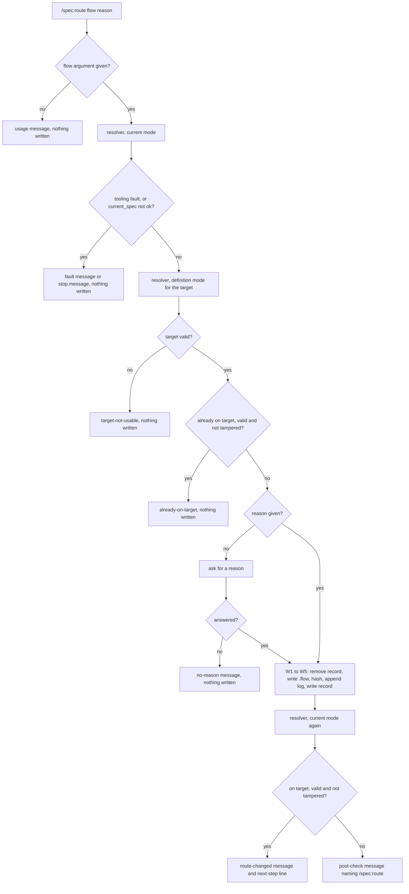

# 91. Slip Creation, Tamper Detection and Route Change

Date: 2026-11-02

## Status

Proposed

Implements part of [issue #4661](https://github.com/BrighterCommand/Brighter/issues/4661). Supersedes no prior ADR. This decision is about the project's own agent tooling, not its runtime. [ADR 0089](0089-slips-resolver-and-routing.md) (Accepted) and [ADR 0090](0090-approval-sub-flows.md) (Proposed) are its siblings.

## Context

ADR 0089 gives a spec a copy of its slip, `.flow`, and a resolver that follows it. It leaves three questions open. How does a slip get into a spec? How does the resolver tell a slip that was installed from one that was edited by hand? How does a spec move to another route? Its report already has the fields, `tampered` and `route_change`, and its roles table names `RouteRecordInspector`, but the logic is left to this ADR (0089 step 7). Its stop ladder holds the placeholder `{route-change command}`.

### Terms

The route vocabulary is defined in [requirements § Definitions](../../specs/0040-routing-slips/requirements.md#definitions): **flow**, **flow definition**, **slip**, **spec slip**, **starter command**, **creation record**, **route change**, **tampered slip**, **legacy spec**, **route-following command** and **stray marker**. **Route report**, **route instructions**, **closing instructions**, **stop** and **message template** are defined in [0089 § Terms](0089-slips-resolver-and-routing.md#terms) and its *How each command consults the resolver*. **Approver**, **sub-flow instructions**, **provenance commands** and **gate run contract** are defined in [0090 § Terms](0090-approval-sub-flows.md#terms). This ADR introduces these words:

- **Slip hash**: the lowercase hex SHA-256 of a slip's bytes after normalisation (*The creation record*).
- **Installation steps**: the canonical shell steps that write `.flow` and `.flow.record`. Every starter and `/spec:route` carries an identical copy.
- **Route-change log**: `route-changes.md` in a spec directory.
- **Spec numbering rule**: FR-18's rule, stated as a procedure under *`/spec:new`*.

### Scope

**Parent requirement**: [specs/0040-routing-slips/requirements.md](../../specs/0040-routing-slips/requirements.md)

**In scope**:

- FR-16: the creation record, normalisation, cases (a), (b) and (c), the legacy rule and the tampered stop message. AC-31 to AC-34.
- FR-17: `/spec:route`, covering its arguments, the order of its checks, its writes, the route-change log and its messages. AC-35 to AC-37, AC-68, AC-80, AC-81.
- FR-18, apart from the check side (0089): `/spec:new` copies `feature` and writes the record; the spec numbering rule; correcting `new.md:15`; no `--flow`. AC-38, AC-40, AC-87, AC-88.
- FR-19 and FR-26, the parts on route change and the starter checklist: the checklist in `.claude/commands/spec/README.md`, including the four items 0090 lists as (a) to (d) under FR-19. AC-41.
- NFR-5: the three files are tracked and stageable. AC-52.
- The `RouteRecordInspector` logic, and the values of `tampered` and `route_change` (0089 *The route report*).
- Naming `/spec:route` in 0089's stop ladder rows 4 and 5.

**Out of scope**:

- These belong to 0089: the report schema, the resolver's modes, the `--definition feature` check in `/spec:new`, `/spec:requirements` no longer creating a directory (0089 step 9.3), and FR-20's classification, stop rows 1 to 3 and their wording. This ADR adds nothing to FR-20. *`.current-spec` and the route-following commands* says how the new commands meet it.
- These belong to 0090: the provenance line, the sub-flow instructions and the gate run contract. The checklist points at them.
- Every test script and fixture (0092). *What 0092 needs from this ADR* lists the inputs.

### Where this ADR sits

| ADR | Decides |
| --- | --- |
| 0089 | The slip and approval-table formats, the route resolver and its report, and how commands consult it |
| 0090 | How a command runs a sub-flow (approval is the first trigger), the provenance line, the gate run contract, the `/adr:*` commands that carry the `design` sub-flow, and the README's notes on running a sub-flow and on the provenance line |
| **0091** *(this one)* | How a slip is installed and frozen at creation (`/spec:new`'s copy and record, numbering, the starter contract), how tampering is detected, how a route is changed, and the README's notes on the route-change command and the starter checklist |
| 0092 | The resolver's and show-me's fixture tests, the fixture flow-definition directories, and the README's notes on running the tests and on a `/bugfix:*` migration |

*"A spec's route is data it carries; commands ask the resolver, not themselves, where it is going."*

### A slip can change without anyone deciding to change it

| Question | Answered today by | After this ADR |
| --- | --- | --- |
| Was this `.flow` installed, or written by hand? | Nobody | `tampered`, from `.flow.record` |
| Why is this spec on `light`? | Nobody | `route_change.reason`, from `route-changes.md` |
| How do I move a spec to another route? | Edit `.flow` | `/spec:route {flow} {reason}` |
| How do I repair a broken copy? | Edit `.flow` | `/spec:route` with the same flow |
| What number does a new spec get? | "001, 002, etc." (`new.md:15`), never followed | Highest four-digit number plus one, made atomic by `mkdir` |
| What must a new flow's starter do? | Unwritten | The README checklist |

In each row, a decision about the route can be made, or undone, by editing a file with no record of who did it or why. If the slip is editable, the route is whatever the last editor left, and 0089's promise that the spec's copy is authoritative (FR-22) means nothing.

### The forces

- **The resolver never writes (NFR-3).** Commands write the slip and record with shell steps. The resolver checks them independently.
- **`* text=auto` (`.gitattributes:2`).** A Windows checkout may hold `.flow` with CRLF. That must not count as tampering (AC-32), and every other change must count.
- **No new parser or runtime (NFR-2).** The record and the log are plain text that `cat` and `grep` read.
- **Tracked, not working state (NFR-5).** Unlike `.current-gear`, all three files are committed.
- **Commands are prose an agent follows.** Any command step can fail partway, so the order of writes must leave a state the resolver names and `/spec:route` repairs.
- **Awkward names.** Spec numbers repeat (`0002`, `0023`, `0027`, `0037`), and one spec directory name contains spaces.
- **Not a security boundary (Constraints).** The aim is to catch careless edits, not a determined one.

## Decision

**A starter installs a slip by copying the definition with CRs stripped and recording its SHA-256 in `.flow.record`. The resolver recomputes the hash to decide tampering. `/spec:route` is the one command that replaces a slip, and it writes in an order whose every interruption reads as tamper case (c).**

### The mechanism, end to end



These invariants follow:

- **Every stop comes before the first write.** That includes the stop for a missing reason (AC-35, AC-37, AC-68).
- **The record is written last.** A matching record exists only if `.flow` and the log entry were written first.
- **Every interrupted run leaves tamper case (c), or no change at all.** The one exception is noted under *The write order*.
- **The resolver judges the result.** The command never decides for itself that the route changed.

### Where the pieces live

| Path | Change | Tracked |
| --- | --- | --- |
| `specs/{dir}/.flow` | Written by starters and `/spec:route` (0089 defines the format) | yes |
| `specs/{dir}/.flow.record` | **new**: the creation record | yes |
| `specs/{dir}/route-changes.md` | **new**: the route-change log, written only by `/spec:route` | yes |
| `.claude/commands/spec/route.md` | **new**: `/spec:route` | yes |
| `.claude/commands/spec/new.md` | Numbering rule, installation steps, post-check | yes |
| `.claude/commands/spec/resolve_route.cs` | `RouteRecordInspector` logic; stop messages for rows 4 and 5 | yes |
| `.claude/commands/spec/README.md` | Canonical installation steps, templates, `/spec:route` and `/spec:new` entries, starter checklist, File Structure | yes |
| `.claude/commands/README.md`, `.agent_instructions/skills_overview.md` | List `/spec:route` | yes |

`git check-ignore -v --no-index` matches none of the three spec files, in any spec directory, including one whose name has spaces. `specs/**/.current-gear` and `specs/**/review-*.md` are the only spec-scoped ignore rules, and neither matches.

### Key Components

#### The roles

| Role | Type | Responsibilities | Responsibility classifier | Collaborators |
| --- | --- | --- | --- | --- |
| Decides the route record | `RouteRecordInspector` (in `resolve_route.cs`) | Normalises and hashes `.flow`, parses `.flow.record`, picks the tamper case, reads the last log entry | deciding, knowing | `RouteResolver` (0089) |
| Installs a slip | installation steps (prose in each starter and `route.md`) | Writes `.flow` with LF only, hashes it, writes the record | doing | `tr`, `shasum`, `date`, `cat` |
| Changes a route | `/spec:route` | Checks, asks for a reason, writes in order, verifies | deciding, doing | resolver, installation steps, the user |
| Starts a `feature` spec | `/spec:new` | Numbers, creates, installs, verifies | doing | resolver, installation steps |

#### The creation record

`.flow.record` holds exactly three lines, each ending in LF:

```
flow: feature
sha256: 3b0c9f…(64 lowercase hex digits)
date: 2026-11-02
```

- **Parsing.** CRLF becomes LF, and trailing spaces and tabs are ignored, as in 0089's slip rule 1. Trailing blank lines are allowed. The patterns are: `flow: [a-z][a-z0-9-]*`, `sha256: [0-9a-f]{64}`, `date: [0-9]{4}-[0-9]{2}-[0-9]{2}`. Anything else makes the record **unreadable**.
- **Normalisation for the slip hash.** Read `.flow` as bytes, replace each CR LF pair with LF, and hash the result with SHA-256. Nothing else is normalised. A byte-order mark, trailing whitespace, a lone CR or a missing final newline all change the hash.
- **The commands write a CR-free `.flow`.** The installation steps copy with `tr -d '\r'`, so the bytes the command hashes are the bytes the resolver hashes after normalisation. A later CRLF checkout normalises back to them (AC-32). A definition holding a lone CR would fail 0089's R0, so stripping CRs changes no valid slip.
- **Only `sha256` decides.** `flow` and `date` are for people to read. The hash covers the flow name on line 1 of `.flow`.

#### `RouteRecordInspector`

| `.flow` | `.flow.record` | `tampered` |
| --- | --- | --- |
| absent | absent | `{false, null}`: legacy (FR-5) |
| absent | present, readable or not | `{true, "b"}` |
| present | absent or unreadable | `{true, "c"}` |
| present | readable, `sha256` equals the slip hash | `{false, null}` |
| present | readable, `sha256` differs | `{true, "a"}` |

- In case (b) there is no slip to follow. The resolver resolves the steps as it would for a legacy spec (`feature.flow`, `flow.source` `default`) so that `/spec:status` can show something. `stop` halts every route-following command first (0089 stop row 4).
- A changed flow definition never affects the result (AC-34). The inspector never reads the definition.
- `route_change` is `null` when `route-changes.md` is absent. Otherwise it comes from the file's last `## ` heading and the next non-blank line (*The route-change log*). If either line is malformed, `route_change` is `null`. The log never affects `valid`, `tampered` or `stop`.
- The inspector reads three files and writes none (NFR-3). It uses no clock (NFR-1).

#### The tampered stop

This fills 0089 stop row 4. The resolver builds the message, and its wording lives in C# as 0089 decides. `{spec}` is the report's `spec`. `{flow}` is line 1 of `.flow` in cases (a) and (c), and the record's `flow:` in case (b). When that name cannot be read, it is the literal `<flow>`.

> ``Spec `{spec}` has a tampered slip: {what}, so it does not match what was recorded when its route was set. {recovery}``

| Case | `{what}` | `{recovery}` |
| --- | --- | --- |
| a | `` `.flow` differs from the content recorded in `.flow.record` `` | ``Restore `.flow` from version control (`git restore --source=HEAD -- "{spec}/.flow"`), or re-copy the flow with `/spec:route {flow} <reason>`.`` |
| b | `` `.flow` is missing but `.flow.record` exists `` | the same as (a) |
| c | `` `.flow` has no readable `.flow.record` `` | ``Re-copy the flow with `/spec:route {flow} <reason>`.`` |

Stop row 5 (`invalid`): wherever 0089's message names `{route-change command}`, it now reads `/spec:route {flow.name} <reason>`.

#### The route-change log

`route-changes.md` is created by the first route change. Each change appends one entry, and earlier entries are never rewritten (AC-81):

```
# Route changes

## 2026-11-02: feature -> light

Reason: The issue is already scoped as an ADR; no requirements step is needed.

## 2026-11-09: light -> feature

Reason: Scope grew; requirements are needed after all.
```

- Heading pattern: `^## ([0-9]{4}-[0-9]{2}-[0-9]{2}): ([a-z][a-z0-9-]*) -> ([a-z][a-z0-9-]*)$`. Reason line: `^Reason: (.+)$`. CRLF is tolerated.
- `from` is the report's `flow.name` before the change, or `unknown` when it is `null`. For a legacy spec it is `feature`. For a case (b) spec it is `feature` too, because that is what the resolver resolved.
- The reason is the user's text on one line, with line breaks replaced by spaces. It may not be empty.

#### Installation steps (canonical text in README.md)

Each step is run on its own from the repository root. `{D}` is `specs/{dir}`, `{S}` is `{flows-dir}/{flow}.flow`, and each is double-quoted.

1. `tr -d '\r' < "{S}" > "{D}/.flow"`
2. `shasum -a 256 < "{D}/.flow"`. If the command is not found, use `sha256sum < "{D}/.flow"`. The slip hash is the first field of the output, and it must match `^[0-9a-f]{64}$`.
3. `date +%Y-%m-%d`
4. Write the record with a quoted here-document, so that nothing is expanded:
   `cat > "{D}/.flow.record" <<'FLOW_RECORD'` followed by the three lines, then `FLOW_RECORD`.

If any step fails, stop and print the installation-failed template. `/spec:route` puts its own steps between steps 1 and 4 (*The write order*).

#### `/spec:route {flow} [reason] [--flows-dir {dir}]`

The analogue of `/spec:gear` (`gear.md:121-128`). It acts on the current spec.

- **Arguments.**
  - The first word is the target flow.
  - `--flows-dir {dir}` may appear anywhere after it, and is taken out before the reason is read. It defaults to `.claude/flows`. Tests use it, and it is passed to every resolver run and used as the source of the copy (FR-17, AC-36).
  - The rest of the text, trimmed and with any wrapping quotes removed, is the reason.
- **`allowed-tools`:** `Bash(dotnet run .claude/commands/spec/resolve_route.cs -- specs/:*)`, `Bash(tr:*)`, `Bash(shasum:*)`, `Bash(sha256sum:*)`, `Bash(date:*)`, `Bash(cat:*)`, `Bash(test:*)`, `Bash(rm:*)`, `Read`, `AskUserQuestion`.

Checks, in order. Each stop writes nothing.

1. No target: print the route-usage template.
2. Run `--current`, applying 0089's tooling-fault test. If `current_spec.state` is not `ok`, print `stop.message`, which carries FR-20's state and the `/spec:switch` and `/spec:new` recoveries. A `stop` whose reason is `tampered` or `invalid` does **not** stop `/spec:route`, because those are the states it repairs. Keep `spec`, `flow`, `valid` and `tampered` from this report.
3. Run `--definition {flow}`. If `valid` is false, print the route-target-not-usable template. This covers a missing definition, a bad name and every R0–R16 fault in the definition or in `approvals.md` (AC-37, AC-68).
4. If `flow.name` equals the target, `valid` is true and `tampered.value` is false, print the already-on-target template. A legacy spec asking for `feature` stops here (FR-17).
5. If no reason was given, ask for one with `AskUserQuestion`, offering free text and suggestions such as "the route drops a step this work does not need" and "re-copy after a fixed definition". A dismissed or empty answer prints the no-reason template (AC-35).

#### The write order

| # | Step | State if the run stops after this step |
| --- | --- | --- |
| W1 | `rm -f "{D}/.flow.record"` | case (c) if `.flow` exists; otherwise as before (legacy) or legacy-looking (was case b) |
| W2 | installation step 1 (the shell creates `.flow` before `tr` runs) | case (c) |
| W3 | installation steps 2 and 3 (read-only) | case (c) |
| W4 | append the log entry with `test -f` and `cat >> "{D}/route-changes.md" <<'ROUTE_CHANGE'`, writing the `# Route changes` header first if the file is new | case (c), with the entry logged |
| W5 | installation step 4 | complete |

Every state with a `.flow` reads as case (c). Only `/spec:route` repairs case (c), and re-running it repairs any of these states. A re-run after W4 appends a second entry, which is accepted: the log records attempts. The exception is a run that started in case (b) and stops between W1 and W2. That spec then looks legacy, which the requirements accept for "both files deleted" (Constraints).

**Post-check.** Run `--current` again. If `flow.name` is the target, `valid` is true and `tampered.value` is false, print the route-changed template. Otherwise print the post-check template. `/spec:route` does not carry 0089's closing instructions. Its post-check is its own second report.

Nothing else is deleted. Markers and artefacts stay where they are, and markers not on the new slip become stray markers (FR-17, FR-21).

#### `/spec:new {name}`

This lands after 0089 step 9.9, which adds the `--definition feature` check before step 1 (AC-69).

1. **Name.** Take `$ARGUMENTS` whole: trimmed, wrapping quotes removed, inner spaces kept, as `show-me.md:32-35` does. If it is empty, contains `/` or starts with `.`, print the spec-name template and stop.
2. **Spec numbering rule** (replaces `new.md:15`, "format: 001, 002, etc."). List the immediate subdirectories of `specs/` whose names match `^[0-9]{4}-`, and take the highest number. The new number is that plus one, zero-padded to four digits, or `0001` when there are none. At `9999`, stop. Only the whole name `{NNNN}-{name}` must be unique, because numbers repeat.
3. `mkdir "specs/{NNNN}-{name}"`, with no `-p`. If it fails because the name exists, including a directory that arrived after step 2, print the spec-exists template and stop with nothing created (AC-87, AC-88). Every later step is skipped.
4. Run the installation steps with `{flow}` = `feature` and `{flows-dir}` = `.claude/flows`.
5. Write `README.md` as today (`new.md:18-21`), then write `specs/.current-spec`. The current spec changes only once the new spec is complete.
6. **Post-check.** Run `--spec "{NNNN}-{name}"`. If it reports `feature` from `slip`, valid and not tampered (AC-38), print the next-step line built from `next`. Otherwise print the post-check template with `/spec:route feature <reason>` as the repair.

If the run stops after step 3, the message names what was created. `/spec:new` has no `--flow` option, nor anything like one (AC-40). `allowed-tools` gains `Bash(mkdir:*)`, `Bash(tr:*)`, `Bash(shasum:*)`, `Bash(sha256sum:*)` and `Bash(date:*)`, beside 0089's resolver entry.

#### `.current-spec` and the route-following commands

0089 already covers FR-20 for every route-following command: the resolver classifies the state, stop rows 1 to 3 halt the command, and the route instructions in each command, with their canonical text in README.md, print `stop.message`. `/adr:adr` keeps its exemption sentence. `/spec:requirements` loses `requirements.md:29-33` in 0089 step 9.3, together with its `Bash(mkdir:*)` grant, and with no usable current spec it stops naming `/spec:switch` and `/spec:new` (AC-39). This ADR adds only two things:

- `/spec:route` takes the same stop (check 2).
- `/spec:new` ignores `.current-spec` and overwrites it in step 5.

The README entry for `/spec:requirements` (`README.md:166-191`) drops "Creates `specs/` directory if it doesn't exist" and says the command needs a current spec from `/spec:new` or `/spec:switch`.

#### Message templates

The canonical text lives in `.claude/commands/spec/README.md`, beside 0089's templates. Each command that prints a template carries an identical copy, and 0092 compares them. `{command}` is the printing command.

| Template | Printed by | Text |
| --- | --- | --- |
| Route usage | `/spec:route` | ``/spec:route needs a target flow: /spec:route {flow} [reason]. Nothing was changed.`` |
| Route target not usable | `/spec:route` | ``Cannot change the route to `{target}`: {violations[0].message} Nothing was changed.`` |
| Already on target | `/spec:route` | ``Spec `{spec}` is already on flow `{target}`, and its slip is valid and not tampered. Nothing was changed.`` |
| No reason | `/spec:route` | ``/spec:route needs a reason for the route change. Nothing was changed.`` |
| Route changed | `/spec:route` | ``Spec `{spec}` moved from flow `{from}` to `{target}`. Reason recorded in route-changes.md: {reason}`` then, when `stray_markers` is non-empty, ``Kept as stray markers: {stray_markers joined with ", "}.`` then 0089's next-step line |
| Post-check | `/spec:route`, `/spec:new` | ``{command} wrote the slip, but the resolver reports {flow.name, valid, tampered.case}. Re-run /spec:route {target} <reason> to repair.`` |
| Installation failed | `/spec:route`, `/spec:new`, starters | ``{command} stopped: {step} failed. Written so far: {files}. Re-run {command}.`` For `/spec:new`, `{files}` begins with the spec directory |
| Spec name | `/spec:new`, starters | ``{command} needs a spec name that is not empty, has no "/" and does not start with ".". Nothing was created.`` |
| Spec exists | `/spec:new`, starters | ``Cannot start a spec: `specs/{dir}/` already exists. Nothing was created. Re-run {command} to take the next number.`` |

#### The starter checklist (FR-19, AC-41)

This goes in `.claude/commands/spec/README.md` under *Starter commands*. Each item is answered yes or no, and each says how it is checked:

- **Fixture**: the flow ships a resolver fixture test in 0092's layout.
- **Statement**: the flow's command text carries an identical copy of the named README text.

Gates and flow approvers carry copies of 0089's route instructions and closing instructions. These copies are *outside* 0089's counts of eight and five commands, which count only the commands this spec ships.

| # | Clause | Yes when | Checked by |
| --- | --- | --- | --- |
| C1 | Stops on a missing or invalid definition | The starter runs `--definition {name}` first and stops when `valid` is false | Statement; Fixture (`--definition {name}` valid) |
| C2 | Numbering rule and `.current-spec` | The starter carries the spec numbering rule, `mkdir` with no `-p`, the spec-exists template, and writes `specs/.current-spec` last | Statement |
| C3 | Installs `.flow` and the record | The starter carries the installation steps, and a fixture spec on the flow with `.flow` and `.flow.record` reports `{name}`, valid, not tampered | Statement; Fixture |
| C4 | Provenance lines (0090 item (b)) | Every marker-writing command of the flow carries 0090's provenance commands | Statement |
| C5 | Artefacts match the slip | Each producing command writes exactly the files its step's Artefacts cell names, and the fixtures at each step name them | Statement; Fixture |
| C6 | Gate run contract (0090 item (d)) | Every gate on the slip carries 0090's gate run contract text from README.md | Statement |
| C7 | Takes routing from the resolver | Every producing and marker-writing command of the flow carries 0089's route instructions, and its closing instructions where its write changes `next` | Statement |
| C8 | Approval-table entry, sub-flow before marker (0090 item (c)) | `approvals.md` has an entry, possibly `(empty)`, for every flow-specific kind on the slip, and every approving command carries 0090's sub-flow instructions, with the marker written by their step 7 only | Fixture (slip valid, R12 (a)); Statement |
| C9 | Ships fixture tests | Fixtures cover every step approved and unapproved | Fixture |
| C10 | Step checks before the sub-flow (0090 item (a)) | Before its sub-flow, a flow's own marker-writing command checks that the step is on the slip, that `steps[N].marker_writer` is itself, and that step N's artefacts are present, using 0089's artefacts-missing template | Statement |

C10 is the "equivalent checks" that 0090 *The sub-flow instructions* leaves to this checklist. Under FR-19, a starter also edits no `/spec:*` file. A reviewer checks that with `git diff --stat -- .claude/commands/spec/`, so it is a rule above the table, not an item in it.

#### Where each type is touched

| Assembly | Type | Change |
| --- | --- | --- |
| `.claude/commands/spec/` | `resolve_route.cs` | `RouteRecordInspector`; the stop row 4 message; `/spec:route` in row 5 |
| `.claude/commands/spec/` | `route.md` | **new** |
| `.claude/commands/spec/` | `new.md` | `:2` grants, `:15` numbering rule, `:16-17` `mkdir` and order, installation steps, post-check, templates |
| `.claude/commands/spec/` | `README.md` | `/spec:new` (`:151-163`), `/spec:requirements` (`:166-191`), a new `/spec:route` entry beside `/spec:gear`, installation steps and record format, templates, the starter checklist, and `.flow.record` and `route-changes.md` beside 0089's `.flow` in File Structure (`:809-830`), marked tracked |
| `.claude/commands/` | `README.md` | Lists `/spec:route` (`:162-168`) |
| `.agent_instructions/` | `skills_overview.md` | Lists `/spec:route` (`:45-46`) |

These are deliberately **unchanged**: `.gitignore`, because nothing new needs ignoring; `.claude/settings.json`; `gear.md`; and every file in an existing spec directory (FR-5, AC-6).

### Refines 0089

0089 is Accepted and 0091 leaves its report, modes and ladders alone. It changes these sentences in 0089's text, which this ADR's commit makes in 0089 too:

| 0089 said | 0091 and 0089 now say | Why |
| --- | --- | --- |
| The route-change command uses `--definition {target}` and `--spec {dir}` | `--current`, `--definition {target}`, and `--current` again after its writes | `/spec:route` acts on the current spec. `--current` gives it FR-20's state classification from the resolver, so it does not read `.current-spec` itself. `/spec:switch` still uses `--spec` because it chooses the directory |
| The route-change command's write does not change what it prints next, so it carries no closing instructions | It carries no copy of the closing instructions paragraph, but its post-check is a second `--current` report, and it prints the next-step line from it | A route change changes `next`. The post-check is also what proves the route changed |
| The next-step line is printed by the closing instructions, status, switch, review's reminder and three templates | Add the route-changed template and `/spec:new`'s post-check | `/spec:new` also shows the new spec's next step |
| `/spec:new` runs `--definition feature` only | It also runs `--spec {dir}` after its writes, as its post-check, and reads `flow`, `valid`, `tampered` and `next` | The post-check proves the slip was installed (AC-38) |
| The closing instructions are carried by the commands whose write changes the next step | They are carried by those five commands. `/spec:route` and `/spec:new` print the next step from their own post-check | The five-command count stays the same |

0089's count of five commands that carry the closing instructions does not change.

### Technology Choices

#### Why a hash, not a second copy

A record holding a full second copy doubles every slip and diffs twice on every route change. A 64-character hash is enough to detect a change, and it shows in a diff as one changed line. As the Constraints allow, someone can edit `.flow` and recompute the hash. That is equally true of a copy.

#### Why the commands and the resolver each compute the hash

NFR-3 keeps the resolver read-only, so it cannot write the record. A resolver mode that printed the hash for the command to record would have to be added to 0089's Accepted schema. The resolver would then be checking its own number, and a hashing bug would go unnoticed. Two independent implementations, `shasum` in the command and `SHA256` from the base class library in the resolver, cross-check each other in every post-check.

#### Why strip CRs on copy, and normalise only CRLF when checking

The command never has to reproduce the resolver's normalisation in shell: it hashes a file that holds no CR. The resolver's rule matches git's `text=auto` exactly, so a CRLF checkout passes and any other change, including a lone CR, is caught.

#### Why the record is written last

When the record is written last, "a record matches" means "every write before it happened". Any other order can leave a matching record next to a half-done change.

#### Why `mkdir` without `-p`

It checks whether the name exists and creates the directory in one step, so a directory that arrives between the listing and the write is never adopted.

#### Why a here-document

A reason may hold quotes, `$` or backticks. A quoted here-document writes it byte for byte, with no escaping rule an agent could get wrong.

### Implementation Approach

Numbered in commit order. Resolver steps are test-first, with 0092's row added before the code.

1. **Behavioural, this is 0089 step 7, after 0089 step 6.** Add `RouteRecordInspector`: record parsing, normalisation, the case table, the log reader, the stop row 4 message, and `/spec:route` in row 5. No starter writes `.flow` yet, so legacy results are unchanged.
2. **Documentation, after 0090 step 2.** In README.md, add the installation steps, the record and log formats, the templates, the tamper recoveries, the `/spec:route` entry and the starter checklist (C4, C6, C8 and C10 point at 0090's text).
3. **Behavioural.** Add `route.md`.
4. **Behavioural, after 0089 step 9.9.** Change `new.md`: the numbering rule, the corrected `:15`, `mkdir`, the installation steps, the post-check and the grants.
5. **Documentation.** The `/spec:new` and `/spec:requirements` README entries, File Structure, `.claude/commands/README.md`, and `skills_overview.md`.
6. **Verification by hand, on a throwaway branch.**
   1. `/spec:new foo` creates `specs/{highest+1}-foo/` with `README.md`, `.flow` byte-equal to `tr -d '\r' < .claude/flows/feature.flow`, and a record. `--spec` then reports `feature`, `slip`, valid, not tampered (AC-38). `git status` lists all three files as untracked, not ignored (AC-52).
   2. Create `specs/{next}-foo/` by hand between the listing and the `mkdir`. `/spec:new foo` stops and creates nothing (AC-88).
   3. Change one character of a command in `.flow`. The resolver reports case (a), and `/spec:tasks` stops naming both recoveries (AC-31). `unix2dos` on `.flow` alone is not tampered (AC-32). Delete `.flow` for case (b). Delete only the record for case (c) (AC-33).
   4. Run `/spec:route light --flows-dir {fixture}` with no reason, then dismiss the question. `git status` is unchanged (AC-35).
   5. Run `/spec:route light "R1" --flows-dir {fixture}` on a spec with `.requirements-approved`. `.flow` holds `light`, the spec is not tampered, the log has R1, the marker stays and is reported stray, and status shows R1 (AC-36). Then run `/spec:route feature "R2" --flows-dir {fixture}`. The log holds both entries in order, and status shows R2 (AC-81).
   6. `/spec:route nosuch`, `/spec:route feature` on a valid legacy spec, and `/spec:route broken` against an invalid fixture definition each stop with no file changed (AC-37, AC-68).
   7. Run `/spec:route light` on a legacy spec and on a tampered spec. Each ends with `.flow` and a record, valid and not tampered (AC-68).
   8. AC-80: a copy that names a deleted command is invalid, and `/spec:tasks`'s stop names `/spec:route feature <reason>`. After `/spec:route feature "R"`, `.flow` equals the definition and R is logged.
   9. Interrupt `/spec:route` after W2 and after W4 by refusing the next permission prompt. Each state reads as case (c), and a re-run repairs it.
   10. `/spec:requirements 123` with no `.current-spec` stops, names missing, and creates no directory (AC-39).

#### What 0092 needs from this ADR

- **Inspector fixtures:**
  - case (a): one changed character, trailing whitespace and a BOM, each reported as (a);
  - CRLF only, not tampered;
  - case (b), and case (c) both with no record and with an unreadable record;
  - legacy;
  - a `feature` definition edited after creation, not tampered (AC-34), using a second `--flows-dir`;
  - a spec directory whose name has spaces, with `.flow` and a record;
  - the log with two entries (the last one is reported), with a malformed last entry (`null`), and absent (`null`).
- **The CRLF fixture cannot be committed as CRLF**, because `* text=auto` normalises it. Either mark it `-text` in `.gitattributes`, or have the test script write the CRLF copy into a temporary directory.
- **Every fixture record's `sha256` must be the hash of the LF content**, generated with the installation steps.
- **The `--all` summary**, including `tampered` and a route change within the 650-character line limit (0089).
- **Comparisons:** the installation steps in `new.md` and `route.md` against README.md, and the templates above, added to 0092's comparison list.
- **The ignore check:** an assertion that `git check-ignore --no-index` exits `1` for `specs/{dir}/.flow`, `.flow.record` and `route-changes.md`, including a directory name with a space.
- **Command prose that no resolver test reaches**, verified by hand (step 6): the numbering rule, `/spec:route`'s checks and the write order.

## Consequences

### Positive

- A hand-edited, deleted or hand-copied slip is named, with the recovery to use (FR-16).
- Every route change is deliberate, dated and explained, and the record travels with the spec (FR-17, NFR-5).
- One command repairs every broken slip: tampered, invalid or interrupted.
- New specs get unique four-digit names, even when another branch adds one at the same time.
- A new flow's author has a ten-item checklist, and each item says how it is checked (FR-19).

### Negative

- Three more files per spec, two of them on every spec created from now on.
- A spec that is valid and untampered cannot pick up a revised version of its own flow's definition. `/spec:route` stops as already on target (FR-17 as written).
- A re-run after an interruption can log the same change twice.
- `from` reads `feature` for a case (b) spec, even if the lost slip was another flow.
- The installation steps are copied into every starter and `route.md`. Only 0092's comparison keeps the copies identical.
- `/spec:new` now refuses a name containing `/` or starting with `.`, and stops at `9999`.
- Tamper detection is advisory. Editing `.flow` and recomputing the hash defeats it (Constraints).

### Risks and Mitigations

- **Risk: the shell hash and the resolver hash disagree on some platform.** Mitigation: the hashed file holds no CR, so text and binary modes agree. The post-check in both commands reports a disagreement at once, before anything is committed.
- **Risk: `shasum` is missing.** Mitigation: `sha256sum` is the fallback, and both are present on macOS, Git for Windows and common Linux distributions. If both are missing, the installation-failed template names the step.
- **Risk: an agent improvises the write order.** Mitigation: the steps are canonical text, compared by 0092. Any order that is wrong in a way that matters leaves no matching record, so the spec reads as tampered.

## Alternatives Considered

### Alternative 1: Keep a second copy of the slip as the record

It doubles the storage and the diff noise, and it detects nothing more than a hash does. The owner rejected it.

### Alternative 2: Add a hash field to the resolver's `--definition` report

The command would then record a number computed by the code that checks it. It would also change 0089's Accepted schema. Independent computation needs neither.

### Alternative 3: Record route changes in `.flow.record`

Each change would overwrite the record, so earlier changes would be lost (AC-81). One file per job keeps the record small and the log append-only.

### Alternative 4: A writer program for installation

A C# writer would bring a second program into the routing scripts, with a write grant, to do what `tr`, `shasum` and a here-document already do. The owner decided against it.

### Alternative 5: Git history as the record

Comparing against `git log` needs a commit, fails before the first commit, and makes the resolver depend on git state, which breaks NFR-1's input list.

### Alternative 6: `--because "reason"`, as in `/spec:gear`

A flag adds nothing to a command with one free-text argument. `/spec:route light the reason` reads naturally, and the command still asks when the reason is absent.

## References

- Parent requirement: [specs/0040-routing-slips/requirements.md](../../specs/0040-routing-slips/requirements.md)
- Issue: [#4661](https://github.com/BrighterCommand/Brighter/issues/4661)
- [ADR 0089](0089-slips-resolver-and-routing.md): the report fields `tampered` and `route_change`, the stop ladder, `RouteRecordInspector`'s contract, the route and closing instructions, the templates, and steps 7 and 9.9
- [ADR 0090](0090-approval-sub-flows.md): the provenance commands, the sub-flow instructions and the gate run contract that checklist items C4, C6, C8 and C10 point at
- Sibling 0092, as *Where this ADR sits* words it
- [ADR 0071 — Shiftable Review Gear](0071-tdd-review-gear.md): the reason-required analogue, with untracked state
- [ADR 0072](0072-show-me-command-resolution-and-output.md): the file-based app conventions the resolver follows
- `.gitattributes:2`, `.gitignore:357-366`
