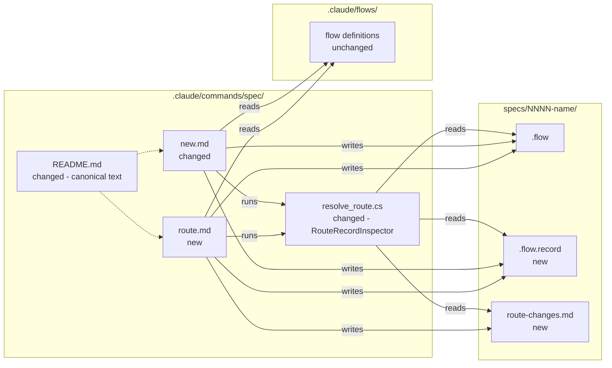

# 91. Slip Creation, Tamper Detection and Route Change

Date: 2026-11-02

## Status

Proposed

Implements part of [issue #4661](https://github.com/BrighterCommand/Brighter/issues/4661). Supersedes no prior ADR. This decision is about the project's own agent tooling, not its runtime. [ADR 0089](0089-slips-resolver-and-routing.md) (Accepted) and [ADR 0090](0090-approval-sub-flows.md) (Proposed) are its siblings.

## Context

ADR 0089 gives a spec a copy of its slip, `.flow`, and a resolver that follows it. It leaves three things open: how a slip gets into a spec, how the resolver tells an installed slip from one edited by hand, and how a spec moves to another route. Its report already has the fields, `tampered` and `route_change`, and its roles table names `RouteRecordInspector`, but the logic is left to this ADR (0089 step 7). Its stop ladder holds the placeholder `{route-change command}`.

### Terms

The route vocabulary is defined in [requirements § Definitions](../../specs/0040-routing-slips/requirements.md#definitions): **flow**, **flow definition**, **slip**, **spec slip**, **starter command**, **creation record**, **route change**, **tampered slip**, **legacy spec**, **route-following command** and **stray marker**. **Route report**, **route instructions**, **closing instructions**, **stop** and **message template** are defined in [0089 § Terms](0089-slips-resolver-and-routing.md#terms) and its *How each command consults the resolver*. **Approver**, **sub-flow instructions**, **provenance commands** and **gate run contract** are defined in [0090 § Terms](0090-approval-sub-flows.md#terms). This ADR introduces these words:

- **Slip hash**: the lowercase hex SHA-256 of a slip's bytes after normalisation (*The creation record*).
- **Installation steps**: the canonical shell steps that write `.flow` and `.flow.record`. Every starter, `/spec:new` and `/spec:route` carries the four steps verbatim. `/spec:route` runs them in its own order (*The write order*), which is a canonical block of its own.
- **Route-change log**: `route-changes.md` in a spec directory.
- **Spec numbering rule**: FR-18's rule, stated as a procedure under *`/spec:new`*.

### Scope

**Parent requirement**: [specs/0040-routing-slips/requirements.md](../../specs/0040-routing-slips/requirements.md)

**In scope**:

- FR-16: the creation record, normalisation, cases (a), (b) and (c), the legacy rule and the tampered stop message. AC-31 to AC-34.
- FR-17: `/spec:route`, covering its arguments, the order of its checks, its writes, the route-change log and its messages. AC-35 to AC-37, AC-68, AC-80, AC-81.
- FR-18, apart from the check side (0089): `/spec:new` copies `feature` and writes the record; the spec numbering rule; correcting `new.md:15`; no `--flow`. AC-38, AC-40, AC-87, AC-88.
- FR-19 and FR-26, the parts on route change and the starter checklist: the checklist in `.claude/commands/spec/README.md`, including the four items 0090 lists as (a) to (d) under FR-19. AC-41.
- NFR-5: the three files are tracked and stageable. AC-52.
- A narrowing of FR-17's stop for a route already on the target (and of AC-37): ladder row 5 also lets `/spec:route` run when the log's last entry names a different flow than the slip, so that a change abandoned part-way can be recorded. A route that is valid, untampered and consistent with its log still stops.
- The `RouteRecordInspector` logic, and the values of `tampered` and `route_change` (0089 *The route report*).
- Naming `/spec:route` in 0089's stop ladder rows 4 and 5.
- Corrections to 0089's text, in these places: *Terms* (the closing-instruction carriers), *The route report* (`tampered.recorded_flow`), *How each command consults the resolver* (the route-change and `/spec:new` rows), the next-step line row, the consequences line on second resolver runs, and step 9.3 (`requirements.md:29-33` and its `mkdir` grant).

**Out of scope**:

- These belong to 0089: the report schema, the resolver's modes, the `--definition feature` check in `/spec:new`, `/spec:requirements` no longer creating a directory (0089 step 9.3), and FR-20's classification, stop rows 1 to 3 and their wording. This ADR adds nothing to FR-20. *`.current-spec` and the route-following commands* says how the new commands meet it.
- These belong to 0090: the provenance line, the sub-flow instructions and the gate run contract. The checklist points at them.
- Every test script and fixture (0092). *What 0092 needs from this ADR* lists the inputs.

### Where this ADR sits

| ADR | Decides |
| --- | --- |
| 0089 | The slip and approval-table formats, the route resolver and its report, and how commands consult it |
| 0090 | How a command runs a sub-flow (approval is the first trigger), the provenance line, the gate run contract, the `/adr:*` commands that carry the `design` sub-flow, and the README's notes on running a sub-flow and on the provenance line |
| **0091** *(this one)* | How a slip is installed and frozen at creation (`/spec:new`'s copy and record, numbering, the starter contract), how tampering is detected, how a route is changed, and the README's notes on the route-change command and the starter checklist |
| 0092 | The resolver's and show-me's fixture tests, the text-comparison script, the fixture flow-definition directories, and the README's notes on running the tests and on a `/bugfix:*` migration |

*"A spec's route is data it carries; commands ask the resolver, not themselves, where it is going."*

### A slip can change without anyone deciding to change it

| Question | Answered today by | After this ADR |
| --- | --- | --- |
| Was this `.flow` installed, or written by hand? | Nobody | `tampered`, from `.flow.record` |
| Why is this spec on `light`? | Nobody | `route_change.reason`, from `route-changes.md` |
| How do I move a spec to another route? | Edit `.flow` | `/spec:route {flow} {reason}` |
| How do I repair a broken copy? | Edit `.flow` | `/spec:route` with the same flow |
| What number does a new spec get? | "001, 002, etc." (`new.md:15`), never followed | Highest number plus one, at least four digits, made atomic by `mkdir` |
| What must a new flow's starter do? | Unwritten | The README checklist |

In each row, a decision about the route can be made, or undone, by editing a file with no record of who did it or why. If the slip is editable, the route is whatever the last editor left, and 0089's promise that the spec's copy is authoritative (FR-22) means nothing.

### The forces

- **The resolver never writes (NFR-3).** Commands write the slip and record with shell steps. The resolver checks them independently.
- **`* text=auto` (`.gitattributes:2`).** A Windows checkout may hold `.flow` with CRLF. That must not count as tampering (AC-32), and every other change must count.
- **No new parser or runtime (NFR-2).** The record and the log are plain text that `cat` and `grep` read.
- **Tracked, not working state (NFR-5).** Unlike `.current-gear`, all three files are committed.
- **Commands are prose an agent follows.** Any command step can fail partway, so the order of writes must leave a state the resolver names and `/spec:route` repairs.
- **Awkward names.** Spec numbers repeat (`0002`, `0023`, `0027`, `0037`), one spec directory name contains spaces, and a name flows into shell paths and into git's ignore rules.
- **Not a security boundary (Constraints).** The aim is to catch careless edits, not a determined one.

## Decision

**A starter installs a slip by copying the definition with CRs stripped and recording its SHA-256 in `.flow.record`, and the resolver recomputes the hash to decide tampering.**

A starter copies a flow definition into the spec as `.flow` and writes `.flow.record` beside it. The resolver's `RouteRecordInspector` compares the two to report whether the slip was tampered with, and reads the latest route change from `route-changes.md`. `/spec:route` is the one command that replaces a slip. It checks everything first, then drops the record, logs the change, replaces the slip and writes the record last, so an interrupted run either changes nothing or leaves the spec reading as tamper case (c), or as legacy when it had no `.flow`. `/spec:new` is the starter for `feature`.

### The mechanism, end to end

`/spec:route {flow} [reason]` follows this ladder. The first row that matches ends the run. Rows 1 to 6 are checks and write nothing.

| # | When | Outcome | Printed |
| --- | --- | --- | --- |
| 1 | No target, or a target that is not a flow name (`[a-z][a-z0-9-]*`), or a `--flows-dir` value holding `$`, a backtick, `"` or `\` | Stop | Route usage |
| 2 | A resolver run fails 0089's tooling-fault test: the `--current` run here, or the `--definition` run of row 4 | Stop | 0089's tooling-fault message |
| 3 | `current_spec.state` is not `ok`, or the report's `spec` holds `$`, a backtick, `"` or `\` | Stop | `stop.message` for the state, which carries FR-20's recoveries (`/spec:switch`, `/spec:new`). Route spec name for the characters. A `stop` whose reason is `tampered` or `invalid` does **not** stop `/spec:route`, because those are the states it repairs |
| 4 | `--definition {flow}` reports `valid` false: a missing definition, or any R0 to R16 fault in the definition or in `approvals.md` (AC-37, AC-68) | Stop | Route target not usable |
| 5 | In the `--current` report of row 2, `flow.name` equals the target, `valid` is true, `tampered.value` is false, and `route_change` is `null` or its `to` equals the target. A legacy spec asking for `feature` stops here (FR-17), unless the log's last entry names another flow, which narrows FR-17 as *Scope* says | Stop | Already on target |
| 6 | No reason was given, and the question asked for one is dismissed or answered empty (AC-35) | Stop | No reason |
| 7 | Otherwise | Run the write order (*The write order*, W0 to W5) | A failed step prints Installation failed, naming what was written (nothing, at W0) |
| 8 | A post-check `--current` fails 0089's tooling-fault test | Print the tooling-fault message in place of rows 9 and 10. Undo no write | 0089's tooling-fault message |
| 9 | The post-check reports `flow.name` equal to the target, `valid` true and `tampered.value` false | Done | Route changed, then the next-step line |
| 10 | Otherwise | Done | Post-check |

These invariants follow:

- **Every check stops before the first write.** That includes the stop for a missing reason. A failed step in row 7 stops with Installation failed, which names what was written.
- **The history is written before the slip changes, and the record is written last.** The previous flow reaches the log before anything is replaced, and a matching record exists only if every earlier write happened.
- **A run that stops before W1 completes changes nothing. After W1, an interrupted run leaves tamper case (c) whenever the spec has a `.flow`.** A spec with none (legacy, or case (b)) reads as legacy until W3 writes one. *The write order* gives the state after each step.
- **The resolver judges the result.** The command never decides for itself that the route changed.

### Where the pieces live



All three files in the spec directory are tracked (NFR-5). `/spec:route` is the only writer of `route-changes.md`. The creation commands refuse a spec name that git would ignore (*`/spec:new`*, step 3), for example one ending `.log` or `.sqlite`. For every other name, `git check-ignore -v --no-index` matches none of the three files, including a name with spaces. `specs/**/.current-gear` and `specs/**/review-*.md` are the only other spec-scoped ignore rules, and neither matches.

### Key Components

#### The roles, and what each is responsible for

| Role | Type | Responsibilities | Responsibility classifier | Collaborators |
| --- | --- | --- | --- | --- |
| Decides the route record | `RouteRecordInspector` (in `resolve_route.cs`; contract in 0089) | Normalises and hashes `.flow`, parses `.flow.record`, picks the tamper case, reads the last log entry | deciding, knowing | `Slip`, and the three spec files it reads |
| Installs a slip | installation steps (prose in each starter, `new.md` and `route.md`) | Writes `.flow` with LF only, hashes it, writes the record | doing | `tr`, `shasum`, `date`, `cat` |
| Changes a route | `/spec:route` | Checks, asks for a reason, writes in order, verifies | deciding, doing | resolver, installation steps, the user |
| Starts a `feature` spec | `/spec:new` | Names, numbers, creates, installs, verifies | doing | resolver, installation steps, `git check-ignore` |

#### The creation record

`.flow.record` holds exactly three lines, each ending in LF:

```
flow: feature
sha256: 3b0c9f…(64 lowercase hex digits)
date: 2026-11-02
```

- **Parsing.** CRLF becomes LF, and trailing spaces and tabs are ignored, as in 0089's slip rule 1. Trailing blank lines are allowed. The patterns are: `flow: [a-z][a-z0-9-]*`, `sha256: [0-9a-f]{64}`, `date: [0-9]{4}-[0-9]{2}-[0-9]{2}`. Anything else makes the record **unreadable**.
- **Normalisation for the slip hash.** Read `.flow` as bytes, replace each CR LF pair with LF, and hash the result with SHA-256. Nothing else is normalised. A byte-order mark, trailing whitespace, a lone CR or a missing final newline all change the hash.
- **The commands write a CR-free `.flow`.** The installation steps copy with `tr -d '\r'`, so the bytes the command hashes are the bytes the resolver hashes after normalisation. A later CRLF checkout normalises back to them (AC-32). A definition holding a lone CR would fail 0089's R0, so stripping CRs changes no valid slip.
- **Only `sha256` decides tampering.** `date` is for people to read. `flow` is reported as `tampered.recorded_flow`, and names the route the spec was set to.

#### `RouteRecordInspector`

| `.flow` | `.flow.record` | `tampered` |
| --- | --- | --- |
| absent | absent | `{false, null, null}`: legacy (FR-5) |
| absent | present, readable or not | `{true, "b", recorded_flow}` |
| present | absent or unreadable | `{true, "c", null}` |
| present | readable, `sha256` equals the slip hash | `{false, null, recorded_flow}` |
| present | readable, `sha256` differs | `{true, "a", recorded_flow}` |

`recorded_flow` is the record's `flow:` value, or `null` when the record is absent or unreadable. It is a third key of 0089's `tampered` object, which was `{value, case}`.

| Member | Input | Output | Error conditions |
| --- | --- | --- | --- |
| Inspect tampering | the spec directory | `tampered` as the table above gives it | An unreadable record is case (c), not a fault. An I/O failure reading a file is a resolver fault, which exits non-zero (0089) |
| Read the latest route change | `route-changes.md` | `route_change` `{date, from, to, reason}`, or `null` | A missing file, or a malformed last heading or reason line, gives `null`. The log never affects `valid`, `tampered` or `stop` |

- In case (b) there is no slip to follow. The resolver resolves the steps as it would for a legacy spec (`feature.flow`, `flow.source` `default`) so that `/spec:status` can show something, and `flow.name` is that flow's name. The recorded route is `tampered.recorded_flow`. `stop` halts every route-following command first (0089 stop row 4).
- A changed flow definition never affects the result (AC-34). The inspector never reads the definition.
- `route_change` comes from the log's last `## ` heading and the next non-blank line (*The route-change log*).
- The inspector reads three files and writes none (NFR-3). It uses no clock (NFR-1).

#### The tampered stop

This fills 0089 stop row 4. The resolver builds the message, and its wording lives in C# as 0089 decides. `{spec}` is the report's `spec`. `{flow}` is `tampered.recorded_flow` when it is not `null`, then `flow.name`, then the literal `<flow>`.

> ``Spec `{spec}` has a tampered slip: {what}, so it does not match what was recorded when its route was set. {recovery}``

| Case | `{what}` | `{recovery}` |
| --- | --- | --- |
| a | `` `.flow` differs from the content recorded in `.flow.record` `` | ``Restore `.flow` from version control (`git restore --source=HEAD -- "{spec}/.flow"`), or re-copy the flow with `/spec:route {flow} <reason>`.`` |
| b | `` `.flow` is missing but `.flow.record` exists `` | the same as (a) |
| c | `` `.flow` has no readable `.flow.record` `` | ``Re-copy the flow with `/spec:route {flow} <reason>`.`` |

Stop row 5 (`invalid`): wherever 0089's message names `{route-change command}`, it now reads `/spec:route {flow.name} <reason>`, or `/spec:route <flow> <reason>` when `flow.name` is `null`, which is the case 0089 row 5 describes as naming no flow.

#### The route-change log

`route-changes.md` is created by the first route change. Each change appends one entry, and earlier entries are never rewritten (AC-81):

```
# Route changes

## 2026-11-02: feature -> light

Reason: The issue is already scoped as an ADR; no requirements step is needed.

## 2026-11-09: light -> feature

Reason: Scope grew; requirements are needed after all.
```

- Heading pattern: `^## ([0-9]{4}-[0-9]{2}-[0-9]{2}): ([a-z][a-z0-9-]*) -> ([a-z][a-z0-9-]*)$`. Reason line: `^Reason: (.+)$`. CRLF is tolerated.
- **`from`.** It is read from the `--current` report of ladder row 2: `tampered.recorded_flow` in case (b), where there is no `.flow` to read, and `flow.name` otherwise. When that is `null`, it is `route_change.to`, then `unknown`. A legacy spec therefore reads `feature`. The log entry is written before `.flow` changes, so after an interruption `flow.name` still names the slip that is on disk, when there is one. A case (b) spec that stops after W1 or W2 has none, reads as legacy, and so logs `feature`; its recorded flow is lost.
- **Re-runs.** A re-run appends a further entry. The earlier entry keeps the true change, and `route_change` reports the latest. A re-copy of the same flow reads `light -> light`, which is what it is. A last entry whose `to` differs from `flow.name` is normally a change that did not finish; it can also be a `.flow` and record restored from version control while the log was not. Ladder row 5 lets `/spec:route` to the slip's own flow run in that case, so it records the abandonment as `feature -> feature`.
- The reason is the user's text on one line, with line breaks replaced by spaces. It may not be empty.

#### Installation steps (canonical text in README.md)

Each step is run on its own from the repository root. `{D}` is `specs/{dir}`, `{S}` is `{flows-dir}/{flow}.flow`, and each is double-quoted. `/spec:new` refuses a name holding `$`, a backtick, `"` or `\`, and `/spec:route` refuses a `--flows-dir` or a spec directory that holds one (ladder rows 1 and 3), so the double quotes are enough (*Why `/spec:new` refuses some names*).

1. `tr -d '\r' < "{S}" > "{D}/.flow"`
2. `shasum -a 256 < "{D}/.flow"`. If the command is not found, use `sha256sum < "{D}/.flow"`. The slip hash is the first field of the output, and it must match `^[0-9a-f]{64}$`.
3. `date +%Y-%m-%d`
4. Write the record with a quoted here-document, so that nothing is expanded:
   `cat > "{D}/.flow.record" <<'FLOW_RECORD'` followed by the three lines, then `FLOW_RECORD`.

If any step fails, stop and print a failure template. `/spec:new` and the starters carry the steps in this order. `/spec:route` carries the same four steps verbatim, then runs them in the order its write order sets.

#### `/spec:route {flow} [reason] [--flows-dir {dir}]`

The analogue of `/spec:gear` (`gear.md:121-128`). It acts on the current spec, and the ladder in *The mechanism, end to end* is its procedure. It uses `--current` rather than `--spec` because it acts on the current spec and gets FR-20's classification from the resolver. `/spec:switch` alone uses `--spec`, to choose a directory.

- **Arguments.**
  - The first word is the target flow.
  - `--flows-dir {dir}` may appear anywhere after it, and is taken out before the reason is read. It defaults to `.claude/flows`. Tests use it, and it is passed to every resolver run and used as the source of the copy (FR-17, AC-36).
  - The rest of the text, trimmed and with any wrapping quotes removed, is the reason. It reaches the shell only inside a quoted here-document.
- **The reason question** (ladder row 6) is asked with `AskUserQuestion`, offering free text and suggestions such as "the route drops a step this work does not need" and "re-copy after a fixed definition".
- **`allowed-tools`:** `Bash(dotnet run .claude/commands/spec/resolve_route.cs -- specs/:*)`, `Bash(tr:*)`, `Bash(shasum:*)`, `Bash(sha256sum:*)`, `Bash(date:*)`, `Bash(cat:*)`, `Bash(test:*)`, `Bash(rm:*)`, `Read`, `AskUserQuestion`.

#### The write order

| # | Step | State if the run stops after this step |
| --- | --- | --- |
| W0 | installation step 3 (`date`, read-only). Its value dates both the log heading and the record | unchanged |
| W1 | `rm -f "{D}/.flow.record"` | case (c) if `.flow` exists; otherwise legacy-looking |
| W2 | append the log entry with `test -f` and `cat >> "{D}/route-changes.md" <<'ROUTE_CHANGE'`, writing the `# Route changes` header first if the file is new | as W1, with the entry logged |
| W3 | installation step 1 (the shell creates `.flow` before `tr` runs) | case (c) |
| W4 | installation step 2 (read-only) | case (c) |
| W5 | installation step 4 | complete |

The previous flow reaches the log at W2, before `.flow` is replaced, so no interruption loses it. After W1, every state with a `.flow` reads as case (c). Only `/spec:route` repairs case (c), and re-running it repairs any of these states. A spec with no `.flow` that stops after W1 or W2 (legacy, or case (b)) reads as legacy, and the requirements accept that for "both files deleted" (Constraints). Its log may then name a change that did not finish, and `/spec:route` to the flow it is on records the abandonment (ladder row 5). A re-run appends another entry in each case.

`/spec:route` carries no copy of 0089's closing instructions. Its post-check, ladder rows 8 to 10, is its own second report. Nothing else is deleted. Markers and artefacts stay where they are, and markers not on the new slip become stray markers (FR-17, FR-21).

#### `/spec:new {name}`

This lands after 0089 step 9.9, which adds the `--definition feature` check before step 1 (AC-69).

1. **Name.** Take `$ARGUMENTS` whole: trimmed, wrapping quotes removed, inner spaces kept, as `show-me.md:32-35` does. If it is empty, or contains `/`, `\`, `$`, a backtick or `"`, print the spec-name template and stop.
2. **Spec numbering rule** (replaces `new.md:15`, "format: 001, 002, etc."). List the immediate subdirectories of `specs/` whose names match `^[0-9]{4,}-`, and take the highest number. The new number is that plus one, zero-padded to at least four digits, or `0001` when there are none. Only the whole name `{NNNN}-{name}` must be unique, because numbers repeat.
3. **Ignore check.** Run `git check-ignore -q --no-index "specs/{NNNN}-{name}/.flow"`. Exit `0` means git would ignore the spec's files, so print the spec-ignored template and stop with nothing created. Exit `1` means it would not. Any other exit prints the start-failed template.
4. `mkdir "specs/{NNNN}-{name}"`, with no `-p`. If it fails because the name exists, including a directory that arrived after step 2, print the spec-exists template and stop with nothing created (AC-87, AC-88). Any other failure prints the start-failed template. Every later step is skipped.
5. Run the installation steps with `{flow}` = `feature` and `{flows-dir}` = `.claude/flows`.
6. Write `README.md` as today (`new.md:18-21`), then write `specs/.current-spec`. The current spec changes only once the new spec is complete.
7. **Post-check.** Run `--spec "{NNNN}-{name}"`, applying 0089's tooling-fault test. On a fault, print the tooling-fault message and undo no write. If the report shows `feature` from `slip`, valid and not tampered (AC-38), print the next-step line built from `next`. Otherwise print the post-check template with `/spec:route feature <reason>` as the repair.

A failure at step 5 or 6 leaves `specs/{NNNN}-{name}/` behind, so the new-spec failure template tells the user to delete it and run `/spec:new {name}` again. A re-run would otherwise take the next number and leave the orphan. `/spec:new` has no `--flow` option, nor anything like one (AC-40). `allowed-tools` gains `Bash(mkdir:*)`, `Bash(tr:*)`, `Bash(shasum:*)`, `Bash(sha256sum:*)`, `Bash(date:*)` and `Bash(git check-ignore:*)`, beside 0089's resolver entry.

#### `.current-spec` and the route-following commands

0089 already covers FR-20 for every route-following command: the resolver classifies the state, stop rows 1 to 3 halt the command, and the route instructions in each command, with their canonical text in README.md, print `stop.message`. `/adr:adr` keeps its exemption sentence. `/spec:requirements` loses `requirements.md:29-33` and its `Bash(mkdir:*)` grant in 0089 step 9.3, and with no usable current spec it stops naming `/spec:switch` and `/spec:new` (AC-39). This ADR adds only two things:

- `/spec:route` takes the same stop (ladder row 3).
- `/spec:new` ignores `.current-spec` and overwrites it in step 6.

The README entry for `/spec:requirements` (`README.md:166-191`) drops "Creates `specs/` directory if it doesn't exist" and says the command needs a current spec from `/spec:new` or `/spec:switch`.

#### Message templates

The canonical text lives in `.claude/commands/spec/README.md`, beside 0089's templates. Each command that prints a template carries an identical copy, and 0092 compares them. `{command}` is the printing command.

| Template | Printed by | Text |
| --- | --- | --- |
| Route usage | `/spec:route` | ``/spec:route needs a target flow name and, if given, a --flows-dir without $, `, " or \. Usage: /spec:route {flow} [reason]. Nothing was changed.`` |
| Route spec name | `/spec:route` | ``Cannot change the route of `{spec}`: its directory name holds $, `, " or \. Nothing was changed.`` |
| Route target not usable | `/spec:route` | ``Cannot change the route to `{target}`: {violations[0].message} Nothing was changed.`` |
| Already on target | `/spec:route` | ``Spec `{spec}` is already on flow `{target}`, and its slip is valid and not tampered. Nothing was changed.`` |
| No reason | `/spec:route` | ``/spec:route needs a reason for the route change. Nothing was changed.`` |
| Route changed | `/spec:route` | ``Spec `{spec}` moved from flow `{from}` to `{target}`. Reason recorded in route-changes.md: {reason}`` then, when `stray_markers` is non-empty, ``Kept as stray markers: {stray_markers joined with ", "}.`` then 0089's next-step line |
| Post-check | `/spec:route`, `/spec:new` | ``{command} wrote the slip, but the resolver reports flow `{flow.name, or "none"}`, valid {valid}, tampered {tampered.case, or "no"}. Re-run /spec:route {target} <reason> to repair.`` |
| Installation failed | `/spec:route` | ``{command} stopped: {step} failed. Written so far: {files}. Re-run {command}.`` |
| New spec failed | `/spec:new`, starters | ``{command} stopped: {step} failed. `specs/{dir}/` was created and holds: {files}. Delete it and run {command} {name} again.`` |
| Start failed | `/spec:new`, starters | ``{command} stopped: {step} failed. Nothing was created.`` |
| Spec name | `/spec:new`, starters | ``{command} needs a spec name that is not empty and has none of / \ $ ` ". Nothing was created.`` |
| Spec exists | `/spec:new`, starters | ``Cannot start a spec: `specs/{dir}/` already exists. Nothing was created. Re-run {command} to take the next number.`` |
| Spec ignored | `/spec:new`, starters | ``Cannot start a spec named `{name}`: git would ignore `specs/{dir}/.flow`. Nothing was created. Choose a name that does not match a .gitignore rule.`` |

#### The starter checklist (FR-19, AC-41)

This goes in `.claude/commands/spec/README.md` under a new *Starter commands* section, which Implementation Approach step 2 adds. Each item is answered yes or no, and each says how it is checked:

- **Fixture**: the flow ships a resolver fixture test in 0092's layout.
- **Statement**: the flow's command text carries an identical copy of the named README text.

Gates and flow approvers carry copies of 0089's route instructions and closing instructions, outside 0089's counts (0090 *The sub-flow instructions*).

| # | Clause | Yes when | Checked by |
| --- | --- | --- | --- |
| C1 | Stops on a missing or invalid definition | The starter runs `--definition {name}` first and stops when `valid` is false | Statement; Fixture (`--definition {name}` valid) |
| C2 | Names, numbers and creates safely | The starter carries the name rule, the spec numbering rule, the ignore check, `mkdir` with no `-p`, the spec-name, spec-exists, spec-ignored, start-failed and new-spec-failed templates, and writes `specs/.current-spec` last | Statement |
| C3 | Installs `.flow` and the record | The starter carries the installation steps, and a fixture spec on the flow with `.flow` and `.flow.record` reports `{name}`, valid, not tampered | Statement; Fixture |
| C4 | Provenance lines (0090 item (b)) | Every marker-writing command of the flow carries 0090's provenance commands | Statement |
| C5 | Artefacts match the slip | Each producing command writes exactly the files its step's Artefacts cell names, and the fixtures at each step name them | Statement; Fixture |
| C6 | Gate run contract (0090 item (d)) | Every gate on the slip carries 0090's gate run contract text from README.md | Statement |
| C7 | Takes routing from the resolver | Every producing and marker-writing command of the flow carries 0089's route instructions, and also its closing instructions when its write changes `next` (every gate and flow approver does). The starter ends with a post-check like `/spec:new`'s | Statement |
| C8 | Approval-table entry, sub-flow before marker (0090 item (c)) | `approvals.md` has an entry, possibly `(empty)`, for every flow-specific kind on the slip, and every approving command carries 0090's sub-flow instructions, with the marker written by their step 7 only | Fixture (slip valid, R12 (a)); Statement |
| C9 | Ships fixture tests | Fixtures cover every step approved and unapproved | Fixture |
| C10 | Step checks before the sub-flow (0090 item (a)) | Before its sub-flow, a flow's own marker-writing command checks that the step is on the slip, that `steps[N].marker_writer` is itself, and that step N's artefacts are present, using 0089's artefacts-missing template | Statement |

C10 is the "equivalent checks" that 0090 *The sub-flow instructions* leaves to this checklist. Under FR-19, a starter also edits no `/spec:*` file. A reviewer checks that with `git diff --stat -- .claude/commands/spec/`, so it is a rule above the table, not an item in it.

#### Where each type is touched

| Assembly | Type | Change |
| --- | --- | --- |
| `.claude/commands/spec/` | `resolve_route.cs` | `RouteRecordInspector`; `tampered.recorded_flow`; the stop row 4 message; `/spec:route` in row 5 |
| `.claude/commands/spec/` | `route.md` | **new** |
| `.claude/commands/spec/` | `new.md` | `:2` grants, `:15` numbering rule, `:16-17` `mkdir` and order, name rule, ignore check, installation steps, post-check, templates |
| `.claude/commands/spec/` | `README.md` | `/spec:new` (`:151-163`), `/spec:requirements` (`:166-191`), a new `/spec:route` entry beside `/spec:gear`, installation steps, write order and record format, templates, the starter checklist, and `.flow.record` and `route-changes.md` beside 0089's `.flow` in File Structure (`:809-830`), marked tracked |
| `.claude/commands/` | `README.md` | Lists `/spec:route` (`:162-168`) |
| `.agent_instructions/` | `skills_overview.md` | Lists `/spec:route` (`:45-46`) |

These are deliberately **unchanged**: `.gitignore`, because the creation commands refuse a name it would match instead of widening it; `.claude/settings.json`; `gear.md`; and every file in an existing spec directory (FR-5, AC-6).

### Technology Choices

#### Why a hash, not a second copy

A record holding a full second copy doubles every slip and diffs twice on every route change. A 64-character hash is enough to detect a change, and it shows in a diff as one changed line. As the Constraints allow, someone can edit `.flow` and recompute the hash. That is equally true of a copy.

#### Why the commands and the resolver each compute the hash

NFR-3 keeps the resolver read-only, so it cannot write the record. A resolver mode that printed the hash for the command to record would have to be added to 0089's Accepted schema. The resolver would then be checking its own number, and a hashing bug would go unnoticed. Two independent implementations, `shasum` in the command and `SHA256` from the base class library in the resolver, cross-check each other in every post-check.

#### Why strip CRs on copy, and normalise only CRLF when checking

The command never has to reproduce the resolver's normalisation in shell: it hashes a file that holds no CR. The resolver's rule matches git's `text=auto` exactly, so a CRLF checkout passes and any other change, including a lone CR, is caught.

#### Why the record is written last

When the record is written last, "a record matches" means "every write before it happened". Any other order can leave a matching record next to a half-done change.

#### Why `mkdir` without `-p`

It checks whether the name exists and creates the directory in one step, so a directory that arrives in this checkout between the listing and the write is never adopted. It cannot see a spec created on another branch, which collides only at merge.

#### Why a here-document

A reason may hold quotes, `$` or backticks. A quoted here-document writes it byte for byte, with no escaping rule an agent could get wrong.

#### Why `/spec:new` refuses some names

A spec name reaches every shell step as part of a double-quoted path, and double quotes still expand `$`, backticks and `\`. Refusing those characters, and `"`, keeps the steps plain, where a quoting rule would have to be remembered in every starter. The same rule applies to `--flows-dir`. `/` would nest the directory under another one. FR-18 states none of these refusals; they are the cost of running its rule through a shell. A name that git would ignore is refused too, because an ignored `.flow` could not be committed (NFR-5), and the check asks git instead of listing today's patterns.

### Implementation Approach

Numbered in commit order. Resolver steps are test-first, with 0092's row added before the code.

1. **Behavioural, this is 0089 step 7, after 0089 step 6.** Add `RouteRecordInspector`: record parsing, normalisation, the case table, `tampered.recorded_flow`, the log reader, the stop row 4 message, and `/spec:route` in row 5. No starter writes `.flow` yet, so legacy results are unchanged.
2. **Documentation, after 0090 step 2.** In README.md, add the installation steps, the write order, the record and log formats, the templates, the tamper recoveries, the `/spec:route` entry and the new *Starter commands* section with its checklist (C4, C6, C8 and C10 point at 0090's text).
3. **Behavioural.** Add `route.md`.
4. **Behavioural, after 0089 step 9.9.** Change `new.md`: the name rule, the numbering rule, the corrected `:15`, the ignore check (the rules it exists for are `.gitignore:8`, `:79`, `:251` and `:255`), `mkdir`, the installation steps, the post-check and the grants.
5. **Documentation.** The `/spec:new` and `/spec:requirements` README entries, File Structure, `.claude/commands/README.md`, and `skills_overview.md`.
6. **Verification by hand, on a throwaway branch.**
   1. `/spec:new foo` creates `specs/{highest+1}-foo/` with `README.md`, `.flow` byte-equal to `tr -d '\r' < .claude/flows/feature.flow`, and a record. `--spec` then reports `feature`, `slip`, valid, not tampered (AC-38). `git status` lists all three files as untracked, not ignored (AC-52).
   2. Run `/spec:new` steps 2 to 4 by hand, because nothing interrupts the command between them: after step 2, create `specs/{next}-foo/`, then run step 4's `mkdir`. It fails, and the spec-exists template applies (AC-88). `/spec:new 'a$b'`, `/spec:new foo.log` and `/spec:new 'a/b'` each stop and create nothing. Make step 5 fail by putting failing `shasum` and `sha256sum` scripts earlier on `PATH`: the new-spec-failed message names the directory, and deleting it and re-running takes the same number.
   3. Change one character of a command in `.flow`. The resolver reports case (a), and `/spec:tasks` stops naming both recoveries (AC-31). `unix2dos` on `.flow` alone is not tampered (AC-32). Delete `.flow` for case (b). Delete only the record for case (c) (AC-33).
   4. Run `/spec:route light --flows-dir {fixture}` with no reason, then dismiss the question. `git status` is unchanged (AC-35).
   5. Run `/spec:route light "R1" --flows-dir {fixture}` on a spec with `.requirements-approved`. `.flow` holds `light`, the spec is not tampered, the log has R1, the marker stays and is reported stray, and status shows R1 (AC-36). Then run `/spec:route feature "R2" --flows-dir {fixture}`. The log holds both entries in order, and status shows R2 (AC-81).
   6. `/spec:route nosuch`, `/spec:route feature` on a valid legacy spec, and `/spec:route broken` against an invalid fixture definition each stop with no file changed (AC-37, AC-68).
   7. Run `/spec:route light` on a legacy spec and on a tampered spec. Each ends with `.flow` and a record, valid and not tampered (AC-68).
   8. AC-80: a copy that names a deleted command is invalid, and `/spec:tasks`'s stop names `/spec:route feature <reason>`. After `/spec:route feature "R"`, `.flow` equals the definition and R is logged.
   9. Run the write order by hand on a `feature` spec with a `.flow`, and stop after W1, after W2, after W3 and after W4, because `allowed-tools` grants leave no permission prompt to refuse. Each state reads as case (c). Re-run `/spec:route light` each time. After W1 the log holds only the new `feature -> light`. After W2 it holds `feature -> light` twice. After W3 or W4 it gains `light -> light`, because `.flow` already holds `light`. Each time the spec ends valid and not tampered.
   10. `/spec:requirements 123` with no `.current-spec` stops, names missing, and creates no directory (AC-39).
   11. `/spec:route light` where the flows directory holds `light` and the spec has `.flow.record` but no `.flow` (case b, recorded flow `light`): it proceeds, and the log entry reads `light -> light`.

#### What 0092 needs from this ADR

- **Inspector fixtures:**
  - case (a): one changed character, trailing whitespace and a BOM, each reported as (a);
  - CRLF only, not tampered;
  - case (b), reporting `recorded_flow`, and case (c) both with no record and with an unreadable record;
  - legacy;
  - a `feature` definition edited after creation, not tampered (AC-34), using a second `--flows-dir`;
  - a spec directory whose name has spaces, with `.flow` and a record;
  - the log with two entries (the last one is reported), with a malformed last entry (`null`), and absent (`null`).
- **The CRLF fixture cannot be committed as CRLF**, because `* text=auto` normalises it. Either mark it `-text` in `.gitattributes`, or have the test script write the CRLF copy into a temporary directory.
- **Every fixture record's `sha256` must be the hash of the LF content**, generated with the installation steps.
- **The `--all` summary**, including `tampered` and a route change within the 650-character line limit (0089).
- **Comparisons:** the installation steps in `new.md` and `route.md`, `route.md`'s write order, and the templates above, against README.md, added to 0092's comparison list.
- **The ignore check:** an assertion that `git check-ignore --no-index` exits `1` for `specs/{dir}/.flow`, `.flow.record` and `route-changes.md`, including a directory name with a space, and exits `0` for a name ending `.log`, which the creation commands refuse.
- **Command prose that no resolver test reaches**, verified by hand (step 6): the name and numbering rules, the ignore check, the ladder and the write order.

## Consequences

### Positive

- A hand-edited, deleted or hand-copied slip is named, with the recovery to use (FR-16).
- Every route change is deliberate, dated and explained, and the record travels with the spec (FR-17, NFR-5).
- One command repairs every broken slip: tampered, invalid or interrupted.
- Within a checkout, `/spec:new` never adopts a directory that already exists. A same-name spec created on another branch still collides at merge, because numbers are not unique (FR-18).
- A new flow's author has a ten-item checklist, and each item says how it is checked (FR-19).

### Negative

- Three more files per spec, two of them on every spec created from now on.
- A spec that is valid and untampered cannot pick up a revised version of its own flow's definition. `/spec:route` stops as already on target (FR-17 as written).
- A re-run after an interruption appends a further log entry. The earlier entry keeps the true change, and `route_change` then reports the latest, which can read `light -> light`.
- The installation steps are copied into every starter, `new.md` and `route.md`, and `route.md` adds its write order. Only 0092's comparison keeps the copies identical.
- `/spec:new` now refuses a name that is empty, contains `/`, `\`, `$`, a backtick or `"`, or that git would ignore. FR-18 states none of these. Numbers past 9999 take five digits, where FR-18 says four and 0089's `/spec:switch` id match would not find them.
- `tampered` gains a third key, `recorded_flow`, in 0089's report.
- A spec with no `.flow` whose `/spec:route` run stops after W2 reads as legacy, but its log already shows the change. `/spec:route` to the flow it is on records the abandonment (row 5), which also lets a legacy spec with such an entry run `/spec:route feature`. That narrows FR-17's stop and AC-37, and the requirements are not amended.
- Tamper detection is advisory. Editing `.flow` and recomputing the hash defeats it (Constraints).

### Risks and Mitigations

- **Risk: the shell hash and the resolver hash disagree on some platform.** Mitigation: the hashed file holds no CR, so text and binary modes agree. The post-check in both commands reports a disagreement at once, before anything is committed.
- **Risk: `shasum` is missing.** Mitigation: `sha256sum` is the fallback, and both are present on macOS, Git for Windows and common Linux distributions. If both are missing, the failure template names the step.
- **Risk: an agent improvises the write order.** Mitigation: the steps are canonical text, compared by 0092. Any order that is wrong in a way that matters leaves no matching record, so the spec reads as tampered.

## Alternatives Considered

### Alternative 1: Keep a second copy of the slip as the record

It doubles the storage and the diff noise, and it detects nothing more than a hash does: anyone who can edit `.flow` can edit its copy too (Constraints).

### Alternative 2: Add a hash field to the resolver's `--definition` report

The command would then record a number computed by the code that checks it. It would also change 0089's Accepted schema. Independent computation needs neither.

### Alternative 3: Record route changes in `.flow.record`

Each change would overwrite the record, so earlier changes would be lost (AC-81). One file per job keeps the record small and the log append-only.

### Alternative 4: A writer program for installation

A C# writer would bring a second program into the routing scripts, with a write grant, to do what `tr`, `shasum` and a here-document already do.

### Alternative 5: Git history as the record

Comparing against `git log` needs a commit, fails before the first commit, and makes the resolver depend on git state, which breaks NFR-1's input list.

### Alternative 6: `--because "reason"`, as in `/spec:gear`

A flag adds nothing to a command with one free-text argument. `/spec:route light the reason` reads naturally, and the command still asks when the reason is absent.

## References

- Parent requirement: [specs/0040-routing-slips/requirements.md](../../specs/0040-routing-slips/requirements.md)
- Issue: [#4661](https://github.com/BrighterCommand/Brighter/issues/4661)
- [ADR 0089](0089-slips-resolver-and-routing.md): the report fields `tampered` and `route_change`, the stop ladder, `RouteRecordInspector`'s contract, the route and closing instructions, the templates, and steps 7 and 9.9
- [ADR 0090](0090-approval-sub-flows.md): the provenance commands, the sub-flow instructions and the gate run contract that checklist items C4, C6, C8 and C10 point at
- Sibling 0092, as *Where this ADR sits* words it
- [ADR 0071 — Shiftable Review Gear](0071-tdd-review-gear.md): the reason-required analogue, with untracked state
- [ADR 0072](0072-show-me-command-resolution-and-output.md): the file-based app conventions the resolver follows
- `.gitattributes:2`, `.gitignore:357-366`
