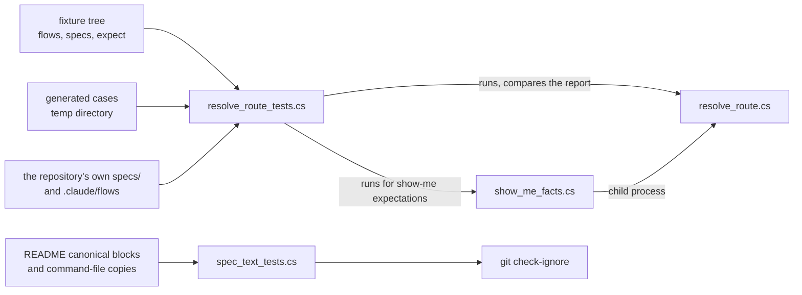
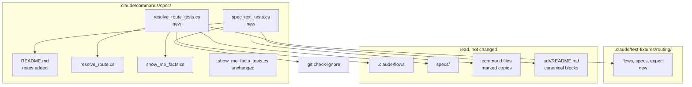

# 92. Routing Fixtures and Test Scripts

Date: 2026-11-04

## Status

Accepted

Implements part of [issue #4661](https://github.com/BrighterCommand/Brighter/issues/4661). Supersedes no prior ADR. This decision is about the project's own agent tooling, not its runtime. [ADR 0089](0089-slips-resolver-and-routing.md), [ADR 0090](0090-approval-sub-flows.md) and [ADR 0091](0091-slip-creation-tamper-detection-and-route-change.md) are its siblings. *Where this ADR sits* says what each ADR decides.

## Context

0089, 0090 and 0091 put the routing logic in one resolver and leave instructions, templates and shell steps copied into many command files. Each names what a test must prove and leaves the tests to this ADR. Its inputs are the *What 0092 needs from this ADR* sections of 0090 and 0091, 0089's *How each command consults the resolver*, and the `--all` size rule in 0089's *The route report*. FR-24 leaves the names and layout to this ADR.

### Terms

These words have the meanings given in [requirements § Definitions](../../specs/0040-routing-slips/requirements.md#definitions): **flow**, **flow definition**, **slip**, **gate**, **approval table**, **intent marker**, **stray marker**, **ignored marker**, **legacy spec** and **primary fixture directory** (FR-6). These are defined in [0089 § Terms](0089-slips-resolver-and-routing.md#terms): **route report**, **record line**, **route instructions** and **closing instructions**. **Message template** is the term of 0089 *How each command consults the resolver*. **Creation record** is a requirements term. 0090 defines **sub-flow instructions** and **provenance commands**. 0091 defines **installation steps** and **route-change log**. This ADR introduces these words:

- **Fixture root**: `.claude/test-fixtures/routing/`.
- **Case**: a tracked spec directory under `{fixture root}/specs/`.
- **Expectation**: one JSON file under `{fixture root}/expect/` that names one resolver or show-me run and the parts of its output to assert (*Expectations*).
- **Generated case**: a spec directory that `resolve_route_tests.cs` writes into a temporary directory at run time and deletes afterwards.
- **Text block**: a canonical text in a README, or a copy of it in a command file, wrapped in block markers (*Text blocks*).

### Scope

**Parent requirement**: [specs/0040-routing-slips/requirements.md](../../specs/0040-routing-slips/requirements.md)

**In scope**:

- FR-24 and AC-47: the resolver test script, the fixture layout, every fixture class, and the existing-specs check (AC-4).
- FR-25 and FR-28, test side: the `light` and `bugfix` fixture definitions and their cases (AC-8, AC-12, AC-15, AC-21, AC-54 to AC-62, AC-73, AC-78, AC-84, AC-89). AC-1 is checked by *Repository checks*. AC-63 is proved by the `bugfix` fixture commit's empty diff (step 5). AC-48 is proved by the `light` commit's empty diff and, for the ACs that cite FR-25, by the resolver rows and the hand items in step 10.
- FR-23, test side: show-me's route probe on finished `light` and `bugfix` cases (AC-45, AC-62, ledger side). AC-46 and NFR-6: `show_me_facts_tests.cs` and `.claude/test-fixtures/show-me/` are not edited.
- FR-26, the parts 0089 hands here: how to run the tests, and FR-28's four migration differences (AC-64).
- NFR-4 (AC-51), 0089's `--all` size assertions, NFR-1 and NFR-3 (AC-7).
- The text comparisons that 0089, 0090 and 0091 hand forward, the gate ladder's five rows, the provenance pattern, and 0091's ignore check.
- Not shipping a fixture gate or a fixture sub-flow command (0090 leaves that choice here).
- The canonical-text order the siblings' steps follow: 0089 step 9 writes the canonical route instructions, closing instructions and message templates before 9.1, and 0090 step 1 writes `.claude/commands/adr/README.md` with the first `/adr:*` copies.

**Out of scope**:

- Command prose that no resolver run reaches is verified by hand. The sibling ADRs' steps (0090 step 7 and 0091 step 6) cover `/spec:route`'s ladder, `/spec:new`'s naming and ADR approval. This ADR's last step covers show-me's reconciliation line and Inputs-used row (AC-45), and the command side of AC-12, AC-16, AC-18 and AC-59.
- Every format, rule, field and message the tests assert. Those belong to the sibling ADRs, and this ADR does not restate them.

### Where this ADR sits

| ADR | Decides |
| --- | --- |
| 0089 | The slip and approval-table formats, the route resolver and its report, and how commands consult it |
| 0090 | How a command runs a sub-flow (approval is the first trigger), the provenance line, the gate run contract, the `/adr:*` commands that carry the `design` sub-flow, and the README's notes on running a sub-flow and on the provenance line |
| 0091 | How a slip is installed and frozen at creation (`/spec:new`'s copy and record, numbering, the starter contract), how tampering is detected, how a route is changed, and the README's notes on the route-change command and the starter checklist |
| **0092** *(this one)* | The resolver's and show-me's fixture tests, the text-comparison script, the fixture flow-definition directories, and the README's notes on running the tests and on a `/bugfix:*` migration |

*"A spec's route is data it carries; commands ask the resolver, not themselves, where it is going."*

### Copies and routes drift with nothing to catch them

The resolver decides every route, but a command is prose. Eight commands carry the same route instructions, five carry the same closing instructions, and dozens carry the same message templates. Nothing but a person reading both files notices when one copy changes and another does not. The resolver itself has the opposite problem: it is code, but its answers are only as trustworthy as the fixtures that show it routing a legacy spec, a tampered slip and a flow nobody has written yet. This ADR makes both kinds of drift fail a script.

### The forces

- **Only executable logic can be tested** (Constraints). The resolver can be run. A command's prose can only be compared with its canonical copy.
- **`* text=auto` (`.gitattributes:2`)** stops a committed file from staying CRLF. Editors and hooks also strip BOMs and trailing whitespace.
- **A file-based app is one file.** Two scripts cannot share helper source without a project file (0089, *Why `show_me_facts.cs` runs `resolve_route.cs`*).
- **Adding a flow must not touch `.claude/commands/`** (AC-48, AC-63). The test scripts live there, as siblings of `show_me_facts_tests.cs`.
- **Legacy specs move.** A spec without `.flow` that is still in progress, such as 0039 or 0040 itself, gains markers. A pinned table of next steps would go stale.

## Decision

**Two framework-free scripts: one runs the resolver against tracked fixtures and generated edge cases, the other compares canonical texts with their marked copies. Every expectation about a flow's cases is a data file, so a flow adds fixtures and edits no script.**

### The mechanism, end to end



1. `resolve_route_tests.cs` first proves the resolver runs at all. It then runs the resolver (or, for a show-me expectation, `show_me_facts.cs`) for each expectation file, twice, and compares the named parts of the report with the expectation. It adds the generated cases, the existing-specs check, the size checks and the read-only check.
2. `spec_text_tests.cs` reads every canonical block in a README and every marked copy in a command file, and fails when a copy differs. It also pins the gate ladder and the provenance pattern and runs the ignore check.
3. Each script prints one `FAIL` line per failed assertion and exits `1` if any failed.
4. A new flow adds fixture files and expectation files, and neither script changes.

### Where the pieces live



Dependencies point from a test to what it reads. Nothing reads a test script, and neither script reads the other.

### Key Components

#### The roles, and what each is responsible for

| Role | Type | Responsibilities | Responsibility classifier | Collaborators |
| --- | --- | --- | --- | --- |
| Resolver harness | `resolve_route_tests.cs` | Runs each expectation and generated case against the resolver, prints the FAIL lines and the exit status | doing | resolver, `show_me_facts.cs` |
| Expectation matcher | in `resolve_route_tests.cs` | Decides whether a report holds the parts an expectation names, and proves it can fail | deciding | expectation files |
| Feature oracle | in `resolve_route_tests.cs` | Computes the next step a legacy spec should have | deciding | `--all` output |
| Fixture tree | `.claude/test-fixtures/routing/` | Holds the flows, cases and expectations that a flow adds | knowing | harness |
| Text comparer | `spec_text_tests.cs` | Compares each marked copy with its canonical block | doing | registry, READMEs, command files |
| Registry | in `spec_text_tests.cs` | Knows which files must carry which block | knowing | text comparer |

#### The two scripts

Both are .NET file-based apps in `.claude/commands/spec/`, run from the repository root with no arguments:

```bash
dotnet run .claude/commands/spec/resolve_route_tests.cs
dotnet run .claude/commands/spec/spec_text_tests.cs
```

Each prints one `FAIL {check}: {message}` line per failed assertion and ends with `{n} check(s) passed.` or `{f} failed assertion(s) across {n} check(s).`. Each exits `0` only when nothing failed, otherwise `1` (AC-47). Neither runs in CI, as with `show_me_facts_tests.cs` (`README.md:750`).

| Script | Checks | Needs the resolver |
| --- | --- | --- |
| `resolve_route_tests.cs` | Every expectation; the generated cases; record integrity; the existing-specs check; `--all` size and NFR-4 timing; determinism and read-only checks; AC-1 | Yes |
| `spec_text_tests.cs` | Every text block; the tooling-fault message copies; the gate ladder rows; the provenance pattern; the ignore check | No |

#### The scripts' contracts

| Member | Input | Output | Error conditions |
| --- | --- | --- | --- |
| `resolve_route_tests.cs` | none; the working directory is the repository root | `FAIL` lines and a summary on standard output | exit `1` on any failed assertion, on a missing resolver (the pre-check FAIL) or on a missing fixture root |
| `spec_text_tests.cs` | none; the working directory is the repository root | `FAIL` lines and a summary on standard output | exit `1` on any failed assertion, a registered file that is missing, or a block that is missing, duplicated or unmatched |
| Expectation file | `run`, `flows`, `exit`, `report`, `show_me`, `ledger` (*Expectations*) | one pass or one `FAIL` | unreadable JSON, or an unknown top-level key, is a `FAIL` for that file |

#### The fixture tree

```
.claude/test-fixtures/routing/
  flows/                  primary: feature.flow (copy), light.flow, bugfix.flow, approvals.md
  flows-edited/           feature.flow with a hand-off detour added; approvals.md as primary
  flows-invalid/          feature.flow naming /spec:designx (R4); approvals.md with a duplicate
                          tasks row (R12 b) and a missing command (R12 c)
  flows-duplicate-entry/  feature.flow (copy); approvals.md with two tasks rows (R12 b)
  flows-spike-entry/      approvals.md: primary's rows plus `| spike | (empty) |`
  flows-rules/            one definition per rule (r00-malformed.flow … r16-name-mismatch.flow,
                          r15-detour-command.flow, r15-detour-return.flow); approvals.md
  specs/                  cases (below); each holds a README.md naming its purpose
  expect/                 {name}.json, one per expectation
```

- **Primary `approvals.md`** has entries for `requirements` and `tasks` (`(empty)`), `design` (the shipped row), `diagnosis` and `evaluation` (`(empty)`). It has no `spike` entry, so it is the missing-entry table of AC-74, and `flows-spike-entry/` is the identical table that has one.
- **`light.flow`** is FR-2's slip with `detour: /refactor:smells @ hand-off -> hand-off`. **`bugfix.flow`** is FR-28's table. Neither is in `.claude/flows/`.
- **Rule fixtures run in flow form** (`--definition {stem} --flows-dir …/flows-rules`), because 0089 step 4 builds `--definition` before `--spec` exists. Each file declares its own stem except `r16-name-mismatch.flow`. No spec case resolves against `flows-rules/`, so its markers never affect any case's intent-marker set.
- **No fixture gate or sub-flow command is shipped.** Every command a fixture names already exists: `/spec:*`, `/bugfix:triage`, `/bugfix:confirm`, `/refactor:smells` and 0090's `/adr:*`. The misspelt `/spec:designx` is the deliberately missing one. Gate and sub-flow contracts are covered by resolver states and text blocks.

Cases (tracked). Each case with a `.flow` holds a `.flow.record` written with the installation steps, apart from the tamper cases. A case whose flow has no definition in the flows directory (`unknown-flow`, `spike-step`, `evaluation-ready`, and `copy-invalid`, whose copy differs from every definition) has a hand-written CR-free `.flow`, and its record is written with installation steps 2 to 4 over that file:

| Group | Cases |
| --- | --- |
| Legacy `feature` | `legacy-nothing`, `legacy-requirements-approved` (empty marker), `legacy-design-approved` (free-text marker), `legacy-all-approved` (`tasks.md` all checked), `legacy-out-of-order` (`requirements.md`, `.design-approved`), `legacy-stray-ignored` (all three markers, `.code-approved`, `.confirm-approved`; added with `bugfix`) |
| `feature` with a slip | `feature-slip` (with `.requirements-approved`), `copy-invalid` (copy names `/spec:designx`, AC-70), `unknown-flow` (`# flow: retired`, AC-44) |
| `light` | `light-nothing`, `light-adr-list`, `light-design-approved`, `light-done` (`tasks.md` all checked) |
| `bugfix` | `bugfix-nothing`, `bugfix-diagnosed`, `bugfix-leftover-tasks`, `bugfix-confirmed`, `bugfix-tasks-written`, `bugfix-tasks-approved-only`, `bugfix-done` (`tasks.md` all checked) |
| Other kinds | `evaluation-ready` (AC-54: `/refactor:smells` produces `evaluation.md`, `/spec:approve evaluation` approves it), `spike-step` (kind `spike`) |
| Route records | `route-changed-light` (`light` slip and record, one log entry `feature -> light`, `.requirements-approved`, `.adr-list`, `.design-approved`: AC-36 and AC-90, read side), `tamper-b-record-only` (record `flow: light`, no `.flow`), `tamper-c-no-record`, `tamper-a-route-changed` (nothing approved, so its line stays short; a record that does not match its `.flow`, and a log whose last entry has a 200-character reason; its measured line length is recorded in its `README.md`, because the margin under 650 is small: 0091's `--all` line with `tampered` and a route change) |

#### Expectations

An expectation is one file, `expect/{name}.json`:

```json
{ "run": ["--spec", "bugfix-confirmed"], "flows": "flows", "exit": 0,
  "report": { "next": { "commands": ["/bugfix:confirm"] },
              "steps": [ { "name": "diagnosis", "approved": true },
                         { "name": "tasks", "artefacts_present": false,
                           "precondition": { "holds": true } } ] } }
```

- `run` holds the mode arguments. The specs root is always `{fixture root}/specs`.
- Because `dotnet run` exits `1` on a missing script or a compile error, the harness first runs `--definition feature` against `.claude/flows` and requires a `route-report:` line. If that fails it prints one FAIL, `the resolver did not run`, and skips every expectation. The same run also requires standard output to hold only record lines, and an extra line prints its own FAIL, `the resolver printed lines other than record lines`, without skipping the expectations. This is the first run, so if the script needs compiling it compiles here, and a warning printed only on a recompile shows as an extra line (0089). An expectation that expects exit `1` also requires empty standard output and no `route-report:` line, which a missing script does not distinguish on its own; the pre-check is what shows the script runs.
- `flows` names a directory under the fixture root. If it is absent, the shipped `.claude/flows` is used, which is how a shipped flow's own cases name it (0091 checklist C3, C9).
- `report` is **partial**: an object matches when every expected key is present and matches; an array matches when it has the same length and matches element by element; a scalar matches when it is equal. When the run exits non-zero there is no `report`.
- A show-me expectation uses `"show_me": "{case}"` and a partial `"ledger"`. The harness runs `show_me_facts.cs` with `--flows-dir`, then deletes or restores the ledger, as `show_me_facts_tests.cs` does.
- A top-level key other than `run`, `flows`, `exit`, `report`, `show_me` and `ledger`, or unreadable JSON, is a FAIL for that file. Keys inside `report` and `ledger` are matched partially.
- The harness runs every expectation twice and requires byte-identical standard output (AC-7, NFR-1).

**Adding a flow's cases adds files under the fixture root and edits neither script.** That is what keeps AC-48's and AC-63's diff over `.claude/commands/` empty. It also answers what 0091's checklist C9 means by "a resolver fixture test in 0092's layout".

#### Generated cases

`resolve_route_tests.cs` builds these under `Directory.CreateTempSubdirectory()` and deletes them in a `finally`. Most start as a copy of `feature-slip`. Their records, if any, are written by the harness. Any record the harness writes holds the SHA-256 of the LF content, computed with `SHA256` from the base class library.

| Case | Change | Asserted |
| --- | --- | --- |
| `gen-crlf` | `.flow` rewritten with CRLF, the copied record kept | not tampered, valid (AC-32) |
| `gen-bom` | UTF-8 BOM prefixed | case (a); R0 on line 1 |
| `gen-trailing-space` | one trailing space on a table row | case (a); valid |
| `gen-one-char` | one character of a command changed | case (a), `recorded_flow` `feature` |
| `gen-unreadable-record` | `sha256: nothex` | case (c) |
| `gen-name with spaces` | the directory name has spaces | valid, not tampered, `--spec` and `spec` exact |
| `gen-log-two` | log with two entries | `route_change` is the second |
| `gen-log-malformed` | log whose last heading is malformed | `route_change` `null` (`feature-slip` covers an absent log) |
| `.current-spec` roots | missing; zero bytes; whitespace only; `0099-gone`; a valid name | `current-spec-missing`, `-empty`, `-empty`, `-stale`, `ok` |
| no command tree | resolver started, by absolute script path, with a temporary working directory | exit `1`, empty standard output, no record line |

CRLF, the BOM and trailing whitespace are generated because a tracked file would not keep them (`* text=auto`, editors, hooks). The one-character change and the unreadable record are generated so that **every tracked record matches its `.flow`** except in the named tamper cases (`tamper-a-route-changed` and `tamper-b-record-only`; `tamper-c-no-record` has no record). A **record integrity check** asserts that invariant. It reads every tracked `.flow.record`, compares it with the SHA-256 of the case's CRLF-normalised `.flow` and with line 1's flow name, and on a mismatch prints a FAIL telling the author to re-run the installation steps.

#### Repository checks in `resolve_route_tests.cs`

- **Existing specs (AC-4).** The harness runs `--all` once over `specs/` with the shipped flows. For every directory with no `.flow`, its line must report `feature` from `default`, valid, with no `tampered`, no `stray_markers` and no `violations` key. Its `next` must equal what a small **feature oracle** in the harness gives. The oracle takes the first step whose marker is missing. If none is missing the result is the hand-off. Otherwise it is the producer when the artefact is missing (`.adr-list` counts only with a non-blank line), or `/spec:review {kind}` then the marker-writer when the artefact is present. `0036-universal-transport-conformance-tests`, `0031-test_naming_conventions` and `0028-box-provisioning-rdd-role-interfaces` are also pinned to the hand-off by name, so an oracle bug cannot hide them.
- **NFR-4 (AC-51).** That run happens after the pre-check has built the script, because NFR-4 counts from "once the resolver has been built". It should take under 10 seconds. A slower run prints a `WARN` line with the duration and does not fail the script, because wall-clock time varies with the machine. The size limits below do fail.
- **Size (0089).** In the same output, every `route-report:` summary line, prefix included and newline excluded, is at most 650 characters (the `route-current:` line is not a summary line, as 0089 words the limit), and the whole standard output is under 24,000. Both are asserted again over `specs/` with `--flows-dir {fixture root}/flows-invalid`. The line limit alone is asserted over `{fixture root}/specs` with `--flows-dir {fixture root}/flows`, which holds `tamper-a-route-changed`; that root is relative to the repository, as `specs/` is. The generated roots are in the system temporary directory, so their absolute paths are not real spec paths, and no size limit applies to them. The FAIL message gives the measured size and says the remedy (paging, retiring finished specs) is undecided (0089).
- **Read-only (NFR-3).** The harness hashes every file under the fixture root, `specs/`, and each generated root before and after the runs against it (show-me ledgers excluded) and requires them to be equal.
- **AC-1.** `.claude/flows/` holds `feature.flow` and `approvals.md`, and holds no `light.flow` or `bugfix.flow`. Other shipped flows are allowed, so a flow's own starter adds no edit here.
- **Matcher self-test.** Before any expectation runs, the partial matcher is given a known mismatch. If it reports none, the run fails, so the matcher is shown able to fail.

#### Text blocks

Each canonical text and each copy is wrapped in HTML-comment markers, after the `show-me:risk-step` precedent (`show-me.md:437`, `:504`):

```
<!-- routing-text:{id}:begin -->
…
<!-- routing-text:{id}:end -->
```

The text between the markers, with CRLF read as LF and nothing else normalised, must be identical to the canonical block. Templates sit in tables, so the canonical block for templates wraps the README's `| Template | Printed by | Text |` tables. Each command's `templates` block is a `| Template | Text |` table, and the test compares each Text cell with the canonical cell of the same Template name. Cells are split on `|` outside code spans, where a code span runs between backtick runs of equal length, as CommonMark defines it. Some template texts hold a lone backtick inside a double-backtick span (0091's *Route usage* and *Spec name*), so a parser that toggles on each backtick would merge cells. The parser self-test runs on those two rows.

`spec_text_tests.cs` holds a **registry**: each block id, its canonical file, and the files that must carry it. It also checks:

- each canonical block appears exactly once in its canonical file;
- each file that must carry a block has it exactly once, and each `templates` block holds exactly the templates the registry expects for that file;
- any other file under `.claude/commands/` that carries a block marker is compared too. This means a future flow's gate or starter is checked without a registry edit (0091 checklist C6, C7).

| Block id | Canonical file | Required copies |
| --- | --- | --- |
| `route-instructions` | `spec/README.md` | `spec/requirements.md`, `design.md`, `tasks.md`, `approve.md`, `review.md`, `implement.md`, `ralph-implement.md`; `adr/adr.md` |
| `closing-instructions` | `spec/README.md` | `spec/requirements.md`, `design.md`, `tasks.md`, `approve.md`; `adr/adr.md` |
| `installation-steps` | `spec/README.md` | `spec/new.md`, `spec/route.md` |
| `write-order` | `spec/README.md` | `spec/route.md` |
| `sub-flow-instructions`, `provenance-commands` | `spec/README.md` | `spec/approve.md` |
| `adr-selection-rule` | `adr/README.md` | `adr/accept.md`, `adr/retire-superseded.md`, `adr/report-approval.md` |
| `gate-run-contract` | `spec/README.md` | none (no gate ships) |
| `templates` | `spec/README.md`, `adr/README.md` | per template, below |

Template copies required, resolving the "Printed by" cells of 0089, 0090 and 0091 to files:

| Templates | Files |
| --- | --- |
| Next-step line | `requirements.md`, `design.md`, `tasks.md`, `approve.md`, `review.md`, `status.md`, `switch.md`, `new.md`, `route.md`, `adr.md` |
| Not on the route; Another producer | `requirements.md`, `design.md`, `tasks.md` |
| Step not on the slip; Another marker-writer; Artefacts missing; No usable entry; Sub-flow failed, questions; Sub-flow failed, actions; Step approved | `approve.md` |
| Phase not on the route; Step with no review criteria; No requirements step | `review.md` |
| No design step | `adr.md` |
| Ambiguous spec id; No spec matches | `switch.md` (`show-me.md` is not compared, as 0089 says) |
| Flow not usable; New spec failed; Start failed; Spec name; Spec exists; Spec ignored | `new.md` |
| Route usage; Route spec name; Route target not usable; Already on target; No reason; Route changed; Installation failed | `route.md` |
| Post-check | `route.md`, `new.md` |
| Supersession question | `adr/retire-superseded.md` |
| Report | `adr/report-approval.md` |
| Gate templates (four) | none (no gate ships) |

Further checks in `spec_text_tests.cs`:

- **Tooling-fault message.** The harness takes the quoted sentence out of the canonical route instructions and requires it, verbatim, in `status.md`, `switch.md`, `new.md` and `route.md`. These commands use the message without carrying the paragraph (0089, 0091).
- **Gate ladder.** The canonical `gate-run-contract` block's ladder has exactly five rows. Their Starting-state cells must equal 0090's, which the test pins. The resolver states for the five rows are expectations (*Coverage*).
- **Provenance pattern.** 0090's pattern is pinned in the test. Every `approved: ` line in the canonical `provenance-commands` block must match it. The `echo` line, with sample values substituted, must give a matching line. Lines with a 39-digit sha, an uppercase sha, an empty `artefacts=`, or a trailing space must not match.
- **Ignore check (0091).** `git check-ignore -q --no-index` exits `1` for `specs/9999-check ignore probe/.flow`, `.flow.record` and `route-changes.md`, and exits `0` for `specs/9999-probe.log/.flow`.

#### Harness, and duplication between the scripts

Each script is one file with its registry (for `spec_text_tests.cs`) at the top and its helpers in a marked `// Harness` region at the bottom. Neither calls the other. Three small helpers appear in both and are deliberately duplicated: a process runner that builds arguments with `ArgumentList`, a CRLF-to-LF reader, and the FAIL/summary reporter. Sharing them would need a project file, which 0089 and ADR 0072 rule out. They are under a hundred lines and change rarely. The hash and the oracle are only in `resolve_route_tests.cs`, and the block extractor and table parser are only in `spec_text_tests.cs`.

#### Coverage

| Requirement item | Where it is tested (R = `resolve_route_tests.cs`, T = `spec_text_tests.cs`) |
| --- | --- |
| FR-24: sibling script, no framework, pass count, FAIL lines, non-zero exit | R and T (*The two scripts*); a broken expectation, by hand (step 10, item 1) |
| AC-75 (shipped table: empty `requirements` and `tasks` sub-flows, the four `design` commands in order) | R `shipped-legacy-nothing` (no `flows` key; asserts `steps[].approval_subflow`) |
| AC-65 (`/spec:implement` fails naming `design` then `tasks`) | R `legacy-requirements-approved`, `hand_off.precondition` |
| FR-24: legacy at each stage, empty and free-text markers (AC-5) | R `legacy-nothing`, `legacy-requirements-approved`, `legacy-design-approved`, `legacy-all-approved` |
| FR-24: `feature` with `.flow` and record | R `feature-slip` |
| FR-24: `light` cases; `bugfix` cases; another flow-specific kind | rows FR-25 and FR-28 below; R `evaluation-ready` (AC-54) |
| FR-24: unknown flow name; nonexistent command | R `unknown-flow` (AC-44); `r04-unknown-command`, `copy-invalid` (AC-3, AC-70) |
| FR-24: zero steps; duplicate steps; last step not `tasks` | R `r01-no-steps`, `r02-duplicate-step`, `r13-last-not-tasks` (AC-3); also `r03`, `r05`, `r14`, `r16` (AC-3), `r06`, `r07`, `r08`, `r09` (AC-53), `r00-malformed` |
| FR-24: stray marker; ignored `.code-approved` | R `legacy-stray-ignored` (added with `bugfix`, step 5), `route-changed-light`; existing 0028 |
| FR-24: self-approval; step after hand-off | R `r10-self-approval` (AC-72), `r11-step-after-hand-off` |
| FR-24: kind with no entry; two entries for one kind | R `spike-step` on `flows` and on `flows-spike-entry` (AC-74); `legacy-nothing` on `flows-duplicate-entry`; R12 (c) on `flows-invalid` |
| FR-24: bad detour command or return point | R `r15-detour-command`, `r15-detour-return` (AC-85) |
| FR-24: whitespace-only `.current-spec` | R generated `.current-spec` roots |
| FR-24: out-of-order approval | R `legacy-out-of-order` (AC-43), `bugfix-tasks-approved-only` |
| FR-24: each gate state (FR-27); 0090's five ladder rows | R row 1 `bugfix-diagnosed` (AC-56, AC-59), row 2 `bugfix-leftover-tasks` (AC-89), row 3 `bugfix-confirmed` (AC-57), row 4 `bugfix-tasks-written` (AC-73), row 5 `bugfix-tasks-approved-only` and `bugfix-done`; T gate ladder |
| FR-24: tamper (a), (b), (c); CRLF only; directory name with a space | R `gen-one-char`, `gen-trailing-space`, `gen-bom`; `tamper-b-record-only`; `tamper-c-no-record`, `gen-unreadable-record`; `gen-crlf`; `gen-name with spaces` and existing `0021-Expose Unacceptable Message Window` |
| FR-24: every existing spec, with 0036, 0031 and 0028 | R existing-specs check (AC-4) |
| FR-25: status; design; approve; tasks; review | R `light-nothing`; `light-nothing` (AC-12, resolver side; command side by hand, step 10 item 5); `light-design-approved` (AC-21: the resolver's `next`, and the closing-instructions comparison for the printed line); `light-design-approved`; `light-adr-list` (AC-18, resolver side; command side by hand, step 10 item 5) |
| FR-25: implement/ralph; show-me; detours | R `light-done` (AC-15), `light-design-approved` (AC-8); `show-me-light-done` (AC-45); `light-done` (AC-84); `/spec:tasks` without `requirements.md` (AC-16), by hand, step 10 item 5 |
| FR-25: no file under `.claude/commands/` changes | the `light` fixture commit (step 5, AC-48) |
| FR-28: valid, commands resolve, `diagnosis` flow-specific, empty entry | R `definition-bugfix`, `bugfix-nothing` (AC-78) |
| FR-28: status, nothing present; `bugfix.md` present | R `bugfix-nothing`; `bugfix-diagnosed` (AC-59; command side by hand, step 10 item 5) |
| FR-28: gate reported; the three interrupted states | R `bugfix-nothing` `gates` (AC-55); ladder rows 2 to 4 above |
| FR-28: not on the route, other producer and marker-writer; no `requirements` or `design` step | R `bugfix-nothing` `known_kinds`, `approve_steps` (AC-58, AC-61) |
| FR-28: implement/ralph; show-me | R `bugfix-done`, `bugfix-tasks-approved-only` (AC-60); `show-me-bugfix-done` (AC-62) |
| FR-28: no file under `.claude/commands/` or `bugfixes/` changes | the `bugfix` fixture commit (step 5, AC-63) |
| 0091: legacy; `feature` edited, not tampered; logs | R `legacy-*`; `feature-slip` on `flows-edited` (AC-34); `gen-log-two`, `gen-log-malformed`, `feature-slip` |
| 0091: records hash the LF content; `--all` line with tamper and change | R integrity check and generator; `tamper-a-route-changed` under the size check |
| 0091: installation steps, write order, templates; ignore check | T blocks; T ignore check |
| 0089: route (8), closing (5), every template copy; `--all` size; NFR-4 | T blocks and tooling-fault message; R size (fails); R timing (AC-51: R prints a WARN, a person reads it) |
| 0090: sub-flow instructions, provenance commands, approver and `/adr:*` templates, ADR selection rule; pattern | T blocks; T provenance pattern |
| NFR-1, NFR-3 (AC-7) | R double runs and before/after hashes |
| NFR-6, AC-46 | `show_me_facts_tests.cs` unedited and passing (step 10, item 2) |

#### Where each type is touched

| Assembly | Type | Change |
| --- | --- | --- |
| `.claude/commands/spec/` | `resolve_route_tests.cs`, `spec_text_tests.cs` | **new** |
| `.claude/test-fixtures/routing/` | flows, cases, expectations | **new** |
| `.claude/commands/spec/` | `README.md` | the notes on running the tests and the `/bugfix:*` migration section; the siblings write the canonical blocks and their markers |
| `.claude/commands/adr/` | `README.md` | the ADR selection rule and `/adr:*` templates, written by 0090 step 1 |
| `.claude/commands/` | command files | marker comments around their copies, added by the sibling steps that write the copies |

These are deliberately **unchanged**:

- `show_me_facts_tests.cs` and `.claude/test-fixtures/show-me/` (NFR-6)
- `.gitattributes`
- `.claude/flows/` (AC-1)

### Technology Choices

#### Why the expectations are JSON files

The scripts live in `.claude/commands/spec/`, so rows written in code would put a flow's cases under `.claude/commands/` (AC-48, AC-63). Data files keep them out. *Alternative 5* records the cost.

#### Why block markers find the copies

The siblings say "identical copy" without saying how a copy is found. Marker comments follow show-me's precedent and let a future flow's copies be found without a registry edit.

#### Why some cases are generated and the helpers duplicated

*Generated cases* and *Harness, and duplication between the scripts* give the reasons.

### Implementation Approach

Numbered in commit order. Each resolver behaviour gets its expectation first. The expectation fails, and the sibling ADR's code commit makes it pass. No copy lands before its canonical block. A fixture commit never touches `.claude/commands/`.

1. **Behavioural, before 0090 step 1.** Add `spec_text_tests.cs` with its harness, block extractor, table parser (and its self-test), the ignore check, and the registry entries for `adr-selection-rule` and the `/adr:*` templates. The registry entries fail until 0090 step 1 lands the canonical text in `.claude/commands/adr/README.md` with the first copies (0090 step 1 writes it). The ignore check tests rules `.gitignore` already holds, so it is a guard that passes on landing.
2. **Behavioural, before 0089 step 3.** Add `resolve_route_tests.cs` with its harness, the `the resolver did not run` pre-check, the matcher self-test, the read-only check, and a bad-mode expectation (exit `1`, empty standard output). The pre-check and the bad-mode expectation fail until 0089 step 3 lands.
3. **Behavioural, with 0089 step 4, one rule at a time.** Add `flows-rules/{rule}.flow` and its `definition-{rule}` expectation before the rule's code. Add the primary `flows/` with `feature.flow` and `approvals.md` (including its `evaluation` entry), with `definition-feature`, `definition-nosuch` and `definition-bad-name`, then `flows-duplicate-entry/`, `flows-invalid/` and `flows-spike-entry/`.
4. **Behavioural, with 0089 step 5.** Add the legacy cases except `legacy-stray-ignored`, `feature-slip`, `copy-invalid`, `unknown-flow`, `evaluation-ready` and `spike-step`, the unknown-`--spec` expectation, and `shipped-legacy-nothing`, before `--spec` code. Add the existing-specs check in `--spec` form for 0036, 0031 and 0028.
5. **Behavioural, fixture-only commits, after step 4 (0089 step 5) passes.** Add `light.flow` and the `light` cases and expectations in one commit. Add `bugfix.flow`, the `diagnosis` entry (in the primary and the `flows-spike-entry/` `approvals.md`), the `bugfix` cases and `legacy-stray-ignored` in another. `git diff --stat HEAD~1 -- .claude/commands/ bugfixes/` is empty for each (AC-48, AC-63). If a row fails, adding the flow needed a resolver edit and the experiment of FR-25 or FR-28 has failed. Fix the resolver in an earlier commit and re-make the fixture commit on top of it, so the fixture commit is green with an empty diff.
6. **Behavioural, with 0089 step 6.** Add the generated `.current-spec` roots and the no-command-tree case. Move the existing-specs check onto `--all` over every spec. Add the size, timing and AC-1 checks.
7. **Behavioural, with 0091 step 1 (0089 step 7).** Add `flows-edited/` with its `feature-slip` expectation (AC-34), `tamper-a-route-changed`, `tamper-b-record-only`, `tamper-c-no-record`, `route-changed-light`, the `gen-*` cases and the record integrity check before `RouteRecordInspector`.
8. **Behavioural, with 0089 step 8.** Add `show-me-light-done`, `show-me-bugfix-done`, and a `show-me-legacy-all-approved` expectation (`has_requirements_step` true).
9. **Behavioural, the remaining text registry, before each copy.** Each registry row, and each file's expected template set, is added in the commit just before that file's copy lands. A row fails until its copy lands, and for a file that is new, until the file exists; that is the red-first state. 0089 step 9 writes the canonical route instructions, closing instructions and message templates before 9.1, and the rows for 0089's copies land just before 0089 steps 9.1 to 9.9. The approver templates land just before 0090 steps 3 and 4, and `route.md`'s and `new.md`'s templates just before 0091 steps 3 and 4. The expected template sets for `approve.md` and `new.md` are therefore registered in stages, each just before the commit that adds those copies (`approve.md`: 0089 step 9.6, then the sub-flow failure and no-entry templates before 0090 step 3, then Step approved before 0090 step 4, which adds the provenance line it describes; `new.md`: 0089 step 9.9, then 0091 step 4). The `sub-flow-instructions` row precedes 0090 step 3, and the `provenance-commands` row precedes 0090 step 4. Both are canonical after 0090 step 2. The first commit that writes templates into a README creates that README's `templates` block, and later commits add tables inside it. The installation steps and write order are canonical after 0091 step 2, so their entries precede 0091 steps 3 and 4. The tooling-fault message check for each file lands just before that file's copy (0089 steps 9.1 to 9.9, 0091 steps 3 and 4). The gate ladder check and the provenance-pattern check land with 0090 step 2. The provenance check first requires the `provenance-commands` block to exist, so that it cannot pass over zero lines.
10. **Documentation, then verification.** In `.claude/commands/spec/README.md` *Supporting scripts*, describe both scripts, how to run them, the fixture tree, and how a flow adds cases and expectations. Add a section recording FR-28's four migration differences as decisions for a later migration (AC-64). Then, by hand:
    1. Change one value in an expectation. The script prints a FAIL line and exits `1`. Revert (AC-47).
    2. `dotnet run .claude/commands/spec/show_me_facts_tests.cs` passes, and `git diff --exit-code {merge-base} -- .claude/commands/spec/show_me_facts_tests.cs .claude/test-fixtures/show-me/` is clean (AC-46).
    3. Both scripts pass on a CRLF checkout (`core.autocrlf=true`).
    4. Run `dotnet run .claude/commands/spec/show_me_facts.cs -- .claude/test-fixtures/routing/specs/light-done --flows-dir .claude/test-fixtures/routing/flows`, apply `show-me.md`'s row 8 and Inputs-used row 1 to that ledger by hand, and then delete the ledger. Row 8 prints the route line within FR-23's constraints, and row 1 reads `not available: not on this spec's route` (AC-45, command side). `/spec:show-me` itself cannot be pointed at a fixture directory, since only `show_me_facts.cs` takes `--flows-dir`.
    5. On a scratch branch, copy `light.flow` and `bugfix.flow` into `.claude/flows/`, add the `diagnosis` entry to its `approvals.md`, and copy `light-nothing`, `light-adr-list`, `light-design-approved` and `bugfix-diagnosed` into `specs/`, with their records. The `.adr-list` of `light-adr-list` and `light-design-approved` names an ADR that exists, for example `0092-routing-fixtures-and-test-scripts.md`. Select each case with `/spec:switch {case}` before running its command. Then check: `/spec:requirements` on `light-nothing` stops, says it is not on flow `light`'s route and names `/spec:design` (AC-12, command side); `/spec:tasks` on `light-design-approved` does not stop for a missing `requirements.md`, and its coverage cross-reference covers ADR decisions with no FR section (AC-16); `/spec:review` with no phase on `light-adr-list` reviews `design`, does not require `requirements.md`, leaves out *Connection to Requirements* and says the route has no requirements step (AC-18); `/spec:review` with no phase on `bugfix-diagnosed` names `diagnosis` and `/bugfix:confirm` (AC-59). Delete the scratch branch and the copies.

## Consequences

### Positive

- Every routing answer that 0089 to 0091 move into code is pinned by a fixture, and adding a flow's cases needs no script edit (FR-19 C9, AC-48, AC-63).
- Every marked copy is checked against one canonical text, including marked copies that future flows carry.
- Generated cases test exactly the bytes that git and editors would alter, and the tracked tree has one rule: every record matches.
- The existing-specs check follows legacy specs as their markers change, which keeps the Constraints' guard on `feature.flow` edits.

### Negative

- Command files and READMEs gain HTML-comment block markers. Agents read them as part of the file, so they are noise to the command's reader.
- Text comparison is exact. A reflowed line or a changed space fails the test until canonical and copy agree. That is intended, and it makes cosmetic edits slower.
- The feature oracle re-implements three rows of 0089's next-step ladder. The three pinned specs and the `legacy-*` expectations cross-check it.
- Expectation files are verbose JSON, and a partial match asserts only what the author wrote down. Review has to check that each expectation pins the fields its requirement names.
- The resolver runs about 150 times (each expectation twice, plus generated cases). At 0089's measured warm start of about 0.2 s that is an estimate of under a minute, plus the show-me runs; the first real run will say.
- A copy that never gets markers is not compared. Checklist items C6 and C7 depend on the author adding them, and only review catches an omission.
- Adding a flow to the primary `flows/` can change other cases' expectations: `bugfix.flow` makes `.confirm-approved` an intent marker, so `legacy-stray-ignored` reports it stray. A flow's commit carries those expectation edits with it.

### Risks and Mitigations

- **Risk: the `--all` budget fails as `specs/` grows** (estimate about 21,000 of 24,000). Mitigation: the FAIL line gives the measured size. The remedy is undecided (0089), and until it is chosen `route unavailable` keeps `/spec:status` usable.
- **Risk: the NFR-4 timing varies on a slow or busy machine.** Mitigation: it times a run made after the pre-check has built the script, and only warns, printing the duration so a one-off can be told apart from a trend. AC-51 is therefore checked by a human reading the WARN, not by the exit status.
- **Risk: a fixture record goes stale when someone edits a case's `.flow`.** Mitigation: the integrity check names the case and the fix before any expectation misreads it as tampering.
- **Risk: a copy loses its markers and stops being compared.** Mitigation: required copies are listed in the registry, so a missing block is a FAIL, not a skip.

## Alternatives Considered

### Alternative 1: One test script

One script would mix fast text checks with the slow resolver runs, so a README edit would wait for every resolver run. It would also need the resolver built before any text check could run. Two scripts match the two kinds of evidence.

### Alternative 2: Track every fixture, CRLF cases marked `-text`

A `-text` attribute keeps CRLF but not a BOM or trailing whitespace through editors and hooks. It also adds `.gitattributes` exceptions, and the tracked tree would hold deliberate mismatches, which weakens the integrity check.

### Alternative 3: Generate every fixture at run time

The cases would then exist only as code. They could not be read, `ls`-ed or run by hand with the resolver, and adding a flow's cases would mean editing the script, which breaks AC-48 and AC-63.

### Alternative 4: Ship a fixture gate and a fixture sub-flow command

They would put test-only commands in `.claude/commands/`, visible to every user as skills, to prove contracts that are prose. A prose contract can be checked by text comparison and by resolver states, not by running a command.

### Alternative 5: Expectations in code

Rows in the script, in the style of `show_me_facts_tests.cs`, give type checking. But every new flow would then edit a file under `.claude/commands/`, which AC-48 and AC-63 forbid.

## References

- Parent requirement: [specs/0040-routing-slips/requirements.md](../../specs/0040-routing-slips/requirements.md)
- Issue: [#4661](https://github.com/BrighterCommand/Brighter/issues/4661)
- [ADR 0089](0089-slips-resolver-and-routing.md): the report, rules R0–R16, modes and `--flows-dir`, the `--all` size rule, the texts to compare, and steps 3 to 11
- [ADR 0090](0090-approval-sub-flows.md): *What 0092 needs from this ADR*, the gate run contract, the provenance pattern and the template tables
- [ADR 0091](0091-slip-creation-tamper-detection-and-route-change.md): *What 0092 needs from this ADR*, the inspector table, the installation steps and write order, the checklist items C3, C6, C7 and C9
- [ADR 0072](0072-show-me-command-resolution-and-output.md): the file-based app and test-script conventions
- `.claude/commands/spec/show_me_facts_tests.cs`, `.claude/test-fixtures/show-me/`, `.claude/commands/spec/README.md:704-750`, `.gitattributes:2`
