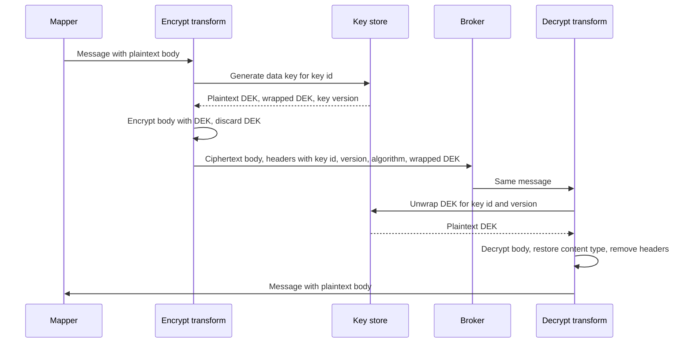

# 93. Encrypt the message body with a transform and a pluggable key store

Date: 2026-11-23

## Status

Proposed

## Context

A message leaves the process and is copied into an Outbox table, a broker, a dead-letter queue, a claim-check store, logs and traces. Each copy has its own retention and access rules. Personal data in the body is copied into all of them unless the body is protected before it leaves.

Teams solve this today inside each mapper, by hand. Brighter already has a place for cross-cutting changes to a message: the transform pipeline. It ships claim check, compression and CloudEvents transforms, but nothing that protects the payload. [Issue 4649](https://github.com/BrighterCommand/Brighter/issues/4649) asks for one and lists the design points. This ADR answers the ones a first cut needs and names the ones it leaves open.

### Terms

- **Data encryption key (DEK)**: a symmetric key used to encrypt one message body.
- **Key encryption key (KEK)**: a key held in a key store, identified by a key id and a version, that encrypts DEKs. It never leaves the store.
- **Wrapped DEK**: a DEK encrypted by a KEK. It is safe to send with the message.
- **Envelope encryption**: encrypt the data with a DEK, wrap the DEK with a KEK, and send the wrapped DEK with the data.

### Scope

In scope:

- A wrap transform that encrypts the whole body, and an unwrap transform that decrypts it.
- A key store abstraction, with an in-memory implementation for tests.
- The headers the receiver needs to decrypt.
- What happens when encryption or decryption fails.

Out of scope, each for a later ADR:

- Field-level encryption.
- A key per data subject chosen from the request (crypto-shredding).
- Key stores for AWS KMS, Azure Key Vault, GCP KMS and HashiCorp Vault.
- Caching of data keys.
- Tokenisation, format-preserving encryption and searching encrypted fields.

### The forces

- A call to a key service for every message is slow, rate-limited and billed per request.
- A message can sit in an Outbox or on a queue across a key rotation, so the receiver must decrypt with the key version the sender used.
- Sending plaintext because the key store was unreachable is worse than failing the send.
- A destroyed key is a permanent failure. An unreachable key store is a temporary one. The pump should not treat them the same way.
- Brighter targets `netstandard2.0`, where `System.Security.Cryptography.AesGcm` does not exist.
- Ciphertext does not compress, and a claim check stores whatever body it is given.

## Decision

**An `[Encrypt]` / `[Decrypt]` transform pair envelope-encrypts the whole message body. A key store wraps and unwraps the data key. Everything the receiver needs, except the key itself, travels in headers.**

```csharp
[Encrypt(step: 1, keyId: "orders")]
public Message MapToMessage(SensitiveOrder request, Publication publication) { ... }

[Decrypt(step: 1)]
public SensitiveOrder MapToRequest(Message message) { ... }
```

The names follow `[Compress]` / `[Decompress]`: they say what the transform does to the body. Encryption protects more than personal data, so the name does not mention PII.

### The mechanism, end to end



### Key store abstraction

The store wraps and unwraps data keys. It does not hand out the KEK. This is the shape of AWS KMS `GenerateDataKey` / `Decrypt`, Azure Key Vault `wrapKey` / `unwrapKey`, GCP KMS `encrypt` / `decrypt` and the Vault transit `datakey` endpoint, so each can implement it without a workaround.

```csharp
public interface IAmAKeyStore
{
    DataKey GenerateDataKey(string keyId);
    byte[] UnwrapDataKey(string keyId, string keyVersion, byte[] wrappedKey);
}

public interface IAmAKeyStoreAsync
{
    Task<DataKey> GenerateDataKeyAsync(string keyId, CancellationToken cancellationToken = default);
    Task<byte[]> UnwrapDataKeyAsync(string keyId, string keyVersion, byte[] wrappedKey, CancellationToken cancellationToken = default);
}
```

`DataKey` carries the plaintext DEK, the wrapped DEK and the key version that wrapped it. The split into sync and async interfaces follows `IAmAStorageProvider` / `IAmAStorageProviderAsync`.

### Headers

The transform writes to the header bag, as the compression transform does for the original content type:

| Header | Value |
| --- | --- |
| `encryption_algorithm` | The content encryption algorithm, for example `A256GCM` |
| `encryption_key_id` | The key id given to the transform |
| `encryption_key_version` | The KEK version the store used |
| `encryption_wrapped_key` | The wrapped DEK, base64 |
| `encryption_original_content_type` | The content type before encryption |

The body becomes `nonce || ciphertext || authentication tag` with content type `application/octet-stream`. The key id, key version and algorithm are passed as additional authenticated data, so a message whose headers were swapped fails authentication. The message id is not included, because a transport may assign a new one.

### Algorithms

| Name | Cipher | Targets |
| --- | --- | --- |
| `A256GCM` (default) | AES-256-GCM, 96-bit nonce, 128-bit tag | `net8.0` and later |
| `A256CBC-HS512` | AES-256-CBC with HMAC-SHA-512, encrypt-then-MAC | All targets, including `netstandard2.0` |

The names are the JOSE content encryption names from RFC 7518. On `netstandard2.0`, asking for `A256GCM` fails when the pipeline is built, with a message that names the alternative. A deployment that mixes .NET Framework and modern .NET services chooses `A256CBC-HS512` on the sender.

### Failure semantics

| Situation | Behaviour |
| --- | --- |
| Wrap: the key store fails or is unreachable | The exception propagates and the send fails. Nothing is sent in plaintext. |
| Unwrap: the message has no encryption headers | The message passes through unchanged, as `[Decompress]` does for an uncompressed body. This lets a consumer deploy `[Decrypt]` before its producers deploy `[Encrypt]`. |
| Unwrap: the key or key version does not exist, or the authentication tag does not verify | Permanent. The message is rejected. |
| Unwrap: the key store is unreachable | Temporary. The message should be deferred, not rejected. |

Today the pumps turn any exception from the unwrap pipeline into a `MessageMappingException` and reject the message as unacceptable. That is right for the permanent failures. It is wrong for an unreachable key store, where rejecting would dead-letter messages that are fine. The implementation has to let a transform signal a temporary failure through the mapping step. How to do that is the main open question below.

### Ordering with the other transforms

On wrap: compress, then encrypt, then claim check. On unwrap: the reverse. Compressing ciphertext gains nothing, and a claim check after encryption stores ciphertext in the luggage store. This ADR documents the order. It does not add a check that warns about a wrong order.

### Where the pieces live

| Assembly | Type | Role |
| --- | --- | --- |
| `Paramore.Brighter` | `EncryptAttribute`, `DecryptAttribute` | Declare the transform on a mapper |
| `Paramore.Brighter` | `EncryptPayloadTransformer` | Encrypt and decrypt the body; read and write the headers |
| `Paramore.Brighter` | `IAmAKeyStore`, `IAmAKeyStoreAsync`, `DataKey` | The key store contract |
| `Paramore.Brighter` | `InMemoryKeyStore` | Tests and samples; keeps keys in process memory |
| Later packages | One per cloud key store | Follow the claim-check store packages |

The cryptography comes from `System.Security.Cryptography` only. The core assembly takes no new dependency.

### Implementation approach

1. This ADR, as a draft pull request, to agree the shape.
2. The contract, the in-memory store and the transformer in core, with tests for round trip, tampering, a missing key, rotation across versions and both algorithms.
3. One cloud key store, in its own package and its own ADR. AWS KMS is the likely first, because the repository already runs LocalStack for tests.

## Consequences

### Positive

- Personal data in a message body is unreadable in every copy outside the two processes that hold key access.
- Key rotation does not break messages already in flight, because the version travels with the message.
- A key store call per message is a design choice of the store, not of the transform: a later caching decorator can remove it without changing the wire format.
- The wire format is described by headers, so a later ADR can add algorithms or field-level encryption without breaking existing messages.

### Negative

- With the whole body encrypted, nothing downstream can inspect or route on the content without the key.
- Each message carries a wrapped key and four more headers.
- Until data keys are cached, each message costs one key store call on send and one on receive.
- `netstandard2.0` consumers cannot read `A256GCM` messages.

### Risks and mitigations

- **Plaintext elsewhere.** Encrypting the body does not stop a handler, a log scope or a span attribute from recording the plaintext. The transform records no body content itself. Wider redaction is a separate concern.
- **Unencrypted pass-through.** A message without headers is accepted, so a misconfigured producer can send plaintext unnoticed. A later option could make `[Decrypt]` reject such a message.
- **The in-memory store used in production.** Keys in process memory are lost on restart and shared with nothing. The type's documentation says so.
- **Nonce reuse.** Each message gets a new DEK and a random nonce, so a nonce is never reused under one key.

## Alternatives Considered

- **The store returns the key (`GetCurrentKey` / `GetKey`), as sketched in the issue.** Simpler, but cloud key services are built so that the key does not leave them, and each message would be encrypted with the same long-lived key.
- **Field-level encryption first.** It keeps the message inspectable, but it ties the transform to the body format and needs a way to mark fields. It is the larger design and can build on the envelope and headers decided here.
- **One algorithm for all targets (`A256CBC-HS512` only).** One wire format, but it gives up the authenticated cipher that every modern target has built in.
- **A separate package for the transform.** It would keep cryptography out of core, but the claim-check and compression transforms live in core and this one adds no dependency.
- **Encrypt at the transport or the broker.** It protects the wire and the broker's disk, but not the Outbox, the dead-letter queue's readers or the claim-check store.

## Open questions

1. How should a transform signal a temporary failure during unwrap, so the pump defers and does not reject? Options: let `DeferMessageAction` pass through the mapping step, or add a specific exception the pumps recognise.
2. Do the encryption headers need a mapping to CloudEvents extension attributes in binary mode, and how should they travel in structured mode?
3. Should `[Decrypt]` have an option to reject messages that arrive unencrypted?
4. Are `[Encrypt]` / `[Decrypt]` the right names, or does the project prefer `[ProtectPII]` / `[UnprotectPII]`?

## References

- [Issue 4649](https://github.com/BrighterCommand/Brighter/issues/4649)
- [ADR 0003: Claim check](0003-use-claim-check-for-large-messages.md)
- [RFC 7518, section 5: content encryption algorithms](https://www.rfc-editor.org/rfc/rfc7518#section-5)
