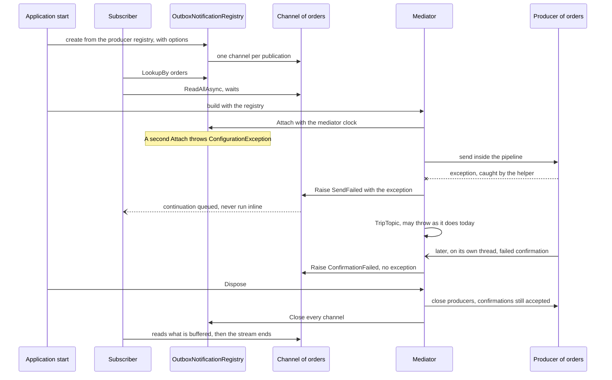
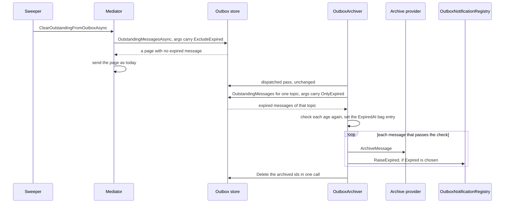
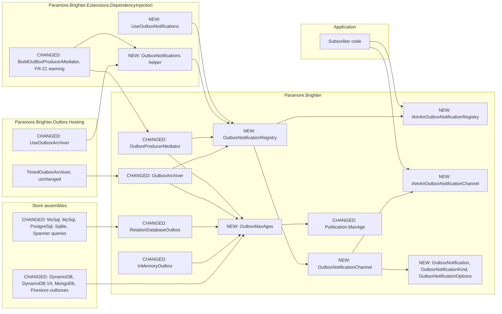

# 93. Outbox notifications and message max age

Date: 2026-11-05

## Status

Accepted

## Context

A send from the outbox can fail and nobody in the application hears about it: the mediator catches the exception, logs it, and `PostAsync` returns normally. A broker can also refuse a message later, on another thread, and a sent message can fail to be marked as dispatched. A sweeper retries an undispatched message for as long as the outbox keeps it, even after the message has lost its value.

### Terms

The requirements of spec 0041 define *clear*, *explicit clear*, *sweep*, *attempt*, *raise*, *kind*, *capacity*, *dropped count*, *max age*, *age*, *expired message* and *archiver run*. This ADR uses those words with those meanings, narrows *notification channel* to one publication, and adds four terms:

- Notification channel, as narrowed here: one bounded in-memory buffer of notifications for one publication, with its own dropped count.
- Stored topic: `MessageHeader.Topic`, the topic the outbox row holds.
- Lookup topic: the topic `Dispatch` uses to find a producer, `Message.ProducerLookupTopic()`.
- Notification registry: the object that holds the notification channels for one producer registry.
- Expiry bound: a pair of topic and max age that the mediator or the archiver passes to a store's outstanding query.

### Scope

Parent requirement: [specs/0041-outbox-failure-channel/requirements.md](../../specs/0041-outbox-failure-channel/requirements.md)

In scope:

- FR-1, FR-15, NFR-4: the builder step `UseOutboxNotifications` on the DI path, and a notification registry passed to the constructor on the direct path, turn the feature on. Without either, no registry exists.
- FR-2, FR-22, D-24: `OutboxNotificationOptions.Validate` rejects an invalid capacity or an empty set of kinds. The step calls it, and so does the registry's constructor.
- FR-3, FR-5, FR-6: the mediator raises at the sites listed in Implementation Approach. A new pair of private helpers carries the swallowed exception to the raise.
- FR-4, FR-7: no other site raises. Each raise comes before any code at its site that can throw.
- FR-8, FR-9, FR-10, NFR-5, NFR-6: each notification channel is a bounded channel from `System.Threading.Channels` in drop-oldest mode, with an exact dropped count.
- FR-11, FR-12, NFR-1, NFR-2, NFR-7: a raise is a guarded, non-blocking write. Readers' continuations never run on the raising thread.
- NFR-3: a successful clear reaches no raise, and with no max age the archiver makes no extra call.
- FR-13: the mediator closes the registry after it has closed its producers.
- FR-14, D-23: the registry creates one channel per publication, and the mediator routes each raise to the channel of the producer involved.
- FR-17, D-20: `Publication.MaxAge`. `OutboxMaxAges` reduces the publications to one max age per stored topic, the smallest.
- FR-18, D-14, D-22: a sweep passes the expiry bounds to the store's outstanding query, and each store leaves expired messages out of the page. DynamoDB's scan departs from FR-18 while a topic is tripped, as the table of open items records. An explicit clear passes nothing new.
- FR-19, FR-20, P-8, P-9: a second archiver pass reads expired messages one topic at a time, marks and archives each, and raises `Expired` after each one the provider accepts.
- FR-21, D-17: the DI build of the mediator writes one `Warning` per topic with a max age when no archiver is registered in the container.
- NFR-8: no listed interface gains a member. The binary breaks are trailing optional constructor parameters on `OutboxProducerMediator` and `OutboxArchiver`. NFR-8 lists binary breaks only. This ADR adds three behaviour lines under `#### Breaking changes`: two for third-party stores and one for causation replay.
- NFR-9, NFR-10: the mediator's clock times its raises and the drop warning. The archiver's clock times `Expired`. Each store applies the age with the clock it already uses for the minimum age.
- NFR-11, AC-40: the XML documentation, and the release notes that the documentation page builds on. The documentation advises running the archiver as well as the sweeper.
- Q-1 and Q-5: this ADR answers both. It confirms P-1 to P-5, P-8 and P-9, and changes part of P-7.

Out of scope:

- Which failures notify. FR-3 and FR-4 define that. Q-6 keeps open whether three kinds are enough.
- A reason on `PublishConfirmationResult`, a record ADR 0063-failed-delivery-context defined (OOS-11, Q-2).
- Which failures trip the breaker of ADR 0089-distributed-outbox-circuit-breaker (OOS-10).
- New instruments beside those of ADR 0084-outbox-metrics, ADR 0081-timed-outbox-sweeper-health-metrics and ADR 0085-outbox-stale-message-telemetry (OOS-8).
- A notification for a sweep that fails as a whole. The failed-sweep count of ADR 0081-timed-outbox-sweeper-health-metrics and the investigate check of ADR 0086-sweeper-remedy-health-checks report that.
- A count of waiting messages per topic, which ADR 0086-outbox-per-topic-stale-count provides. That count still includes expired messages.
- The archiver's lock and timer, which ADR 0056-timed-outbox-archiver-sync-fallback and ADR 0021-move-archive-from-esb describe. Neither changes.
- A notification for a successful send, including a sweep send (OOS-13).
- The page in BrighterCommand/Docs that NFR-11 asks for. It follows this ADR.

### What a failed or stale message does today

| What happens | What the mediator or archiver does today | What application code can see at the time |
| --- | --- | --- |
| A send throws, after the pipeline's retries | Logs, returns false, may trip the topic | Nothing. `PostAsync` returns |
| The broker refuses the message in a confirmation, usually on another thread | Logs, trips the topic | Nothing. On async Kafka the send looked successful |
| `MarkDispatched` throws after a good send | Logs | Nothing. A sweeper sends the message again |
| A message stays undispatched for hours | Every sweep tries it again | The stale gauge, if enabled, counts it |
| The archiver runs | Moves dispatched messages only | Nothing about undispatched messages |

A subscriber cannot tell a message that is too large from a broker outage, because the exception goes no further than the log.

### The forces

- A raise can happen on a request thread, on the sweeper's own thread, on a producer's confirmation thread or in an archiver run. Producers wait on their callbacks, so subscriber code must never run there.
- A subscriber can start before the mediator exists. The DI path builds the mediator lazily, on first resolve, and a hosted service starts earlier.
- `IAmAnOutboxProducerMediator` gains no member under NFR-8, and the DI path registers only that interface. A subscriber therefore cannot reach a channel through the mediator.
- `IAmProducersConfiguration` gains no member. The DI path ignores or replaces an application's own implementation of it when it builds the mediator (the mediator factory in `ServiceCollectionExtensions.AddProducers`).
- `Paramore.Brighter` also targets netstandard2.0, so the buffer and the dropped count can use only what exists there.
- `TripTopic`, a logger and the store can all throw on the same paths. Each of those exceptions keeps its current effect under FR-7.
- Producers report confirmations while they close, so a channel cannot close before the producers do.
- The stores order their outstanding query differently, and some read oldest first. An expired backlog must not fill a sweep's page or hide from the archiver.
- No outbox interface gains a member, so the expiry bound must travel through what `OutstandingMessages(Async)` already accepts.
- The archiver and the mediator are built separately, often in different assemblies of the application. They must route `Expired` to the same channels.

## Decision

**A registry built from the producer registry holds one bounded notification channel per publication, and messages older than their publication's max age go to the archiver instead of the sweep.**

The mediator raises failures into those channels without blocking, and changes no outcome. The archiver moves expired messages to the archive and raises `Expired` on the same channels. The registry is a separate object, so a subscriber can ask it for a channel by topic and optional CloudEvents type before the mediator exists. The max age is the one setting that changes what Brighter does, and it acts on the message, not on a notification.

| Decision point | Choice | Section |
| --- | --- | --- |
| How a subscriber reaches the channels | A notification registry built from the producer registry, before the mediator | Technology Choices |
| How a subscriber names a publication | Topic and optional CloudEvents type, as `ProducerRegistry.LookupBy` | Technology Choices |
| One read across all channels | Not offered. The registry lists its keys | Technology Choices |
| Which kinds are raised | A flags set on the options, all by default | Key Components |
| When a channel is full | Drop the oldest, count exactly, warn at most once per 60 seconds | Technology Choices |
| Where the max age lives | `Publication.MaxAge`, reduced per stored topic to the smallest | Key Components |
| How a store learns the bound | Two well-known keys in the query's `args` | Technology Choices |
| How the archiver finds expired messages | One query per topic, then a check in memory | Technology Choices |
| How an archived message shows it expired | A header bag entry with the time of the move | Key Components |
| How FR-21 sees the archiver | `IServiceProviderIsService` at the mediator's build | Technology Choices |
| When invalid options fail | At the step and at the registry's construction. No validation finding | Technology Choices |

### The mechanism, end to end

The failure path:



The max age path:



Four rules hold at the mediator's raise sites:

| Rule | What it protects |
| --- | --- |
| A raise never throws, because the channel guards it end to end | A clear's outcome stays the same as with the feature off |
| A raise comes before any code at its site that can throw | A throwing `TripTopic` or logger cannot suppress the notification |
| On a confirmation, a catch raises only if the result reported success | A failed confirmation whose `TripTopic` throws raises once |
| A raise that is the last statement of a `try` cannot reach its catch | A failed `MarkDispatched` on a confirmation raises once |

A raise first checks the kinds the options chose. A kind left out returns at once, allocates nothing and counts nothing. A raise of a chosen kind ends in one of three states: delivered, still buffered, or counted as dropped. The buffer drops its oldest notification when full. After a close, the raise itself is discarded. Both cases add 1 to the dropped count.

`Expired` goes to a channel by these rules, in order:

| Step | The archiver looks for | Result |
| --- | --- | --- |
| 1 | The key of the message's lookup topic and `MessageHeader.Type`, the key the mediator's `Dispatch` finds | That publication's channel, the one `Dispatch` would send through |
| 2 | Publications on the message's stored topic, `MessageHeader.Topic`, whose own max age equals the age applied to that topic | The first such key in ordinal order of its text, `topic:type` |

Step 2 always finds a channel when the archiver's producer registry is the one the notification registry was built from. A message is expired only if a publication on its stored topic sets the age applied, so such a publication always exists. With another producer registry, which the direct path allows, step 2 can find no channel, and then the archiver raises nothing. A send routed by `RequestContext.Destination` has no request context at the archiver, so its `Expired` follows the same two steps.

`Expired` tells the subscriber that the archiver moved the message and that later sweeps leave it out. It does not prove the message was never sent. A sweep checks the age only when it reads its page. A send from that page, retries included, can still reach the broker after the archiver moved the row.

### Where the pieces live



The dependencies point inward to the core. The mediator and the archiver know the registry, and the registry knows neither. Stores know `OutboxMaxAges`, and the relational dialects also implement `IRelationalDatabaseOutboxExpiryQueries`. Transports and the sweeper have no dependency on any new type.

### Key Components

#### The roles, and what each is responsible for

| Role | Type | Responsibilities | Responsibility classifier | Collaborators |
| --- | --- | --- | --- | --- |
| Reports one failure or one expired message | `OutboxNotification` (core) | Holds id, topic, kind, exception and time | knowing | `OutboxNotificationKind` |
| Names what happened, and the set of kinds chosen | `OutboxNotificationKind` (core) | One flag per kind, combinable for the set | knowing | None |
| Holds the feature's settings | `OutboxNotificationOptions` (core) | Capacity and kinds, with their validation | knowing | `ConfigurationException` |
| Lets a subscriber read one publication | `IAmAnOutboxNotificationChannel` (core) | Yields notifications, reports the end, the key and the dropped count | doing, knowing | `OutboxNotification` |
| Holds one publication's notifications | `OutboxNotificationChannel` (core) | Filters kinds, bounds the buffer, counts drops, limits the drop warning, closes | doing, knowing, deciding | Bounded channel, `TimeProvider`, logger |
| Lets a subscriber find a channel | `IAmAnOutboxNotificationRegistry` (core) | Lists keys, looks a channel up by topic and type | knowing | `IAmAnOutboxNotificationChannel` |
| Owns the channels of one producer registry | `OutboxNotificationRegistry` (core) | Creates a channel per publication, accepts one mediator, routes `Expired`, closes | doing, deciding | Producer registry, `OutboxNotificationChannel` |
| Gives each stored topic its max age | `OutboxMaxAges` (core) | Reduces publications to the smallest age per topic, names the query keys | knowing | `Publication` |
| Observes failures and decides their kind | `OutboxProducerMediator` (core) | Raises at each site, passes the expiry bounds to a sweep's query | deciding, doing | Notification registry, `OutboxMaxAges` |
| Moves dispatched and expired messages | `OutboxArchiver` (core) | Reads expired messages per topic, checks and marks them, archives each, raises `Expired` after each, then deletes the archived ones | doing, deciding | Store, archive provider, notification registry |
| Applies the bound in a query | Each outbox store | Leaves expired messages out, or returns only them | doing | `OutboxMaxAges` |
| Turns the feature on in a container | `UseOutboxNotifications` (DI) | Validates options, registers one registry per container | doing | `IBrighterBuilder` |

The mediator alone decides which kind a failure is. The channel alone decides what happens to a notification afterwards. `OutboxMaxAges` alone decides which age a topic has, so the sweep, the archiver and every store agree.

#### `Publication.MaxAge`

```csharp
public TimeSpan? MaxAge { get; set; }
```

| Member | Input | Output | Error conditions |
| --- | --- | --- | --- |
| `MaxAge` | A `TimeSpan`, or null | The age after which a sweep leaves an undispatched message on this publication's topic out. Null, zero or negative means no limit | None. No value throws |

The mediator, the archiver and the registry read the property once, when each is constructed. A changed max age therefore takes effect after a restart, as `StaleMessageAge` does.

#### `OutboxNotificationKind`

```csharp
[Flags]
public enum OutboxNotificationKind
{
    None = 0,
    SendFailed = 1,
    ConfirmationFailed = 2,
    MarkDispatchedFailed = 4,
    Expired = 8,
    All = SendFailed | ConfirmationFailed | MarkDispatchedFailed | Expired
}
```

| Member | Input | Output | Error conditions |
| --- | --- | --- | --- |
| `SendFailed` | None | An attempt to send ended in an exception | None |
| `ConfirmationFailed` | None | The producer reported that the broker did not confirm the message | None |
| `MarkDispatchedFailed` | None | The send or the confirmation succeeded, and the outbox was not updated | None |
| `Expired` | None | The archiver moved an expired message to the archive | None |
| `None`, `All` | None | Only for a set of kinds. A notification never carries them | None |

A notification carries exactly one flag. The options carry a set of them.

#### `OutboxNotification`

```csharp
public sealed record OutboxNotification(
    Id MessageId,
    RoutingKey Topic,
    OutboxNotificationKind Kind,
    Exception? Exception,
    DateTimeOffset OccurredAt);
```

| Member | Input | Output | Error conditions |
| --- | --- | --- | --- |
| `MessageId` | None | The message, or `Id.Empty` when a confirmation carries no id | None |
| `Topic` | None | The message's stored topic, or `RoutingKey.Empty` when a confirmation carries none | None |
| `Kind` | None | One kind | None |
| `Exception` | None | The exception object, or null for `ConfirmationFailed` and `Expired` | None |
| `OccurredAt` | None | The time of the raise, from the mediator's `TimeProvider`, or the archiver's for `Expired` | None |

The record has a public constructor, so an application can build one to test its subscriber.

#### `OutboxNotificationOptions`

```csharp
public sealed class OutboxNotificationOptions
{
    public const int DefaultCapacity = 1024;
    public const int MaxCapacity = 1_048_576;
    public int Capacity { get; set; } = DefaultCapacity;
    public OutboxNotificationKind Kinds { get; set; } = OutboxNotificationKind.All;
    public void Validate();
}
```

| Member | Input | Output | Error conditions |
| --- | --- | --- | --- |
| `Capacity` | 1 to `MaxCapacity` | The most undelivered notifications each channel holds | Checked by `Validate` |
| `Kinds` | A non-empty set of defined flags | The kinds raised. The default is `All` | Checked by `Validate` |
| `Validate` | None | Nothing | `ConfigurationException` naming `Capacity` and its value outside 1 to `MaxCapacity`, or naming `Kinds` and its value when it is `None` or has an undefined bit |

#### `IAmAnOutboxNotificationChannel`

```csharp
public interface IAmAnOutboxNotificationChannel
{
    ProducerKey Key { get; }
    long DroppedCount { get; }
    IAsyncEnumerable<OutboxNotification> ReadAllAsync(CancellationToken cancellationToken = default);
}
```

| Member | Input | Output | Error conditions |
| --- | --- | --- | --- |
| `Key` | None | The publication's topic and type, as the registry lists it | None |
| `DroppedCount` | None | The total dropped so far, readable at any time | None |
| `ReadAllAsync` | The reader's token | Notifications in raise order. The stream ends after the close, once the buffer is empty. The token cancels a wait on an empty buffer at once, and is checked before each notification is taken | `OperationCanceledException` from the reader's own token only. No exception at the end or after the close |

Several readers may read one channel. They compete, and each notification reaches one of them. A loop that ended because subscriber code threw can start again.

#### `OutboxNotificationChannel`

```csharp
public sealed class OutboxNotificationChannel : IAmAnOutboxNotificationChannel
{
    public int Capacity { get; }
    internal OutboxNotificationChannel(ProducerKey key, OutboxNotificationOptions options, Func<TimeProvider> clock);
    internal void Raise(Id messageId, RoutingKey? topic, OutboxNotificationKind kind, Exception? exception, DateTimeOffset occurredAt);
    internal void Close();
}
```

| Member | Input | Output | Error conditions |
| --- | --- | --- | --- |
| `Capacity` | None | The validated capacity | None |
| Constructor | Key, validated options, the registry's current clock | A channel with an empty buffer | None. The registry validated the options |
| `Raise` | The fields, with a null topic read as `RoutingKey.Empty` | Nothing for a kind not chosen. Otherwise written, or counted as dropped | None. Every exception is caught, and logged with its type only where the logger allows |
| `Close` | None | `TryComplete`. Buffered notifications stay readable. Safe to call more than once | None |

The constructor and `Raise` are internal, so a subscriber cannot write to a channel. The mediator and the archiver are in the same assembly as the channel.

#### `IAmAnOutboxNotificationRegistry` and `OutboxNotificationRegistry`

```csharp
public interface IAmAnOutboxNotificationRegistry
{
    IReadOnlyCollection<ProducerKey> Keys { get; }
    IAmAnOutboxNotificationChannel LookupBy(RoutingKey topic, CloudEventsType? type = null);
}

public sealed class OutboxNotificationRegistry : IAmAnOutboxNotificationRegistry, IDisposable
{
    public OutboxNotificationRegistry(IAmAProducerRegistry producerRegistry, OutboxNotificationOptions? options = null);
    public void Dispose();
    internal void Attach(IAmAProducerRegistry producerRegistry, TimeProvider timeProvider);
    internal OutboxNotificationChannel? ChannelFor(IAmAMessageProducer producer);
    internal void RaiseExpired(Message message, DateTimeOffset occurredAt);
    internal void Close();
}
```

| Member | Input | Output | Error conditions |
| --- | --- | --- | --- |
| `Keys` | None | One key per publication, topic and type | None |
| `LookupBy` | Topic, and a type or null for none | The channel whose key is the topic and the type, or `CloudEventsType.Empty` when null | `ConfigurationException` naming the topic and type when no publication has that key |
| Constructor | The producer registry, options or null for the defaults | A registry with one channel per publication, keyed as the producer registry finds it | `ArgumentNullException` for the producer registry. The `ConfigurationException` of `Validate` |
| `Dispose` | None | Calls `Close` | None |
| `Attach` | The mediator's producer registry and clock | Stores the clock for the drop warnings | `ConfigurationException` if a mediator already attached, or if a producer of the mediator has no channel |
| `ChannelFor` | A producer | Its channel, by reference | None. Null for an unknown producer |
| `RaiseExpired` | The archived message, the archiver's time | Raises `Expired` on the channel the routing table above picks | None. Guarded as `Raise` is |
| `Close` | None | Closes every channel | None |

The constructor reads the producers once and keeps the keys, so `LookupBy` still works after the mediator's `Dispose` has cleared the producer registry. For each producer it asks the producer registry which key finds it: first the publication's topic and type, then the topic alone. `ProducerRegistry.LookupBy` throws `ConfigurationException` for a key it lacks, so the probe catches that exception and compares the producer found by reference. A producer registry built from a dictionary of topics therefore yields keys with an empty type, as its own lookup does. When neither key finds the same producer, as a third-party producer registry may do, the constructor throws `ConfigurationException` naming the publication. Before `Attach`, the drop warnings use `TimeProvider.System`.

#### `UseOutboxNotifications`

```csharp
public static IBrighterBuilder UseOutboxNotifications(
    this IBrighterBuilder brighterBuilder,
    Action<OutboxNotificationOptions>? configure = null);
```

| Member | Input | Output | Error conditions |
| --- | --- | --- | --- |
| The step | Builder, an optional action on the options | The builder. Registers `IAmAnOutboxNotificationRegistry` as a singleton created by a factory over `IAmAProducerRegistry`. It does not register the class | `ArgumentNullException` for the builder. The `ConfigurationException` of `Validate`, before anything is registered |

When the step runs twice, the first call's options are kept, as `UseOutboxStaleMessageMonitor` does.

#### `OutboxMaxAges`

```csharp
public sealed class OutboxMaxAges
{
    public const string ExcludeExpiredArgsKey = "paramore.brighter.ExcludeExpired";
    public const string OnlyExpiredArgsKey = "paramore.brighter.OnlyExpired";
    public static OutboxMaxAges From(IEnumerable<Publication> publications);
    public IReadOnlyDictionary<RoutingKey, TimeSpan> ByTopic { get; }
    public bool IsEmpty { get; }
}
```

| Member | Input | Output | Error conditions |
| --- | --- | --- | --- |
| `From` | Publications | The smallest positive `MaxAge` per `Publication.Topic`. A publication with no limit does not lift a topic's age | `ArgumentNullException` |
| `ByTopic` | None | Topic to max age | None |
| `IsEmpty` | None | True when no publication sets a positive age | None |
| `ExcludeExpiredArgsKey` | None | The `args` key whose value, an `OutboxMaxAges`, asks a query to leave expired messages out | None |
| `OnlyExpiredArgsKey` | None | The `args` key whose value, an `OutboxMaxAges` with one topic, asks a query to return only that topic's expired messages | A store throws `ArgumentException` for more than one topic |

A message is expired when its `MessageHeader.TimeStamp` is earlier than now minus the age. An age equal to the max age is not expired. An age whose cutoff would fall before the earliest time the store can hold expires nothing. With `ExcludeExpiredArgsKey` that topic gets no bound, and with `OnlyExpiredArgsKey` the store returns an empty page without a query. A store compares the age with the time since that earliest time before it subtracts, so no age makes the subtraction throw.

#### `IRelationalDatabaseOutboxExpiryQueries`

```csharp
public interface IRelationalDatabaseOutboxExpiryQueries
{
    string ExpiredMessageFragment { get; }
    DateTimeOffset EarliestTimestamp { get; }
}
```

| Member | Input | Output | Error conditions |
| --- | --- | --- | --- |
| `ExpiredMessageFragment` | None | A predicate with two placeholders, the topic parameter and the cutoff parameter, over the dialect's topic and timestamp columns | None |
| `EarliestTimestamp` | None | The earliest time the dialect's timestamp column holds, such as 1753-01-01 for MsSql's `DATETIME` | None |

`RelationDatabaseOutbox` joins the fragments with `OR` and adds `AND NOT (...)` for `ExcludeExpiredArgsKey` or `AND (...)` for `OnlyExpiredArgsKey`. The fragment is NULL-safe for both columns. A row with a null topic or a null timestamp is never expired and stays in the sweep. Each dialect's queries class implements the role, as with `IRelationalDatabaseOutboxTopicCountQueries`. A queries class without the role, given a bound, makes the query throw `NotSupportedException`.

#### `OutboxArchiver` constructor and `Message.ExpiredAtHeaderName`

```csharp
public OutboxArchiver(
    IAmAnOutbox outbox,
    IAmAnArchiveProvider archiveProvider,
    IAmARequestContextFactory? requestContextFactory = null,
    int archiveBatchSize = 100,
    IAmABrighterTracer? tracer = null,
    InstrumentationOptions instrumentationOptions = InstrumentationOptions.All,
    IAmAProducerRegistry? producerRegistry = null,
    OutboxNotificationRegistry? notifications = null,
    TimeProvider? timeProvider = null);

public const string ExpiredAtHeaderName = "paramore.brighter.ExpiredAt";
```

| Member | Input | Output | Error conditions |
| --- | --- | --- | --- |
| `producerRegistry` | The producer registry whose publications set the max ages, or null | With null, or with no max age, the archiver's run does exactly what it does today | None |
| `notifications` | The same notification registry the mediator holds, or null | With null, expired messages are moved and nothing is raised | None |
| `timeProvider` | A clock, or null for `TimeProvider.System`. `UseOutboxArchiver` passes `TimeProvider.System`, as the mediator's build does | The time on `Expired` and on the bag entry, and the clock of the check in memory | None |
| `ExpiredAtHeaderName` | None | The header bag key the archiver sets on an expired message, valued with its time in round-trip `O` format | None |

#### `OutboxProducerMediator` constructor

One trailing optional parameter, `OutboxNotificationRegistry? notifications = null`, follows `outboxMeter`. The mediator reads the max ages from its producer registry whether or not the parameter is set.

#### Where each type is touched

| Assembly | Type | Change |
| --- | --- | --- |
| `Paramore.Brighter` | `OutboxNotification`, `OutboxNotificationKind`, `OutboxNotificationOptions`, `IAmAnOutboxNotificationChannel`, `OutboxNotificationChannel`, `IAmAnOutboxNotificationRegistry`, `OutboxNotificationRegistry`, `OutboxMaxAges`, `IRelationalDatabaseOutboxExpiryQueries` | New |
| `Paramore.Brighter` | `Publication` | `MaxAge` |
| `Paramore.Brighter` | `Message` | `ExpiredAtHeaderName`, and an internal `ProducerLookupTopic` moved from the mediator |
| `Paramore.Brighter` | `OutboxProducerMediator` | The trailing parameter, two private helpers, the raises, the close, the sweep's bound |
| `Paramore.Brighter` | `OutboxArchiver` | Three trailing parameters and the expired pass |
| `Paramore.Brighter` | `RelationDatabaseOutbox`, `InMemoryOutbox` | Read the two keys in the outstanding query |
| `Paramore.Brighter.Outbox.MsSql`, `.MySql`, `.PostgreSql`, `.Sqlite`, `.Spanner` | Each queries class | Implements `IRelationalDatabaseOutboxExpiryQueries` |
| `Paramore.Brighter.Outbox.DynamoDB`, `.DynamoDB.V4`, `.MongoDb`, `.Firestore` | Each outbox | Reads the two keys in the outstanding query |
| `Paramore.Brighter.Extensions.DependencyInjection` | `ServiceCollectionExtensions` | The step, a public helper that resolves the registry, one more positional argument, the FR-21 warning |
| `Paramore.Brighter.Outbox.Hosting` | `HostedServiceCollectionExtensions` | `UseOutboxArchiver` passes the three new arguments, with `TimeProvider.System` as the clock |
| `tools/Paramore.Brighter.Test.Generator` | Outbox templates | Two new templates, sync and async |
| `release_notes.md` | None | The feature, and the change of behaviour a max age brings. Under `#### Breaking changes`, two *(binary)* lines and three behaviour lines: a third-party relational dialect without the role, a third-party outbox that ignores `ExcludeExpiredArgsKey`, and causation replay. The behaviour line for the dialect says every archiver run then fails in its expired pass, after the dispatched pass. The line for replay says a replayed message older than its max age is left out of sweeps and archived as expired |

These stay unchanged:

- `IAmAnOutbox`, `IAmAnOutboxSync`, `IAmAnOutboxAsync`, `IAmAnOutboxProducerMediator` and its generic form.
- `IAmAMessageProducer` and its roles, `ISupportPublishConfirmation` and `ISupportPublishConfirmationAsync`, and `PublishConfirmationResult`.
- `IAmAProducerRegistry`, `ProducerRegistry` and `ProducerKey`.
- `IAmAnOutboxCircuitBreaker`, `IAmABrighterOutboxMeter`, `IAmABrighterTracer` and every instrument.
- `IAmProducersConfiguration` and `ProducersConfiguration`.
- `IAmAnArchiveProvider` and every archive provider.
- `IAmACausationTrackingOutbox` and `ReplayCausation` in every store. A replayed message keeps its `TimeStamp`, so a max age applies to it.
- `TimedOutboxSweeper`, `OutboxSweeper`, `TimedOutboxArchiver` and their options.
- Every store schema, and the order of every outstanding query.
- `BrighterPipelineValidationExtensions` and its validators.
- The outbox-write sites and the `Call` send, which keep the bool-returning helpers.
- The mediators the control bus builds. They receive no registry, so their failures do not notify.

### Technology Choices

#### Why a registry built before the mediator

A subscriber can start before the mediator exists, so it needs an object that does not depend on the mediator. The producer registry is that kind of object. It exists before the mediator and holds the publications. The notification registry builds its channels from it, so a subscriber that resolves the registry early reaches every channel. On the DI path that early resolve also builds the producer registry. The deferred `AddProducers` overload otherwise builds it at the first resolve of the outbox, the archiver or the mediator.

The step is on the builder and not on `ProducersConfiguration`. The DI path looks for a registered registry when it builds the mediator, whichever `AddProducers` overload ran. An application with its own `IAmProducersConfiguration` therefore gets the feature with the same step, and replacing that configuration cannot turn the feature off.

The step registers a factory and not an instance, so two containers built from one service collection get two registries. It registers only the interface. The default container disposes in reverse order of creation, and the mediator's build resolves the registry first. The container therefore disposes the mediator before the registry, and confirmations reported while producers close still reach an open channel.

#### How a subscriber names a publication

`LookupBy(topic, type)` uses the key `ProducerRegistry.LookupBy` uses, so a subscriber names a publication as the configuration already does. Typed publications on one topic have separate keys and separate channels. An unknown key throws `ConfigurationException`, which is what `ProducerRegistry` throws for the same mistake. `Keys` lets a subscriber read every channel without knowing the publications.

#### Why no read across all channels

A merged read would add API and define no order across channels, and FR-10 promises order only within one. Each channel already has its own capacity and dropped count, which is what one channel per publication is for. A subscriber that wants everything starts one loop per key. A merged read can be added later without changing this contract.

#### What a subscriber sees when the feature is off

There is no registry to see. On the DI path a constructor that takes `IAmAnOutboxNotificationRegistry` fails at resolve, with the container's normal exception, and `GetService` returns null. On the direct path the application has no object to hold. No read can end at once and look like a normal end.

#### How a waiting reader ends when no mediator was built

A reader has two ways out. One is its own cancellation token, such as a hosted service's stopping token. The other is `Dispose` on the registry, which closes every channel. On the DI path the container disposes the registry at teardown, after the host has stopped its hosted services. On the direct path the application that created the registry disposes it.

#### Why two mediators cannot share a registry

The second `Attach` throws `ConfigurationException`, so the second mediator's constructor fails. `Attach` is atomic: a call that throws leaves the registry as it was. Sharing would merge two mediators' dropped counts, and the first `Dispose` would close the channels under the second. A producer shared by two mediators with two registries raises on each registry's channel, as FR-14 expects. `Attach` also checks that each of the mediator's producers has a channel, which catches a registry built from another producer registry.

#### How the archiver receives the same channels

On the direct path the application passes the same registry to the mediator and the archiver. On the DI path a public helper, `ServiceCollectionExtensions.OutboxNotifications(IServiceProvider)`, resolves the interface. It returns the concrete registry, null when nothing is registered, and throws `ConfigurationException` naming any other implementation. The mediator's build and `UseOutboxArchiver` both call it, so both get the container's one registry. `UseOutboxArchiver` also passes `IAmAProducerRegistry`, resolved with `GetService`, so it is null without `AddProducers`. It passes `TimeProvider.System` as the clock, as the mediator's build does.

#### How FR-21 sees the archiver

`UseOutboxArchiver` registers `OutboxArchiver<Message, TTransaction>`. The mediator's build knows the transaction type, so it asks `IServiceProviderIsService` whether that closed type is registered. When the max ages are not empty and the answer is not yes, it writes one `Warning` per topic, naming it. A container without `IServiceProviderIsService` counts as no archiver, so the warning errs toward being written. The check runs at the mediator's build, so the order of the two steps does not matter.

#### Why validation happens at the step and at construction

`Validate` runs in the step, before anything is registered, so a DI application fails while it configures its services. It runs again in the registry's constructor, so the direct path fails no later than the mediator's construction. `ValidatePipelines()` adds no finding. The validator resolves the mediator when the validator is built (`BrighterPipelineValidationExtensions.ValidatePipelines`), so the constructor's exception comes first. With `ValidatePipelines()`, an invalid option stops the host at startup, whatever `throwOnError` says (AC-59). The step already fails earlier than any finding could.

#### How the sweep keeps expired messages out of its page

The mediator builds `OutboxMaxAges` once from its producer registry. When it is not empty, a sweep copies the caller's `args` and adds `ExcludeExpiredArgsKey`. The caller's dictionary is never changed, and an empty set of ages passes `args` exactly as today. An explicit clear reads by id and passes nothing new, so it sends an expired message.

Each store applies the bound where its order needs it:

| Store | Order | Where the bound applies |
| --- | --- | --- |
| MsSql, MySql, PostgreSql, Sqlite, Spanner | Oldest first in MsSql, newest first in the others | In SQL, beside the tripped-topic clause |
| `InMemoryOutbox` | Oldest first | In the query, on `MessageHeader.TimeStamp` |
| MongoDb | Oldest first | In the filter document |
| Firestore | Newest first | In memory, reading further pages until the page is full |
| DynamoDB, DynamoDB.V4 | Within a page or a shard | The scan: in the same `Where` as the tripped-topic filter. The query for one topic: in the key condition |

Firestore filters in memory, because that keeps the sweep's query free of a composite `OR` filter. Topics have different ages, so a page of the newest messages can hold only expired ones while an unexpired message of another topic waits further back. Firestore therefore keeps reading further pages until it has a full page of unexpired messages or reaches the end. D-22 names extra reads as a cost on DynamoDB only, so the change to P-7 records these.

DynamoDB's scan filters in the same `Where` that applies the tripped-topic filter. `ScanOutstandingIndexSegmentForMessages` already keeps scanning while no topic is excluded, a pagination token remains and the segment holds fewer messages than the page size. So the loop scans past expired messages until the page is full or the scan ends. With tripped topics it reads one scan page per segment and returns what is left, as it does today. Expired messages then take up room in that scan page. While the scan passes the backlog, a sweep can send fewer than its batch size, or nothing. The scan resumes from its saved position on the next sweep. FR-18's third bullet therefore holds on DynamoDB only while no topic is tripped. D-22 accepts extra reads, not a short page, so this departs from FR-18.

With `"Topic"` in `args`, `OutstandingMessagesForTopicAsync` queries each shard oldest first. A filter after the query would then fill pages with expired messages and leave later shards unread. On that path the bound goes into the key condition, since `OutstandingCreatedTime` holds `MessageHeader.TimeStamp`. `OnlyExpiredArgsKey` lowers the upper bound to the cutoff. `ExcludeExpiredArgsKey` adds the cutoff as a lower bound, through a `BETWEEN` expression beside `KeyTopicOutstandingCreatedTimeExpression`. `BETWEEN` includes both bounds, so the upper bound is one tick below the minimum age's limit and stays strict, as it is today. When the cutoff is not earlier than now minus the minimum age, the topic gets an empty page without a query. `GetShardNumber` can return a negative shard for a partition key. With `OnlyExpiredArgsKey`, the query therefore reads every shard from `-(NumberOfShards - 1)`, as `GetOutstandingMessageCountsByTopicAsync` does. Without that key it starts at shard 0, as it does today. The archiver always asks for page 1, as the mediator does, so it never relies on the paging state DynamoDB keeps per topic.

#### How the archiver finds expired messages

The archiver asks one topic at a time, with `OnlyExpiredArgsKey` holding that topic alone and with `dispatchedSince` of zero. It also passes `topic.Value` under `"Topic"`, the key DynamoDB and MongoDb already read for a per-topic query, and DynamoDB casts it to a string. The relational stores and `InMemoryOutbox` ignore `"Topic"`, and the single-topic bound restricts them. Their behaviour for an application that already passes `"Topic"` therefore does not change. Firestore adds an equality on the topic and a range on the timestamp. That needs a composite index on `IsDispatched`, `Topic` and `TimeStamp`, which the release notes name and the CI project needs (C-4).

The archiver then checks each returned message in memory, with its own clock: the stored topic and the age must match. A store that ignores the key returns messages that are not expired, and the check moves none of them. The store's clock and the archiver's clock agree by default, because both are the system clock or the same injected `TimeProvider`.

The archiver archives every message of the page that passes the check, raising `Expired` after each one the provider accepts. It then deletes the ids of the archived messages in one call, as the dispatched pass does. A message that fails the check stays in the outbox.

The archiver starts each run at the next topic in ordinal order, so one topic's backlog cannot starve the others. It then visits the topics in that order until it has moved its batch size of expired messages or has asked every topic. The batch size bounds the expired messages it moves in a run, apart from the dispatched pass.

#### When the age is measured, and by which clock

Each store computes the cutoff with the clock it already uses for the minimum age. The relational stores use `DateTimeOffset.UtcNow`, and `InMemoryOutbox`, DynamoDB, MongoDb and Firestore use their injected `TimeProvider`. A relational store whose column cannot hold the cutoff, such as MsSql's `DATETIME` for a huge age, treats that topic as having nothing expired. `OutboxMaxAges` describes this. The mediator passes ages, not cutoffs. The max age and the minimum age of one query therefore share one clock. Tests against the relational stores use stamps relative to the time they run. MsSql's `DATETIME` rounds to 1/300 of a second, so boundary tests keep a margin.

#### Why the expired marker is a bag entry

`MessageHeader.Bag` travels with the message to every archive provider, so no provider changes. The value is the time of the move, so a reader of the archive can tell when the message left. `AzureBlobArchiveProvider` stores the body only, so its archive does not carry the entry. Its tags can, with `TagBlobs` and a `TagsFunc` that reads the bag, and the documentation shows that.

#### Why the helper returns the exception

A new private pair, `TryExecuteWithResiliencePipeline` and `TryExecuteWithResiliencePipelineAsync`, holds the current bodies unchanged and returns the caught exception, or null. The bool helpers become one-line wrappers. The outbox-write sites and the `Call` send keep them, and their logs and checks stay as they are. An `async` method cannot have an `out` parameter, so a return value serves both helpers. It also keeps the raise at the site, where the kind and the id are known.

One case loses a notification. If the logger or `CheckOutstandingMessages` throws inside the helper's catch, the helper throws and the site never runs. That exception reaches the caller as it does today, so the failure is not silent.

#### Why capacity is 1,024, with a maximum of 1,048,576

The sweeper's defaults are 100 messages every 5 seconds, so one sweeper raises at most about 20 notifications per second. Against a broker that is down, that sweeper alone takes at least 50 seconds to fill 1,024 notifications. A failing `Post` raises at the application's rate, so the buffer can fill sooner. A notification keeps its exception, and capacity bounds the number of notifications, not their bytes. The maximum rejects a mistake such as `int.MaxValue`. It is not a recommendation.

#### Why drop the oldest

Waiting would block a publisher, which NFR-1 forbids. Dropping the newest would hide the failures happening now. The cost: with no sweeper, a dropped failure does not recur, and only the stale gauge can show its message. In the example of FR-9, a read after n1, n2 and n3 at capacity 2 returns n2 and n3.

#### How the dropped count stays exact on every target framework

| Path | Signal | Action |
| --- | --- | --- |
| The buffer is full | The `itemDropped` delegate of `Channel.CreateBounded`, called once per dropped item | `Interlocked.Increment`, then the rate-limited warning |
| The channel is closed | `TryWrite` returns false, which in drop-oldest mode has no other cause | `Interlocked.Increment`, with no log entry |

`DroppedCount` reads through `Interlocked.Read`, which is safe for a `long` in a 32-bit process. The core references `System.Threading.Channels` only for netstandard2.0, pinned at 10.0.12. net8.0, net9.0 and net10.0 use the shared framework. Each of those declares the `itemDropped` overload. The delegate runs on the raising thread after the bounded channel releases its lock, and the new item is already buffered. A slow or throwing logger therefore holds up no other writer and loses no notification. Test projects run on net9.0 and net10.0 only, so the netstandard2.0 and net8.0 targets rest on the documented API, not on a test run.

#### How the drop warning stays limited

The delegate reads the clock and compares it with the next permitted time, a `long` of ticks. It claims the slot with `Interlocked.CompareExchange`, so only one thread logs per interval. The interval is 60 seconds of `TimeProvider` time. The first drop always logs. The entry names the channel's key and the count, and nothing else. Nothing runs on a timer.

#### How FR-12 and the close hold

Each bounded channel has `AllowSynchronousContinuations = false`, so a reader's continuation is queued and never runs on the raising thread. `InMemoryJobChannel` in `Paramore.Brighter.Mediator` sets the opposite, so the setting is not copied from there. `SingleReader` and `SingleWriter` are false, because raises come from many threads and readers may compete. `ReadAllAsync` is its own iterator over `WaitToReadAsync` and `TryRead`. `ChannelReader.ReadAllAsync` checks its token only when the buffer runs dry, so a cancelled reader of a full buffer would go on. The interface does not expose `ChannelReader`, whose `ReadAsync` throws `ChannelClosedException` at the end.

The mediator closes the registry after its guarded `CloseAll`. A close is `TryComplete`, which cannot throw and can repeat. Neither `Close` nor `Dispose` waits for any reader.

#### Public names

`OutboxNotification`, `OutboxNotificationKind`, `OutboxNotificationOptions`, `IAmAnOutboxNotificationChannel`, `OutboxNotificationChannel`, `IAmAnOutboxNotificationRegistry`, `OutboxNotificationRegistry`, `UseOutboxNotifications`, `Publication.MaxAge`, `OutboxMaxAges` and `Message.ExpiredAtHeaderName` answer Q-5. The kinds are `SendFailed`, `ConfirmationFailed`, `MarkDispatchedFailed` and `Expired`. "Notification" covers `Expired`, which is not a failure. The `Outbox` qualifier keeps "channel" apart from a consumer's channel to a broker, as `Job` does in `IAmAJobChannel`. `MaxAge` avoids `TimeToLive`, which `AzureServiceBusPublication` uses for the broker. `InMemoryOutbox` also clears "expired" entries, which are dispatched entries past its own limit, and the documentation keeps the two apart.

#### How the open items resolve

| Item | Outcome |
| --- | --- |
| P-1 | Confirmed. The bounded channel adds no dependency, and the dropped count is exact on every target |
| P-2 | Confirmed: default 1,024, valid values 1 to 1,048,576 |
| P-3 | Confirmed: drop the oldest |
| P-4 | Confirmed: at most one `Warning` per 60 seconds of the mediator's `TimeProvider` |
| P-5 | Confirmed. A second reader competes and is not rejected |
| P-7 | Changed in part. Two `args` keys carry the bounds. The archiver passes `"Topic"` to every store, and only DynamoDB and MongoDb use it. Firestore applies the topic from `OnlyExpiredArgsKey`, and filters a sweep's page in memory, reading further pages until the page is full |
| P-8 | Confirmed: `paramore.brighter.ExpiredAt` in the header bag |
| P-9 | Confirmed: three trailing optional parameters on `OutboxArchiver` |
| Age clock | Each store's own clock. No cutoff computed by the caller |
| `Error` finding | None |
| Fallback channel | The publication on the stored topic with the applied age, first in ordinal key order |
| Changed max age | Takes effect after a restart |
| Q-1 sub-items | Answered in the sections above |
| Q-2 | Out of scope (OOS-11). `PublishConfirmationResult` is unchanged |
| Q-3 | Answered. The documentation covers a store TTL, and a max age shorter than the TTL gives `Expired` |
| Q-4 | Out of scope (OOS-8). No new instrument |
| Q-6 | Open. This ADR follows FR-4 and raises only the three failure kinds |
| Q-7 | Out of scope. A notification carries no trace context, and the subscriber reads the message by id |
| Q-8 | Open. This ADR follows D-10 and FR-3.2, so a failed `Call` confirmation notifies. On DynamoDB and Firestore a successful confirmed `Call` raises `MarkDispatchedFailed` (FR-3.3) |
| D-1 to D-24 | Stand, except that Firestore applies D-22's bound in memory, as the change to P-7 records |
| FR-18 | Stands, except on DynamoDB's scan while a topic is tripped: expired messages can take up room in its scan page, so the page can be short. The scan does this today for tripped topics |

### Implementation Approach

Each behavioural step starts with its failing tests, as `CONTRIBUTING.md` asks. Structural steps come first, in their own commits.

1. Structural. Move `GetProducerLookupTopic` to an internal `Message.ProducerLookupTopic()`, so the archiver can route `Expired` the way `Dispatch` looks up its producer.
2. Structural. Move the bodies of `ExecuteWithResiliencePipeline` and `ExecuteWithResiliencePipelineAsync` into the two `TryExecute` helpers. Leave the bool helpers as wrappers. The async wrapper awaits with `ConfigureAwait(continueOnCapturedContext)`.
3. Structural. In `src/Paramore.Brighter/OutboxArchiver.cs`, extract the dispatched pass of `Archive` and `ArchiveAsync` into private methods. The early `return` on an empty page in `Archive` then ends only that pass.
4. Add `OutboxNotificationKind`, `OutboxNotification`, `OutboxNotificationOptions`, the two interfaces, `OutboxNotificationChannel` and `OutboxNotificationRegistry`, with validation, keys, lookups, reads and close. `ChannelFor` uses a reference-equality comparer of its own, because netstandard2.0 lacks `ReferenceEqualityComparer`.
5. Add `notifications` after the `outboxMeter` constructor parameter, and a field beside `_outboxMeter`. In the constructor, call `Attach` before `ConfigureCallbacks`, so a rejected second mediator adds no callback to a shared producer. In `ConfigureCallbacks`, capture each producer's channel in its handlers. Call `Close` in a `finally` on the `try` around `CloseAll` in `Dispose(bool)`. `ControlBusSenderFactory` and `ControlBusReceiverBuilder` bind optional arguments and need no change.
6. Raise at the send sites, then the mark sites, then the confirmation sites, each as its own commit, as the table below lists.
7. Add the `itemDropped` count and the rate-limited `Warning`, with `LoggerMessage` entries. The channel's logger comes from `ApplicationLogging.CreateLogger<OutboxNotificationChannel>()`.
8. Add `Publication.MaxAge` beside `StaleMessageAge` (`src/Paramore.Brighter/Publication.cs`) and `OutboxMaxAges`, whose grouping by `Publication.Topic` follows `TimedOutboxStaleMessageMonitor.BuildTopicAges`.
9. In `BackgroundDispatchUsingAsync`, copy `args` and add the exclude key before the `OutstandingMessagesAsync` fetch when the ages are not empty.
10. Read both keys in `InMemoryOutbox.OutstandingMessages`, on `MessageHeader.TimeStamp`.
11. Add the generated templates under `tools/Paramore.Brighter.Test.Generator/Templates/Outbox/Sync` and `Async`, beside `When_Retrieving_Outstanding_Messages_It_Should_Filter_By_Age`. One excludes expired messages from a page, and one returns only a topic's expired messages. Each template also has a case with two topics of different ages. There, an expired backlog on one topic must not hide the other's unexpired message from a page (AC-56). Each also has a case with a huge age, and the DynamoDB run stores an expired message in a negative shard. The negative shard comes from a partition key whose hash gives a negative shard at the default three shards. The only-expired template passes `"Topic"`, as the archiver does. The exclude template has a case with `"Topic"`, so DynamoDB and MongoDb also run their per-topic path. Regenerate, and see them fail on every store before the stores change. Every store with a generated suite then runs both templates. `InMemoryOutbox` has none, so the Core tests of step 10 cover it. Never edit a generated file.
12. Add `IRelationalDatabaseOutboxExpiryQueries`. Compose its fragments in `RelationDatabaseOutbox` next to `GeneratePagedOutstandingCommandInStatementAndAddParameters`, into the same `{1}` slot. Take the cutoff from `DateTimeOffset.UtcNow`, as `CreatePagedOutstandingParameters` does. Create it with the dialect's `CreateSqlParameter(name, DbType.DateTimeOffset, cutoff)`, and the topic with `DbType.String`. MsSql's paged command holds `{1}` twice, so its fragment appears twice and one cutoff parameter serves both. A cutoff before the earliest time the column holds adds no fragment for `ExcludeExpiredArgsKey`, and gives an empty page for `OnlyExpiredArgsKey`. When no topic adds a fragment, the command gains no clause. Throw `NotSupportedException` without the role, as in `GetOutstandingMessageCountsByTopicAsync`. Implement the role in each of the five dialects' queries classes.
13. Read both keys in DynamoDB and DynamoDB.V4 beside the `"Topic"` read (`OutstandingMessagesAsync` in each `DynamoDbOutbox`). On the per-topic path, put the bound into the key condition, and keep the upper bound strict. With `OnlyExpiredArgsKey`, read the shards from `-(NumberOfShards - 1)`. Read both keys in MongoDb beside the `"Topic"` read in both `OutstandingMessages` and `OutstandingMessagesAsync` of `MongoDbOutbox`, and in Firestore's `FirestoreOutbox.OutstandingMessagesAsync`.
14. Add the archiver's parameters after `instrumentationOptions` in the `OutboxArchiver` constructor, and the expired pass after the dispatched pass. The pass queries one topic at a time, passing `topic.Value` under `"Topic"`, and checks each message in memory. It sets the bag entry and archives every message of the page that passes the check, raising `Expired` after each one the provider accepts. Then it deletes the ids of those messages in one call.
15. Add `UseOutboxNotifications` and the public `OutboxNotifications(IServiceProvider)` helper to `src/Paramore.Brighter.Extensions.DependencyInjection/ServiceCollectionExtensions.cs`, beside `TransformFactory`, the precedent for a public helper. Pass the registry after the `OutboxMeter(serviceProvider)` argument. Add the FR-21 check after the mediator's construction in `BuildOutBoxProducerMediator`.
16. In `UseOutboxArchiver` in `src/Paramore.Brighter.Outbox.Hosting/HostedServiceCollectionExtensions.cs`, pass the producer registry, the registry from the helper and `TimeProvider.System` to the archiver's constructor, as the mediator's build does.
17. Add the XML documentation and the `release_notes.md` entries: the feature, and the change of behaviour a max age brings. Under `#### Breaking changes`, add two *(binary)* lines and three behaviour lines: a third-party relational dialect without the role, a third-party outbox that ignores `ExcludeExpiredArgsKey`, and causation replay. The dialect line says every archiver run then fails in its expired pass, after the dispatched pass. The replay line says a replayed message older than its max age is left out of sweeps and archived as expired. The documentation advises running the archiver as well as the sweeper.

Every raise site of the mediator:

| Site | Kind | Today | Where the raise sits |
| --- | --- | --- | --- |
| `Dispatch`, confirming send | `SendFailed` | `sentToConfirmingProducer` false untracks the pending confirmation | Directly after the helper returns an exception, before the untrack |
| `Dispatch`, send | `SendFailed` | `sent` false, nothing trips | Directly after the helper returns an exception |
| `Dispatch`, mark | `MarkDispatchedFailed` | `marked` false | Directly after the helper returns an exception |
| `DispatchAsync`, send | `SendFailed` | `sent` false untracks the pending confirmation, then `TripTopic` in `if (!sent)` | Directly after the helper returns an exception, before the untrack and `TripTopic` |
| `DispatchAsync`, mark | `MarkDispatchedFailed` | `marked` false | Directly after the helper returns an exception |
| `BulkDispatchAsync`, send | `SendFailed`, per id | In `if (!sent)`, untracks each id, then `TripTopic` | In `if (!sent)`, before the untrack loop and `TripTopic`. One raise per `batch.Ids()`, with `batch.RoutingKey` and the same exception |
| `BulkDispatchAsync`, mark | `MarkDispatchedFailed`, per id | `marked` false | Directly after the helper returns, with the id and the stored topic |
| `HandleAsyncPublishConfirmation`, failure | `ConfirmationFailed` | Untracks, logs, then `TripTopic` | First statement of the `else` |
| `HandleAsyncPublishConfirmation`, mark | `MarkDispatchedFailed` | `marked` false untracks the pending confirmation | Last statement of the `else` of `marked`, after the untrack, which cannot throw. Nothing follows it in the `try` |
| `HandleAsyncPublishConfirmation`, catch | `MarkDispatchedFailed` | Logs | First statement of the catch, only when `result.Success` |
| `ConfigurePublisherCallbackMaybe`, failure | `ConfirmationFailed` | Untracks, logs, then `TripTopic` | First statement of the `else` |
| `ConfigurePublisherCallbackMaybe`, mark | `MarkDispatchedFailed` | `marked` false untracks the pending confirmation | Last statement of the `else` of `marked`, after the untrack, which cannot throw. Nothing follows it in the `try` |
| `ConfigurePublisherCallbackMaybe`, catch | `MarkDispatchedFailed` | Logs | First statement of the catch, only when `result.Success` |

Reading the table:

- A `TripTopic` that throws in the two callbacks, `BulkDispatchAsync` or `DispatchAsync` runs after the raise, so the notification already exists.
- The `GetPipeline` lookup in `ExecuteWithResiliencePipeline` and `ExecuteWithResiliencePipelineAsync` sits outside the helper's `try`. On a confirmation a missing pipeline reaches the catch and raises once. At a send site the exception reaches the caller, as today, and nothing raises.
- `CallViaExternalBus` and the outbox writes in `AddToOutboxAsync`, `AddToOutbox`, `EndBatchAddToOutbox` and `EndBatchAddToOutboxAsync` keep the bool helpers and raise nothing.
- The batch raise goes through one small mediator method with its own guard. Enumerating a third-party `batch.Ids()` or reading `batch.RoutingKey` can throw before the channel's guard applies.
- Every site first checks whether it has a channel, so a mediator with none builds no arguments.

The tests use the doubles of the requirements. `FakeTimeProvider` drives time, and the `CapturingLogger` family in `tests/Paramore.Brighter.Core.Tests/Observability/StaleMessages/TestDoubles` captures log entries. Tests that capture logs share one xUnit collection, because `ApplicationLogging.LoggerFactory` is process-wide.

| Test group | Project | Criteria | How it shows the behaviour |
| --- | --- | --- | --- |
| Off, options and kinds | Core, and `Paramore.Brighter.Extensions.AspNetCore.Tests` for the DI forms | AC-1, AC-2, AC-3, AC-55, AC-59 | `GetService` returns null with the feature off. The step and the constructor throw for a capacity of 0 and for `None` |
| Each site raises once | Core | AC-4 to AC-13, AC-18, AC-19 | One test per row of the site table, sync and async |
| Nothing else raises | Core | AC-14 to AC-17 | The FR-4 cases, with the existing exceptions asserted |
| Behaviour unchanged | Core | AC-20, AC-21 | The same script with a registry and with none, compared through counting doubles and captured logs |
| Delivery, order, full buffer | Core | AC-22 to AC-27, AC-35, AC-36, AC-38 | Real readers with bounded waits. A fake clock at T, T + 59 seconds and T + 60 seconds |
| Never blocks, shutdown | Core | AC-28 to AC-31 | A blocked reader, a producer double that raises from `Dispose` |
| Scope and routing | Core | AC-32, AC-33, AC-37, AC-57, AC-58 | Two mediators, single-role outbox doubles, two publications, typed publications |
| Success raises nothing | Core, DI | AC-43, AC-44 | A succeeding producer, sync and async, bulk and not, with a registry attached |
| Hosted | `Paramore.Brighter.Extensions.AspNetCore.Tests` | AC-34, AC-54 | A hosted reader before and after the mediator's resolve. The warning with and without `UseOutboxArchiver` |
| Max age on the sweep | Core | AC-45 to AC-48, AC-56 | `InMemoryOutbox` with a fake clock, bulk and not bulk |
| Archiver | Core, `tests/Paramore.Brighter.Core.Tests/Archiving` | AC-49 to AC-53 | Sync and async, with the single-role outbox wrappers there |
| Store queries | Generated tests per store | AC-50, AC-56 | The two new templates, in Docker where a container exists, and Firestore against the GCP project the CI uses |
| Content and documents | Core, and by reading | AC-39, AC-40 | Captured entries hold no body. A person reads the page |

Further tests pin decisions of this ADR:

- `LookupBy` with an unknown key throws `ConfigurationException`, and still works after the mediator's `Dispose`.
- A second mediator on one registry throws and adds no handler to a shared producer.
- A registry built from another producer registry makes `Attach` throw.
- `Dispose` on an unattached registry ends a waiting read.
- A token cancelled after the first read of a full buffer throws before the next notification is taken.
- An application with its own `IAmProducersConfiguration` receives notifications with the step.
- Two containers from one collection get two registries.
- A sweep with caller `args` leaves the caller's dictionary unchanged.
- A store double that ignores `OnlyExpiredArgsKey` leads the archiver to move and delete nothing that is not expired.
- An archiver run with several expired topics starts at a different topic on the next run.
- A second call of the step keeps the first options.

## Consequences

### Positive

- A subscriber reads failures with their exceptions, per publication, soon after they happen, on every outbox and both wiring paths.
- A max age gives a signal, `Expired`, and stops later sweeps from sending a message older than its max age.
- A burst on one publication cannot push another publication's notifications out.
- A forgotten step fails where the subscriber asks for the registry. It never looks like an empty stream.
- With no max age set, the mediator's outcomes, breaker trips and metrics stay as they are, and its logs gain only the drop warning.
- No outbox, producer or mediator interface gains a member, so third-party implementations keep compiling.
- The archiver's check in memory means it never archives a message that is not expired, even from a store that ignores the bound.

### Negative

- `OutboxProducerMediator` and `OutboxArchiver` gain trailing optional parameters, which breaks binary compatibility. Code compiled against the old constructors must be recompiled.
- A max age changes what Brighter sends, with or without notifications. The release notes list it as a change of behaviour.
- Without an archiver, expired messages stay in the outbox. They count toward `MaxOutStandingMessages`, so where that limit is set a `Post` can throw `OutboxLimitReachedException` (`OutboxProducerMediator.CheckOutboxOutstandingLimit`, C-3). They also stay in the stale gauge.
- With a max age set, the archiver also deletes undispatched rows, so it can contend with the sweep on the outbox table.
- `Expired` is at least once. A failed delete, or several instances without a distributed lock, repeats it.
- A notification keeps its exception, which can hold a message body on Kafka's sync path.
- A third-party relational dialect without the new role makes every sweep throw `NotSupportedException` once a max age is set. The sweeper then sends nothing from that outbox, and every archiver run fails in its expired pass, after the dispatched pass. `RelationDatabaseOutbox.GetOutstandingMessageCountsByTopicAsync` throws the same way without its role.
- A third-party outbox that ignores `ExcludeExpiredArgsKey` keeps sending expired messages from a sweep.
- A throw in the archiver's dispatched pass skips the expired pass for that run.
- One failure inside the helper's own catch loses its notification. Its exception still reaches the caller.
- A subscriber that resolves the registry early also builds the producer registry early.
- Channels are per process, so `Expired` reaches only the subscribers of the process whose archiver holds the lock for that run.
- An archiver built without a producer registry moves no expired message, while the sweep still leaves them out. The documentation says so (NFR-11).
- A provider that always throws on one message ends each archiver run that reaches it. The `Expired` of the messages archived before it then repeats on each such run. FR-20 allows the repeat, and the stale gauge shows the message.
- A max age on a reply publication has no effect, because a reply's topic is set per request.
- A max age at or below the sweeper's minimum message age means a send that failed is never tried again.
- Causation replay (`IAmACausationTrackingOutbox.ReplayCausation`) clears the dispatched state but keeps `TimeStamp`. With a max age set, a replayed message older than that age is left out of sweeps, and an archiver archives it as expired.
- `OutboxNotificationKind.Expired` and the `InMemoryOutbox` clean-up of old dispatched entries both use the word "expired".

### Risks and Mitigations

| Risk | Mitigation |
| --- | --- |
| A Firestore composite index is missing, so the archiver's query fails | The release notes and the Docs page name the index. The archiver's run fails and logs, as today, and the sweep is unaffected |
| While fewer than a page of unexpired messages wait, every Firestore sweep reads the whole expired backlog, one read per document, until the archiver drains it | The change to P-7 records the extra reads. The archiver drains the backlog at its batch size |
| A DynamoDB sweep reads past an expired backlog each time its scan passes the backlog. With a tripped topic, its page can hold fewer messages than the batch size | D-22 accepts the extra reads, and the short page departs from FR-18, as the table of open items records. The scan resumes from its saved position, and the archiver drains the backlog at its batch size |
| A store TTL shorter than the max age deletes an undispatched message before the archiver sees it, so no `Expired` is raised | The documentation advises a TTL longer than the largest max age on DynamoDB, Firestore and MongoDb |
| The archiver deletes undispatched rows and contends with the sweep | The batch size bounds each run, the delete is by id, and the sweep no longer reads those rows |
| An expired backlog after a long outage takes many runs to leave | The documentation states the rate, about 400 a minute at the defaults, and how to raise the batch size |
| Rolling deploys run two max ages at once | The documentation says a changed max age takes effect per instance at restart |
| The bag entry is not visible in an Azure blob archive | The documentation shows a `TagsFunc` that copies the entry into a tag |
| A send that outlives the max age reaches the broker after the archiver moved the row | The documentation advises a max age well above the time a sweep takes to send its page, retries included. On DynamoDB and Firestore, whose `MarkDispatched` throws for a missing row, `MarkDispatchedFailed` reports the case. The relational stores, MongoDb and `InMemoryOutbox` report nothing |
| A container without `IServiceProviderIsService` warns although an archiver is registered | The warning only writes a log entry. Microsoft's container provides the service |
| The netstandard2.0 and net8.0 paths are not executed by tests | The design uses only `Interlocked` and the documented `itemDropped` overload |

## Alternatives Considered

### A `Publication` instance as the lookup key

A subscriber would pass the `Publication` it configured. Few subscribers hold that instance, especially in a hosted service that starts before the configuration code runs. Topic and type are what the configuration states, and they match `ProducerRegistry.LookupBy`.

### `For<TRequest>()` by `RequestType`

A generic lookup by request type reads well, but a publication's request type is optional, and several publications can share one. Topic and type always identify one publication.

### A `ReadAllAsync` across all channels

A merged read needs more API and defines no order between channels. It would also undo the reason for separate capacities, since one reader would serve every publication. The registry lists its keys, and a merged read can come later.

### An `Error` finding in `ValidatePipelines()`

The validator resolves the mediator when it is built (`BrighterPipelineValidationExtensions.ValidatePipelines`), so the constructor's exception comes first. A finding would need that validator to change, and the step already fails earlier.

### A property on `ProducersConfiguration`

The DI path ignores or replaces an application's own `IAmProducersConfiguration`, so the feature would stay off in silence for that application. A builder step works with every overload.

### The mediator creates the channels and exposes them

A subscriber could not reach a channel before the mediator exists, and the mediator's interface cannot gain a member under NFR-8.

### One channel per mediator, or per topic

One channel per mediator makes every subscriber sort by publication and lets one publication's burst push out another's. One per topic merges typed publications that have separate producers (D-23).

### An empty, closed channel when the feature is off

A read that ends at once looks like a normal end, and hides a forgotten step.

### A .NET event, or a handler role

An event raised inline runs subscriber code on the raising thread, against FR-12. A handler role makes Brighter run subscriber code, with its own loop and exception handling.

### Exposing `ChannelReader`

`ReadAsync` throws `ChannelClosedException` at the end, against FR-13. It would also make the buffer's type part of the contract.

### An exception callback passed to the helpers, or the last exception in a field

A callback needs a closure at every site, including the successful ones. A field or an `AsyncLocal` is shared state that concurrent clears would overwrite.

### Raising from `TripTopic`

A synchronous send failure trips nothing, and no `MarkDispatched` failure trips (D-3).

### Counting drops without `itemDropped`

Comparing the count before and after a write races with other writers. The delegate is called once per dropped item.

### A constructor overload that keeps the old signature

Every later parameter would need another overload, and the type would carry two constructors.

### Registering the registry class as well as the interface

A second descriptor resolved after the mediator would be disposed before it, and close the channels before the producers.

### The mediator marks an expired message dispatched

The row would leave the pending set at once, but "dispatched" would then be false, and `Expired` would depend on a sweep reading the row (D-13).

### The sweep raises `Expired`

A sweep meets the same expired message every run until the archiver moves it, so it would notify every few seconds (D-15).

### Filtering expired messages in memory after every page

On a store that reads oldest first, an expired backlog larger than the page fills every page, and the sweep sends nothing newer on that topic (D-22). Firestore filters in memory but reads further pages until its page is full, so its page is never filled with expired messages.

### A `protected virtual` member on `RelationDatabaseOutbox`

The base class would read the earliest time from a member that MsSql overrides. The role keeps every dialect's expiry knowledge in one place, beside the fragment.

### A typed parameter beside `trippedTopics`

A parameter such as `maxAges` on `OutstandingMessages(Async)` would be typed, but it changes `IAmAnOutboxSync` and `IAmAnOutboxAsync`, so every outbox outside this repository stops compiling (NFR-8). The `args` keys reach every store through the signature it already has, as `"Topic"` already does for DynamoDB and MongoDb.

### An optional outbox role for the expiry queries

A role interface such as `IAmATopicCountingOutbox` adds a type per store and a test in the mediator and the archiver. The `args` keys reach every store through the methods it already has.

### A cutoff computed by the caller's `TimeProvider`

The relational stores use the system clock for the minimum age. A cutoff from another clock would let the two bounds of one query disagree.

### Reading `"Topic"` in the relational stores and `InMemoryOutbox`

An application that already passes `"Topic"` to those stores would see its sweep filtered. The single-topic bound restricts the archiver's query without that change.

### A new archive provider method for the marker

Every provider would change, and `IAmAnArchiveProvider` would gain a member (P-8).

### A new archiver type

Two archivers would need to stay in step, and `TimedOutboxArchiver` would need to choose between them (P-9).

### A `ConfigurationException` for a max age without an archiver

It rejects valid setups, such as an archiver in another process or one the application calls from its own job (D-17).

### Several kinds on one notification, or a second enum for the filter

A notification reports one thing, so one flag is enough. A second enum would repeat the four names.

### Validating only at the step

The direct path has no step, so the registry's constructor must validate too. The same `Validate` method serves both.

### Rejecting a second reader, or built-in fan-out

Rejecting needs reader tracking for no gain. Fan-out needs a buffer and a dropped count per subscriber, and an application can fan out itself (P-5).

## References

- Parent: [specs/0041-outbox-failure-channel/requirements.md](../../specs/0041-outbox-failure-channel/requirements.md)
- Related ADRs:
  - ADR 0084-outbox-metrics
  - ADR 0085-outbox-stale-message-telemetry
  - ADR 0086-outbox-per-topic-stale-count
  - ADR 0086-sweeper-remedy-health-checks
  - ADR 0089-distributed-outbox-circuit-breaker
  - ADR 0063-failed-delivery-context
  - ADR 0081-timed-outbox-sweeper-health-metrics
  - ADR 0056-timed-outbox-archiver-sync-fallback
  - ADR 0021-move-archive-from-esb
  - ADR 0053-pipeline-validation-at-startup
  - ADR 0064-validate-pipeline-assembly-and-provider-registration
  - ADR 0035-generated-test
- External:
  - [System.Threading.Channels](https://learn.microsoft.com/dotnet/core/extensions/channels)
  - [BoundedChannelFullMode](https://learn.microsoft.com/dotnet/api/system.threading.channels.boundedchannelfullmode)
  - [Service disposal in Microsoft.Extensions.DependencyInjection](https://learn.microsoft.com/dotnet/core/extensions/dependency-injection#service-lifetimes)
  - [IServiceProviderIsService](https://learn.microsoft.com/dotnet/api/microsoft.extensions.dependencyinjection.iserviceproviderisservice)
