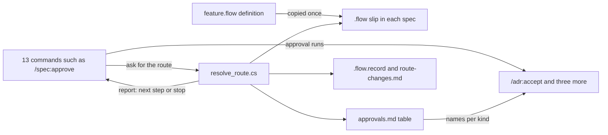

# Show me — 0040-routing-slips

- **Generated:** 2026-11-15
- **Spec:** specs/0040-routing-slips/
- **Issue:** 4661
- **Spec branch:** refs/heads/spec/4661-routing-slips
- **Measured head:** ea8926986
- **Base ref:** origin/master
- **Merge base:** 556002274
- **PR:** none found

## What changed and why

Until now every spec in this repository followed one fixed path (requirements, design, tasks, implementation), and each `/spec:*` command had that path written into its own text. That made it impossible to add a different workflow, such as the planned module-refactoring flow, without editing every command and risking a spec being misrouted by `/spec:*`.

This spec makes the path data. A spec can carry a routing slip, a small `.flow` file copied once from a flow definition, listing its steps, the artefact each step produces, the marker that approves it and the command that does so. A spec with no slip is a `feature` spec, so every existing spec behaves exactly as before. One script, the route resolver, reads the slip and answers every routing question: what is the next step, is the slip valid, has anyone tampered with it. The commands ask the resolver instead of deciding for themselves.

Two decisions shaped the result. Approval work moved out of `/spec:approve` into small `/adr:*` commands that an approval table names per artefact kind, so a new kind needs a table row, not an edit to the approver. And a slip is frozen at creation and recorded with a hash: it changes only through `/spec:route` with a stated reason, so a hand-edit is detected and refused.

The work is described by four ADRs: [Routing Slips, the Route Resolver and the Approval Table (0089-slips-resolver-and-routing)](../../docs/adr/0089-slips-resolver-and-routing.md), Status Accepted; [Approval Sub-flows, Provenance Lines and the Gate Run Contract (0090-approval-sub-flows)](../../docs/adr/0090-approval-sub-flows.md), Status Accepted; [Slip Creation, Tamper Detection and Route Change (0091-slip-creation-tamper-detection-and-route-change)](../../docs/adr/0091-slip-creation-tamper-detection-and-route-change.md), Status Accepted; and [Routing Fixtures and Test Scripts (0092-routing-fixtures-and-test-scripts)](../../docs/adr/0092-routing-fixtures-and-test-scripts.md), Status Accepted.

## Breaking changes

- `/spec:requirements` no longer creates the spec directory or writes `specs/.current-spec` — behavioural. Migration: run `/spec:new {name}` first.
- A missing, empty or stale `specs/.current-spec` now stops route-following commands instead of being guessed — behavioural. Migration: run `/spec:switch {spec}`.
- `/spec:approve design` now runs the `/adr:*` sub-flow, which can stop before any write on a bad ADR selector or frontmatter fault — behavioural. Migration: fix the ADR it names and re-run.

No release_notes.md section found for this spec; this list is derived from the ADRs and the diff.

Total breaking-change items: 3

## Did it ship what it said?

Shipped as planned: 33 of 36 numbered requirements — FR-1–FR-16, FR-18, FR-20–FR-28, FR-30, NFR-1–NFR-6.

- **FR-17** — changing a route needs the explicit route-change command and a reason. **Shipped with deviation:** `/spec:route` also runs when the log's last entry names a different flow, to record an abandoned change. Evidence: T15.1, ADR 0091.
- **FR-19** — a starter command meets a fixed contract. **Shipped with deviation:** the starter checklist has ten items (C1–C10) mapped to FR-19's nine clauses by a mapping column, rather than ten matching clauses. Evidence: T11.3.
- **FR-29** — approving a step runs its kind's sub-flow from one table. **Shipped with deviation:** ADR 0090 adds a `design` sub-flow that narrows the requirement's out-of-scope and "structural refactoring" wording. Evidence: T14.1, ADR 0090.

Nothing shipped outside the numbered requirements.

Shipped: 33 · Shipped with deviation: 3 · Deferred: 0 · Dropped: 0 · Withdrawn: 0 · Unverifiable: 0 (of 36)

## How it was built

- **Tasks:** 93 total — 77 `TEST + IMPLEMENT`, 1 `STRUCTURAL`, 8 `PROJECT`, 7 `DOC`, 0 untagged
- **Commits:** 228 since the merge base

## Blast radius

| Bucket | Files changed | Net lines |
| --- | --- | --- |
| `src/` | 0 | +0/−0 |
| `tests/` | 0 | +0/−0 |
| `docs/` | 5 | +2334/−1 |
| `specs/` | 9 | +2132/−1 |
| `.github/` | 0 | +0/−0 |
| `other` | 264 | +7153/−307 |
| **Total** | 278 | +11619/−309 |

- **Public API declaration lines changed:** 0
- **Distinct `src/` subdirectories touched:** 0
- Measured from git diff 5560022748c723e7121be23ee45a3c2b58c8fa54..ea892698666557d9de07e5341580ebb243780a5d (spec branch tip)
- Ref used: refs/heads/spec/4661-routing-slips at ea892698666557d9de07e5341580ebb243780a5d; base ref origin/master at 5560022748c723e7121be23ee45a3c2b58c8fa54; merge base 5560022748c723e7121be23ee45a3c2b58c8fa54.

## Risk assessment (advisory)

| Factor | Measured value | Level |
| --- | --- | --- |
| F1 | 0 files under src/ | Low |
| F2 | 3 items | Medium |
| F5 | 3 deviation entries of 36 requirements: 3 Shipped with deviation | Medium |

**Overall risk: Medium**

Nothing under `src/` changed, so no library code ships, but the change rewrites how every `/spec:*` command routes. F2 (three behavioural breaks to the spec workflow) and F5 (three accepted departures from the requirements) both set the level at Medium. A reviewer should confirm the departures are acceptable, because the requirements were not amended. This assessment is advisory only. It is not a merge gate; the merge decision stays with a human reviewer.

## Where to look first

- `.claude/commands/spec/resolve_route.cs` — the resolver every command now depends on; all routing, tamper and stop rules live here.
- `.claude/flows/approvals.md` — the approval table naming each kind's sub-flow; a wrong row changes what approval does.
- `.claude/commands/spec/approve.md` — approval now delegates to the `/adr:*` sub-flow and writes provenance lines.
- `.claude/commands/spec/route.md` — the only way to change a slip; its write order and tamper recovery matter.
- `docs/adr/0089-slips-resolver-and-routing.md` — the contract the resolver and the other commands follow.

## Inputs used

| Input | Status |
| --- | --- |
| `requirements.md` | used |
| `tasks.md` | used |
| `.adr-list` | used |
| `0089-slips-resolver-and-routing` | used |
| `0090-approval-sub-flows` | used |
| `0091-slip-creation-tamper-detection-and-route-change` | used |
| `0092-routing-fixtures-and-test-scripts` | used |
| `.issue-number` | used |
| `release_notes.md` section | not available: no marked release_notes.md section for this spec |
| `git history` | used |
| `pull request` | not available: no PR found for branch spec/4661-routing-slips |
| `.claude/commands/spec/resolve_route.cs` | used (targeted extraction) |
